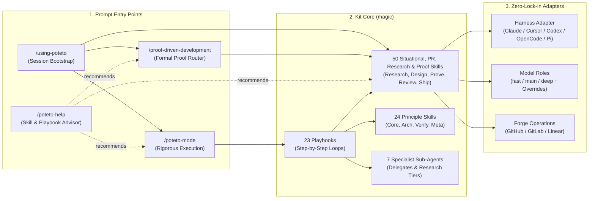
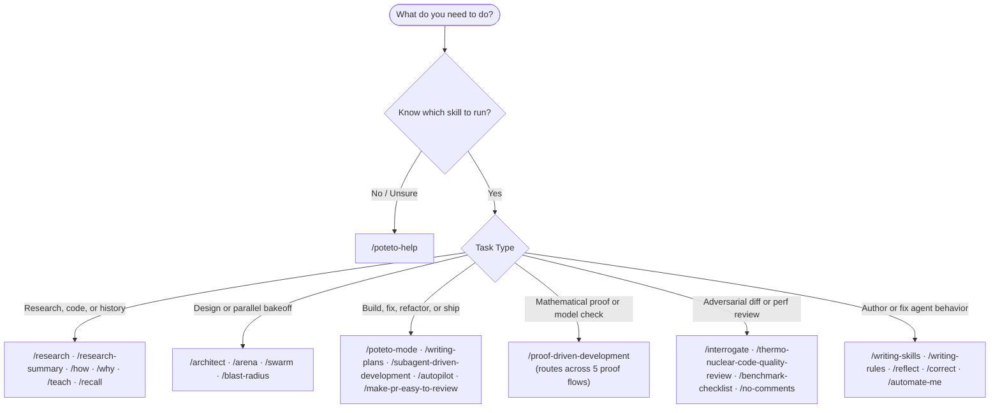
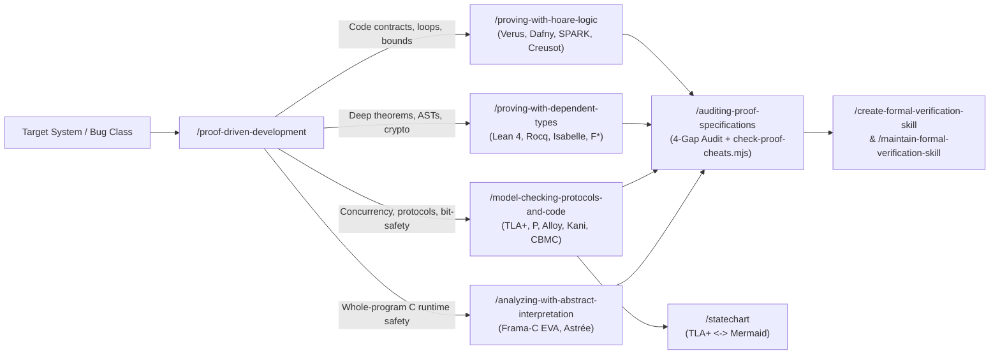

# magic

<p align="center">
  
</p>

> *"Any sufficiently advanced technology is indistinguishable from magic."*
> — **Arthur C. Clarke**, Clarke's Third Law (*Science*, January 19, 1968; *Profiles of the Future*, rev. ed. 1973)

---

[](https://github.com/PhillipChaffee/.agents/actions/workflows/validate.yml) [](LICENSE)

## Installation

You can use `magic` in two ways: **install it as a native plugin/package** in your coding harness, or **use it directly as a `.agents` directory** (`~/.agents` globally or `.agents/` inside a project).

### 1. Native Plugin Installation (Superpowers-Style)

Install `magic` through your harness's plugin or package manager to register skills, sub-agents, rules, and the session-start bootstrap automatically:

| Harness | Installation Command / Configuration |
| --- | --- |
| **Claude Code** | `/plugin marketplace add PhillipChaffee/magic` then `/plugin install magic@magic-dev` |
| **Cursor** | `/add-plugin` from the repository (or `.cursor-plugin/plugin.json`) |
| **Codex CLI / App** | `/plugins` via `.agents/plugins/marketplace.json` (or `~/.agents/skills`) |
| **OpenCode (V1 & V2)** | `"plugins": ["magic@git+https://github.com/PhillipChaffee/magic.git"]` in `opencode.json` (or `"plugin"` in V1) |
| **Pi** | `pi install git:github.com/PhillipChaffee/magic` (or `pi -e /path/to/magic`) |

### 2. Use as a `.agents` Directory (`~/.agents` or `.agents/`)

Because this repository's root layout (`skills/`, `agents/`, `rules/`, `agents.kit.md`) follows the `.agents` directory standard, you can either clone it directly as `~/.agents` (or a project's `.agents/` folder) or sync it non-destructively into an existing `~/.agents` directory with `./scripts/install.sh`:

```sh
# Option A: Non-destructive sync into ~/.agents (writes both SKILL.md and skill.md + prompts for models.json)
git clone https://github.com/PhillipChaffee/magic.git && cd magic && ./scripts/install.sh --target agents

# Option B: Clone directly as ~/.agents (for harnesses that auto-discover ~/.agents/skills/)
git clone https://github.com/PhillipChaffee/magic.git ~/.agents
```

| `./scripts/install.sh` Flag | Behavior | Touches Unmanaged Files in `~/.agents`? |
| --- | --- | --- |
| *(default)* | Copies managed skills (both `SKILL.md` and `skill.md`), assets, scripts, agents, rules, `agents.md`, and notices into `~/.agents`; records `.kit-stamp` | No (skips differing unstamped files) |
| `--dry-run` | Prints every `ADD`, `UPDATE`, `SKIP`, or `PRUNE` action without writing to disk | No |
| `--force` | Overwrites pre-existing unstamped files that differ from the kit source | Only colliding kit paths |
| `--prune` | Removes previously stamped files whose source was deleted from the kit | No |
| `--pull` | Reverse-syncs local edits on existing mapped files from `~/.agents` back into the repo working tree | No |
| `--uninstall` | Removes all paths listed in `.kit-stamp` and deletes `.kit-stamp` | No |

- **Security boundary:** Never commit API keys, tokens, or private MCP configs. `models.json` and `.kit-stamp` stay local to `~/.agents/`.

---

## How to Use It

Once installed, `magic` is active automatically at the start of every session (`skills/using-poteto/SKILL.md` and `rules/workflow-routing.md`). Before taking action on a task, your agent checks the request against its entry-point skills—or you can invoke any skill directly with `/<skill-name>`.

| Step / Workflow | Command / Prompt | What Happens |
| --- | --- | --- |
| **1. Configure Model Roles (Once)** | `/setup-pstack` | Picks a reasoning budget, maps your available models to specialist roles (`fast` / `main` / `deep`), and optionally creates project-local `verify-<app>` and formal verification skills. |
| **2. Build, Fix, Refactor, or Ship** | `/poteto-mode <goal + how to verify>` | Matches one of the 23 execution playbooks, copies its steps into the todo list, dispatches `poteto-agent` sub-agents, applies the 24 engineering principles, and verifies against the real artifact. |
| **3. Plan & Execute Multi-Step Work** | `/writing-plans` $\to$ `/subagent-driven-development` | Turns a spec into a bite-sized TDD plan, then dispatches a fresh implementer and a two-stage (spec + code quality) reviewer sub-agent per task. |
| **4. Research Code, Web, or Tools** | `/research <question>` or `/research-summary <topic>` | Triages complexity (Tier 1 direct, Tier 2 parallel, Tier 3 collector $\to$ planner $\to$ researcher $\to$ synthesizer pipeline) and writes a cited report to `docs/research/<topic>.md`. |
| **5. Prove Correctness Formally** | `/proof-driven-development <target>` | Routes across 5 formal verification flows (Hoare logic/SMT, dependent types, TLA+/Kani model checking, abstract interpretation, and proof-cheat auditing). |
| **6. Review & Drive PRs to Merge** | `/interrogate`, `/autopilot`, `/make-pr-easy-to-review` | Runs multi-model adversarial review, cleans commit history and reviewer guidance, and drives PRs to green under a strict diff size budget. |
| **7. Ask What to Run** | `/poteto-help <question>` | Recommends the right skill, playbook, or principle and gives you a ready-to-send prompt without spending execution tokens. |

- **First-time walkthrough:** [The pstack guide (`docs/pstack-guide/README.md`)](docs/pstack-guide/README.md)

---

## Acknowledgments

`magic` stands on the shoulders of several open-source agent frameworks whose ideas, skills, playbooks, and plugin infrastructure were borrowed, combined, and augmented here. Huge thanks to their creators and maintainers:

- **[pstack](https://github.com/cursor/plugins/tree/main/pstack) by Lauren Tan (`@poteto`)** — The heart of the execution engine: `/poteto-mode`, all 23 execution playbooks, the 24 `principle-*` skills, the situational engineering skills (`/how`, `/why`, `/teach`, `/architect`, `/arena`, `/swarm`, `/interrogate`, `/blast-radius`, `/statechart`, `/ketchup`, `/ketchup-video`, `/unslop`, `/technical-writing`, `/no-comments`, `/setup-pstack`, `/poteto-help`), the `poteto-agent` and `comment-sicko` sub-agents, and `docs/pstack-guide/`. Augmented here with vendor-neutral harness, model-role, and forge adapters so the entire stack runs outside Cursor too.
- **[Superpowers](https://github.com/obra/superpowers) by Jesse Vincent (`@obra`) and [Prime Radiant](https://primeradiant.com)** — The multi-harness plugin and zero-fork session-start bootstrap architecture (`hooks/run-hook.cmd`, `hooks/session-start`, `.opencode/plugins/magic.js`, `.pi/extensions/magic.ts`, and the Claude Code, Cursor, and Codex plugin manifests), plus the `/writing-skills`, `/writing-plans`, and `/subagent-driven-development` workflows.
- **[cursor-team-kit](https://github.com/cursor/plugins) by Cursor** — The `/make-pr-easy-to-review` and `/thermo-nuclear-code-quality-review` PR review and maintainability audit skills.
- **[mattpocock/skills](https://github.com/mattpocock/skills) by Matt Pocock** — The preserved skill archive in `skills-disabled/` and inspiration for spec-first grilling and vertical-slice planning workflows.

Full upstream commit hashes, provenance notes, and MIT license notices are preserved in [`THIRD-PARTY-NOTICES.md`](THIRD-PARTY-NOTICES.md).

---

## Architecture & Workflow



---

## Kit Inventory at a Glance

| Category | Count | Source Path | Installed Target (`~/.agents/`) | Purpose |
| --- | --- | --- | --- | --- |
| **pstack Situational Skills** | 35 | `skills/<name>/SKILL.md` | `skills/<name>/{SKILL.md,skill.md}` | Entry mode, session bootstrap, architecture, debugging, TDD, TypeScript practices, bot UIs, multi-model review, statecharts, and shipping |
| **PR Review & Merge-Ready Skills** | 3 | `skills/{autopilot,make-pr-easy-to-review,thermo-nuclear-code-quality-review}/SKILL.md` | `skills/<name>/{SKILL.md,skill.md}` | Budget-disciplined PR autopilot, history/description review prep, and strict maintainability audit |
| **Research & Synthesis Skills** | 2 | `skills/{research,research-summary}/SKILL.md` | `skills/{research,research-summary}/{SKILL.md,skill.md}` | Tiered codebase/web/MCP research orchestrator (`docs/research/<topic>.md`) and structured research summaries |
| **Proof-Driven Development Skills** | 6 | `skills/<name>/SKILL.md` | `skills/<name>/{SKILL.md,skill.md}` | Orchestrator + 5 formal verification flows (Hoare/SMT, Dependent Types, Model Checking, Abstract Interpretation, Spec Auditing) |
| **Engineering Principles** | 24 | `skills/principle-*/SKILL.md` | `skills/principle-*/{SKILL.md,skill.md}` | Single-rule design, architecture, verification, delegation, and meta invariants cited by `/poteto-mode` |
| **Superpowers & Authoring Workflows** | 4 | `skills/{writing-skills,writing-rules,writing-plans,subagent-driven-development}/SKILL.md` | `skills/<name>/{SKILL.md,skill.md}` | Implementation plan authoring, sub-agent-driven plan execution, and TDD skill and rule authoring ([Superpowers](https://github.com/obra/superpowers)) |
| **Execution Playbooks** | 23 | `skills/poteto-mode/playbooks/*.md` | `skills/poteto-mode/playbooks/*.md` | Structured workflows loaded automatically by `/poteto-mode` |
| **Sub-Agents** | 7 | `agents/<name>/agent.md` | `agents/<name>/agent.md` | 5 tiered research agents + `poteto-agent` (code delegate) + `comment-sicko` (comment stripper) |
| **Rules** | 4 | `rules/*.md` | `rules/*.md` | Always-on rules for workflow routing, doc lookup, new-repo bootstrapping, and polling bounds |
| **Distilled Root Instructions** | 1 | `agents.kit.md` | `agents.md` | Auto-loaded root instruction file for protocol consumers |
| **Archived Skills (Disabled)** | 37 | `skills-disabled/` | *Not installed* | Preserved Matt Pocock skill archive (source reference only; never activated) |

---

## Task Routing Map



---

## Portability Adapters (Zero Vendor Lock-In)

| Adapter | What It Decouples | How It Works | Specification |
| --- | --- | --- | --- |
| **Harness Adapter** | IDE / CLI tool names, sub-agent fields, transcript paths, loop primitives | Maps neutral vocabulary in skills to Cursor, Claude Code, Codex, OpenCode, and Pi | [`harness-adapter.md`](skills/poteto-mode/references/harness-adapter.md) |
| **Model Roles** | Hard-coded vendor model slugs (`claude-*`, `gpt-*`, `gemini-*`, `grok-*`) | Resolves named roles (`judgment and prose`, `swarm workers`, `arena runners`) to your local `fast` / `main` / `deep` tiers or `/setup-pstack` overrides | [`model-roles.md`](skills/poteto-mode/references/model-roles.md) |
| **Forge Operations** | Hard-coded `gh`, `glab`, Graphite, or Origin CLI calls | Translates named forge actions (`open PR`, `list checks`, `resolve thread`) via the target repo's `docs/agents/issue-tracker.md` | [`forge-operations.md`](skills/poteto-mode/references/forge-operations.md) |

- **External companion skills (install separately if used):** `/create-skill`.
- **Intentionally excluded from upstream pstack:** the `benny` automation pack (Cursor Automations only) and GitHub-only binaries (`watch-pr` — replaced by the forge-agnostic `babysit` playbook).

---

## Proof-Driven Development & Formal Verification



| Skill | Mathematical Mechanism | Representative Tools | Use It When |
| --- | --- | --- | --- |
| [`/proof-driven-development`](skills/proof-driven-development/SKILL.md) | Orchestrator & 4-Gap Router | All formal verifiers | Choosing a proof technique, tool, or multi-skill verification pipeline |
| [`/proving-with-hoare-logic`](skills/proving-with-hoare-logic/SKILL.md) | Hoare triples $\{P\}\;C\;\{Q\}$, 4-step loop induction, separation logic ($P * Q$), SMT | Verus, Dafny, SPARK, Creusot, Frama-C WP | Proving imperative functions, bounds, and data-structure invariants for all input sizes $N$ |
| [`/proving-with-dependent-types`](skills/proving-with-dependent-types/SKILL.md) | Curry-Howard propositions-as-types, uninhabited types (`S -> False`), tactics | Lean 4, Rocq, Isabelle/HOL, F\*, Aeneas, KaRaMeL | Proving compiler passes, crypto, policy lattices (`forbid` overrides `permit`), or state impossibility |
| [`/model-checking-protocols-and-code`](skills/model-checking-protocols-and-code/SKILL.md) | Temporal logic ($\Box\text{Safety}$, $\Diamond\text{Liveness}$) & bit-precise symbolic execution | TLA+, P, Alloy, Kani, CBMC, ESBMC | Finding multi-step concurrency/retry/crash races or proving bit-exact panic/overflow freedom |
| [`/analyzing-with-abstract-interpretation`](skills/analyzing-with-abstract-interpretation/SKILL.md) | Galois-connected abstract domains (intervals, octagons) & widening ($\nabla$) | Frama-C EVA, Astrée, Goblint | Proving whole-program absence of division-by-zero, overflow, and out-of-bounds errors in C/firmware |
| [`/auditing-proof-specifications`](skills/auditing-proof-specifications/SKILL.md) | Two-sided completeness audit, escape-hatch scanner (`check-proof-cheats.mjs`), conformance check | `check-proof-cheats.mjs`, `#print axioms`, differential fuzzing | Auditing human or AI-generated proofs for `sorry`/`admit`/`assume`/`external_body`, vacuity, and the 4 remaining gaps |
| [`/statechart`](skills/statechart/SKILL.md) | TLA+ / TLC trace-to-statechart projection | TLC + `statechart.mjs` | Rendering TLA+ state machines and invariant counterexamples as readable Mermaid diagrams |
| [`/create-formal-verification-skill`](skills/create-formal-verification-skill/SKILL.md) | Repo-local verification harness packaging | Any repo verifier | Locking a proven check into a repository with covered files, bounds, and a sync commit |
| [`/maintain-formal-verification-skill`](skills/maintain-formal-verification-skill/SKILL.md) | Commit-diff drift detection & counterexample replay | Project `verify-*` skills | Bringing a formal verification skill back in sync after merges or refactors |

---

## Catalog Reference

<details>
<summary><strong>23 Playbooks</strong> (auto-routed by <code>/poteto-mode</code>)</summary>

| Category | Playbook | Use For |
| --- | --- | --- |
| **Understand & Diagnose** | [investigation](skills/poteto-mode/playbooks/investigation.md) | Read-only question: how $X$ works, why $Y$ was built this way, or whether an assumption holds |
| **Understand & Diagnose** | [runtime forensics](skills/poteto-mode/playbooks/runtime-forensics.md) | Diagnose a live symptom (memory leak, idle-CPU spin, glitch) from runtime instrumentation |
| **Understand & Diagnose** | [trace forensics](skills/poteto-mode/playbooks/trace-forensics.md) | Diagnose a captured profiling artifact (`cpuprofile`, trace, spindump, heap snapshot) |
| **Build, Fix & Optimize** | [feature](skills/poteto-mode/playbooks/feature.md) | New or changed behavior built from a named data shape |
| **Build, Fix & Optimize** | [bug fix](skills/poteto-mode/playbooks/bug-fix.md) | Reproduce a defect, root-cause it, and fix with runtime evidence |
| **Build, Fix & Optimize** | [refactoring](skills/poteto-mode/playbooks/refactoring.md) | Behavior-preserving change to code structure or shape |
| **Build, Fix & Optimize** | [perf issue](skills/poteto-mode/playbooks/perf-issue.md) | Trace a measured slowness and improve it against a baseline |
| **Build, Fix & Optimize** | [hillclimb](skills/poteto-mode/playbooks/hillclimb.md) | Sustained, hypothesis-driven improvement of one metric against a target |
| **Build, Fix & Optimize** | [prototype](skills/poteto-mode/playbooks/prototype.md) | Throwaway sketch to settle a design or empirical fork by observation |
| **Build, Fix & Optimize** | [visual parity](skills/poteto-mode/playbooks/visual-parity.md) | Pixel-exact UI equivalence between two implementations |
| **PRs & Shipping** | [opening a PR](skills/poteto-mode/playbooks/opening-a-pr.md) | Open a review-ready PR from small ordered commits (runs at the end of build playbooks) |
| **PRs & Shipping** | [babysit](skills/poteto-mode/playbooks/babysit.md) | Drive a PR or stack to merge-ready: conflicts, review threads, and CI |
| **PRs & Shipping** | [shipping](skills/poteto-mode/playbooks/shipping.md) | Independently verify a green stack and land the contiguous verified run bottom-up |
| **Scale & Autonomy** | [multi-phase plan](skills/poteto-mode/playbooks/multi-phase-plan.md) | Author a plan for work spanning multiple phases or stacked PRs |
| **Scale & Autonomy** | [autonomous run](skills/poteto-mode/playbooks/autonomous-run.md) | Drive a long task to completion against a checkable predicate without stopping |
| **Scale & Autonomy** | [orchestrate](skills/poteto-mode/playbooks/orchestrate.md) | Coordinate a multi-day, multi-PR program across fleets of sub-agents |
| **Scale & Autonomy** | [autopilot-full](skills/poteto-mode/playbooks/autopilot-full.md) | Run independent PRs to merged with one owner per PR and a swarm verdict before merge |
| **Scale & Autonomy** | [autopilot-stack](skills/poteto-mode/playbooks/autopilot-stack.md) | Build and verify one linear base-branch stack for the operator to review and land |
| **Session & Hygiene** | [session pickup](skills/poteto-mode/playbooks/session-pickup.md) | Resume or take over a prior agent's in-flight branch or transcript |
| **Session & Hygiene** | [pause safely](skills/poteto-mode/playbooks/pause-safely.md) | Suspend in-flight work cleanly so it can be resumed without state loss |
| **Session & Hygiene** | [worktree cleanup](skills/poteto-mode/playbooks/worktree-cleanup.md) | Reclaim disk by pruning merged/abandoned worktrees and stale simulators (safety-gated) |
| **Skills & Evals** | [authoring a skill](skills/poteto-mode/playbooks/authoring-a-skill.md) | Author or edit a `SKILL.md` |
| **Skills & Evals** | [eval](skills/poteto-mode/playbooks/eval.md) | Blind-test how a skill or prompt change affects agent behavior |

</details>

<details>
<summary><strong>41 Situational, PR, Research, Planning & Authoring Skills</strong> (non-formal-verification)</summary>

| Group | Skill | Use It When |
| --- | --- | --- |
| **Entry & Routing** | [`/using-poteto`](skills/using-poteto/SKILL.md) | Session-start bootstrap that routes tasks to `/poteto-mode`, `/research`, `/proof-driven-development`, or `/poteto-help` before acting |
| **Entry & Routing** | [`/poteto-mode`](skills/poteto-mode/SKILL.md) | Default entry point for any non-trivial engineering task |
| **Entry & Routing** | [`/poteto-help`](skills/poteto-help/SKILL.md) | Unsure which skill, playbook, or principle fits your task |
| **Entry & Routing** | [`/setup-pstack`](skills/setup-pstack/SKILL.md) | Configuring per-role models and reasoning budgets |
| **Entry & Routing** | [`/figure-it-out`](skills/figure-it-out/SKILL.md) | No bundled playbook fits; designs a bespoke, auditable playbook |
| **Planning & Execution** | [`/writing-plans`](skills/writing-plans/SKILL.md) | Turning a spec or requirements for a multi-step task into a bite-sized TDD implementation plan before touching code |
| **Planning & Execution** | [`/subagent-driven-development`](skills/subagent-driven-development/SKILL.md) | Executing an implementation plan with a fresh implementer and two-stage reviewer sub-agent per task |
| **Alignment & Prompting** | [`/in-your-own-words`](skills/in-your-own-words/SKILL.md) | Having the agent play back your goal and problem before starting |
| **Alignment & Prompting** | [`/sharpen`](skills/sharpen/SKILL.md) | Rewriting a prompt deeper (not longer) before sending it |
| **Research, Code & History** | [`/research`](skills/research/SKILL.md) | Running tiered (direct, parallel, or scoped pipeline) research across codebase, web, and MCP tools into `docs/research/<topic>.md` |
| **Research, Code & History** | [`/research-summary`](skills/research-summary/SKILL.md) | Producing a concise, cited research summary with head-to-head option comparison tables |
| **Research, Code & History** | [`/how`](skills/how/SKILL.md) | Getting a cited walkthrough of how a subsystem works |
| **Research, Code & History** | [`/why`](skills/why/SKILL.md) | Investigating why something was built this way across code, PRs, issues, and docs |
| **Research, Code & History** | [`/teach`](skills/teach/SKILL.md) | Learning a change or subsystem explained from first principles |
| **Context & Catch-Up** | [`/recall`](skills/recall/SKILL.md) | Rebuilding recent context on a topic when starting or resuming work |
| **Context & Catch-Up** | [`/ketchup`](skills/ketchup/SKILL.md) | Catching up on what changed in the current chat, with every decision waiting on you |
| **Context & Catch-Up** | [`/ketchup-video`](skills/ketchup-video/SKILL.md) | Rendering `/ketchup` as a short subtitled video of slides |
| **Design & Parallelism** | [`/architect`](skills/architect/SKILL.md) | Settling types and module boundaries before writing cross-boundary code |
| **Design & Parallelism** | [`/arena`](skills/arena/SKILL.md) | Running $N$ parallel attempts at the same brief and grafting the best parts |
| **Design & Parallelism** | [`/swarm`](skills/swarm/SKILL.md) | Dispatching $N$ parallel workers across slices or races into one report |
| **Design & Parallelism** | [`/blast-radius`](skills/blast-radius/SKILL.md) | Checking what else a small-looking change could break outside the diff |
| **Build & Implementation** | [`/tdd`](skills/tdd/SKILL.md) | Fixing a bug test-first with a focused failing regression test when a cheap local test path exists |
| **Build & Implementation** | [`/typescript-best-practices`](skills/typescript-best-practices/SKILL.md) | Applying TypeScript discriminated-union, branded-type, and boundary-validation patterns on `.ts`/`.tsx` files |
| **Build & Implementation** | [`/make-bot-ui`](skills/make-bot-ui/SKILL.md) | Building a custom UI that wakes a bot over a webhook and exposes the page on Tailscale |
| **Review & Verification** | [`/autopilot`](skills/autopilot/SKILL.md) | Driving a PR to merge-ready (conflicts, triaged review/bot threads, in-scope CI) under a strict diff size budget |
| **Review & Verification** | [`/make-pr-easy-to-review`](skills/make-pr-easy-to-review/SKILL.md) | Preparing PRs for review by cleaning commit history, improving PR descriptions, and adding reviewer guidance |
| **Review & Verification** | [`/thermo-nuclear-code-quality-review`](skills/thermo-nuclear-code-quality-review/SKILL.md) | Running a strict maintainability audit for abstraction quality, >1k-line files, spaghetti branching, and code-judo simplifications |
| **Review & Verification** | [`/interrogate`](skills/interrogate/SKILL.md) | Having diverse models adversarially review a diff to break it |
| **Review & Verification** | [`/benchmark-checklist`](skills/benchmark-checklist/SKILL.md) | Vetting a benchmark speedup or regression number before trusting it |
| **Review & Verification** | [`/create-verification-skill`](skills/create-verification-skill/SKILL.md) | Generating a project-local `verify-<app>` skill and feature map to drive the live app |
| **Review & Verification** | [`/maintain-verification-skill`](skills/maintain-verification-skill/SKILL.md) | Syncing a project's `verify-<app>` skill and feature map after app changes |
| **Review & Verification** | [`/show-me-your-work`](skills/show-me-your-work/SKILL.md) | Recording an auditable TSV decision log (`scripts/log.sh`) during autonomous runs |
| **Prose & Code Hygiene** | [`/no-comments`](skills/no-comments/SKILL.md) | Stripping narration and alibi comments before review via `comment-sicko` |
| **Prose & Code Hygiene** | [`/unslop`](skills/unslop/SKILL.md) | Removing AI tells and filler from prose |
| **Prose & Code Hygiene** | [`/technical-writing`](skills/technical-writing/SKILL.md) | Writing docs, RFCs, READMEs, PR descriptions, and commit messages to standard |
| **Prose & Code Hygiene** | [`/bro`](skills/bro/SKILL.md) | Restating the previous reply in plain human language |
| **Meta & Skill Evolution** | [`/writing-skills`](skills/writing-skills/SKILL.md) | Authoring and testing new skills with sub-agent pressure scenarios (TDD for skills) |
| **Meta & Skill Evolution** | [`/writing-rules`](skills/writing-rules/SKILL.md) | Triaging, authoring, and pressure-testing agent rules (`rules/` and `agents.kit.md`) with TDD |
| **Meta & Skill Evolution** | [`/reflect`](skills/reflect/SKILL.md) | Capturing lessons from a completed task as concrete skill edits |
| **Meta & Skill Evolution** | [`/correct`](skills/correct/SKILL.md) | Stopping repeated agent mistakes at the highest structural level that works |
| **Meta & Skill Evolution** | [`/automate-me`](skills/automate-me/SKILL.md) | Drafting a personal `-mode` skill from your actual working history |

</details>

<details>
<summary><strong>24 Engineering Principles</strong> (<code>/principle-&lt;name&gt;</code>)</summary>

| Group | Principle | Core Rule |
| --- | --- | --- |
| `core` | [laziness-protocol](skills/principle-laziness-protocol/SKILL.md) | Bias toward deletion and the smallest change that solves the problem |
| `core` | [foundational-thinking](skills/principle-foundational-thinking/SKILL.md) | Get the data structures right so downstream logic becomes obvious |
| `core` | [redesign-from-first-principles](skills/principle-redesign-from-first-principles/SKILL.md) | Redesign as if the new requirement had been foundational from day one |
| `core` | [attack-the-premise](skills/principle-attack-the-premise/SKILL.md) | When two fixes sharing one premise fail the same gate, test the premise before a third fix |
| `core` | [subtract-before-you-add](skills/principle-subtract-before-you-add/SKILL.md) | Remove dead weight first, then build on the simpler base |
| `core` | [minimize-reader-load](skills/principle-minimize-reader-load/SKILL.md) | Count layers and hidden state; collapse one-caller wrappers and shrink mutable scope |
| `core` | [outcome-oriented-execution](skills/principle-outcome-oriented-execution/SKILL.md) | Converge on the target architecture; skip throwaway compatibility states |
| `core` | [experience-first](skills/principle-experience-first/SKILL.md) | Choose user delight over implementation convenience |
| `core` | [exhaust-the-design-space](skills/principle-exhaust-the-design-space/SKILL.md) | Build 2–3 competing prototypes and compare before committing |
| `core` | [build-the-lever](skills/principle-build-the-lever/SKILL.md) | Build the deterministic script or tool that does or proves the work |
| `architecture` | [model-the-domain](skills/principle-model-the-domain/SKILL.md) | Encode domain rules in a structure (state machine, table, typed model) instead of scattered branches |
| `architecture` | [boundary-discipline](skills/principle-boundary-discipline/SKILL.md) | Validate at system boundaries; trust internal types; keep core logic pure |
| `architecture` | [type-system-discipline](skills/principle-type-system-discipline/SKILL.md) | Make illegal states unrepresentable; brand semantic primitives; parse at boundaries |
| `architecture` | [make-operations-idempotent](skills/principle-make-operations-idempotent/SKILL.md) | Converge to the same end state regardless of partial prior runs or retries |
| `architecture` | [migrate-callers-then-delete-legacy-apis](skills/principle-migrate-callers-then-delete-legacy-apis/SKILL.md) | Migrate all callers and delete the old API in the same wave |
| `architecture` | [separate-before-serializing-shared-state](skills/principle-separate-before-serializing-shared-state/SKILL.md) | Eliminate shared state first; serialize only for a true invariant |
| `verification` | [prove-it-works](skills/principle-prove-it-works/SKILL.md) | Verify against the real artifact, not a proxy, self-report, or "it compiles" |
| `verification` | [fix-root-causes](skills/principle-fix-root-causes/SKILL.md) | Trace each symptom to the first place the system went wrong and fix it there |
| `verification` | [sequence-verifiable-units](skills/principle-sequence-verifiable-units/SKILL.md) | Break work into small units that each end in a check, verified before the next |
| `verification` | [test-behavior-not-implementation](skills/principle-test-behavior-not-implementation/SKILL.md) | Assert what callers and users can observe, not internal implementation details |
| `verification` | [explain-the-number](skills/principle-explain-the-number/SKILL.md) | Identify what limits a measured number before trusting or reporting it |
| `delegation` | [guard-the-context-window](skills/principle-guard-the-context-window/SKILL.md) | Route bulk exploration and fan-out to sub-agents; keep summaries in the main thread |
| `delegation` | [never-block-on-the-human](skills/principle-never-block-on-the-human/SKILL.md) | Proceed autonomously on reversible work; reserve confirmation for irreversible actions |
| `meta` | [encode-lessons-in-structure](skills/principle-encode-lessons-in-structure/SKILL.md) | Encode recurring lessons as a lint, flag, check, or script instead of more prose |

</details>

<details>
<summary><strong>7 Sub-Agents & 4 Rules</strong></summary>

### Sub-Agents (`agents/`)

| Agent | Mode | Role |
| --- | --- | --- |
| [`poteto-agent`](agents/poteto-agent/agent.md) | Read-Write | Delegate sub-agent spawned by `/poteto-mode` playbooks; loads `poteto-mode` and its principles |
| [`comment-sicko`](agents/comment-sicko/agent.md) | Read-Write | Strips narration comments and flags `MUST KILL` refactor targets for `/no-comments` |
| [`research-planner`](agents/research-planner/agent.md) | Read-Only (Thinking) | Decomposes complex investigations into parallel, right-sized researcher subtasks |
| [`researcher-lite`](agents/researcher-lite/agent.md) | Read-Only | High-volume, low-cost lookups: definitions, call sites, config values |
| [`researcher-mid`](agents/researcher-mid/agent.md) | Read-Only | Moderate reasoning: tracing subsystem data flows and cross-source gathering |
| [`researcher-deep`](agents/researcher-deep/agent.md) | Read-Only | Deep architectural, security, performance, and multi-source synthesis |
| [`research-synthesizer`](agents/research-synthesizer/agent.md) | Read-Only | Deduplicates, reconciles conflicts, and synthesizes researcher outputs with citations |

### Rules (`rules/` & `agents.kit.md`)

| File | Scope | Rule Summary |
| --- | --- | --- |
| [`agents.kit.md`](agents.kit.md) | Installed as `~/.agents/agents.md` | Distilled root instruction layer (single-bullet rules: use `rg`, separate test files, GitHub user commit attribution, workflow routing pointer) |
| [`rules/workflow-routing.md`](rules/workflow-routing.md) | Always applied | Route engineering, research, and formal-proof tasks to `/poteto-mode`, `/research`, or `/proof-driven-development` before acting |
| [`rules/look-it-up.md`](rules/look-it-up.md) | Always applied | Never answer factual tool/API questions from memory; check official docs and primary sources first |
| [`rules/new-repo-setup.md`](rules/new-repo-setup.md) | New repo creation | Bootstrap greenfield repos from the strictest-setups reference repo ($\ge 95\%$ coverage + full hygiene gates) |
| [`rules/sleeps-and-polling.md`](rules/sleeps-and-polling.md) | CI & background waits | Cap single-call sleeps at $\le 30\text{s}$ and return control between polls |

</details>

---

## Verification & CI Gates

```sh
./scripts/validate.sh
python3 -m unittest discover -s tests
node --test tests/*.test.mjs
```

| Gate | Command / Tool | What It Verifies |
| --- | --- | --- |
| **Kit Structure & Contract** | `./scripts/validate.sh` | Frontmatter keys, cross-skill/agent/rule links, and zero vendor model slugs, Cursor fields, or forge CLIs |
| **Installer Sandbox Suite** | `python3 -m unittest discover -s tests` | Byte-identical install, executable bit preservation, `SKILL.md`/`skill.md` parity, `--dry-run`, `--prune`, `--uninstall` |
| **CLI & Skill Safety Suite** | `node --test tests/*.test.mjs` | Worktree dirty/untracked/ignored hold gates, statechart path confinement, proof cheat scanner, plugin manifests/hooks, and flowchart rendering |
| **Repo Hygiene CI (`validate.yml`)** | `typos` · `markdownlint-cli2` · `lychee` · `gitleaks` · `jscpd` · `shellcheck` · `shfmt` · `yamllint` · `actionlint` | Zero typos, clean Markdown, live links, zero secrets, $<5\%$ code duplication, and clean shell/workflow scripts |
