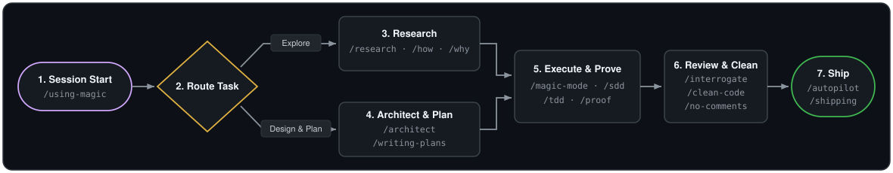

# magic

<p align="center">
  
</p>

> *"Any sufficiently advanced technology is indistinguishable from magic."*
> — **Arthur C. Clarke**, Clarke's Third Law (*Science*, January 19, 1968; *Profiles of the Future*, rev. ed. 1973)

---

## Installation

Install `magic` as a native plugin for your coding harness, or sync it as a `.agents` directory (`~/.agents` globally or `.agents/` in a project). When installed as a plugin, `using-magic` loads automatically at session start. **You never need to invoke `/using-magic` yourself**—just state your task in plain language or invoke a skill like `/magic-mode` directly.

### Claude Code

Register the marketplace and install the plugin:

```bash
/plugin marketplace add PhillipChaffee/magic
/plugin install magic@magic-dev
```

### Cursor

- **From GitHub:** Import the repository in **Customize → Plugins → From GitHub Repository** (or in **Dashboard → Plugins & MCPs → Add Marketplace → Import from Repo**), then install `magic`:

  ```text
  https://github.com/PhillipChaffee/magic
  ```

- **Local install:** Clone directly into `~/.cursor/plugins/local/magic` and reload Cursor:

  ```bash
  git clone https://github.com/PhillipChaffee/magic.git ~/.cursor/plugins/local/magic
  ```

### Codex

Register the repository marketplace and install from **Plugins** (`/plugins` in the Codex CLI or **Plugins Directory** in the Codex App):

```bash
codex plugin marketplace add PhillipChaffee/magic
```

### OpenCode

Add `magic` to your `opencode.json` (use `"plugins"` on OpenCode V2 or `"plugin"` on V1):

```json
{
  "plugins": ["magic@git+https://github.com/PhillipChaffee/magic.git"]
}
```

### Pi

Install `magic` as a Pi package (or run `pi -e /path/to/magic` for a local checkout):

```bash
pi install git:github.com/PhillipChaffee/magic
```

### `.agents` Directory (`~/.agents` or `.agents/`)

Sync `magic` non-destructively into `~/.agents` (or clone directly to `~/.agents` / `.agents/`):

```bash
git clone https://github.com/PhillipChaffee/magic.git && cd magic && ./scripts/install.sh --target agents
```

**What works vs. what doesn't without a plugin:** `Cursor`, `Codex`, and `OpenCode` auto-discover `~/.agents/skills/` (and `.agents/skills/`), whereas `Claude Code` and `Pi` do not scan `~/.agents/` by default. Without native plugin installation or manual bridging, no harness runs `SessionStart` hooks, plugin injectors, or `~/.agents/rules/*.md` automatically, so you must invoke `/magic-mode` or `/using-magic` manually.

<details>
<summary><strong><code>.agents</code> directory CLI flags &amp; per-harness behavior</strong></summary>
<br />

| `./scripts/install.sh` Flag | Behavior | Touches Unmanaged Files in `~/.agents`? |
| --- | --- | --- |
| *(default)* | Copies managed skills (both `SKILL.md` and `skill.md`), assets, scripts, agents, rules, `agents.md`, and notices into `~/.agents`; records `.kit-stamp` | No (skips differing unstamped files) |
| `--dry-run` | Prints every `ADD`, `UPDATE`, `SKIP`, or `PRUNE` action without writing to disk | No |
| `--force` | Overwrites pre-existing unstamped files that differ from the kit source | Only colliding kit paths |
| `--prune` | Removes previously stamped files whose source was deleted from the kit | No |
| `--pull` | Reverse-syncs local edits on existing mapped files from `~/.agents` back into the repo working tree | No |
| `--uninstall` | Removes all paths listed in `.kit-stamp` and deletes `.kit-stamp` | No |

**Security boundary:** Never commit API keys, tokens, or private MCP configs. `models.json` and `.kit-stamp` stay local to `~/.agents/`.

| Harness | What Works from `~/.agents` Alone | What Does **Not** Work Without the Plugin (and How to Bridge Manually) |
| --- | --- | --- |
| **Cursor** | Auto-discovers `~/.agents/skills/` and `.agents/skills/` in local sessions | **No `sessionStart` hook**, **no `~/.agents/rules/*.md` or `agents.md`** (Cursor requires `.mdc` files in `~/.cursor/rules/`), **no named `agents/` registration**, and local `~/.agents/` is not mounted in Cloud Agents. |
| **Codex CLI / App** | Auto-discovers `~/.agents/skills/` and `.agents/skills/` (surfaces `using-magic` in the skill index) | **No `~/.agents/rules/*.md` or `agents.md`** (Codex reads `~/.codex/AGENTS.md` and uses `~/.codex/rules/*.rules` for Starlark command allowlists, not Markdown rules). |
| **OpenCode (V1 & V2)** | Auto-discovers `~/.agents/skills/` and `.agents/skills/` | **No `.opencode/plugins/magic.js` bootstrap or V1/V2 tool-mapping injection**, and **no `~/.agents/rules/*.md` or `agents.md`** unless you add `"instructions": ["~/.agents/agents.md", "~/.agents/rules/*.md"]` to `opencode.json`. |
| **Claude Code** | *None by default* (Claude Code only scans `~/.claude/` and `.claude/`) | **No `SessionStart` hook, skills, agents, or rules** unless you symlink `~/.claude/{skills,agents,rules}` to `~/.agents/` and `@`-import `~/.agents/agents.md` in `~/.claude/CLAUDE.md`. |
| **Pi** | *None by default* (Pi does not scan `~/.agents/`) | **No `.pi/extensions/magic.ts` bootstrap, Pi tool mapping, or skills** unless installed as a Pi package (`pi install` or `pi -e`). |

</details>

---

## The Basic Workflow

`magic` intercepts every request at session start, routes it to the right workflow, and verifies the result before shipping.

<p align="center">
  
</p>

- **1. Route ([`using-magic`](skills/using-magic/SKILL.md), [`workflow-routing`](rules/workflow-routing.md))** — Auto-injected at session start on plugin installs (no manual invocation needed; invoke manually only on bare `.agents` directory installs) to load the matching entry-point skill before the first tool call.
- **2. Understand ([`research`](skills/research/SKILL.md), [`how`](skills/how/SKILL.md), [`why`](skills/why/SKILL.md))** — Dispatches read-only sub-agents to investigate code, history, or options into `docs/research/<topic>.md`.
- **3. Design ([`architect`](skills/architect/SKILL.md), [`writing-plans`](skills/writing-plans/SKILL.md))** — Settles types and module boundaries, then writes a bite-sized TDD implementation plan.
- **4. Execute ([`magic-mode`](skills/magic-mode/SKILL.md), [`subagent-driven-development`](skills/subagent-driven-development/SKILL.md))** — Runs one of 23 step-by-step playbooks or dispatches a fresh implementer + reviewer sub-agent per task.
- **5. Prove ([`tdd`](skills/tdd/SKILL.md), [`proof-driven-development`](skills/proof-driven-development/SKILL.md))** — Enforces RED-GREEN-REFACTOR tests and routes subtle invariants to formal verification ([Hoare/SMT](skills/proving-with-hoare-logic/SKILL.md), [Lean 4](skills/proving-with-dependent-types/SKILL.md), [TLA+/Kani](skills/model-checking-protocols-and-code/SKILL.md), [abstract interpretation](skills/analyzing-with-abstract-interpretation/SKILL.md), [spec audit](skills/auditing-proof-specifications/SKILL.md)).
- **6. Review ([`interrogate`](skills/interrogate/SKILL.md), [`no-comments`](skills/no-comments/SKILL.md), [`unslop`](skills/unslop/SKILL.md))** — Strips narration comments, pits adversarial models against the diff, and cleans AI prose tells.
- **7. Ship ([`make-pr-easy-to-review`](skills/make-pr-easy-to-review/SKILL.md), [`autopilot`](skills/autopilot/SKILL.md), [`shipping`](skills/magic-mode/playbooks/shipping.md))** — Structures clean commits, resolves CI and review threads, and verifies against the real artifact.
- **First-time walkthrough:** [The magic guide (`docs/magic-guide/README.md`)](docs/magic-guide/README.md) · **Full catalog:** [Catalog reference (`docs/CATALOG.md`)](docs/CATALOG.md) · **Configure model roles:** [`/setup-magic`](skills/setup-magic/SKILL.md) · **Ask what to run:** [`/magic-help`](skills/magic-help/SKILL.md)

---

## Acknowledgments

`magic` stands on the shoulders of several open-source agent frameworks whose ideas, skills, playbooks, and plugin infrastructure were borrowed, combined, and augmented here. Huge thanks to their creators and maintainers:

- **[pstack](https://github.com/cursor/plugins/tree/main/pstack) by Lauren Tan (`@poteto`)** — The heart of the execution engine (adapted here as `/magic-mode`, `/magic-help`, `/setup-magic`, `magic-agent`, and `docs/magic-guide/`): all 23 execution playbooks, the 24 `principle-*` skills, the situational engineering and review skills (such as `/how`, `/why`, `/architect`, `/arena`, `/interrogate`, and `/statechart`), the `magic-agent` and `comment-sicko` sub-agents, and the walkthrough guide. Augmented here with vendor-neutral harness, model-role, and forge adapters so the entire stack runs outside Cursor too.
- **[Superpowers](https://github.com/obra/superpowers) by Jesse Vincent (`@obra`) and [Prime Radiant](https://primeradiant.com)** — The multi-harness plugin and zero-fork session-start bootstrap architecture (`hooks/run-hook.cmd`, `hooks/session-start`, `.opencode/plugins/magic.js`, `.pi/extensions/magic.ts`, and the Claude Code, Cursor, and Codex plugin manifests), plus the `/writing-skills`, `/writing-plans`, and `/subagent-driven-development` workflows.
- **[cursor-team-kit](https://github.com/cursor/plugins) by Cursor** — The `/make-pr-easy-to-review` and `/thermo-nuclear-code-quality-review` PR review and maintainability audit skills.
- **[SimpleEnglish](https://github.com/AminBlg/SimpleEnglish) by Amin Boulouma (`@AminBlg`)** — The `/simple-english` plain-language writing, rewriting, and ASD-STE100 Issue 9 verification skill and reference tables.
- **[mattpocock/skills](https://github.com/mattpocock/skills) by Matt Pocock** — The preserved skill archive in `skills-disabled/` and inspiration for spec-first grilling and vertical-slice planning workflows.

Full upstream commit hashes, provenance notes, and MIT license notices are preserved in [`THIRD-PARTY-NOTICES.md`](THIRD-PARTY-NOTICES.md).

---

## Catalog Reference

Browse the full inventory of **23 playbooks**, **75 active skills** (**50 workflow/domain skills** + **25 engineering principles**), **7 sub-agents**, and **5 operational rules** in **[`docs/CATALOG.md`](docs/CATALOG.md)**.

---

## Verification & CI Gates

```sh
./scripts/validate.sh
python3 -m unittest discover -s tests
node --test tests/*.test.mjs
```

| Gate | Command / Tool | What It Verifies |
| --- | --- | --- |
| **Kit Structure & Contract** | `./scripts/validate.sh` | Frontmatter keys, cross-skill/agent/rule links, and zero vendor model slugs, Cursor fields, or forge CLIs |
| **Installer Sandbox Suite** | `python3 -m unittest discover -s tests` | Byte-identical install, executable bit preservation, `SKILL.md`/`skill.md` parity, `--dry-run`, `--prune`, `--uninstall` |
| **CLI & Skill Safety Suite** | `node --test tests/*.test.mjs` | Worktree dirty/untracked/ignored hold gates, statechart path confinement, proof cheat scanner, plugin manifests/hooks, and flowchart rendering |
| **Repo Hygiene CI (`validate.yml`)** | `typos` · `markdownlint-cli2` · `lychee` · `gitleaks` · `jscpd` · `shellcheck` · `shfmt` · `yamllint` · `actionlint` | Zero typos, clean Markdown, live links, zero secrets, `< 5%` code duplication, and clean shell/workflow scripts |
