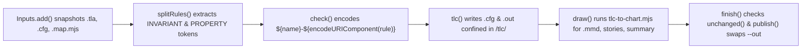

# Variant A: Table-First + Blockquote Callout `> **TL;DR:**`

`/statechart` turns TLA+ models into reader-labeled Mermaid statecharts and bug stories, or converts agreed Mermaid statecharts into TLA+ specifications.

## Subcommands and Key Concepts

| Subcommand / Concept | Entrypoint | What It Does |
| --- | --- | --- |
| `from-spec` | `fromSpec()` in `skills/statechart/scripts/statechart.mjs` | Snapshots the TLA+ model, config, and mapping module, runs TLC on each rule and the full state graph, and generates Mermaid charts, `stories.md`, and `summary.json`. |
| `from-chart` | `fromChart()` in `skills/statechart/scripts/statechart.mjs` | Scaffolds `<Module>.tla`, `.cfg`, and `.map.mjs` via `chart-to-tla.mjs`, runs TLC, and verifies round-trip fidelity with `compare-charts.mjs`. |
| `render` | `renderFile()` in `skills/statechart/scripts/statechart.mjs` | Renders a `.mmd` Mermaid file into a `.png` diagram using `renderPng()` with the chosen `light` or `dark` theme. |
| `Inputs` snapshot | `Inputs` class in `skills/statechart/scripts/snapshot.mjs` | Copies input files and transitive TLA+ (`EXTENDS`, `INSTANCE`) and JS (`import`) dependencies into a temp directory and detects concurrent edits via `changed()`. |
| `check()` and `tlc()` | `check()`, `tlc()` in `skills/statechart/scripts/statechart.mjs` | Runs TLC in `tlc2.TLC` per `INVARIANT` and `PROPERTY` inside `<work>/tlc/` using `encodeURIComponent` filenames, then dumps the full state graph to `<name>.dot`. |
| Atomic `publish()` | `publish()`, `refuseForeign()` in `skills/statechart/scripts/statechart.mjs` | Rejects output folders containing foreign files not matching `OWN`, checks `unchanged()`, and atomically swaps the temporary work directory into `--out`. |

## File Ownership Map

| File | Role |
| --- | --- |
| `skills/statechart/SKILL.md` | Defines the `/statechart` skill workflow for reader-centric state and step labels, rule modeling, `from-spec` and `from-chart` directions, code replay, and hand-off artifacts. |
| `skills/statechart/scripts/statechart.mjs` | Main CLI script handling flag parsing, TLC execution, DOT graph dumping, `tlc-to-chart.mjs` orchestration, PNG rendering, path confinement, and atomic output publishing. |
| `skills/statechart/scripts/snapshot.mjs` | Snapshot helper (`Inputs`, `copyPath`) that copies input specs, configs, maps, and local dependencies into an isolated `statechart-inputs-*` temp root and checks base64 digests for mid-run mutations. |
| `tests/pr26-regressions.test.mjs` | Regression test suite verifying `magic-mode` worktree audit safety (tests 1-7) and `statechart` path-traversal confinement for `INVARIANT` and `PROPERTY` names (tests 8-11). |

## Execution Pipeline and Path Confinement

## How `/statechart` Works and Prevents Path Traversal

- `fromSpec()` snapshots the input `.tla`, `.cfg`, `.map.mjs`, and optional `--fixed` or `--against` models into a temporary `statechart-inputs-*` folder using `Inputs` from `skills/statechart/scripts/snapshot.mjs`.
- `splitRules()` strips TLA+ block and line comments from the `.cfg` file and splits on whitespace (`/\s+/`) to collect rule names under `INVARIANT`/`INVARIANTS` and `PROPERTY`/`PROPERTIES`.
- Because `splitRules()` collects any non-whitespace token, a `.cfg` containing a malicious or malformed token like `../../../../escape` passes directly into `model.rules` or `model.properties`.
- `inWorkFolder()` creates an isolated `<tmpdir>/statechart-<id>` working directory with a `<work>/tlc` subdirectory (`tlcDir`) where `check()` writes per-rule `.cfg` and `.out` files via `tlc()`.
- Without encoding, interpolating a raw rule token into ``path.join(tlcDir, `${name}-${rule}`)`` would resolve `../` segments outside `tlcDir` and overwrite files such as `<tmpdir>/escape.cfg` and `<tmpdir>/escape.out`.
- `check()` blocks traversal at lines 300 and 313 of `skills/statechart/scripts/statechart.mjs` by calling ``path.join(tlcDir, `${name}-${encodeURIComponent(rule)}`)`` for invariants and ``path.join(tlcDir, `${name}-${encodeURIComponent(property)}`)`` for temporal properties.
- `encodeURIComponent` converts `/` into `%2F`, forcing `../../../../escape` to become the flat filename `M-..%2F..%2F..%2F..%2Fescape.cfg` (and `.out`) directly inside `<tmp>/statechart-<id>/tlc/`.
- The raw token is still written inside the generated config body (`INVARIANT ${rule}` or `PROPERTY ${property}`) so TLC evaluates the token while all filesystem writes stay confined to `tlcDir`.
- `tests/pr26-regressions.test.mjs` proves this confinement by seeding `$TMPDIR/escape.cfg` and `$TMPDIR/escape.out` with `KEEP\n`, running `from-spec` with a Java stub across `INVARIANT` and `PROPERTY` for both `Safe_Name1` and `../../../../escape`, and asserting that the sentinel files remain untouched and the captured `-config` path has 3 path segments under `$TMPDIR` (`statechart-*`, `tlc`, `M-${encodeURIComponent(token)}.cfg`).

## Verification Results

| Suite / Check | Status | Duration / Evidence |
| --- | --- | --- |
| `node --test tests/pr26-regressions.test.mjs` | PASS (11/11) | `605.0 ms` total (`exit code 0`) |
| Test 1 (`cleanup guide requires fresh inspection and non-forced removal`) | PASS | `0.9 ms`, verified `worktree-cleanup.md` flags |
| Tests 2-7 (`worktree audit preserves <kind> work`) | PASS (6/6) | `43.1 ms` to `49.3 ms` each across `clean`, `tracked`, `untracked`, `ignored`, `hidden-untracked`, and `status-failure` |
| Tests 8-9 (`statechart confines INVARIANT output for Safe_Name1 / ../../../../escape`) | PASS (2/2) | `73.2 ms` and `68.1 ms`, verified `M-..%2F..%2F..%2F..%2Fescape.cfg` stays inside `tlc/` and `$TMPDIR/escape.{cfg,out}` remain `KEEP` |
| Tests 10-11 (`statechart confines PROPERTY output for Safe_Name1 / ../../../../escape`) | PASS (2/2) | `65.5 ms` and `68.5 ms`, verified `M-..%2F..%2F..%2F..%2Fescape.cfg` stays inside `tlc/` and `$TMPDIR/escape.{cfg,out}` remain `KEEP` |

> **TL;DR:** `/statechart` snapshots TLA+ specs and configs, runs TLC per rule to generate reader-facing Mermaid statecharts and bug stories, and atomically publishes outputs. Wrapping `INVARIANT` and `PROPERTY` tokens in `encodeURIComponent` inside `check()` neutralizes `../` segments so all `.cfg` and `.out` files stay confined within `<work>/tlc/`, verified with 11/11 passing tests in `node --test tests/pr26-regressions.test.mjs`.
