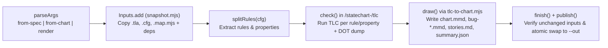

# Variant B: Visual-First + Bold-Lead Bullets + 3-Bullet `Summary (TL;DR)`

`/statechart` (`skills/statechart/scripts/statechart.mjs`) turns TLA+ models and Mermaid statecharts into verified state graphs, bug path diagrams, and human-readable counterexample stories. It prevents `.cfg` token path traversal by URL-encoding every invariant and property name before building TLC artifact paths inside its temporary working directory.



```text
Unsafe raw join (escapes tlcDir and overwrites <tmp>/escape.{cfg,out})
  path.join("<tmp>/statechart-<id>/tlc", "M-../../../../escape")
  -> "<tmp>/escape.cfg" and "<tmp>/escape.out"

Confined encodeURIComponent join (lines 300 and 313 of statechart.mjs)
  path.join("<tmp>/statechart-<id>/tlc", `M-${encodeURIComponent("../../../../escape")}`)
  -> "<tmp>/statechart-<id>/tlc/M-..%2F..%2F..%2F..%2Fescape.cfg" and ".out"
```

## Runtime Walkthrough and Gotchas

- **Command dispatch.** `parseArgs` routes CLI invocations to `fromSpec`, `fromChart` (which first scaffolds `.tla`, `.cfg`, and `.map.mjs` via `chart-to-tla.mjs` and later diffs with `compare-charts.mjs`), or `renderFile`.
- **Dependency snapshotting.** `Inputs` in `skills/statechart/scripts/snapshot.mjs` copies the primary files plus transitive TLA+ `EXTENDS`/`INSTANCE` modules and relative JS imports into `<tmp>/statechart-inputs-<id>/` so `inputs.changed()` can abort publication if any source file mutates mid-run.
- **Config rule extraction.** `splitRules` strips TLA+ block and line comments from the `.cfg` copy and partitions whitespace-delimited tokens into `cfgWithoutRules`, `rules` (`INVARIANT`/`INVARIANTS`), and `properties` (`PROPERTY`/`PROPERTIES`).
- **Path-confined TLC rule checks.** Inside `inWorkFolder`, `check` iterates over `rules` and `properties` and builds each per-check base filename with `encodeURIComponent`, preventing crafted tokens like `../../../../escape` from escaping `<tmp>/statechart-<id>/tlc/`.
- **Deterministic shortest bug traces.** Each invariant first runs TLC with `-workers auto` and `CONSTRAINT <rule>`, then re-runs with single-worker breadth-first search (`-workers 1`) whenever an invariant fails so the resulting bug trace is minimal and reproducible.
- **Isolated Java temp and size guards.** Every `tlc` call creates a fresh `-metadir` with a private `-Djava.io.tmpdir` so concurrent runs do not clobber standard modules like `Naturals.tla`, and `runJava` kills TLC with `SIGKILL` if stdout, stderr, or the `.dot` state graph dump exceeds `MAX_STRING_LENGTH`.
- **Chart synthesis and atomic publish.** `draw` delegates to `tlc-to-chart.mjs` to emit `chart.mmd`, `bug-<n>.mmd`, `stories.md`, and `summary.json`, while `publish` rejects target directories containing foreign files (`refuseForeign`) before atomically swapping the staged output folder into place.

## File Map and Verification Results

| File / Test Suite | Role / Scope | Verification Detail |
| --- | --- | --- |
| `skills/statechart/SKILL.md` | Skill workflow guide | Documents `from-spec`, `from-chart`, mapping conventions, and hand-off artifacts (`chart.mmd`, `stories.md`, `summary.json`). |
| `skills/statechart/scripts/statechart.mjs` | Main CLI orchestrator | Sanitizes per-rule TLC filenames via `encodeURIComponent(rule)` (line 300) and `encodeURIComponent(property)` (line 313), manages TLC runs, and publishes outputs atomically. |
| `skills/statechart/scripts/snapshot.mjs` | Input snapshot tracker | Mirrors input specs, configs, maps, and transitive imports into a temp root and detects concurrent modifications via base64 comparison. |
| `tests/pr26-regressions.test.mjs` (Tests 1 to 7) | Worktree cleanup and audit tests | Passed 7/7 subtests verifying `worktree-cleanup.md` rules and `worktree-audit.sh` preservation across `clean`, `tracked`, `untracked`, `ignored`, `hidden-untracked`, and `status-failure` states. |
| `tests/pr26-regressions.test.mjs` (Tests 8 to 11) | Statechart path-traversal confinement | Passed 4/4 subtests (`INVARIANT` and `PROPERTY` with `Safe_Name1` and `../../../../escape`), confirming sentinel `<tmp>/escape.{cfg,out}` files remain untouched (`KEEP\n`) and TLC receives `<tmp>/statechart-<id>/tlc/M-..%2F..%2F..%2F..%2Fescape.cfg`. |

## Summary (TL;DR)

`statechart.mjs` orchestrates TLA+ model checking and Mermaid statechart generation inside isolated temporary directories while confining all per-rule TLC files against path traversal, and all 11 regression tests in `tests/pr26-regressions.test.mjs` pass.

- **Mechanism:** Snapshots `.tla`/`.cfg`/`.map.mjs` inputs, splits invariants and properties into isolated TLC runs plus a DOT state-graph dump, synthesizes Mermaid charts and bug stories via `tlc-to-chart.mjs`, and atomically publishes the output directory.
- **Safety fix:** Encodes rule and property names with `encodeURIComponent` when constructing `<tlcDir>/<name>-<token>.{cfg,out}` paths so `../` sequences in `.cfg` tokens cannot escape `<tmp>/statechart-<id>/tlc/`.
- **Verification:** `node --test tests/pr26-regressions.test.mjs` exited `0` with 11/11 passing tests (0 failures) in 631 ms, including all 4 `INVARIANT`/`PROPERTY` path-traversal confinement checks.
