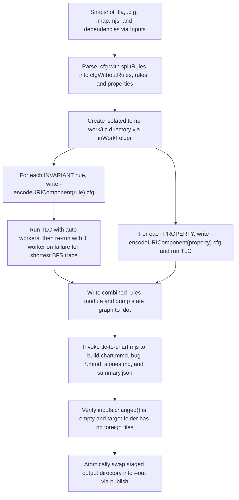

# Variant C: Section-Framed + Code Reference + Plain `## TL;DR`

The `/statechart` skill converts TLA+ specifications and Mermaid statecharts into reader-facing state diagrams and bug traces. Its CLI driver snapshots inputs, isolates each rule check in a temporary workspace, and atomically publishes output artifacts.

## Subcommands, Concepts, and File Map

The CLI exposes three subcommands and relies on a small set of core modeling concepts.

| Item | Kind | Purpose |
| :--- | :--- | :--- |
| `from-spec` | Subcommand | Runs TLC against a `.tla` model (plus optional `--fixed` or `--against` models) to generate `chart.mmd`, per-bug `.mmd` views, `stories.md`, `summary.json`, and optional `.png` files. |
| `from-chart` | Subcommand | Compiles an agreed `.mmd` chart into a `.tla`, `.cfg`, and `.map.mjs` skeleton, runs TLC to check `%% never` rules, and diffs the resulting graph against the original chart. |
| `render` | Subcommand | Renders a standalone `.mmd` file directly to a `.png` image using the selected theme (`light` or `dark`). |
| Reader mapping (`.map.mjs`) | Concept | Translates raw TLA+ state variables and actions into observable `state`, `step`, `group`, `cause`, and `readerActions` labels. |
| `INVARIANT` vs `PROPERTY` | Concept | State predicates (`INVARIANT`) draw numbered blue-bordered bug paths on the chart, whereas temporal formulas (`PROPERTY`) emit counterexamples into `stories.md` and `summary.json`. |

The implementation and its regression tests span four primary files.

| File | Role |
| :--- | :--- |
| `skills/statechart/SKILL.md` | Defines the workflow for `from-spec` and `from-chart`, rule authoring conventions, code-citation comments (`\* file:line`), and hand-off deliverables. |
| `skills/statechart/scripts/statechart.mjs` | Implements CLI argument parsing, `.cfg` rule splitting, TLC process execution, path confinement, chart generation via `tlc-to-chart.mjs`, and atomic output publishing. |
| `skills/statechart/scripts/snapshot.mjs` | Provides `Inputs` and `copyPath` to snapshot `.tla`, `.cfg`, and `.mjs`/`.js` files (and transitive `EXTENDS`, `INSTANCE`, or `import` dependencies) into an isolated temp directory and detect mid-run edits. |
| `tests/pr26-regressions.test.mjs` | Verifies worktree audit safety and tests that `statechart.mjs` confines `INVARIANT` and `PROPERTY` output filenames against `../../../../escape` path traversal. |

## Execution Flow (`from-spec` and `check`)

The `from-spec` pipeline isolates input snapshots and TLC rule runs inside temporary directories before publishing to the target output folder.



## Path-Traversal Prevention and Operational Gotchas

In `check()`, `statechart.mjs` constructs per-rule `.cfg` and `.out` paths inside `tlcDir` by URL-encoding each rule or property token with `encodeURIComponent`.

```javascript
  for (const rule of rules) {
    const file = path.join(tlcDir, `${name}-${encodeURIComponent(rule)}`);
    const cfg = `${cfgWithoutRules}INVARIANT ${rule}\nCONSTRAINT ${rule}\n`;
    let result = await run(cfg, file, { workers: "auto" });
    // Several workers can reach a bad state by a longer path first. One worker searches breadth
    // first in a fixed order, so the chart's bug paths are the shortest, and the same every run.
    if (/^Error: Invariant /m.test(result.stdout)) result = await run(cfg, file);
    const broken = /^Error: Invariant /m.test(result.stdout);
    console.log(said(rule, broken));
    if (result.warning) console.error(`${shown(`${file}.out`)}: ${result.warning}`);
    traces.push({ file: `${file}.out`, rule, broken });
  }
  const temporal = [];
  for (const property of properties) {
    const file = path.join(tlcDir, `${name}-${encodeURIComponent(property)}`);
    const { stdout } = await run(`${cfgWithoutRules}PROPERTY ${property}\n`, file, {
      workers: "auto",
    });
```

- `splitRules()` tokenizes the `.cfg` file on whitespace after stripping comments, which means a crafted `INVARIANT` or `PROPERTY` entry can contain path separators like `../../../../escape`.
- Without encoding, ``path.join(tlcDir, `${name}-${rule}`)`` would resolve `../` segments and allow `tlc()` to overwrite arbitrary `.cfg` and `.out` files outside `tlcDir`.
- Wrapping `rule` and `property` in `encodeURIComponent` turns `/` into `%2F`, confining the generated file (`M-..%2F..%2F..%2F..%2Fescape.cfg` and `.out`) strictly inside `<tmp>/statechart-<id>/tlc/` while preserving the raw token inside the `.cfg` file body for TLC.
- `Inputs` snapshots all input files into a separate `statechart-inputs-*` temp directory at startup, and `unchanged()` aborts publishing with `NotPublished` if any source file is modified during the run.
- `refuseForeign()` rejects `--out` directories that contain any file not matching the `OWN` allowlist regex so a run never clobbers unrelated user files when replacing the output folder.
- Every `tlc()` invocation creates a private `java.io.tmpdir` inside its `tlc-*` metadir so concurrent TLC processes do not race when writing standard modules like `Naturals.tla`.
- When an `INVARIANT` fails under `-workers auto`, `check()` re-runs TLC with a single worker (`workers = "1"`) and `CONSTRAINT <rule>` so the counterexample trace is guaranteed to be deterministic and minimal-length via breadth-first search.
- If a TLC `.out` stream or `.dot` state graph exceeds `buffer.constants.MAX_STRING_LENGTH`, `runJava()` kills the child process with `SIGKILL` to prevent memory exhaustion.

## Verification Status

Running `node --test tests/pr26-regressions.test.mjs` passed all 11 regression tests with exit code `0`.

| Test Group | Cases Verified | Result | Duration |
| :--- | :--- | :--- | :--- |
| `cleanup guide requires fresh inspection and non-forced removal` | 1 playbook assertion test | Pass (1/1) | 0.9 ms |
| `worktree audit preserves <kind> work` | 6 git worktree states (`clean`, `tracked`, `untracked`, `ignored`, `hidden-untracked`, `status-failure`) | Pass (6/6) | 263.0 ms |
| `statechart confines INVARIANT output for <token>` | 2 tokens (`Safe_Name1`, `../../../../escape`) | Pass (2/2) | 134.9 ms |
| `statechart confines PROPERTY output for <token>` | 2 tokens (`Safe_Name1`, `../../../../escape`) | Pass (2/2) | 149.4 ms |
| **Total (`node --test tests/pr26-regressions.test.mjs`)** | **11 subtests across 0 suites** | **Pass (11/11, exit 0)** | **598.3 ms** |

- The four statechart regression cases stub `JAVA` to inspect the `-config` path passed to TLC and verify that sentinel `escape.cfg` and `escape.out` files in `TMPDIR` remain untouched (`KEEP\n`).
- Each traversal test confirms the config path resolves to a 3-segment relative path under `TMPDIR` matching `statechart-*/tlc/M-..%2F..%2F..%2F..%2Fescape.cfg`.

## TL;DR

`/statechart` orchestrates TLA+ model checking and Mermaid diagram generation inside isolated temporary workspaces before atomically swapping results into the output folder. It prevents `.cfg` and `.out` path traversal by passing `INVARIANT` and `PROPERTY` names through `encodeURIComponent` when building file paths in `check()`, and all 11 regression tests in `node --test tests/pr26-regressions.test.mjs` pass (exit code `0`).
