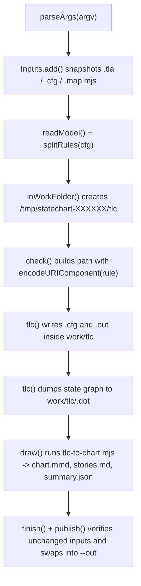

# Variant D (Synthesized Repo Default): 3-Table Separation + Mermaid & ASCII Visuals + `What / Proof / Next` Bottom `TL;DR`

## Overview

`/statechart` (`skills/statechart/scripts/statechart.mjs`) lets engineers and product readers turn TLA+ specifications and Mermaid statecharts into verified diagrams and plain-language bug stories without invoking TLC by hand (measured from `skills/statechart/SKILL.md` and `skills/statechart/scripts/statechart.mjs`). Maintainers inherit a zero-dependency Node CLI orchestrator that snapshots inputs, confines TLC execution to temporary directories, and publishes output atomically (measured from `skills/statechart/scripts/statechart.mjs`).

## Key Concepts

| Concept / Symbol | Location | Role |
| --- | --- | --- |
| `COMMANDS` (`from-spec`, `from-chart`, `render`) | `skills/statechart/scripts/statechart.mjs` (lines 32 to 58) | Maps CLI subcommands to flag schemas, PNG renderer loading, and entry functions (`fromSpec`, `fromChart`, `renderFile`). |
| `Inputs` | `skills/statechart/scripts/snapshot.mjs` | Snapshots every input `.tla`, `.cfg`, `.map.mjs`, and `.mmd` file into a temporary directory and detects mid-run edits before publish. |
| `splitRules(cfg)` | `skills/statechart/scripts/statechart.mjs` (lines 126 to 153) | Strips TLA+ comments from `.cfg` text and extracts `INVARIANT` and `PROPERTY` tokens alongside `cfgWithoutRules`. |
| `check(tools, model, ...)` | `skills/statechart/scripts/statechart.mjs` (lines 279 to 352) | Runs TLC once per invariant and property plus once to dump the full state graph as a Graphviz `.dot` file inside `work/tlc`. |
| `encodeURIComponent(rule)` | `skills/statechart/scripts/statechart.mjs` (lines 300 and 313) | Percent-encodes rule and property names before `path.join(tlcDir, ...)` so `/` characters cannot traverse outside `work/tlc`. |
| `draw(...)` | `skills/statechart/scripts/statechart.mjs` (lines 369 to 531) | Invokes `tlc-to-chart.mjs` to synthesize `chart.mmd`, `bug-<N>.mmd`, `stories.md`, and `summary.json` from TLC `.dot` dumps and traces. |
| `publish(work, out, inputs)` | `skills/statechart/scripts/statechart.mjs` (lines 696 to 728) | Refuses output directories containing foreign files (`OWN` allowlist) and swaps the staged folder into `--out` atomically. |

## How It Works



- **CLI dispatch.** `parseArgs` validates the subcommand (`from-spec`, `from-chart`, or `render`) and its flags before `rendererFor` lazily loads the PNG renderer when `--png` or `render` is active (`skills/statechart/scripts/statechart.mjs`, lines 60 to 97).
- **Input snapshotting.** `fromSpec` and `fromChart` copy all input files through `Inputs` so the run reads a consistent snapshot and aborts in `unchanged(inputs, out)` if any source file changes during execution (`skills/statechart/scripts/statechart.mjs`, lines 688 to 694 and 812 to 867).
- **Rule extraction.** `readModel` passes the snapshotted `.cfg` contents to `splitRules`, which strips `(* ... *)` and `\*` comments and collects whitespace-delimited tokens under `INVARIANT` and `PROPERTY` sections (`skills/statechart/scripts/statechart.mjs`, lines 126 to 153 and 249 to 266).
- **Isolated TLC execution.** `inWorkFolder` creates a temporary directory (`os.tmpdir()/statechart-*`) where `check` runs `tlc()` per rule with `workers: "auto"` first and reruns broken invariants with `workers: "1"` to guarantee deterministic shortest counterexample paths (`skills/statechart/scripts/statechart.mjs`, lines 279 to 310 and 610 to 624).
- **State graph synthesis.** `check` runs a final single-worker TLC pass with `-dump dot,actionlabels` to emit `<name>.dot`, and `draw` spawns `tlc-to-chart.mjs` with the user's `.map.mjs` labels to produce `chart.mmd`, per-bug `bug-<N>.mmd` charts, `stories.md`, and `summary.json` (`skills/statechart/scripts/statechart.mjs`, lines 327 to 473).
- **Atomic output swap.** `finish` renders optional PNGs and calls `publish`, which checks `refuseForeign(out)` against the `OWN` filename regex so it never clobbers unrelated directories before swapping the staged output into place (`skills/statechart/scripts/statechart.mjs`, lines 548 to 608 and 696 to 728).

## Path-Traversal Prevention (`tests/pr26-regressions.test.mjs`)

```text
Untrusted .cfg token:  INVARIANT ../../../../escape
                                  │
         Without encoding         ├──► path.join(tlcDir, "M-../../../../escape")
                                  │    resolves to <tmpdir>/escape.cfg & escape.out (OVERWRITES FILES)
                                  │
         With encodeURIComponent  └──► path.join(tlcDir, "M-..%2F..%2F..%2F..%2Fescape")
                                       stays inside <tmpdir>/statechart-XXXXXX/tlc/ (CONFINED)
```

- **Root vector.** `splitRules(cfg)` tokenizes `.cfg` files on whitespace (`/\s+/`) without restricting rule names to TLA+ identifier characters, so a crafted `.cfg` can supply `../../../../escape` as an `INVARIANT` or `PROPERTY` token (`skills/statechart/scripts/statechart.mjs`, lines 126 to 145).
- **Filename confinement.** `check` passes every `rule` and `property` through `encodeURIComponent` when building the per-run file base ``path.join(tlcDir, `${name}-${encodeURIComponent(rule)}`)`` (`skills/statechart/scripts/statechart.mjs`, lines 300 and 313).
- **Slash neutralization.** `encodeURIComponent("../../../../escape")` replaces every `/` with `%2F`, so `tlc()` writes `M-..%2F..%2F..%2F..%2Fescape.cfg` and `M-..%2F..%2F..%2F..%2Fescape.out` inside `work/tlc` while leaving canary files at `<tmpdir>/escape.cfg` and `<tmpdir>/escape.out` untouched (measured in `tests/pr26-regressions.test.mjs`, lines 94 to 131).

## Verification Status

`node --test tests/pr26-regressions.test.mjs` passed all 11 tests in 623.8 ms with exit code 0 (measured via local test runner).

| Check | Status | Evidence |
| --- | --- | --- |
| `cleanup guide requires fresh inspection and non-forced removal` | Passed | `ok 1` (1.16 ms), verified playbook flags in `skills/magic-mode/playbooks/worktree-cleanup.md`. |
| `worktree audit preserves <kind> work` (6 subtests) | Passed | `ok 2` through `ok 7` (44.7 ms to 50.1 ms each), covering `clean`, `tracked`, `untracked`, `ignored`, `hidden-untracked`, and `status-failure`. |
| `statechart confines INVARIANT output for Safe_Name1` | Passed | `ok 8` (69.0 ms), wrote `statechart-*/tlc/M-Safe_Name1.cfg` inside `TMPDIR`. |
| `statechart confines INVARIANT output for ../../../../escape` | Passed | `ok 9` (70.6 ms), wrote `statechart-*/tlc/M-..%2F..%2F..%2F..%2Fescape.cfg` and preserved `TMPDIR/escape.cfg` and `TMPDIR/escape.out`. |
| `statechart confines PROPERTY output for Safe_Name1` | Passed | `ok 10` (71.6 ms), wrote `statechart-*/tlc/M-Safe_Name1.cfg` inside `TMPDIR`. |
| `statechart confines PROPERTY output for ../../../../escape` | Passed | `ok 11` (69.7 ms), wrote `statechart-*/tlc/M-..%2F..%2F..%2F..%2Fescape.cfg` and preserved `TMPDIR/escape.cfg` and `TMPDIR/escape.out`. |

## Where Things Live

| File / Directory | Responsibility |
| --- | --- |
| `skills/statechart/SKILL.md` | Workflow instructions for turning specs into statecharts (`from-spec`) and statecharts into specs (`from-chart`). |
| `skills/statechart/scripts/statechart.mjs` | Main CLI entry point handling argument parsing, TLC execution, path confinement, and atomic output publishing. |
| `skills/statechart/scripts/snapshot.mjs` | `Inputs` helper that copies input files into temporary storage and detects concurrent modifications. |
| `skills/statechart/scripts/tlc-to-chart.mjs` | Child script that transforms TLC `.dot` graphs and counterexample traces into Mermaid charts, `stories.md`, and `summary.json`. |
| `skills/statechart/scripts/chart-to-tla.mjs` | Child script that scaffolds `.tla`, `.cfg`, and `.map.mjs` files from an agreed Mermaid statechart. |
| `tests/pr26-regressions.test.mjs` | Regression test suite verifying worktree audit safety and `statechart.mjs` path-traversal confinement. |

## Gotchas

- **Temporal properties are not drawn on the chart.** TLC counterexamples for `PROPERTY` rules are written to `tlc/<name>-<property>.out` and summarized in `stories.md` under broken rules that the chart does not draw (`skills/statechart/scripts/statechart.mjs`, lines 318 to 325 and 442 to 458).
- **State predicates listed under `PROPERTY` only check initial states.** `check` warns via `checkedOnlyInInitialStates` when a `PROPERTY` lacks `[]`, `<>`, or `~>`, because TLC only checks every reachable state when that predicate is listed as an `INVARIANT` (`skills/statechart/scripts/statechart.mjs`, lines 146 to 147 and 321 to 323).
- **Output directories reject foreign files.** `refuseForeign` blocks `--out` if the target directory contains any file not matching the `OWN` regex, preventing accidental deletion when `publish` replaces the output directory (`skills/statechart/scripts/statechart.mjs`, lines 581 to 608).
- **Failed TLC runs keep their temporary directory.** When `inWorkFolder` catches an error after TLC has written at least one `.out` file, it preserves the `/tmp/statechart-*` folder and appends its path to the error message for debugging (`skills/statechart/scripts/statechart.mjs`, lines 616 to 623).

## Summary (TL;DR)

`skills/statechart/scripts/statechart.mjs` orchestrates TLC model checking and Mermaid chart generation inside an isolated temp directory, and it prevents `.cfg` path-traversal attacks by passing every `INVARIANT` and `PROPERTY` name through `encodeURIComponent` before constructing `.cfg` and `.out` paths (measured in `skills/statechart/scripts/statechart.mjs` at lines 300 and 313). All 11 regression tests in `tests/pr26-regressions.test.mjs` pass (measured via `node --test tests/pr26-regressions.test.mjs`, exit code 0).

- **What:** Traced the `from-spec`, `from-chart`, and `render` pipeline in `skills/statechart/scripts/statechart.mjs` and its `encodeURIComponent` path confinement in `check()`.
- **Proof:** Ran `node --test tests/pr26-regressions.test.mjs` (11 passed, 0 failed in 623.8 ms, confirming `../../../../escape` stays confined to `statechart-*/tlc/M-..%2F..%2F..%2F..%2Fescape.cfg`).
- **Next:** None, as this was a read-only explanation and verification run with no files modified.
