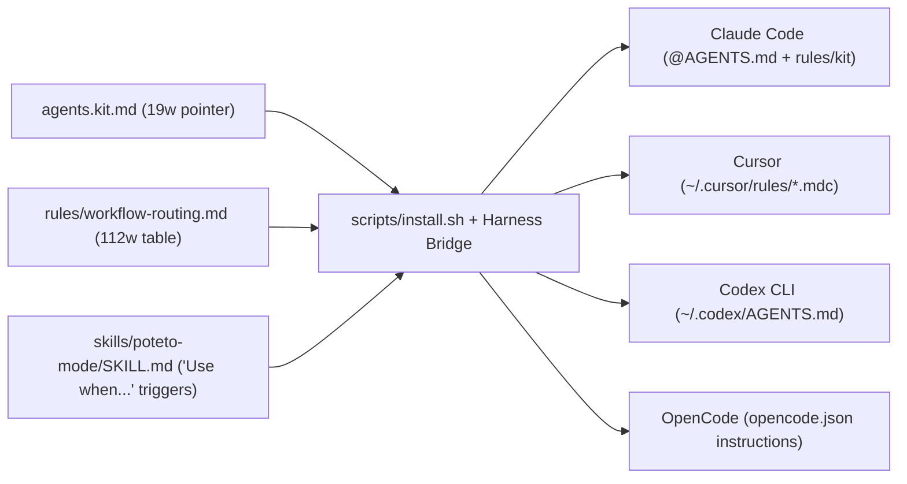

# Always-active kit: research summary

This investigation evaluated how to make the `dot-agents` kit automatically active across Cursor, Claude Code, Codex CLI, and OpenCode without burning context tokens or breaking repository validation.

## Key takeaways

- **One bullet is not enough.** A single line in `agents.kit.md` reaches only 1 of 4 harnesses today and leaves subjective loopholes under the 25-word limit. [1] [2]
- **Four-harness rule + bridge wins.** A `rules/workflow-routing.md` rule plus `poteto-mode` SDO (skill discovery optimization) triggers and harness bridges covers 4 of 4 harnesses for 150 to 235 tokens. [2] [3]
- **Live install is currently empty.** On disk, `~/.agents/skills/`, `~/.agents/agents/`, and `~/.claude/rules/` hold 0 files today, and `~/.agents/AGENTS.md` is stale from October 26. [4] [5]
- **Avoid `@import` and startup hooks.** Force-loading `poteto-mode/SKILL.md` costs 6,250 to 7,150 tokens per turn, while `SessionStart` hooks fail in Cursor Cloud Agents and subagents. [6] [7]

## Visualization

The flow below shows how the 3 repository surfaces connect through `scripts/install.sh` to all 4 agent harnesses.

## Head-to-head

The table below compares 5 activation options across the 4 local harnesses (`Cursor`, `Claude Code`, `Codex CLI`, and `OpenCode`) and repository contract tests.

| Metric | 1. `agents.kit.md` 1-liner | 2. Rule + SDO + Bridge | 3. `@import` `poteto-mode` | 4. `SessionStart` hooks | 5. Manual `Option+Enter` |
| --- | --- | --- | --- | --- | --- |
| Automatic coverage (count, 4 local harnesses) | 1 of 4 [8] | **4 of 4** [9] | 1 of 4 [8] | 3 of 4 [7] | 0 of 4 [10] |
| Always-on context cost (tokens per turn, repo files) | 20 to 35 [2] | 150 to 235 [2] | 6,250 to 7,150 [6] | 600 to 850 [7] | **0** [10] |
| Cursor Cloud Agent and subagent reach (coverage, Cursor runtime) | No [11] | **Yes** [11] | Partial [8] | No [7] | No [10] |
| Repo contract compliance (pass rate, `validate.sh` and `writing-rules.test.mjs`) | **Pass** [12] | **Pass** [12] | Fail [3] [12] | Fail [13] | **Pass** [10] |

## Findings

### Why `agents.kit.md` alone does not activate the kit

- `tests/writing-rules.test.mjs` caps `agents.kit.md` to single-line bullets of 25 words or fewer with no headings or tables. [2] [12]
- Zero of 4 harnesses natively auto-load `~/.agents/agents.md` or `~/.agents/rules/*.md` without harness-specific configuration bridges. [1] [9]
- Currently `skills/poteto-mode/SKILL.md` only triggers on the literal words `poteto` or `/poteto-mode`, so harnesses never auto-select it from task prompts. [6] [14]

### Live disk drift and cross-harness bridges

- `~/.agents/skills/` and `~/.agents/agents/` have 0 entries on disk after a November 7 cleanup, while `~/.agents/.kit-stamp` still reflects October 26. [4] [5]
- Cursor, Codex CLI, and OpenCode natively discover `~/.agents/skills/*/SKILL.md` (3 of 4), and the `~/.claude/skills` symlink covers Claude Code (4 of 4). [5] [15]
- Bridging rules to 4 of 4 harnesses requires `~/.claude/rules/kit`, `~/.cursor/rules/*.mdc`, a managed block in `~/.codex/AGENTS.md`, and `instructions` globs in `opencode.json`. [5] [9] [11]

## Open questions

- Does Cursor follow symlinks inside `~/.cursor/rules/*.mdc`, or must `scripts/install.sh` copy `.mdc` files directly like it does for skills?
- Should the 4-harness bridge run inside `scripts/install.sh --target agents` by default or behind a `--bridge-harnesses` flag so unit tests stay isolated in `$HOME` sandboxes?

## Next steps

1. [ ] Run `./scripts/install.sh --target agents` and `~/.agents/scripts/link-claude-config.sh` to restore the 73 skills, 7 agents, and `~/.claude/rules/kit` symlink.
2. [ ] Update `skills/poteto-mode/SKILL.md` line 2 so its `description` starts with `"Use when..."` task triggers (`~0` net tokens).
3. [ ] Add `rules/workflow-routing.md` (`< 150` words, observable task predicates and exceptions) and a 19-word pointer bullet in `agents.kit.md`.
4. [ ] Extend `scripts/install.sh` (or a companion linker script) to bridge `~/.agents/{agents.md,rules}` into `~/.cursor/rules/*.mdc`, `~/.codex/AGENTS.md`, and `~/.config/opencode/opencode.json`.
5. [ ] Add `rule_files` and `agents.kit.md` to `md_files` in `scripts/validate.sh` so CI checks `/skill` and `rules/<id>.md` links inside rules.

## Sources

1. `scripts/install.sh:80-114`
2. `skills/writing-rules/SKILL.md:26-87`
3. `skills/writing-skills/references/discovery.md:58-94`
4. `/Users/phillipchaffee/.agents/.kit-stamp:1-220`
5. `/Users/phillipchaffee/.agents/scripts/link-claude-config.sh:48-92`
6. `skills/poteto-mode/SKILL.md:1-153`
7. `/Users/phillipchaffee/git/ponytail/docs/cursor-hooks.md:48-133`
8. `/Users/phillipchaffee/.claude/CLAUDE.md:17-25`
9. `rules/new-repo-setup.md:43-46`
10. `skills/poteto-mode/references/harness-adapter.md:32-52`
11. [Cursor Rules Documentation](https://cursor.com/docs/context/rules)
12. `tests/writing-rules.test.mjs:39-64`
13. `AGENTS.md:8-15`
14. `skills/poteto-help/SKILL.md:42-60`
15. [Cursor Agent Skills Documentation](https://cursor.com/docs/context/skills)

## TL;DR

Adding a line to `agents.kit.md` alone will not make the kit always active because 0 of 4 harnesses natively load `~/.agents/agents.md` or `~/.agents/rules/*.md`, and your live `~/.agents/skills/` directory is currently empty on disk. Re-run `./scripts/install.sh`, add a `< 150`-word `rules/workflow-routing.md` rule plus `"Use when..."` triggers in `skills/poteto-mode/SKILL.md` and a 1-bullet pointer in `agents.kit.md` (`150` to `235` tokens total), and bridge `~/.agents/` into all 4 harnesses.
