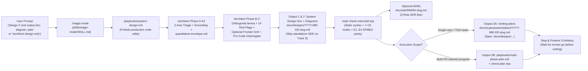

# Research: Adding a 3-Artifact System Design Output (Design Doc, System Design Diagram, and Plan)

This Tier 2 research synthesis investigates how to extend `/agent/repos/.agents` so system design requests can stop cleanly after emitting three coordinated, non-overlapping artifacts—a **System Design Document**, validated **System Design Diagram(s)**, and an **Implementation Plan**—without modifying application code or violating the kit's existing `74`-skill and validator contracts. Combining local repository forensics with 2024–2026 Staff+ RFC/Design-Doc and Diagram-as-Code standards shows that adding a new `magic-mode` playbook (`skills/magic-mode/playbooks/system-design.md`), two `/architect` reference specs (`design-doc-template.md`, `diagram-standards.md`), and a zero-dependency Mermaid linter (`check-mermaid.mjs`) delivers this workflow cleanly with **zero new top-level skill directories**.

## Key findings

1. **The kit currently has a routing gap between `Investigation`, `Feature`, and `Multi-phase plan`.** `skills/architect/SKILL.md:44` defaults to implementing code immediately (`"Default: proceed directly to implementation... No human checkpoint"`), `playbooks/investigation.md:12` forbids `/architect` unless preceding a code change, `playbooks/feature.md:12` bans skipping code delegation, and `skills/writing-plans/SKILL.md:3,66` assumes a `**Spec:**` already exists before it writes a TDD plan.
2. **Adding a `magic-mode` playbook avoids breaking hardcoded `74`-skill tests while shipping in `install.sh`.** `tests/opencode-and-pi-plugins.test.mjs:158,182` asserts `expectedSkillDirs.length === 74`, whereas playbooks under `skills/magic-mode/playbooks/` and references/scripts under `skills/architect/` add zero top-level `skills/*/SKILL.md` directories and are automatically packaged by `scripts/install.sh:84-114`.
3. **Diátaxis separation prevents AI-era RFC bloat across the three outputs.** Following [Google Design Docs](https://www.industrialempathy.com/posts/design-docs-at-google/), [Oxide RFDs](https://rfd.shared.oxide.computer/rfd/0001), [Phil Calçado (2026)](https://philcalcado.com/2026/07/10/writing_ai_assisted_rfcs.html), and `/technical-writing` (`skills/technical-writing/SKILL.md:31-51`), the **System Design Doc** (`docs/designs/YYYY-MM-DD-<slug>.md`) covers *Explanation + Bounded Reference* (`<= 1,200` words Track M / `1,500–2,500` words Track L, zero DDL or task lists), the **Implementation Plan** (`docs/superpowers/plans/YYYY-MM-DD-<slug>.md` or `multi-phase-plan.md`) covers strict *How-to* execution steps linked via `**Spec:**`, and **ADRs** (`docs/adr/NNNN-<slug>.md`) record single hard-to-reverse choices.
4. **Mermaid `flowchart LR` + `sequenceDiagram` + `stateDiagram-v2` beat Mermaid `C4Container` and `architecture-beta` in 2026.** [Mermaid `architecture-beta`](https://mermaid.ai/open-source/syntax/architecture.html) supports zero text labels on edges, and Mermaid [`C4Container`](https://mermaid.ai/open-source/syntax/c4.html) ignores v12 ELK layouts and hits headless grid bugs (`mermaid-cli#440`, `#872`), whereas standard `flowchart LR` with `subgraph` trust/blast-radius boundaries and `[(Store)]` cylinders renders reliably across GitHub, GitLab, and IDEs.
5. **Diagrams must map 1:1 to a DFMEA / Boundary Contract table and pass deterministic linting.** Every inter-container arrow carries an Edge ID (`E1..En`), `Protocol/Transport`, and `Sync/Async` distinction, mapping 1:1 to a row in the Design Doc's Boundary Contract / DFMEA table (`fail | degrade | queue | ignore`, timeout, retry budget, idempotency) and checked by a zero-dependency Node script (`skills/architect/scripts/check-mermaid.mjs`) matching `package.json`'s dependency-free policy.
6. **Optional heavy layout engines (`pele`, `mmdc`, D2 v0.9.0 TALA, `archify`) should stay external to `.agents/package.json`.** `package.json:1-24` contains zero npm dependencies; following `skills/statechart/references/render.md:3`, external SVG rendering via `pele@1.9.0` or [D2 v0.9.0 (open-source TALA)](https://d2lang.com/blog/tala-is-open-source/) can be invoked on demand outside the repo while keeping CI/local validation 100% self-contained.

## Comparison / Architecture (tables & visualizations)

The tables and diagram below define the three non-overlapping deliverables, the local kit constraints they must satisfy, and the Track-scoped diagram views.

### 1. Three-Artifact Separation of Concerns (Diátaxis & Industry Standards)

This table enforces strict boundaries across the System Design Document, System Design Diagram(s), Implementation Plan, and optional ADRs to eliminate mode-mixing and content duplication.

| Deliverable & Save Path | Diátaxis Mode & Audience | Required Sections & Size Cap | Strictly Excluded (Put Elsewhere) |
| --- | --- | --- | --- |
| **1. System Design Document** `docs/designs/YYYY-MM-DD-<slug>.md` *(Track M & Track L)* | **Explanation** + **Bounded Reference** *(Staff/Eng alignment, security, SRE)* | `0. Metadata & TL;DR` (Status, Track, Review Deadline, Revisit Date); `1. Context, Scope & Strategy Kernel`; `2. Goals, Non-Goals & Tenets`; `3. Architecture & Boundary Contract` (embeds Diagrams + DFMEA table); `4. Quantitative Envelope & FinOps Unit Cost`; `5. Alternatives Considered (incl. Do Nothing) & Tradeoffs`; `6. Resilience, Metastability, STRIDE & Data Class`; `7. Rollout Invariants & Rollback Contract`; `8. Open Questions & Links`. **Cap:** `<= 1,200` words (Track M); `1,500–2,500` words + tables (Track L). | File trees, class/method bodies, exhaustive SQL DDL/OpenAPI dumps, ticket lists, step-by-step migration commands (`-> Implementation Plan`). Skip standalone SDD for **Track S**. |
| **2. System Design Diagram(s)** Embedded in SDD + optional `.mmd`/`.d2`/Canvas | **Spatial Reference & Dynamic Flow** *(All reviewers)* | Track-scoped complementary views (max `<= 15` nodes per diagram, explicit `subgraph Legend`): • **Track M:** `flowchart LR` C2 Container Topology + `sequenceDiagram` critical write & failure/retry path (`alt`/`else`). • **Track L:** Adds C1 External Context or Deployment/Blast-Radius view (Cells, Control vs. Data Plane) + `stateDiagram-v2` / `/statechart` lifecycle. | Bidirectional arrows (`<-->`), vague verbs (`"Uses"`), mixed C1/C2/C3 levels, `architecture-beta` (no edge labels), `C4Container` (headless layout bugs), decision prose (`-> ADRs`). |
| **3. Implementation Plan** `docs/superpowers/plans/YYYY-MM-DD-<slug>.md` *(via `/writing-plans`)* OR `<agent store>/docs/` *(via `multi-phase-plan.md`)* | **How-to** *(Action-only execution guide)* | Links SDD via `**Spec:** docs/designs/...`; lists exact `Global Constraints` (1 line each), `Review Focus` (5 implied failure inputs), `File Structure`, and ordered `### Task N` TDD steps (exact files, signatures, test assertions, 6-step Expand-Contract waves, CLI checks). | Background history essays, re-arguing rejected options, empty `"TBD"` placeholders (`skills/writing-plans/SKILL.md:57-159`). |
| **4. Architecture Decision Records** `docs/adr/NNNN-<slug>.md` *(Optional, 0–N files)* | **Point-in-Time Decision Log** *(Immutable history)* | Emitted **only** when the 3-rule ADR bar holds (*Hard to reverse* + *Surprising without context* + *Real tradeoff*). 1 paragraph to 1 page: `Context`, `Decision`, `Consequences`, optional `Options` (`docs/adr/`). | Routine two-way-door library picks, rollout steps, living system overviews. |

### 2. Local Kit Constraints & Validation Rules

This table documents the exact test and linter invariants in `/agent/repos/.agents` that shape how the 3-artifact mode must be implemented.

| Constraint Source | Rule Enforced | Architectural Impact on Implementation |
| --- | --- | --- |
| `tests/opencode-and-pi-plugins.test.mjs:158,182` | Hardcodes **`expectedSkillDirs.length === 74`** (`skills/*/SKILL.md`). | Do **not** add a new `skills/system-design/SKILL.md`; add a playbook (`skills/magic-mode/playbooks/system-design.md`) and `skills/architect/{references,scripts}/`. |
| `scripts/install.sh:84-114` & `tests/test_install.py:37-76` | Ships `skills/`, `agents/`, `rules/`, `agents.kit.md`; ignores `docs/`. | Put all templates, playbooks, and diagram validators inside `skills/` so consumers receive them; generated design artifacts land in the target repo's `docs/designs/` and `docs/superpowers/plans/`. |
| `scripts/validate.sh:117-204` | Rejects unmatched `/kebab-word` (`SLASH_REF`), unsorted frontmatter keys, Cursor-specific tokens, model slugs, and forge CLIs (`BANNED`). | Never write unbackticked slashes (`S/M/L`, `and/or`) in `skills/`; check `./scripts/validate.sh` on every edit. |
| `skills/magic-mode/scripts/check-plan.mjs:78-200` | Enforces `<10`-line intro, exact 9 PR sub-blocks, 10 swarm lanes, `Appendix` H2s after `Close the program`, and bans `—`, `–`, curly quotes, and `/: \S/`. | Keep `multi-phase-plan.md` strictly for multi-PR stacked programs; use `/writing-plans` (`docs/superpowers/plans/`) for single-repo TDD plans; place any SDD reference in `Appendix D` when using `multi-phase-plan.md`. |
| `tests/output-format-skills.test.mjs:8-65` | Enforces Variant C (`1-2 sentences?`, `table`, `## TL;DR`) on 22 named files including `skills/magic-mode/SKILL.md` and `skills/magic-help/SKILL.md`. | Keep Variant C markers intact when adding `system-design.md` entries to `magic-mode/SKILL.md` and `magic-help/SKILL.md`. |
| `package.json:1-24` | Zero npm `dependencies` or `devDependencies` at the repo root. | Implement `skills/architect/scripts/check-mermaid.mjs` in zero-dependency Node ESM; invoke optional `pele@1.9.0` or `d2` only externally when installed. |

### 3. Design-Only Flow Diagram (`playbooks/system-design.md` + `/architect`)

The Mermaid diagram below illustrates how a design-only request flows from `/magic-mode` through `/architect` and branches to `/writing-plans` or `multi-phase-plan.md` without modifying application source code.

## Details

Each bullet below grounds the design choices for the new playbook, SDD template, diagram standards, and zero-dependency validator.

- **Playbook trigger decoupling from `Investigation` and `Feature`.** `docs/magic-guide/03-understand.md:15` routes `"don't change any code yet"` on diagnostic asks to `playbooks/investigation.md`, while `playbooks/system-design.md` captures forward-looking design requests (`"design X"`, `"system design doc"`, `"output a plan, design doc, and diagram"`, `"/architect design-only"`), explicitly honoring the user gate in `skills/magic-mode/SKILL.md:20` and halting before Phase D implementation (`skills/architect/SKILL.md:44-54`).
- **Google, Oxide, Stripe, and Calçado anti-bloat guardrails.** [Malte Ubl (2020)](https://www.industrialempathy.com/posts/design-docs-at-google/), [Ryan Madden (2024)](https://ryanmadden.net/things-i-learned-at-google-design-docs/), [Ziftci & Greenberg (ASE 2023)](https://research.google/pubs/improving-design-reviews-at-google/), and [Phil Calçado (2026)](https://philcalcado.com/2026/07/10/writing_ai_assisted_rfcs.html) establish hard length limits (`<= 2` pages mini doc; `1,500–2,500` words core RFC), mandatory **Non-Goals** and **"Do Nothing"** alternatives, explicit revisit dates ([Oxide RFD 1](https://rfd.shared.oxide.computer/rfd/0001)), and strict exclusion of file trees, DDL dumps, and task lists.
- **Readiness, security, and unit-economics coverage in Track M/L docs.** Synthesizing [AWS Operational Readiness Reviews (2026)](https://docs.aws.amazon.com/pdfs/wellarchitected/latest/operational-readiness-reviews/operational-readiness-reviews.pdf), [AWS Threat Modeling](https://aws.amazon.com/blogs/security/how-to-approach-threat-modeling/), [AWS Data Classification](https://docs.aws.amazon.com/pdfs/whitepapers/latest/data-classification/data-classification.pdf), [FinOps Unit Economics](https://www.finops.org/framework/capabilities/unit-economics/), and [AWS Rollback Safety](https://aws.amazon.com/builders-library/ensuring-rollback-safety-during-deployments/) adds compact Boundary/DFMEA, STRIDE (triggered when assets cross trust boundaries), Data Tier, `$/unit` FinOps, and Two-Phase Prepare/Activate rollback invariant tables without padding N/A boilerplate.
- **Portable Mermaid rules and 1:1 Edge-to-DFMEA binding.** Using [Simon Brown's C4 principles](https://c4model.com/diagrams/checklist) inside portable `flowchart LR` (`subgraph` trust/blast-radius boundaries, `[(Store)]` cylinders, solid `-->` sync vs. dashed `-.->` async, explicit `subgraph Legend`) avoids [Mermaid `architecture-beta` missing edge labels](https://mermaid.ai/open-source/syntax/architecture.html) and [Mermaid `C4Container` `mmdc` grid bugs](https://github.com/mermaid-js/mermaid-cli/issues/440), while requiring `E1..En` labels to match the SDD's DFMEA table row-for-row ([Ruchit Suthar](https://ruchitsuthar.com/architecture/spine/context/)).
- **Zero-dependency Node validation + external render escalation.** Building `skills/architect/scripts/check-mermaid.mjs` in pure Node ESM (checking banned types `architecture-beta`/`C4Context`/`C4Container`, lowercase `end` node IDs, unbalanced `subgraph`/`alt`/`opt`/`loop` blocks, unlabelled cross-boundary arrows, node count `<= 15`, and `E1..En` DFMEA table parity) requires zero changes to `package.json:1-24`, while [D2 v0.9.0 TALA](https://d2lang.com/releases/0.9.0/), [`pele@1.9.0`](https://pele.run/api), [`tt-a1i/archify`](https://github.com/tt-a1i/archify), and Cursor's `WriteCanvas` remain optional escalation paths for $>15$-node or interactive reviews.

## Open questions / next steps

These three steps integrate the 3-artifact mode into our existing augmentation plan (`docs/superpowers/plans/2026-11-08-system-design-skill-augmentations.md`).

- **Add Task 7 (`playbooks/system-design.md`, `design-doc-template.md`, `diagram-standards.md`, `check-mermaid.mjs`) to the implementation plan.** Wire `magic-mode/SKILL.md`, `magic-help/SKILL.md`, `docs/CATALOG.md`, and `architect/SKILL.md` so natural-language design-only requests and `/architect design-only` stop cleanly after outputting the SDD, validated diagrams, and plan.
- **Verify `check-mermaid.mjs` against real failing/passing Markdown fixtures in `tests/system-design-skills.test.mjs`.** Confirm it catches `architecture-beta`, `C4Container`, dangling `E3` arrows missing from the DFMEA table, and >15-node bloated diagrams.
- **Decide whether Track L design-only runs should also auto-emit an interactive Cursor Canvas when `WriteCanvas` is available.** Keeping Markdown/Mermaid in `docs/designs/` as git source of truth and offering Canvas as an optional companion gives both PR-diffable files and side-by-side interactive inspection.

## Sources

- **Local Repository (`file:line`):**
  - `skills/magic-mode/SKILL.md:12-154`, `skills/magic-mode/playbooks/feature.md:1-21`, `skills/magic-mode/playbooks/investigation.md:1-15`, `skills/magic-mode/playbooks/multi-phase-plan.md:1-155`, `skills/magic-mode/scripts/check-plan.mjs:1-205`
  - `skills/architect/SKILL.md:1-82`, `skills/architect/references/rationale-template.md:1-38`
  - `skills/writing-plans/SKILL.md:1-205`, `skills/technical-writing/SKILL.md:1-109`, `skills/statechart/SKILL.md:1-85`, `skills/statechart/references/render.md:1-92`, `skills/statechart/scripts/backends/mermaid.ts:1-20`, `skills/magic-help/SKILL.md:1-177`
  - `docs/CATALOG.md:1-148`, `docs/magic-guide/03-understand.md:1-60`, `docs/magic-guide/04-design.md:1-131`, `docs/superpowers/plans/2026-11-08-system-design-skill-augmentations.md:1-502`
  - `scripts/validate.sh:1-227`, `scripts/install.sh:84-114`, `package.json:1-24`, `tests/opencode-and-pi-plugins.test.mjs:150-190`, `tests/output-format-skills.test.mjs:1-65`, `tests/magic-sync.test.mjs:1-135`, `tests/test_install.py:37-88`
- **System Design Documents, RFCs & Diátaxis:**
  - [Google Design Docs (Malte Ubl)](https://www.industrialempathy.com/posts/design-docs-at-google/) · [Google ASE 2023 Review Study](https://research.google/pubs/improving-design-reviews-at-google/) · [Ryan Madden (2024)](https://ryanmadden.net/things-i-learned-at-google-design-docs/)
  - [Oxide RFD 1](https://rfd.shared.oxide.computer/rfd/0001) · [Oxide RFD 5](https://rfd.shared.oxide.computer/rfd/0005) · [Ben Leonard (2023)](https://oxide.computer/blog/a-tool-for-discussion)
  - [Pragmatic Engineer RFC Survey (2024)](https://blog.pragmaticengineer.com/rfcs-and-design-docs/) · [Uber RFCs](https://blog.pragmaticengineer.com/scaling-engineering-teams-via-writing-things-down-rfcs/) · [Stripe Part 2](https://newsletter.pragmaticengineer.com/p/stripe-part-2) · [HashiCorp RFC Template](https://www.hashicorp.com/en/how-hashicorp-works/articles/rfc-template) · [Phil Calçado — Writing AI-Assisted RFCs (2026)](https://philcalcado.com/2026/07/10/writing_ai_assisted_rfcs.html) · [Birgitta Böckeler — SDD Tools (2025)](https://www.martinfowler.com/articles/exploring-gen-ai/sdd-3-tools.html) · [MADR 4.0.0](https://adr.github.io/madr/)
  - [AWS Operational Readiness Reviews (2026)](https://docs.aws.amazon.com/pdfs/wellarchitected/latest/operational-readiness-reviews/operational-readiness-reviews.pdf) · [AWS Threat Modeling](https://aws.amazon.com/blogs/security/how-to-approach-threat-modeling/) · [AWS Data Classification](https://docs.aws.amazon.com/pdfs/whitepapers/latest/data-classification/data-classification.pdf) · [FinOps Unit Economics](https://www.finops.org/framework/capabilities/unit-economics/) · [AWS Rollback Safety](https://aws.amazon.com/builders-library/ensuring-rollback-safety-during-deployments/) · [Diátaxis Framework](https://diataxis.fr/)
- **System Design Diagrams & Validation:**
  - [C4 Abstractions](https://c4model.com/abstractions) · [C4 Checklist](https://c4model.com/diagrams/checklist) · [Structurizr DSL](https://docs.structurizr.com/dsl/language) · [IcePanel Mistakes](https://icepanel.io/blog/common-diagramming-mistakes) · [Google BSRS Ch. 6](https://google.github.io/building-secure-and-reliable-systems/raw/ch06.html) · [Ruchit Suthar](https://ruchitsuthar.com/architecture/spine/context/) · [Ryan Lee Anti-Patterns](https://ryanleej.com/artifacts/architecture-diagram-anti-pattern-gallery/)
  - [Mermaid Layouts (v12)](https://mermaid.ai/open-source/config/layouts.html) · [Mermaid Architecture Syntax](https://mermaid.ai/open-source/syntax/architecture.html) · [Mermaid C4 Syntax](https://mermaid.ai/open-source/syntax/c4.html) · [`mermaid-cli#440`](https://github.com/mermaid-js/mermaid-cli/issues/440) · [D2 0.9.0 / TALA Open Source](https://d2lang.com/blog/tala-is-open-source/) · [`tt-a1i/archify`](https://github.com/tt-a1i/archify) · [`@crayon-c4/mcp`](https://www.crayon-c4.com/docs/getting-started/mcp-server)

## TL;DR

Add a `system-design` playbook (`skills/magic-mode/playbooks/system-design.md`) and three supporting `/architect` files (`references/design-doc-template.md`, `references/diagram-standards.md`, and zero-dependency `scripts/check-mermaid.mjs`) to output a Diátaxis-separated System Design Document (`docs/designs/YYYY-MM-DD-<slug>.md`), validated `flowchart LR` / `sequenceDiagram` / `stateDiagram-v2` diagrams mapped 1:1 to a DFMEA table, and a linked Implementation Plan (`/writing-plans` or `multi-phase-plan.md`) without adding any new top-level `skills/*/SKILL.md` directories or touching application code.
