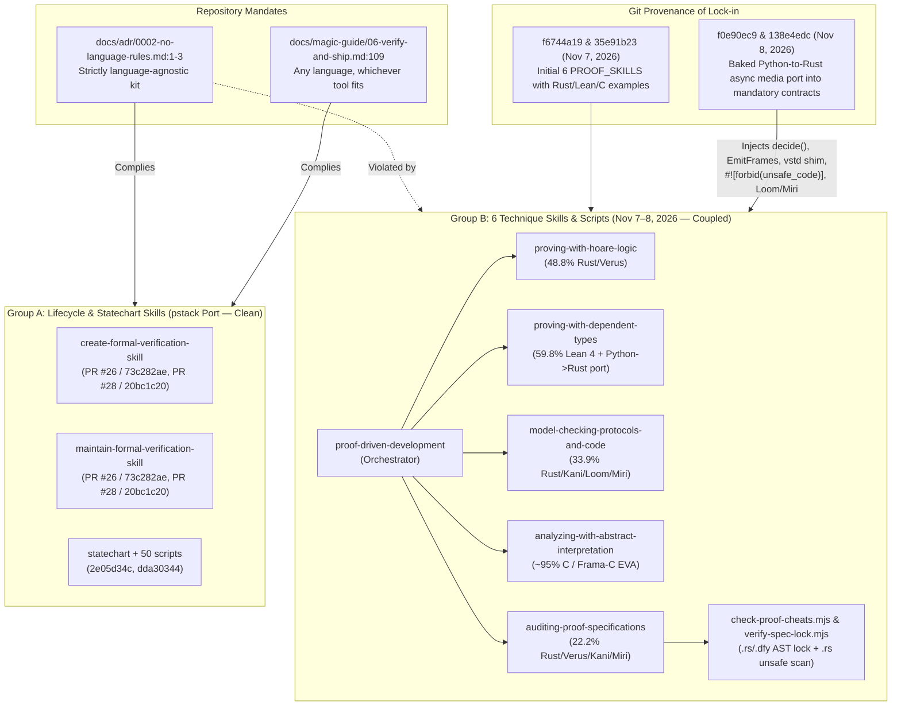

# Formal Proof Skills Language-Agnosticism Audit

An audit of all nine formal verification skills (`docs/CATALOG.md:65-73`), their companion scripts, and their test suite reveals a sharp split between three language-agnostic lifecycle skills (`Group A`) and six technique skills (`Group B`) that violate `docs/adr/0002-no-language-rules.md:1-3` by hardcoding Rust (`Verus`, `Kani`, `Loom`, `Miri`, `cargo`), Lean 4, and C (`Frama-C EVA`) constructs into universal output contracts. Commits `f0e90ec98c599ab51359f5155b35c92248185d20` and `138e4edc8871fe24524e10592b134a5eaf946cbe` directly baked artifacts from a specific Python-to-Rust async media/protocol rewrite—including domain-specific enum variants like `EmitFrames` and `CancelAndRecreateProcessTask`—into mandatory rules that execute on every codebase.

## Key Findings

1. **Repository Mandate Violation**: Six of the nine formal verification skills violate the kit's core invariant that it carries no language-specific rules (`docs/adr/0002-no-language-rules.md:1-3`, reaffirmed in `docs/adr/0006-hygiene-gates.md:3` and `docs/adr/0008-pstack-port.md:5`) and contradict the promise to verify code "in any language, with whichever verification tool fits" (`skills/create-formal-verification-skill/SKILL.md:2`, `docs/magic-guide/06-verify-and-ship.md:109`).
2. **Two-Generation Split (`Group A` vs. `Group B`)**: The three `Group A` skills (`create-formal-verification-skill`, `maintain-formal-verification-skill`, `statechart`) ported from `pstack` in [PR #26](https://github.com/PhillipChaffee/magic/pull/26) (`73c282ae207a0c4bfb76f5009e95fd23a9e19a5f`) and renamed in [PR #28](https://github.com/PhillipChaffee/magic/pull/28) (`20bc1c206b1eb302a5d75ad15ae6cf9e4e507397`) have zero target-language lock-in, whereas all six `Group B` skills (`PROOF_SKILLS` in `tests/proof-skills.test.mjs:12-19`) enforce language-bound syntax and tooling.
3. **Leaked Project-Specific Rewrite Artifacts**: Commits `f0e90ec98c599ab51359f5155b35c92248185d20` and `138e4edc8871fe24524e10592b134a5eaf946cbe` copied architecture and identifiers from a single Python-to-Rust media/protocol port (`decide(&mut self, event) -> StepDecision`, `HoldUntilStarted`, `EnqueueForProcessTask`, `CancelAndRecreateProcessTask`, `EmitFrames`, `SpscRingBuffer`, `ConcurrentProcessorHandle`) into universal skill prerequisites (`skills/proving-with-hoare-logic/SKILL.md:33-42`, `skills/model-checking-protocols-and-code/SKILL.md:152-154`).
4. **Universal Output Contracts Mandate Rust Syntax**: `proof-driven-development`, `proving-with-hoare-logic`, `model-checking-protocols-and-code`, and `auditing-proof-specifications` require agents to emit Rust/Verus/Kani/Loom/Miri constructs (`#![forbid(unsafe_code)]`, `spec fn inv(&self)`, `proof fn verify_spec_not_vacuous`, `#[kani::proof]`, `kani::cover!`, `cargo +nightly miri test`, `RUSTFLAGS="--cfg loom" cargo test --release`) "even when asked for a brief or code-only response" (`skills/proving-with-hoare-logic/SKILL.md:46-60`, `skills/model-checking-protocols-and-code/SKILL.md:64-81`).
5. **Single-Prover Lock-in in Non-Rust Technique Skills**: `proving-with-dependent-types` advertises Rocq, Isabelle/HOL, and F\* in frontmatter (`skills/proving-with-dependent-types/SKILL.md:2`) but hardcodes Lean 4 (`lake build`, `#print axioms`, `OracleMain.lean`) and a Python-to-Rust differential pipeline (`Hypothesis` to `proptest`) in its mandatory contract (`skills/proving-with-dependent-types/SKILL.md:47-68`), while `analyzing-with-abstract-interpretation` is nearly 100% locked to C and Frama-C EVA (`skills/analyzing-with-abstract-interpretation/SKILL.md:40-150`).
6. **AST Locker & Cheat Scanner Blind Spots and Contradictions**: `verify-spec-lock.mjs` only extracts AST headers for `.rs` and `.dfy` (`skills/auditing-proof-specifications/scripts/verify-spec-lock.mjs:37-113, 139-150`) and strips `/* ... */` comments (`lines 17-21`), directly contradicting `skills/auditing-proof-specifications/SKILL.md:38` which claims `spec.lock` protects C/Frama-C (`/*@ ... */`) and Ada/SPARK contracts.
7. **Test Suite Reinforces Rust Lock-in**: `tests/proof-skills.test.mjs:12-19, 91-180` only tests the six `Group B` skills and validates `verify-spec-lock.mjs` exclusively against a synthetic Rust/Verus crate (`crates/core/src/lib.rs` with `#![forbid(unsafe_code)]`, `pub open spec fn`, and `{ todo!() }`).

---

## `/principle-take-a-step-back` Diagnosis: Tool Routing vs. Mandatory Contract Lock-in

Many formal verification engines are inherently language-bound, so making the skill suite language-agnostic requires separating legitimate **tool-routing guidance** from illegitimate **universal contract lock-in**.

| Dimension | Legitimate in a Language-Agnostic Skill | Illegitimate Lock-in Found in `Group B` | Citation |
| --- | --- | --- | --- |
| **Verifier Selection** | Naming Verus/Kani for Rust, Frama-C/CBMC for C, SPARK for Ada, and TLA+/Lean/Dafny for language-independent models in a routing table. | Assuming the target implementation language is always Rust (`"synthesizing Rust"`, `"separate hand-written Rust codebase"`). | `skills/proof-driven-development/SKILL.md:126`, `skills/auditing-proof-specifications/SKILL.md:96` |
| **Architectural Pattern** | Advising separation of pure state transitions from async I/O and locks before proving functional invariants. | Mandating the exact Rust signature `decide(&mut self, event) -> StepDecision`, `#![forbid(unsafe_code)]`, `tokio::select!`, and `vstd` proc-macro ghost-erasure shims for `cargo`. | `skills/proving-with-hoare-logic/SKILL.md:33-42, 51, 162` |
| **Required Output Contract** | Requiring a well-formedness invariant, a non-vacuity witness, and frame conditions expressed in the active verifier's syntax. | Mandating literal `spec fn inv(&self)`, `proof fn verify_spec_not_vacuous`, `#[kani::proof]`, `kani::cover!`, `lake build`, and `Miri` + `Loom` in every response. | `skills/proving-with-hoare-logic/SKILL.md:46-60`, `skills/model-checking-protocols-and-code/SKILL.md:64-81` |
| **AST Contract Locking** | Hashing spec files or extracting contract headers per language adapter (or failing loudly on unsupported extensions). | Claiming Frama-C and SPARK support in prose while only parsing Rust/Verus and Dafny prefixes and only scanning `.rs` files for `unsafe`. | `skills/auditing-proof-specifications/SKILL.md:38, 67`, `skills/auditing-proof-specifications/scripts/verify-spec-lock.mjs:37-113, 162-178` |

---

## Comparison & Provenance Architecture

The table and provenance diagram below compare all nine formal verification skills, both verification scripts, and the test suite across language coupling, worked examples, and severity.

| Skill / Script / Test | Group & Provenance | Lines | Rust Coupling (Lines / Density) | Other Language Lock-in | Worked Examples | Severity & Verdict |
| --- | --- | --- | --- | --- | --- | --- |
| `skills/create-formal-verification-skill/SKILL.md` | **Group A** (`pstack` port, `73c282ae`) | 44 | 0 (0%) | None (TLA+ named as default design modeler; adapts to any host language) | None | **Clean** — 100% language-agnostic |
| `skills/maintain-formal-verification-skill/SKILL.md` | **Group A** (`pstack` port, `73c282ae`) | 60 | 0 (0%) | None (reads project's own verification skill and git history) | None | **Clean** — 100% language-agnostic |
| `skills/statechart/SKILL.md` + `references/render.md` + `scripts/` (50 files) | **Group A** (`pstack` sync, `2e05d34c`) | 177 + 50 scripts | 0 (0%) | None for target repo (operates on `.tla`, `.cfg`, `.mmd`, JS/TS view files) | TLA+ state machines | **Clean** — 100% language-agnostic for host repo |
| `skills/proof-driven-development/SKILL.md` | **Group B** (`35e91b23`, `138e4edc`) | 136 | 25 lines (~18.4%, ~42 Rust tokens) | Lean 4 (`lake build`), TLA+ (`TLC`), C (`CBMC`, `Frama-C`), Python (`Hypothesis`) | None (orchestrator checklists) | **Critical** — 4-Phase Blueprint & TCB mandate Rust/Verus/Kani/Loom/Miri |
| `skills/proving-with-hoare-logic/SKILL.md` | **Group B** (`f6744a19`, `138e4edc`) | 170 | 83 lines (48.8%) | Dafny, SPARK, Frama-C WP (mentioned in prose/tables only) | 100% Rust/Verus (`binary_search`, 52 lines) | **Critical** — Mandatory contract, prerequisites, and example are locked to Rust/Verus |
| `skills/proving-with-dependent-types/SKILL.md` | **Group B** (`f6744a19`, `138e4edc`) | 164 | 10 lines (6.1%) | **Lean 4** (98 lines / 59.8%), Python (`Hypothesis`), TypeScript (`fast-check`), Rocq | 100% Lean 4 (`LedgerSpec.lean` + `OracleMain.lean`, 72 lines) | **Critical** — Mandatory contract locks into Lean 4 CLI + Python-to-Rust port |
| `skills/model-checking-protocols-and-code/SKILL.md` | **Group B** (`f6744a19`, `138e4edc`) | 168 | 57 lines (33.9%) | TLA+ (`TLC`), C (`CBMC`, `ESBMC`, `GenMC`), Python (`pytest TlaTraceObserver`) | 50% Rust/Kani (`midpoint`, 24 lines), 50% TLA+ (`*Trace.tla`, 33 lines) | **Critical** — Code-level contract & Red Flags mandate Kani, Loom, and Miri |
| `skills/analyzing-with-abstract-interpretation/SKILL.md` | **Group B** (`f6744a19`) | 150 | 1 line (0.7%, routing note) | **C / Frama-C EVA** (~95% of file), CompCert, Astrée | 100% C11 / Frama-C ACSL (`actuator.c`, 44 lines) | **High** — Locked to C and Frama-C EVA flags/ACSL syntax |
| `skills/auditing-proof-specifications/SKILL.md` | **Group B** (`f6744a19`, `f0e90ec9`, `138e4edc`) | 108 | 24 lines (22.2%) | Lean 4, Rocq, Dafny, Frama-C, SPARK, TLA+ | Inline Verus (`res@.to_multiset() =~= xs@.to_multiset()`) & Kani snippets | **Critical** — Audit checklist and Gap 4 TCB mandate Rust `#![forbid(unsafe_code)]`, Verus, Kani, and Miri |
| `skills/auditing-proof-specifications/scripts/check-proof-cheats.mjs` | **Group B** (`f6744a19`, `f0e90ec9`) | 131 | 14 of 32 regex rules (43.8%) | Lean (7 rules), Rocq (2), Dafny (4), C/EVA (5); 0 SPARK or TLA+ rules | N/A (scanner script) | **High** — Missing SPARK/TLA+/F\*/Isabelle; comment-stripping and multiline bugs |
| `skills/auditing-proof-specifications/scripts/verify-spec-lock.mjs` | **Group B** (`f0e90ec9`) | 275 | AST parser + `scanUnsafeViolations` are Rust-centric | Hashes `.tla`, `.cfg`, `.lean`, `.v` whole-file; AST extraction only for `.rs` & `.dfy` | N/A (locker script) | **Critical** — Ignores C/SPARK files; `stripCStyleComments` destroys ACSL `/*@ ... */` |
| `tests/proof-skills.test.mjs` | **Group B** (`86b19450`, `f0e90ec9`) | 205 | Lines `91-180` (44% of file) | Small `.lean`, `.dfy`, `.c` fixtures in lines `47-88` | Synthetic Rust/Verus crate (`crates/core/src/lib.rs`) | **High** — Tests only `Group B` and validates `spec.lock` solely on Rust/Verus |

---

## Skill-by-Skill Detailed Findings

### 1. `skills/proof-driven-development/SKILL.md` (136 lines)
- **Phase 1.3 Contract Freezing (`line 99`)**: Mandates authoring target contract skeletons (`spec fn inv`, `requires`, `ensures` with `{ todo!() }` bodies), mechanized `proof fn verify_spec_not_vacuous` lemmas, and `#[kani::proof]` harnesses.
- **Phase 3.1–3.4 Synthesis (`lines 105-108`)**: References `--allow-unsafe` (`line 105`); mandates factoring stateful logic into `decide(&mut self, event) -> StepDecision` state machines (`#![forbid(unsafe_code)]`) with ghost-erasure dual compilation (`line 106`); requires verifying whitelisted `unsafe` containers with Kani/CBMC/Frama-C EVA and `Miri (0 UB/leaks)` (`line 107`); and mandates `Loom / Shuttle / GenMC` (`line 108`).
- **Phase 4.1–4.2 & Section 5.4 TCB (`lines 110-111, 118`)**: Mandates `proptest` alongside `Hypothesis` (`line 110`), assumes `"the compiled binary"` (`line 111`), and hardcodes `(#![forbid(unsafe_code)] with explicit spec.lock whitelisted_unsafe_files verified by Kani + Miri, compiler trust, and constant-time side-channel discipline)` (`line 118`).
- **Common Mistakes (`line 126`)**: Explicitly assumes the target language is Rust: `"Our TLA+ and Lean 4 specs passed TLC and lake build, so we can jump straight to synthesizing Rust"`.

### 2. `skills/proving-with-hoare-logic/SKILL.md` (170 lines)
- **Architectural Prerequisite (`lines 33-42`)**: Assumes async `.await` points, `tokio::select!` macros, and `Mutex` primitives (`line 33`); mandates `decide(&mut self, event) -> StepDecision` under `#![forbid(unsafe_code)]` (`line 36`); leaks domain-specific enum variants from an external media project (`HoldUntilStarted`, `EnqueueForProcessTask`, `CancelAndRecreateProcessTask`, `EmitFrames`) and mandates `Loom / Shuttle` (`line 37`); mandates `{ todo!() }` bodies and `pub proof fn verify_spec_not_vacuous(...)` (`lines 38-39`); and mandates a `vstd` proc-macro or `#[cfg(verus_keep_ghost)]` erasure shim for standard `cargo` so downstream crates (`runtime`, `diff-harness`, `loom`, `miri`, `proptest`) can link verified Rust types (`lines 41-42`).
- **Required Output Contract (`lines 46-60`)**: Forces every Hoare proof response to include `spec fn inv(&self)` (`line 49`), `proof fn verify_spec_not_vacuous(...)` (`line 50`), `decide(&mut self, ...) -> StepDecision` with ghost erasure (`line 51`), Verus sequence equality `=~=` (`line 55`), and `Rust &mut exclusivity` (`line 57`).
- **Diagnostic Table, Worked Example & Red Flags (`lines 71, 83-165`)**: Hardcodes Verus attributes (`#[trigger]`, `#[verifier::truncate]`, `#[verifier::external_body]`, `#[verifier::trusted]`), provides only a 52-line Rust/Verus worked example (`lines 89-141`), and blocks completion unless `decide(&mut self, ...) -> StepDecision` with ghost-erasure dual compilation is used (`line 162`).

### 3. `skills/proving-with-dependent-types/SKILL.md` (164 lines)
- **Lean 4 Lock-in (`lines 47-64, 70-141, 155-163`)**: Despite naming Rocq, Isabelle/HOL, and F\* in the frontmatter (`line 2`), the Required Output Contract, 72-line Core Pattern, and Red Flags lock into Lean 4 syntax (`def`, `partial def`, `noncomputable`, `Reachable : State -> Prop`, `vcgen invariants`, `List.foldl`, `induction xs generalizing acc`, `#print axioms`, `sorryAx`, `Lean.ofReduceBool`) and Lake CLI tooling (`lake build`, `lake exe`, `.lake/build/bin/<oracle-name>`, `OracleMain.lean`). Isabelle/HOL is never mentioned after line 2.
- **Python-to-Rust Rewrite Assumption (`lines 65-68, 148-149`)**: Stage 1 & Stage 2 Differential Conformance (`lines 65-68`) and Common Mistakes (`line 149`) explicitly assume porting `"legacy Python code"` (`Hypothesis`) to `"new Rust code"` (`proptest`): `"testing only Rust == Lean will faithfully build the wrong behavior into Rust."`

### 4. `skills/model-checking-protocols-and-code/SKILL.md` (168 lines)
- **Mandatory Code-Level Contract (`lines 64-81`)**: Mandates all five parts in order using Rust/Kani/Miri/Loom constructs: `const MAX_LEN: usize = ...; kani::assume(len <= MAX_LEN);`, `#[kani::unwind(N)]` (`lines 68-71`); `#[kani::unwind(K + 1)]` and `kani::cover!(...)` (`lines 72-74`); `Miri`, `unsafe`, `UnsafeCell<MaybeUninit<T>>` lock-free SPSC ring buffer whitelisted in `spec.lock`, `cargo kani`, `cargo +nightly miri test`, `std::mem::forget`, `#[cfg(kani)]`, `VecDeque<Vec<u8>>` (`lines 75-77`); and `#[cfg(loom)]`, `loom::sync::{Mutex, atomic::AtomicBool}`, `RUSTFLAGS="--cfg loom" cargo test --release`, `loom::model(|| { ... })` (`lines 78-79`).
- **Leaked Project Identifiers & Red Flags (`lines 117, 152-154, 162-167`)**: References `pytest TlaTraceObserver` (`line 117`), leaks project-specific Rust structs `SpscRingBuffer` and `ConcurrentProcessorHandle` (`line 153`), and concludes with the hard stop: `"add kani::cover!, and run Miri + Loom alongside Kani and TLC"` (`line 167`).

### 5. `skills/analyzing-with-abstract-interpretation/SKILL.md` (150 lines)
- **C & Frama-C EVA Lock-in (`lines 14, 20, 40-150`)**: Only 1 line mentions Rust (`line 28`, routing single-function Rust harnesses to `model-checking-protocols-and-code`), while ~95% of the skill is hardcoded to C and Frama-C EVA (`-eva-domains octagon`, `-eva-slevel`, `-eva-error-on-alarms`, `-machdep`, `/*@ requires ... */`, `CompCert`, and a 44-line `actuator.c` example), mandating C code fixes in its Required 4-Step Contract (`lines 56, 60`).

### 6. `skills/auditing-proof-specifications/SKILL.md` (108 lines) & Scripts
- **Prose Audit Contract (`lines 28-107`)**: Uses Verus multiset syntax `res@.to_multiset() =~= xs@.to_multiset()` (`line 33`); mandates `proof fn verify_spec_not_vacuous`, `kani::assume`, `kani::cover!`, `#[kani::proof]`, and `#[kani::unwind(K)]` (`lines 36-38, 56-57`); mandates `#![forbid(unsafe_code)] across all verified crates`, `UnsafeCell<MaybeUninit<T>>` whitelisted via `--allow-unsafe <rel-path>`, and `Kani` + `Miri` (`line 61`); and assumes `crates/`, `{ todo!() }`, and `"the Rust implementation"` (`lines 93, 96`).
- **`scripts/check-proof-cheats.mjs` (131 lines)**: 14 of 32 rules target Rust/Verus/Creusot/Kani (`lines 8-22, 62-63`); zero rules cover SPARK (`.ads`/`.adb`), TLA+ (`.tla`/`.cfg`), F\*, Isabelle, P, or Alloy; `stripLineComment` (`lines 71-75`) only strips comments in `.lean`, `.rs`, and `.dfy`; and `acsl-admit` (`/\/\*@[\s\S]*?\badmit\b/`, `line 54`) fails on multiline ACSL annotations because `scanFile` splits files line-by-line first (`lines 110-117`).
- **`scripts/verify-spec-lock.mjs` (275 lines)**: Only extracts contract AST headers from `.rs` and `.dfy` (`lines 37-113, 139-150`), ignoring C/Frama-C (`.c`/`.h`) and SPARK (`.ads`/`.adb`) despite `SKILL.md:38` claiming support; `stripCStyleComments` (`lines 17-21`) deletes all `/* ... */` blocks first, which would erase C ACSL `/*@ ... */` contracts; and `scanUnsafeViolations` (`lines 162-178`) exclusively scans `.rs` files for `#![forbid(unsafe_code)]` and `unsafe`.

### 7. `Group A` Skills (`create-formal-verification-skill`, `maintain-formal-verification-skill`, `statechart`)
- **100% Target-Language Agnostic**: `skills/create-formal-verification-skill/SKILL.md:1-44`, `skills/maintain-formal-verification-skill/SKILL.md:1-60`, and `skills/statechart/SKILL.md:1-84` (plus `references/render.md` and all 50 scripts in `skills/statechart/scripts/`) contain zero Rust-specific or target-language assumptions, serving as the clean baseline for the repository.

---

## Leaked Project-Specific Artifacts Inventory

| Leaked Identifier / Pattern | Origin Domain | Where Hardcoded in `Group B` Skills |
| --- | --- | --- |
| `HoldUntilStarted`, `EnqueueForProcessTask`, `CancelAndRecreateProcessTask`, `EmitFrames` | Domain-specific enum variants from an async media frame-processing state machine | `skills/proving-with-hoare-logic/SKILL.md:37` |
| `decide(&mut self, event) -> StepDecision` | Rust method signature for the project's functional core | `skills/proof-driven-development/SKILL.md:106`, `skills/proving-with-hoare-logic/SKILL.md:36, 51, 162` |
| `SpscRingBuffer` & `UnsafeCell<MaybeUninit<T>>` lock-free SPSC ring buffer | Project's single whitelisted `unsafe` Rust container | `skills/model-checking-protocols-and-code/SKILL.md:76, 153`, `skills/auditing-proof-specifications/SKILL.md:61` |
| `ConcurrentProcessorHandle` | Project's multi-threaded Rust wrapper struct tested under `Loom` | `skills/model-checking-protocols-and-code/SKILL.md:153` |
| `Ghost-Erasure Dual Compilation (vstd Erasure Shim)` + downstream crates (`runtime`, `diff-harness`, `loom`, `miri`, `proptest`) | Project's Cargo workspace layout and `#[cfg(verus_keep_ghost)]` proc-macro shim | `skills/proving-with-hoare-logic/SKILL.md:41-42, 51, 162`, `skills/proof-driven-development/SKILL.md:106, 125` |
| Legacy Python (`Hypothesis` / `pytest TlaTraceObserver`) -> New Rust (`proptest`) cutover | Project's specific migration from a legacy Python system to Rust via a Lean 4 CLI oracle | `skills/proving-with-dependent-types/SKILL.md:65-68, 149`, `skills/model-checking-protocols-and-code/SKILL.md:117, 152`, `skills/proof-driven-development/SKILL.md:126` |
| `git diff --exit-code crates/` & `{ todo!() }` stub bodies | Project's Cargo `crates/` directory layout and Rust `todo!()` macro | `skills/auditing-proof-specifications/SKILL.md:93`, `skills/proof-driven-development/SKILL.md:99`, `skills/proving-with-hoare-logic/SKILL.md:38`, `tests/proof-skills.test.mjs:98-117` |

---

## Remediation Blueprint

| Step | Target Files | Concrete Action |
| --- | --- | --- |
| **1. Decouple Universal Output Contracts from Verifier Syntax** | All 6 `Group B` `SKILL.md` files | Rewrite every `## Required Output Contract`, `## Red Flags`, and `## Common Mistakes` section in tool-neutral terms (well-formedness invariant, non-vacuity witness, frame condition, loop/unwind sufficiency check, functional core / imperative shell, TCB boundary audit), paired with a compact **Language & Tool Mapping Table** showing how each concept maps to Verus, Dafny, SPARK, Frama-C, Kani, CBMC, Lean 4, Rocq, Isabelle/HOL, F\*, and TLA+. |
| **2. Purge Leaked Project-Specific Identifiers** | `proving-with-hoare-logic`, `model-checking-protocols-and-code`, `proving-with-dependent-types`, `auditing-proof-specifications`, `proof-driven-development` | Remove `HoldUntilStarted`, `EnqueueForProcessTask`, `CancelAndRecreateProcessTask`, `EmitFrames`, `SpscRingBuffer`, `ConcurrentProcessorHandle`, hardcoded `crates/` paths, and the assumption of a Python-to-Rust rewrite; scope `vstd` ghost erasure and `Miri`/`Loom` as conditional rules that apply **only when the target language is Rust**. |
| **3. Balance Worked Examples or Move Tool Syntax to `references/`** | `proving-with-hoare-logic`, `proving-with-dependent-types`, `model-checking-protocols-and-code`, `analyzing-with-abstract-interpretation` | Either show compact multi-verifier equivalents (e.g., Dafny/SPARK alongside Verus; Rocq/F\* alongside Lean 4) or move verifier-specific syntax templates into `references/<tool>.md` files (mirroring `skills/statechart/references/render.md`). |
| **4. Fix `verify-spec-lock.mjs` & `check-proof-cheats.mjs`** | `skills/auditing-proof-specifications/scripts/*.mjs` | Preserve `/*@ ... */` ACSL annotations before stripping C comments in `verify-spec-lock.mjs`, add C/ACSL (`.c`, `.h`) and Ada/SPARK (`.ads`, `.adb`) contract extraction, fix `stripLineComment` and multiline `acsl-admit` scanning in `check-proof-cheats.mjs`, and add SPARK (`pragma Assume`), F\*, Isabelle, and TLA+ cheat rules. |
| **5. Expand `tests/proof-skills.test.mjs` & Record an ADR** | `tests/proof-skills.test.mjs`, `docs/adr/` | Add non-Rust contract-locking tests (Dafny `.dfy`, C/ACSL `.c`, SPARK `.ads`) to `tests/proof-skills.test.mjs`, and document the separation between language-neutral verification gates and tool-specific adapters in `docs/adr/`. |

---

## Open Questions & Sources

- **Open Questions**:
  1. Should verifier-specific syntax templates (Verus, Dafny, SPARK, Frama-C, Kani, CBMC, Lean 4, Rocq) live inline in mapping tables or in per-skill `references/` files?
  2. Should `verify-spec-lock.mjs` fail loudly when invoked on a repository with zero supported contract files instead of silently writing an empty `contract_asts` map?
- **Sources**:
  - `docs/CATALOG.md:65-73`, `docs/adr/0002-no-language-rules.md:1-3`, `docs/adr/0006-hygiene-gates.md:3`, `docs/adr/0008-pstack-port.md:5`, `docs/magic-guide/06-verify-and-ship.md:109`
  - `skills/create-formal-verification-skill/SKILL.md:1-44`, `skills/maintain-formal-verification-skill/SKILL.md:1-60`, `skills/statechart/SKILL.md:1-84`
  - `skills/proof-driven-development/SKILL.md:1-136`, `skills/proving-with-hoare-logic/SKILL.md:1-170`, `skills/proving-with-dependent-types/SKILL.md:1-164`, `skills/model-checking-protocols-and-code/SKILL.md:1-168`, `skills/analyzing-with-abstract-interpretation/SKILL.md:1-150`, `skills/auditing-proof-specifications/SKILL.md:1-108`
  - `skills/auditing-proof-specifications/scripts/check-proof-cheats.mjs:1-131`, `skills/auditing-proof-specifications/scripts/verify-spec-lock.mjs:1-275`, `tests/proof-skills.test.mjs:1-205`
  - Git commits `73c282ae207a0c4bfb76f5009e95fd23a9e19a5f` ([PR #26](https://github.com/PhillipChaffee/magic/pull/26)), `20bc1c206b1eb302a5d75ad15ae6cf9e4e507397` ([PR #28](https://github.com/PhillipChaffee/magic/pull/28)), `f6744a1932133d74c0b554e65904274ae0349d6a`, `35e91b2357deebcd799dd0124324e0f01139a0bb`, `86b194507cf0eff92f65e5fe6c0c9328964e33aa`, `f0e90ec98c599ab51359f5155b35c92248185d20`, and `138e4edc8871fe24524e10592b134a5eaf946cbe`
