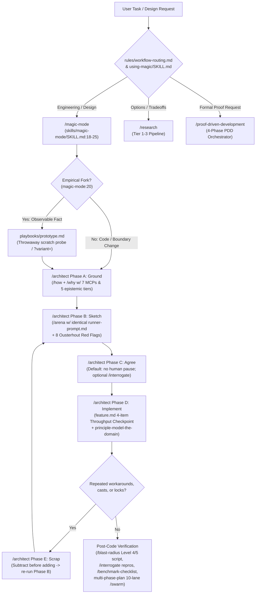
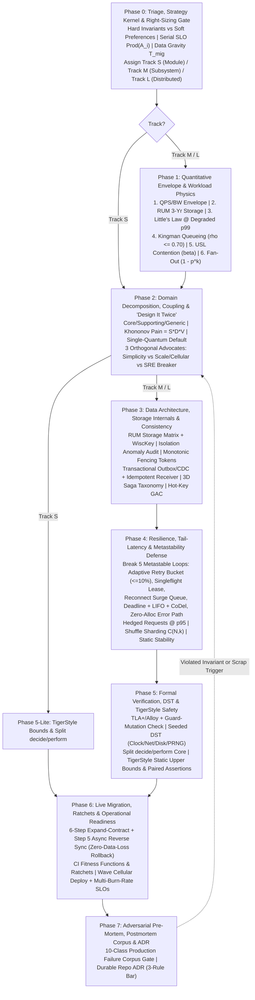

# Kit System Design Audit, Optimal Process & Augmentation Blueprint

This synthesis audits the current `magic` kit's system design process (`/agent/repos/.agents`), contrasts it against an unbiased, research-backed 8-phase Staff/Principal system design process (derived with zero local repository access), and provides a surgical file-by-file blueprint for upgrading existing skills without adding bloat. **Nearly every gap between the current kit and the optimal Staff+ system design process can be closed by augmenting existing skills (`/architect`, `/arena`, `/interrogate`, `/benchmark-checklist`, `/blast-radius`, `/magic-mode`, and `principle-*`) and folding in 4 patterns from `skills-disabled/mattpocock-2026-09-09/`, requiring zero new core workflow skills and at most one new reference file (`skills/architect/references/quantitative-envelope.md`).**

## Key findings

1. **The current `magic` kit excels at code-level module design, empirical prototyping, and post-hoc verification, but lacks quantitative pre-code system design gates.** `/architect` (`skills/architect/SKILL.md:10-81`) goes straight from qualitative grounding (`/how` + `/why`) to type/signature sketching in `/arena`, skipping back-of-the-envelope capacity math, storage-engine physics (RUM/WiscKey), distributed consistency/fencing, and metastability defense.
2. **Giving every `/arena` runner the identical prompt limits structural divergence.** `skills/arena/SKILL.md:14` and `skills/architect/references/runner-prompt.md:3-20` rely solely on cross-model variance (`magic-models`), whereas `skills-disabled/mattpocock-2026-09-09/codebase-design/DESIGN-IT-TWICE.md:20-29` forces genuinely orthogonal architectures by assigning distinct constraint axes per runner (e.g., Radical Simplicity / Single-Quantum vs. Disaggregated Scale & Cellular Isolation vs. Failure/Partition-First).
3. **`/interrogate` is structurally blind to pre-code design flaws unless paired with an executable model or pre-mortem rubric.** `skills/interrogate/SKILL.md:20-25` drops any finding not proven by a failing command against real code, which `docs/magic-guide/04-design.md:86` explicitly acknowledges makes `/interrogate` ineffective on pre-code architectural plans.
4. **Performance math and benchmarking happen only *after* code is written.** `skills/benchmark-checklist/SKILL.md:10-29` and `skills/principle-explain-the-number/SKILL.md:10-20` trigger *after* running a benchmark rather than enforcing a pre-design Quantitative Envelope (Little's Law at degraded $p99$, Kingman's $\rho \le 0.70$ knee, USL contention ceiling $\beta$, and tail-latency fan-out $1 - p^k$).
5. **Migration policy in the current kit is unsafe for stateful or distributed systems.** `skills/magic-mode/playbooks/refactoring.md:11` and `skills/principle-migrate-callers-then-delete-legacy-apis/SKILL.md:9-17` mandate deleting legacy APIs in the same wave with "no compatibility shims, no parallel old-and-new paths," which works for in-repo TypeScript callsites but causes downtime or data loss on stateful schemas, wire protocols, and multi-service cutovers that require the 6-step Expand-Contract + Reverse-Sync protocol.
6. **Formal verification exists in world-class depth (`/proof-driven-development`), but is disconnected from `/architect` and lacks TigerStyle code-safety bounds.** `skills/proof-driven-development/SKILL.md:1-137` is only triggered when a user explicitly asks for formal proofs (`rules/workflow-routing.md:13`), rather than `/architect` automatically routing stateful/concurrent Track M/L designs to lightweight TLA+/Alloy model checking, Deterministic Simulation Testing (DST), and TigerStyle static bounds.

---

## Part 1 — Audit of Current `magic` System Design Process

The current `magic` kit routes design work through `/magic-mode` (`skills/magic-mode/SKILL.md:18-25`), combining evidence-backed grounding (`/how`, `/why`), throwaway empirical probes (`playbooks/prototype.md`), multi-model type sketching (`/architect` + `/arena`), and runtime verification (`/blast-radius`, `/interrogate`, `/proof-driven-development`).

The table below catalogs every active skill and playbook that participates in the current kit's system design workflow.

| Stage | Active Skill / Playbook | Exact Mechanism in Repository | Core Strength |
| --- | --- | --- | --- |
| **Routing & Triage** | `rules/workflow-routing.md:1-19`, `skills/magic-mode/SKILL.md:18-37` | Routes nontrivial tasks to `/how`, empirical forks to `playbooks/prototype.md`, boundary-crossing code to `/architect`, and multi-PR work to `playbooks/multi-phase-plan.md` or `/figure-it-out`. | Prevents blocking on the human for observable facts (`magic-mode/SKILL.md:20`). |
| **Grounding & Lineage** | `skills/how/SKILL.md:1-39`, `skills/why/SKILL.md:1-101`, `skills/why/references/epistemics.md:1-74` | Parallel explorers explain current architecture (`/how`); up to 7 parallel MCP investigators reconstruct historical intent across 5 epistemic tiers (`Direct` to `Unknown`) plus a Preserve/Change/Avoid/Risk table (`/why`). | Eliminates Chesterton's Fence errors before redesigning existing subsystems. |
| **Empirical Prototyping** | `skills/magic-mode/playbooks/prototype.md:1-18` | Throwaway scratch implementation comparing variants behind a single switcher before committing to production types. | Converts architectural debates into cheap runtime observations (`docs/magic-guide/04-design.md:74-86`). |
| **Interface & Module Sketching** | `skills/architect/SKILL.md:1-82`, `references/runner-prompt.md:1-21`, `references/design-red-flags.md:1-56`, `references/rationale-template.md:1-38` | Caller-usage-first README sketch, core data structures, `not implemented` signatures, screened against 8 Ousterhout/agent-drift red flags (`design-red-flags.md:1-56`). | Optimizes strongly for deep modules, boundary discipline, and local agent safety. |
| **Multi-Model Bakeoff** | `skills/arena/SKILL.md:1-50` | Spawns $N$ model-diverse runners with the *same prompt* (`arena/SKILL.md:14`), runs a non-parent-family read-only cross-judge (`:28`), picks a base (`:32`), and grafts 1–2 loser ideas (`:38`). | Avoids single-model local optima and preserves one coherent mental model during grafting. |
| **Decomposition & Execution** | `skills/magic-mode/playbooks/feature.md:5-11`, `refactoring.md:1-17`, `multi-phase-plan.md:1-155`, `skills/figure-it-out/SKILL.md:1-54` | 4-item Throughput Checkpoint (`Blocking first steps`, `Independent workstreams`, `Shared mutable state`, `Smallest safe decomposition`) and `scripts/check-plan.mjs:1-205` mechanical plan linter. | Enforces verifiable sequencing (`principle-sequence-verifiable-units`) and structural plan linting. |
| **Formal & Runtime Verification** | `skills/proof-driven-development/SKILL.md:1-137`, `skills/blast-radius/SKILL.md:1-54`, `skills/interrogate/SKILL.md:1-38`, `skills/benchmark-checklist/SKILL.md:1-43`, `skills/correct/SKILL.md:1-36` | 4-phase formal verification (`*Trace.tla`, Lean 4 `OracleMain`, Verus/Kani/Loom, `verify-spec-lock.mjs`), Level 4/5 blast-radius scripts, multi-model exploit repros (`/interrogate`), 7-question perf vetting, and 4-tier structural mistake elimination (`/correct`). | High epistemic bar: requires runnable repros, spec-mutation kill gates, and AST contract locks. |

---

## Part 2 — The Unbiased Optimal Staff+ System Design Process

Derived independently from primary industry research (Ousterhout, Kleppmann & Riccomini, Khononov, Ford & Richards, Helland, Bronson et al. HotOS '21, Brooker, Dean & Barroso, Gunther USL, Kingsbury/Jepsen, Newcombe et al. AWS TLA+, FoundationDB/TigerBeetle DST, and `napkin-math`), the optimal Staff+ system design process is an **8-phase gated feedback loop (Phases 0–7)** with a **Right-Sizing Track Matrix (Tracks S / M / L)**.

The table below defines each of the 8 phases, its mathematical or structural gate, and its required exit artifact.

| Phase | Core Decision Frameworks & Equations | Hard Gate (Must Pass Before Proceeding) | Exit Artifact |
| --- | --- | --- | --- |
| **Phase 0: Triage, Strategy Kernel & Right-Sizing** | Rumelt Strategy Kernel (Diagnosis, Guiding Policy, Coherent Actions); Conway's Law check; Serial Availability $A_{\text{serial}} = \prod_{i=1}^n A_i \ge \text{SLO}$; Data Gravity $T_{\text{migration}} = \frac{D_{\text{bytes}} \times WA}{B_{\text{sustained}} \times (1 - \rho_{\text{prod}})}$. | Reject serial sync chains where $\prod A_i < \text{SLO}$; classify as Type-1 One-Way Door if $T_{\text{migration}} > \text{RTO}$; select **Track S** (Phases 0, 2, 5-Lite, 6), **Track M** (Phases 0–4, 6, 7-Lite), or **Track L** (All Phases 0–7). | 1-page Problem Charter + Track Selection (`S`/`M`/`L`). |
| **Phase 1: Quantitative Envelope & Workload Physics** | 6 deterministic equations against 2026 `napkin-math` constants: (1) Peak $QPS$/BW, (2) 3-yr storage $S_{\text{total}}(t)$ with $WA/SA$, (3) Little's Law $L_{\max} = \lambda_{\text{peak}} \times W_{\text{degraded } p99}$, (4) Kingman's $E(W_q)$ with $\rho \le 0.70$, (5) USL $C(N)$ with retrograde ceiling $N_{\max} = \lfloor\sqrt{(1-\alpha)/\beta}\rfloor$, (6) Fan-out tail $P(\text{Root} > T) = 1 - p^k$. | No unverified mental arithmetic; pool sizes must hold at $10\times$ degraded downstream $p99$; steady-state utilization $\rho \le 0.70$; cross-node coherency $\beta$ bounded before adding workers. | Executed Python/Node capacity script + Bottleneck Table. |
| **Phase 2: Domain Decomposition & "Design It Twice"** | DDD Subdomain typing (Core/Supporting/Generic); Khononov Coupling Balance $\text{Balanced} = (S \oplus D) \lor \neg V$ and $\text{Pain} = S \times D \times V$; Ousterhout Module Depth; Ford & Richards Quantum Count; **3-Advocate Orthogonal Bakeoff** (Advocate 1: Single-Quantum Simplicity vs. Advocate 2: Disaggregated/Cellular Scale vs. Advocate 3: Red-Team Breaker). | **Single-Quantum Modular Monolith default** unless independent scaling, fault isolation, or team cognitive boundary proves distributed tax is justified; high-$S \times D \times V$ boundary rejected. | Bounded Context Map + 2 Orthogonal Sketches + Coupling Matrix. |
| **Phase 3: Data Architecture, Storage & Consistency** | RUM Conjecture (Read/Update/Memory) storage matrix + *WiscKey* KV blob separation ($>1\text{ KB}$); Isolation Anomaly Audit (Write Skew/Phantom under SI vs. SSI/CAS); Linearizable `ReadIndex`/Clock-Bound Wait; **Monotonic Fencing Tokens** (`generation_clock` checked by storage); Helland Inside/Outside data (**Transactional Outbox + CDC** + Idempotent Receiver $T_{\text{TTL}} \ge T_{\text{retry}} + T_{\text{DLQ}}$); Ford's **3D Saga Taxonomy**; Hot-key skew ($\max/\text{mean}$) & Global Admission Control. | Zero uncoordinated dual-writes across storage/queue boundaries; zero unfenced distributed locks/leases; explicit isolation level and compensation semantics for every multi-step workflow. | Data & Consistency Spec + Isolation/Fencing Table. |
| **Phase 4: Resilience, Tail-Latency & Metastability** | Break **5 Metastable Failure Loops** (Bronson HotOS '21): (1) Retry storms ($\le 10\%$ client adaptive retry token bucket + single-layer retry + full jitter), (2) Cache stampedes (`singleflight` lease + soft-TTL), (3) Reconnect/TLS storms (surge queue + rate limit), (4) Queue expiration (deadline propagation + bounded LIFO + CoDel), (5) Slow/allocating error paths; Tail-latency hedging at $p95$; **Shuffle Sharding** $\binom{N}{k}$; **Static Stability** & **Constant Work**. | Every positive-feedback amplification loop has an explicit, mathematically bounded circuit breaker; data plane operates across 100% control-plane outage; fallback paths continuously exercised. | Metastability Matrix + Blast-Radius & Hedging Spec. |
| **Phase 5: Formal Verification, DST & TigerStyle** | Lightweight TLA+/Alloy state machine + **Guard-Mutation Check**; Seeded Deterministic Simulation Testing (DST) over virtual `Clock`/`Network`/`Disk`/`PRNG(seed)`; **Split `decide`/`perform` Architecture** (pure state machine vs. I/O shell); **TigerStyle Safety Gate** (static upper bounds on every loop/queue/batch/map, explicit units in identifiers `timeout_ms`, paired assertions). | Zero unbounded queues, loops, or retries; every state invariant survives guard-mutation checks and seeded fault-injection simulation before distributed plumbing ships. | TLA+/Alloy Model + DST Seed Harness + TigerStyle Checklist. |
| **Phase 6: Live Migration, Ratchets & Operability** | **6-Step Zero-Downtime Expand-Contract Protocol**: (1) Expand, (2) Dual-Write + version-guarded idempotent backfill, (3) Shadow Dark-Read Parity ($0$ diffs), (4) Progressive Read Cutover, (5) **Write Cutover WITH Async Reverse Sync to Old Store** (zero-data-loss rollback during bake window), (6) Contract; CI Fitness Functions & Auto-Decrementing Ratchets; Wave Cellular Rollout + Multi-Burn-Rate SLOs ($14.4\times$/$6\times$). | Step 5 Write Cutover is forbidden unless reverse sync back to the old store is active or rollback data loss is explicitly waived; legacy callers enforced via auto-decrementing CI ratchet. | 6-Step Cutover Runbook + CI Ratchet Script + SLO Alert Spec. |
| **Phase 7: Pre-Mortem, Postmortem Corpus & ADR** | **10-Class Production Postmortem Corpus Stress-Test** (bad config push, $100\times$ gray failure, retry storm, cold-cache stampede, poison pill, NTP backward clock jump, zombie leader split-brain, compaction/TXID stall, FD/port/DNS exhaustion, $N-1/N+1$ wire skew); Concise repo ADR when the 3-rule bar holds (Hard to reverse + Surprising + Real tradeoff). | Design must name the exact mechanism that bounds blast radius and recovery time for each applicable postmortem class without human heroics. | Completed 10-Class Corpus Table + Committed `docs/adr/NNNN-*.md`. |

---

## Part 3 — Structured Phase-by-Phase Diff (`Current Kit` vs. `Optimal Staff+ Process`)

The head-to-head comparison below maps each phase of the optimal Staff+ process against what exists today in `/agent/repos/.agents`, exposing the exact structural gaps and contradictions.

| Phase / Dimension | What Matches / Exists Today in `.agents` | What Is Missing or Contradicts Today in `.agents` | Severity / Impact |
| --- | --- | --- | --- |
| **Phase 0: Triage, Strategy Kernel & Right-Sizing (Tracks S / M / L)** | `magic-mode/SKILL.md:18` requires restating the user's goal, problem, and smallest change; `figure-it-out/SKILL.md:20-23` scales rigor to one-way doors and requires a falsifiable done predicate; `/why` (`skills/why/SKILL.md:95`) produces a Preserve/Change/Avoid/Risk table. | **No Right-Sizing Track Matrix (`S`/`M`/`L`)** inside `/architect`: a local TypeScript interface and a distributed storage service run the exact same `runner-prompt.md`. **No Strategy Kernel**, **no serial availability math** ($\prod A_i \ge \text{SLO}$), and **no Data Gravity / Reversibility equation** ($T_{\text{migration}} > \text{RTO}$) to mathematically classify Type-1 vs. Type-2 doors. | **High** — Over-ceremonializes small changes or severely under-specifies distributed/stateful systems. |
| **Phase 1: Quantitative Envelope & Workload Physics** | `benchmark-checklist/SKILL.md:23` Question 3 ("Did it break limits?") checks disk/network bandwidth and Amdahl's Law *after* a benchmark is run; `principle-explain-the-number/SKILL.md:10-20` requires naming the physical limiter for measured numbers. | **Zero pre-code quantitative envelope in `/architect`.** None of the 6 core capacity equations exist in the design flow: (1) 2026 `napkin-math` physical constants, (2) RUM 3-year storage sizing with $WA/SA$, (3) Little's Law at **degraded $p99$ latency** (prevents pool exhaustion), (4) Kingman's queueing knee ($\rho \le 0.70$), (5) USL contention/coherency ($\alpha,\beta$), or (6) Fan-out tail amplification ($1 - p^k$). | **Critical** — Designs pass `/architect` with unbounded pools, $p50$-sized concurrency, or serial fan-outs that collapse under tail latency. |
| **Phase 2: Domain Decomposition, Coupling & "Design It Twice"** | `architect/SKILL.md:34-39` enforces Ousterhout interface depth and "Design it twice" via `/arena`; `architect/references/design-red-flags.md:1-56` screens 8 Ousterhout/agent-drift red flags; `principle-model-the-domain/SKILL.md:10-28` prevents temporal decomposition; `skills-disabled/.../domain-modeling` and `DESIGN-IT-TWICE.md` exist in disabled storage. | **1. Same-prompt homogeneity:** `arena/SKILL.md:14` gives every runner the *exact same prompt*, losing the orthogonal constraint forcing in `skills-disabled/.../DESIGN-IT-TWICE.md:20-29`. **2. No Khononov Coupling Balance ($\text{Pain} = S \times D \times V$) or Architectural Quantum check** (no explicit Single-Quantum Modular Monolith default). **3. `CONTEXT.md` ubiquitous glossary checks** (`skills-disabled/.../domain-modeling/SKILL.md:42-65`) are disabled. | **High** — `/arena` runners from different model families often converge on flavors of the same architecture instead of exploring genuinely orthogonal points on the Pareto frontier. |
| **Phase 3: Data Architecture, Storage Internals & Consistency** | `runner-prompt.md:10,12,17` tells runners to "trace each dominant access pattern," "default to per-actor state with a merge at the read boundary" (`principle-separate-before-serializing-shared-state`), and use "idempotent state transitions" (`principle-make-operations-idempotent`). | **No storage-engine or distributed consistency rigor in `/architect`:** missing RUM storage matrix (B-Tree vs. LSM vs. S3-LSM vs. Log + *WiscKey* blob separation), missing **Isolation Anomaly Audit** (Write Skew under Snapshot Isolation vs. SSI/CAS), missing **Monotonic Fencing Tokens** on leases/locks, missing **Transactional Outbox/CDC** ban on dual-writes, missing **3D Saga Taxonomy**, and missing **Hot-Key Skew / Global Admission Control**. | **Critical** — The largest blind spot in the kit for backend/infrastructure work; `runner-prompt.md` treats data structures purely as in-memory types rather than durable storage and distributed state. |
| **Phase 4: Resilience, Tail-Latency & Metastability Defense** | `why/SKILL.md:56` inspects `incident-postmortem.md` when existing code has retries/timeouts; `blast-radius/SKILL.md:1-54` checks multi-hop failure propagation on diffs. | **Zero metastability or overload engineering in `/architect`:** none of the **5 Metastable Failure Loops** (Bronson HotOS '21) are checked during design (retry-storm $\le 10\%$ adaptive token buckets + single-layer retry, cache-stampede `singleflight` leases, reconnect surge queues, deadline propagation + LIFO + CoDel load shedding, zero-alloc error paths). Missing **hedged/tied requests**, **Shuffle Sharding** $\binom{N}{k}$, **Static Stability** (data plane surviving control-plane death), and **Constant Work**. | **Critical** — Agents routinely design naive multi-layer retries, unbounded FIFO queues, and dynamically fetched control-plane dependencies that trigger cascading production outages. |
| **Phase 5: Formal Verification, DST & TigerStyle Safety** | **World-class formal verification suite:** `/proof-driven-development` (`SKILL.md:1-137`), `/model-checking-protocols-and-code` (`*Trace.tla`, Loom/Shuttle, Kani/Miri), `/proving-with-hoare-logic` (Verus/Dafny + **Split `decide`/`perform` architecture** at lines 32–45), `/proving-with-dependent-types` (Lean 4 `OracleMain`), `/auditing-proof-specifications` (Gates A/B/C + `verify-spec-lock.mjs`), and `/statechart`. | **1. Routing disconnect:** `/architect` never invokes `/model-checking-protocols-and-code` or the Split `decide`/`perform` pattern from `/proving-with-hoare-logic:32-45` unless the user explicitly asks for formal verification. **2. Missing Deterministic Simulation Testing (DST)** with injectable virtual `Clock`/`Network`/`Disk`/`PRNG(seed)` in standard TypeScript/Go/Python/Rust services. **3. Missing TigerStyle Safety Gate** (`TIGER_STYLE.md`: static upper bounds on all loops/queues/batches, explicit units in variable names `timeout_ms`, paired assertions). | **High** — The kit already owns the hardest parts of Phase 5, but leaves them siloed in `/proof-driven-development` instead of wiring their lightweight forms into `/architect`. |
| **Phase 6: Live Migration, Evolutionary Ratchets & Operability** | `multi-phase-plan.md:11-18,64-129` enforces 10-lane `/swarm` live verification + interleaved trunk-vs-head perf verification; `correct/SKILL.md:20-25` mentions failing CI only when a change adds more of a legacy pattern. | **Direct contradiction on migrations:** `refactoring.md:11` and `principle-migrate-callers-then-delete-legacy-apis/SKILL.md:9-17` mandate *"migrate every caller and delete the old API in the same wave. No compatibility shims, no parallel old-and-new paths."* That is fatal for live DB schemas, wire contracts, and persistent state, which require the **6-Step Expand-Contract + Step 5 Async Reverse Sync** protocol. Also missing **Multi-Window Multi-Burn-Rate SLOs** and **Hindsight Trace Sampling**. | **Critical (Contradiction)** — Applying `refactoring.md:11` to a database column, RPC field, or event schema breaks rolling deploys ($N-1/N+1$) and destroys rollback safety. |
| **Phase 7: Pre-Mortem, Postmortem Corpus & ADR Synthesis** | `/interrogate` (`skills/interrogate/SKILL.md:1-38`) runs multi-model adversarial review in isolated worktrees; `architect/references/rationale-template.md:1-38` produces a 1-page design rationale; `skills-disabled/.../domain-modeling/ADR-FORMAT.md` defines the 3-rule ADR bar. | **1. `/interrogate` fails on pre-code designs** (`docs/magic-guide/04-design.md:86`) because it drops any finding not proven by a failing command against real code, and lacks the **10-Class Postmortem Corpus Stress-Test**. **2. Ephemeral rationale:** `rationale-template.md` is not persisted as a numbered `docs/adr/NNNN-*.md` when a Type-1 One-Way Door is crossed. | **High** — Pre-code architectural blind spots (gray failures, zombie leaders, NTP clock jumps, TXID/compaction stalls, $N-1/N+1$ wire skew) slip past `/interrogate` until production. |
| **4 AI Workflow Modes (Socratic / Generative / Analytical / Adversarial)** | Generative (`/arena` + `/architect`), Analytical (`/how`, `/why`, `/blast-radius`, `/proof-driven-development`), and Post-Code Adversarial (`/interrogate`) are all first-class. | **Socratic Design-Tree Frontier Grilling** (`skills-disabled/mattpocock-2026-09-09/grilling/SKILL.md:1-33`) is disabled, leaving no structured multi-round requirement-sharpening mode when a user asks to stress-test an ambiguous system design before coding. | **Medium** — When product/architecture invariants are genuinely ambiguous, the agent lacks the dependency-ordered frontier interview pattern. |

---

## Part 4 — Concrete Recommendations: How to Augment Existing Skills vs. What to Add

Following your constraint strictly—**modify and augment existing skills in `/agent/repos/.agents/skills/` wherever possible, fold in the best patterns from `skills-disabled/mattpocock-2026-09-09/`, and avoid adding new top-level skills unless a gap cannot be cleanly solved inside an existing skill**—here is the complete architectural recommendation.

```mermaid
flowchart LR
    subgraph Existing["1. Augment Existing Core Skills (Primary Path)"]
        A1["skills/architect/SKILL.md\n+ Phase 0 Right-Sizing (Track S/M/L)\n+ Phase A2 Quantitative Envelope (Track M/L)\n+ Phase B Orthogonal Axes & Coupling Check\n+ Phase C2 TLA+/DST/TigerStyle Gate\n+ Phase F ADR Persistence (3-Rule Bar)"]
        A2["skills/architect/references/\n- runner-prompt.md (Add Track M/L Data, Metastability, TigerStyle, Split decide/perform)\n- design-red-flags.md (+6 Distributed/Storage/Metastability Red Flags)\n- rationale-template.md (+Envelope, Coupling, Consistency/Fencing, Rollback/Cutover)\n- NEW: quantitative-envelope.md (6 Equations + 2026 Napkin Constants)"]
        A3["skills/arena/SKILL.md\n+ Support orthogonal per-runner constraint axes\n(Simplicity vs Scale/Cellular vs Breaker)"]
        A4["skills/interrogate/SKILL.md\n+ Pre-Code Design Mode: executable Envelope/TLA+/DST probes\n+ 10-Class Postmortem Corpus Stress-Test"]
        A5["skills/magic-mode/playbooks/refactoring.md &\nprinciple-migrate-callers-then-delete-legacy-apis\n+ Carve out Stateful/Wire/Schema 6-Step Expand-Contract + Reverse Sync"]
        A6["skills/benchmark-checklist/SKILL.md &\nskills/blast-radius/SKILL.md &\nskills/correct/SKILL.md\n+ Pre-design capacity mode, Shuffle Sharding/Metastability check, Auto-decrementing CI ratchets"]
    end

    subgraph Disabled["2. Fold In From skills-disabled/mattpocock-2026-09-09/ (Zero New Skills)"]
        D1["codebase-design/DESIGN-IT-TWICE.md\n-> Fold orthogonal runner axes into /arena & /architect"]
        D2["domain-modeling/ (CONTEXT.md + 3-Rule ADR)\n-> Fold into /architect Phase A & Phase C/Outputs"]
        D3["prototype/LOGIC.md (Pure reducer harness)\n-> Fold into playbooks/prototype.md & /architect"]
        D4["grilling/SKILL.md (Design-Tree Frontier)\n-> Fold into /architect Phase C (when checkpoint/grill requested)"]
    end

    Disabled --> Existing
```

### 4.1 Skill-by-Skill Augmentation Specification (Existing Files in `/agent/repos/.agents/skills/`)

Every gap in Part 3 maps cleanly into an existing skill or reference file below.

| Target File in `.agents` | Phases Closed | Exact Edits & Additions to Make |
| --- | --- | --- |
| **`skills/architect/SKILL.md`** (`:10-82`) | Phases 0, 1, 2, 3, 4, 5, 6, 7 | **1. Add Phase 0 (Triage & Right-Sizing Track Selection) before Phase A:** Classify work into **Track S** (Localized module/type change $\rightarrow$ current fast flow + TigerStyle bounds), **Track M** (Subsystem / new table, index, lock, queue, cross-module contract $\rightarrow$ adds Quantitative Envelope + Data/Consistency + Metastability + Expand-Contract), or **Track L** (New service/quantum, storage engine, consistency shift, $>10\times$ scale $\rightarrow$ full rigor + lightweight TLA+/DST + 10-class corpus + repo ADR). Include the Data Gravity equation ($T_{\text{migration}} > \text{RTO} \implies$ Type-1 One-Way Door) and Serial SLO check ($\prod A_i \ge \text{SLO}$). **2. Augment Phase A (Ground):** Read `CONTEXT.md` / `CONTEXT-MAP.md` if present (`skills-disabled/.../domain-modeling/SKILL.md:12-65`). For Track M/L, require executing a 20-line quantitative envelope script per new reference `references/quantitative-envelope.md`. **3. Augment Phase B (Sketch):** Pass **orthogonal constraint axes** to `/arena` runners for Track M/L (Runner 1: *Single-Quantum Deep Module / Radical Simplicity*; Runner 2: *Disaggregated Scale, Cellular Isolation & Explicit Quotas*; Runner 3: *Failure, Partition, Skew & Metastability First*) instead of identical prompts. **4. Augment Phase C (Agree):** Support opt-in Socratic Design-Tree Frontier grilling (`skills-disabled/.../grilling/SKILL.md:5-33`) when requirements are under-specified; for Track L stateful/concurrent designs, route core state transitions to `/model-checking-protocols-and-code` (TLA+/Alloy) or a seeded DST harness before Phase D. **5. Augment Outputs (`:79-82`):** When the 3-rule ADR bar holds (*Hard to reverse* + *Surprising without context* + *Real tradeoff*), persist the rationale to `docs/adr/NNNN-<slug>.md`. |
| **`skills/architect/references/runner-prompt.md`** (`:1-21`) | Phases 2, 3, 4, 5 | Add 5 bullets to the runner discipline: - **Coupling balance & quantum discipline:** Evaluate Khononov's $\text{Pain} = S \times D \times V$; default to a **Single-Quantum Modular Monolith** unless independent scaling, fault isolation, or team boundary justifies a network hop. - **Split `decide`/`perform` core:** Separate pure, deterministic state-transition logic (`decide(state, event) -> (State, Effects[])`, zero I/O, testable with a seeded PRNG/virtual clock) from the imperative I/O shell (`perform`), matching `skills/proving-with-hoare-logic/SKILL.md:32-45` and `skills-disabled/.../prototype/LOGIC.md`. - **Storage & consistency explicitness (Track M/L):** Name the storage structure along the RUM spectrum (B-Tree vs. LSM vs. Log vs. Lakehouse + *WiscKey* blob separation $>1\text{ KB}$), exact SQL/storage isolation level (auditing for Snapshot Isolation write skew), **monotonic fencing tokens** on every lease/lock/worker, and **Transactional Outbox/CDC** (zero uncoordinated dual-writes). - **Metastability breakers (Track M/L):** Bound retries with a client-side adaptive retry token bucket ($\le 10\%$ overhead) and single-layer retry + full jitter; guard hot cache keys with `singleflight`/leases; propagate deadlines and shed load via bounded LIFO/CoDel; keep error paths allocation-free; ensure **Static Stability** (data plane works when control plane is down). - **TigerStyle bounds (All Tracks):** Put explicit static upper bounds on every loop, queue, batch, query, and in-memory map; put explicit units in every variable/field name (`timeout_ms`, `max_payload_bytes`, `lease_ttl_sec`); pair positive and negative assertions at module boundaries. |
| **`skills/architect/references/design-red-flags.md`** (`:1-56`) | Phases 2, 3, 4, 5, 6 | Keep all 8 existing code/module red flags and append **6 System & Distributed Red Flags** for Track M/L screening: 1. **High-$S \times D \times V$ distributed boundary** (intrusive contract across a network/service hop in a high-volatility core subdomain — *Distributed Monolith*). 2. **Uncoordinated dual-write** (updating a DB and publishing to a queue/cache/API without a Transactional Outbox, CDC log, or idempotent saga). 3. **Unfenced lease or Time-of-Check-to-Time-of-Use (TOCTOU) lock** (distributed worker or lock holder writing to storage without a storage-verified monotonic fencing token). 4. **Unbounded queue, loop, retry, or fan-out** (violates TigerStyle static bounds or creates a Bronson HotOS '21 metastable retry/queue storm). 5. **Control-plane dependency on the hot data path** (breaks AWS Static Stability when control plane or config store is unreachable). 6. **One-way write cutover without reverse sync** (switching primary writes to a new store/schema without async reverse replication back to the old store during the bake window). |
| **`skills/architect/references/rationale-template.md`** (`:1-38`) | Phases 0, 1, 2, 3, 4, 6, 7 | Augment the template sections so Track M/L rationales (and repo ADRs) remain 1–2 pages while covering: - Under `## Problem`: add **Strategy Kernel & Hard Invariants** (RPO/RTO, latency/availability SLO $\prod A_i$, Track `S`/`M`/`L`, and Data Gravity $T_{\text{migration}}$). - Under `## Shape`: add a compact **Quantitative Envelope & Coupling Table** (for Track M/L: Peak $QPS$/BW, Little's Law pool size at degraded $p99$, Kingman $\rho \le 0.70$, USL $\beta$, Khononov $S \times D \times V$, Storage isolation & Fencing token, Metastability breakers). - Under `## Next implementation step`: for stateful/wire/schema changes, require naming the **6-Step Expand-Contract + Reverse-Sync Cutover Plan**. |
| **`skills/architect/references/quantitative-envelope.md`** *(New Reference File inside `/architect`)* | Phase 1 | Add a concise 1-page reference file inside `skills/architect/references/` containing the **6 mandatory Phase 1 equations** (Peak $QPS$/BW, 3-Year RUM Storage with $WA/SA$, Little's Law at degraded $p99$, Kingman's Queueing approximation $\rho \le 0.70$, USL $C(N)$ retrograde ceiling, and Tail-Latency Fan-Out $1 - p^k$) plus the **2026 `napkin-math` physical constants table** and a 25-line runnable Node/Python calculator template. |
| **`skills/arena/SKILL.md`** (`:12-26`) | Phase 2 | In **Phase A: Frame** (`arena/SKILL.md:14`), relax *"Every candidate gets the same prompt"* by adding an explicit **Orthogonal Constraint Axes option**: when `/arena` is invoked for architectural design (`/architect` Track M/L or `/arena` with design directions), allow passing the shared problem contract plus a **per-runner design constraint axis** (from `skills-disabled/.../DESIGN-IT-TWICE.md:20-29`: e.g., Axis 1: *Minimize interface & quantum count*; Axis 2: *Maximize throughput, cellular isolation & independent scaling*; Axis 3: *Optimize for failure recovery, partition tolerance & zero-data-loss rollback*). Keep the shared rubric in Phase C/D so the cross-judge evaluates all axes fairly. |
| **`skills/interrogate/SKILL.md`** (`:15-28`) | Phases 4, 5, 7 | Add a **Pre-Code Design & Architecture Mode** alongside the existing code-diff mode so `/interrogate` works on designs and plans (`docs/magic-guide/04-design.md:86`): 1. When the target is a design sketch, RFC, or `multi-phase-plan.md`, adversaries prove findings by running **quantitative failure probes** (a 20-line script showing Little's Law pool exhaustion under $10\times$ degraded $p99$, Kingman queue explosion, retry-storm amplification, or fan-out tail violation) or **state-space counterexamples** (a minimal TLA+/Alloy or Python/Node state-machine repro demonstrating write skew, unfenced zombie-leader overwrite, dual-write partial failure, or $N-1/N+1$ rolling-deploy wire breakage). 2. Equip adversaries with the **10-Class Production Postmortem Corpus Checklist** (bad global config push, $100\times$ gray failure, retry/reconnect storm, cold-cache stampede, poison pill, NTP backward clock jump, zombie leader split-brain, compaction/TXID stall, FD/ephemeral port/DNS exhaustion, $N-1/N+1$ wire incompatibility). |
| **`skills/magic-mode/playbooks/refactoring.md`** (`:11`) & **`skills/principle-migrate-callers-then-delete-legacy-apis/SKILL.md`** (`:1-18`) | Phase 6 | Resolve the Phase 6 contradiction by distinguishing **In-Repo Synchronous Callers** from **Stateful / Persisted / Cross-Service Boundaries**: - Keep *"migrate every caller and delete the old API in the same wave; no shims"* strictly for **in-memory, single-deploy-unit internal code**. - Add an explicit rule: **Whenever a change touches persisted schemas, storage formats, queues, public/cross-service RPCs, or rolling $N-1/N+1$ deployments, same-wave deletion is forbidden.** Route instead to the **6-Step Zero-Downtime Expand-Contract Protocol**: (1) Expand, (2) Dual-Write + version-guarded idempotent backfill, (3) Shadow Dark-Read Parity ($0$ diffs), (4) Progressive Read Cutover, (5) **Write Cutover WITH Async Reverse Sync back to the old store** (preserving zero-data-loss rollback during the bake window), and (6) Contract gated by an auto-decrementing CI ratchet. |
| **`skills/benchmark-checklist/SKILL.md`** (`:10-29`) & **`skills/principle-explain-the-number/SKILL.md`** (`:10-20`) | Phase 1 | Add a **"Before You Design (Envelope Mode)"** section to `benchmark-checklist/SKILL.md:14` that links to `skills/architect/references/quantitative-envelope.md`, and add Question 8 to the checklist: **"How does it behave at the knee ($\rho > 0.70$) and under $p99/p99.9$ tail amplification?"** (checking open-loop vs. closed-loop coordinated omission, Kingman queueing delay, and USL contention $\beta$). |
| **`skills/blast-radius/SKILL.md`** (`:32-40`) | Phases 3, 4, 6 | Augment Step 3 ("Look where grep stops", `:35`) with 3 explicit distributed/system checks: (1) **$N-1 / N+1$ Mixed-Version Rolling Deploy skew** (new writer $\rightarrow$ old reader and old writer $\rightarrow$ new reader), (2) **Metastable amplification loops** (does this diff add a retry, cache invalidation, reconnect, or fallback path that multiplies load during partial degradation?), and (3) **Tenant blast-radius math** (single shared queue/pool vs. cellular / Shuffle Sharding $\binom{N}{k}$ isolation). |
| **`skills/correct/SKILL.md`** (`:20-25`) | Phase 6 | Under Level 1/2 enforcement (`correct/SKILL.md:20-21`), add two concrete architectural fitness patterns: (1) **Module Boundary / Acyclicity Check** (e.g., `dependency-cruiser` from `skills-disabled/.../setup-ts-deep-modules/dependency-cruiser.config.cjs` or custom import-graph test forbidding cyclic dependencies and deep-internal imports), and (2) **Auto-Decrementing Migration Ratchet** (`MAX_ALLOWED_LEGACY_CALLERS` counter in CI that ratchets down automatically and fails if incremented). |
| **`skills/principle-make-operations-idempotent/SKILL.md`** (`:1-25`) & **`skills/principle-separate-before-serializing-shared-state/SKILL.md`** (`:1-21`) | Phase 3 | - In `principle-make-operations-idempotent/SKILL.md:16`: add **Monotonic Fencing Tokens** (Kleppmann — every lease/lock/worker carries a monotonically increasing epoch/token validated by the storage engine so zombie processes cannot corrupt state) and **Idempotency Key TTL sizing** ($T_{\text{TTL}} \ge T_{\text{max\_retry\_window}} + T_{\text{DLQ\_replay\_window}}$) + **Transactional Outbox / CDC**. - In `principle-separate-before-serializing-shared-state/SKILL.md:18`: add **USL Coherency ($\beta$) & Hot-Key Partition Skew ($\max/\text{mean}$)** (key-salting $K$ sub-keys for writes + read-combining, or CRDT/local batching when shared state cannot be eliminated). |

---

### 4.2 Disposition of Disabled Skills (`skills-disabled/mattpocock-2026-09-09/`) and External Skills

Rather than re-enabling the 10 disabled Matt Pocock skills as separate competing slash commands or installing heavy external skill packs, fold their high-leverage mechanisms directly into the existing `magic` skills as shown below.

| Disabled or External Skill | Verdict | Why & Exact Target in Existing `.agents` Kit |
| --- | --- | --- |
| `skills-disabled/.../codebase-design/DESIGN-IT-TWICE.md` | **Fold into `/arena` & `/architect` (Do NOT enable separately)** | `/architect` + `/arena` already own parallel design exploration (`architect/SKILL.md:30-40`). Folding its **per-runner orthogonal constraint axes** (`DESIGN-IT-TWICE.md:20-29`) into `arena/SKILL.md:14` and `architect/SKILL.md:34` upgrades `/architect` without creating a duplicate design skill. |
| `skills-disabled/.../domain-modeling/` (`SKILL.md`, `CONTEXT-FORMAT.md`, `ADR-FORMAT.md`) | **Fold into `/architect` (Do NOT enable separately)** | Add a 3-line rule to `architect/SKILL.md` Phase A (read/challenge `CONTEXT.md` & `CONTEXT-MAP.md` glossary terms) and Phase C/Outputs (write `docs/adr/NNNN-*.md` using the 3-rule ADR bar from `domain-modeling/SKILL.md:67-75`). |
| `skills-disabled/.../grilling/SKILL.md` & `grill-with-docs/SKILL.md` | **Fold into `/architect` Phase C (Optional checkpoint mode)** | When a user invokes `/architect with checkpoint` or asks to "grill me on this design," use `grilling/SKILL.md:5-33`'s **Design-Tree Frontier** protocol (dispatch subagents for codebase facts; ask only the unblocked decision frontier with recommended answers). |
| `skills-disabled/.../prototype/LOGIC.md` & `UI.md` | **Already 80% in `playbooks/prototype.md`; fold the remaining 20%** | `UI.md`'s `?variant=` switcher is already in `playbooks/prototype.md:10`. Fold `LOGIC.md`'s **pure reducer / zero-I/O terminal harness** pattern into `playbooks/prototype.md:8` and `architect/references/runner-prompt.md` as the lightweight Track S/M form of Split `decide`/`perform`. |
| `skills-disabled/.../setup-ts-deep-modules/dependency-cruiser.config.cjs` | **Fold into `/correct` as a reference template** | `correct/SKILL.md:20-21` already mandates enforcing module boundaries in CI. Moving `dependency-cruiser.config.cjs` into `skills/correct/references/` gives `/correct` a ready-to-drop AST boundary linter for TS/JS repos. |
| `skills-disabled/.../improve-codebase-architecture`, `to-spec`, `wayfinder` | **Keep Disabled** | Fully superseded by `playbooks/refactoring.md`, `playbooks/multi-phase-plan.md` (`scripts/check-plan.mjs`), and `/how` + `/why`. |
| **External:** `paralin/tla-skill`, `beagle-team/lean4-skills`, `autoharness` | **Skip (Do NOT install)** | `/proof-driven-development` + `/model-checking-protocols-and-code` + `/proving-with-dependent-types` + `/auditing-proof-specifications` + `/statechart` in this kit are already substantially more rigorous (3-Gate validation, `*Trace.tla`, persistent `OracleMain`, `verify-spec-lock.mjs`, `check-proof-cheats.mjs`). |
| **External:** `sirupsen/napkin-math` physical constants & scripts | **Embed as `skills/architect/references/quantitative-envelope.md`** | High-value gap filler for Phase 1, best embedded directly as a reference table + 25-line script template inside `/architect` rather than an external dependency. |
| **External:** `clickhouse-architecture-advisor` & `clickhouse-best-practices` | **Already available in environment (`$5/clickhouse-*`)** | Already mounted as plugin skills for OLAP-specific workloads; no changes needed in `.agents/skills/`. |
| **External:** `@crayon-c4/mcp` (C4 model MCP) or `tt-a1i/archify` | **Skip by default (Optional MCP only if org standardizes on C4)** | Mermaid architecture, sequence, and statechart diagrams (`magic-mode/SKILL.md:110`, `statechart/SKILL.md:1-86`) plus committed `docs/adr/` files already provide clean, git-native documentation without extra MCP ceremony. |

---

## Sources

- **Repository Skills & Playbooks (`/agent/repos/.agents`):**
  - `rules/workflow-routing.md:1-19`
  - `skills/magic-mode/SKILL.md:1-154`
  - `skills/magic-mode/playbooks/feature.md:1-21`
  - `skills/magic-mode/playbooks/refactoring.md:1-17`
  - `skills/magic-mode/playbooks/multi-phase-plan.md:1-155` & `skills/magic-mode/scripts/check-plan.mjs:1-205`
  - `skills/magic-mode/playbooks/prototype.md:1-18`
  - `skills/architect/SKILL.md:1-82`, `skills/architect/references/runner-prompt.md:1-21`, `skills/architect/references/design-red-flags.md:1-56`, `skills/architect/references/rationale-template.md:1-38`
  - `skills/arena/SKILL.md:1-50`
  - `skills/interrogate/SKILL.md:1-38`
  - `skills/how/SKILL.md:1-39` & `skills/why/SKILL.md:1-101` (`references/epistemics.md:1-74`)
  - `skills/blast-radius/SKILL.md:1-54`
  - `skills/benchmark-checklist/SKILL.md:1-43`
  - `skills/correct/SKILL.md:1-36`
  - `skills/figure-it-out/SKILL.md:1-54`
  - `skills/proof-driven-development/SKILL.md:1-137`, `skills/proving-with-hoare-logic/SKILL.md:1-171`, `skills/model-checking-protocols-and-code/SKILL.md:1-168`, `skills/auditing-proof-specifications/SKILL.md:1-108`, `skills/statechart/SKILL.md:1-86`
  - `skills/principle-explain-the-number/SKILL.md:1-21`, `skills/principle-make-operations-idempotent/SKILL.md:1-25`, `skills/principle-separate-before-serializing-shared-state/SKILL.md:1-21`, `skills/principle-foundational-thinking/SKILL.md:1-23`, `skills/principle-model-the-domain/SKILL.md:1-28`, `skills/principle-migrate-callers-then-delete-legacy-apis/SKILL.md:1-18`
  - `docs/magic-guide/04-design.md:1-132`
  - `skills-disabled/mattpocock-2026-09-09/codebase-design/DESIGN-IT-TWICE.md:1-45`, `domain-modeling/SKILL.md:1-76`, `grilling/SKILL.md:1-33`, `prototype/LOGIC.md`, `setup-ts-deep-modules/dependency-cruiser.config.cjs`
- **Primary System Design Research Corpus:**
  - [Full System Design Resources & AI Skills Report](./system-design-resources-and-ai-skills.md)

## TL;DR

The current `magic` kit is already elite at code-level module design (`/architect` + `/arena`), empirical prototyping (`playbooks/prototype.md`), lineage grounding (`/how` + `/why`), and formal verification (`/proof-driven-development`), but lacks pre-code quantitative capacity math, storage/consistency/fencing gates, metastability defenses, pre-code adversarial stress-testing, and safe stateful migration protocols (where `refactoring.md:11`'s ban on parallel paths actively contradicts zero-downtime Expand-Contract + Reverse Sync). All of these gaps can be closed with **zero new top-level workflow skills** by augmenting `/architect` (adding Track S/M/L right-sizing, a `references/quantitative-envelope.md` script gate, 6 distributed/storage red flags, TigerStyle bounds, and automatic routing to lightweight TLA+/DST), enabling orthogonal constraint axes in `/arena`, adding pre-code Envelope/TLA+ probes and the 10-class postmortem corpus to `/interrogate`, and carving out the 6-step Expand-Contract + Reverse-Sync protocol in `refactoring.md` and `principle-migrate-callers-then-delete-legacy-apis`.
