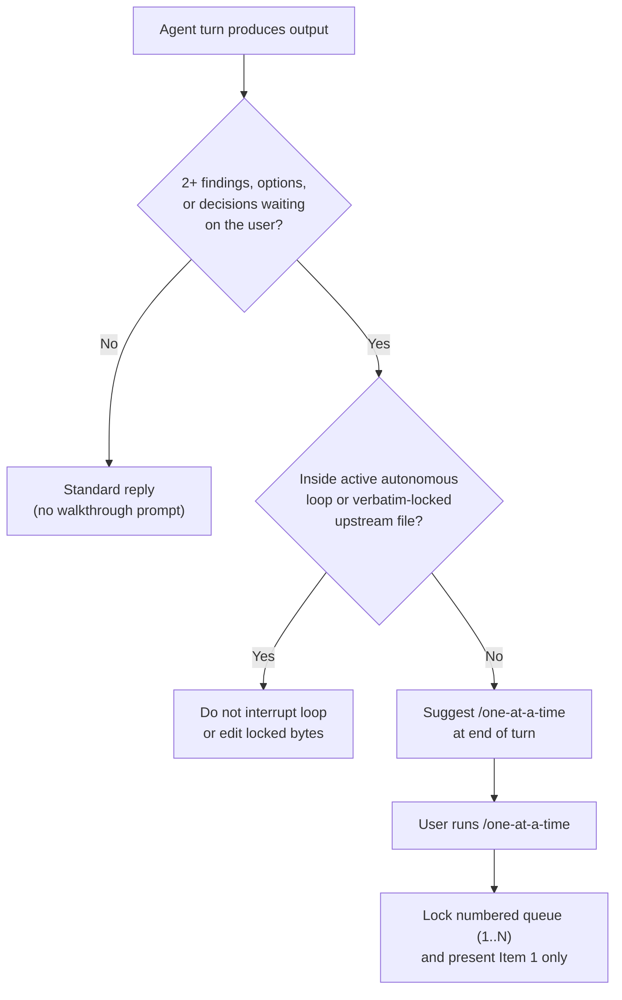

# Where `/one-at-a-time` belongs in the `magic` kit

**Triage.** Tier 2 (`research` standard workflow) across 3 independent threads covering review and verification skills, research and planning skills, and `magic-mode` playbooks and catalog contracts.

The user wants a skill (`/one-at-a-time`) that walks through a batch of findings, recommendations, or open decisions one item per turn, waiting for an explicit decision on the current item before advancing to the next. They also want existing kit skills and playbooks to suggest `/one-at-a-time` whenever a turn returns multiple findings or decisions for the human to adjudicate.

## Step-back alignment check

Applying [`principle-take-a-step-back`](../../skills/principle-take-a-step-back/SKILL.md) across the kit's 75 existing skills and 23 playbooks reveals three structural constraints that govern where `/one-at-a-time` should and should not be wired:

- **Interactive handoff vs. autonomous execution.** Under `magic-mode` Autonomy (`skills/magic-mode/SKILL.md:85-89`) and [`principle-never-block-on-the-human`](../../skills/principle-never-block-on-the-human/SKILL.md), agents do not pause mid-execution on reversible work or inside autonomous loops (`playbooks/autonomous-run.md`, `playbooks/autopilot-full.md`, `playbooks/orchestrate.md`). Suggesting `/one-at-a-time` belongs only at **interactive turn boundaries** where a skill or playbook hands multiple findings, trade-offs, or action items back to the human and already waits for their direction.
- **Upstream byte-preservation locks.** Five skill paths in the repository are locked to upstream bytes and must not be edited: `skills/make-pr-easy-to-review/SKILL.md` and `skills/thermo-nuclear-code-quality-review/SKILL.md` in `scripts/magic-verbatim.txt:5-6` (`tests/magic-sync.test.mjs:132,161-162`), plus `skills/writing-skills/`, `skills/writing-plans/`, and `skills/subagent-driven-development/` in `THIRD-PARTY-NOTICES.md:3-11` (`scripts/validate.sh:168-169`).
- **Central reply rule vs. leaf skill prompts.** Wiring a concise rule in `skills/magic-mode/SKILL.md` under `## Writing the reply` covers all 23 playbooks by default whenever a reply surfaces two or more open decisions, trade-offs, or escalated findings, while targeted 1-line additions in the high-signal multi-finding skills and playbooks cover standalone invocations.

## Tier 1 strong-fit wiring targets

These 15 files end an interactive turn by presenting a table or list of findings, design trade-offs, approval rows, or escalated questions where the human must make per-item calls before work continues.

| Target file | Section and lines | Multi-finding output returned to the user | Wiring recommendation |
| --- | --- | --- | --- |
| `skills/magic-mode/SKILL.md` | `## Writing the reply` (`107-121`) | Any playbook reply that ends with 2+ open decisions, design alternatives, or escalated review-bot items | Add a bullet rule stating that when a reply leaves 2 or more open decisions, trade-offs, or findings waiting on the user, offer `/one-at-a-time` so they can resolve them one by one. |
| `skills/interrogate/SKILL.md` | `## Output` (`29-36`) | Verified adversarial findings table (`Finding`, `Command`, `Adversaries`, `How It Breaks Intent`) where fixes are intentionally withheld (`line 10`) | Suggest `/one-at-a-time` in `## Output` when 2 or more verified findings survive so the user can decide how to handle each finding sequentially. |
| `skills/blast-radius/SKILL.md` | `## What to hand back` (`41-52`) | `Risks & Cleared Surfaces` table plus `Before you merge` checklist | Suggest `/one-at-a-time` when 2 or more confirmed risk surfaces or pre-merge actions require user decisions. |
| `skills/reflect/SKILL.md` | `## 5. Apply` (`42-46`) and `## 6. Summarize for the user` (`59-67`) | Synthesizer `Accepted / Rejected / Backlog` proposals that explicitly wait for row-by-row user approval (`line 44`) | Suggest `/one-at-a-time` in `## 5. Apply` when multiple `Accepted` or `Backlog` proposals need row-by-row approval or routing changes. |
| `skills/reflect/references/synthesizer.md` | `# Accepted` (`42-50`) | Synthesizer output table whose footer states `"One row per finding. The user approves row by row."` (`line 50`) | Append a cue on line 50 noting the user can run `/one-at-a-time` to approve or redirect each row one by one. |
| `skills/ketchup/SKILL.md` | `## Write the reply` (`22-35`) | Action items and calls waiting on the user (merges, approvals, product choices, option trade-offs) | Suggest `/one-at-a-time` after the action items when 2 or more calls wait on the user. |
| `skills/ketchup-video/SKILL.md` | Body (`11`) | Same action items block rendered beneath the subtitled catch-up video | Note that when 2 or more waiting calls are listed under the video, the reply offers `/one-at-a-time`. |
| `skills/autopilot/SKILL.md` | `## Exit & Wrap-Up Contract` (`150-167`) | Item 3 (`Paused Plan Asks / Escalations`) and Item 2 (`Triaged Items Breakdown`) when autopilot pauses or exits with multiple `pause-plan` or over-budget blockers | Suggest `/one-at-a-time` when exiting or pausing with 2 or more `pause-plan` asks or escalated review threads. |
| `skills/research/SKILL.md` | Tier 2 (`70-75`), Tier 3 (`136-139`), and `## Guardrails` (`161-165`) | Multi-thread research synthesis, option comparisons, and open questions or gaps | Suggest `/one-at-a-time` when the research summary surfaces 2 or more open questions, competing options, or recommended next steps. |
| `agents/research-synthesizer/agent.md` | `## Open questions / next steps` (`68-69`) and `## TL;DR` (`74-75`) | Tier 3 synthesized findings, comparison tables, conflicts, and open questions | Add a 1-line rule to suggest `/one-at-a-time` in `## TL;DR` when 2 or more open questions or option choices remain for the user. |
| `skills/research-summary/SKILL.md` | `## Open questions` (`61-63`), `## Next steps` (`65-68`), and `## TL;DR` (`74-76`) | Head-to-head comparison table (2 to 5 options), open questions, and 3 to 6 checkbox next steps | Suggest `/one-at-a-time` in `## TL;DR` when multiple open questions, options, or next-step checkboxes need user decisions. |
| `skills/architect/SKILL.md` & `references/rationale-template.md` | Phase C (`SKILL.md:45`), `Outputs` (`SKILL.md:77-80`), and `## Open questions and risks` (`rationale-template.md:29-31`) | Design trade-offs, alternatives considered, and open questions phrased for the human to resolve before or after implementation | Suggest `/one-at-a-time` at the Phase C checkpoint and in `rationale-template.md` when 2 or more design questions or trade-offs need user sign-off. |
| `skills/swarm/SKILL.md` | `## Phase D - Report` (`40-42`) | Consolidated worker results table plus one-line bullets for every proven `ISSUES` defect and verification gap | Suggest `/one-at-a-time` in Phase D when 2 or more issues or gaps are reported so the user can triage them one by one. |
| `skills/writing-rules/SKILL.md` | `## Output Format When Presenting Rule Changes` (`205-213`) | `Four-Gate Triage Table` classifying multiple candidate instructions across `Structure`, `No-Op`, `Skill`, `Project Rule`, and `Kit Rule` | Suggest `/one-at-a-time` when presenting 2 or more triaged rule candidates or drafted rules for approval. |
| `skills/magic-mode/playbooks/investigation.md`, `prototype.md`, `babysit.md`, & `references/review-bot-triage.md` | `investigation.md:9,14`, `prototype.md:12,14`, `babysit.md:20-21`, `review-bot-triage.md:11,76-85` | Multi-option investigation tables, prototype variant comparisons, and `ask`-bucket review-bot or security-review escalations | Suggest `/one-at-a-time` when an investigation, prototype comparison, or babysit pass surfaces 2 or more open decisions or `ask` escalations. |

## Tier 2 optional-fit skills

These 7 skills occasionally end with multiple findings or open questions depending on the run outcome. They benefit from either a light conditional mention or coverage via `magic-mode`'s general reply rule.

| Target file | Section and lines | When multiple findings arise | Assessment |
| --- | --- | --- | --- |
| `skills/auditing-proof-specifications/SKILL.md` | `## The Four Remaining Proof Gaps` (`24-26`) and `## Red Flags` (`99-107`) | When a proof audit reports multiple `FAIL` or `BOUNDED/DOCUMENTED` gaps across the four categories | Wire a conditional mention when 2 or more gaps fail or require scope decisions. |
| `skills/show-me-your-work/SKILL.md` | `## Cross-model review of the trail` (`66-74`) | When the cross-model reviewer raises multiple flags in the end-of-run `Attention` section | Wire a conditional mention under `## Cross-model review of the trail` when 2 or more `Attention` flags are listed. |
| `skills/figure-it-out/SKILL.md` | `## Phase A - Frame` (`24`) and `## Phase E - Verify and hand back` (`53`) | At the pre-run framing checkpoint or when multiple items remain in `"what's still open"` | Wire a brief mention in Phase A and Phase E when multiple open framing calls or residual items remain. |
| `skills/why/SKILL.md` | `## 5. Shape the output` (`96`) | When `/why` runs before a code change and outputs a `Preserve / Change / Avoid / Risk` table with multiple contested constraints | Covered when run under `magic-mode`; optional standalone mention on line 96. |
| `skills/recall/SKILL.md` | `## Output` (`29-32`) | Lists multiple active threads and up to 5 recurring bugs, though line 32 deliberately narrows to `"the single most useful next action"` | Keep `recall` focused on its single next action; no edit needed. |
| `skills/arena/SKILL.md` | `## Outputs` (`46-49`) | Reports synthesized winner plus grafted and rejected candidate parts | `arena` is designed for autonomous base selection and grafting; no edit needed. |
| `skills/maintain-verification-skill/SKILL.md` & `maintain-formal-verification-skill/SKILL.md` | `maintain-verification-skill:36-38`, `maintain-formal-verification-skill:48-59` | When live maintenance uncovers multiple product bugs or formal counterexamples outside the verification PR | Covered by `magic-mode` reply rules; optional in `maintain-formal-verification-skill` `## Report`. |

## Tier 3 files that must not be wired

| File or group | Reason not to wire | Evidence |
| --- | --- | --- |
| `skills/make-pr-easy-to-review/SKILL.md` and `skills/thermo-nuclear-code-quality-review/SKILL.md` | Locked to upstream wording in `scripts/magic-verbatim.txt` and tested for upstream byte preservation | `scripts/magic-verbatim.txt:5-6`, `tests/magic-sync.test.mjs:132,161-162` |
| `skills/writing-skills/`, `skills/writing-plans/`, and `skills/subagent-driven-development/` | Vendored without content changes from `obra/superpowers` under MIT provenance rules and excluded from `validate.sh` cross-reference checks | `THIRD-PARTY-NOTICES.md:3-11`, `scripts/validate.sh:168-169` |
| `skills/magic-mode/playbooks/autonomous-run.md`, `autopilot-full.md`, `autopilot-stack.md`, `orchestrate.md`, `hillclimb.md`, `shipping.md` | Autonomous execution and merge loops that must not pause mid-run on reversible work | `skills/magic-mode/playbooks/autonomous-run.md:9-13` |
| `skills/correct/SKILL.md` and `skills/no-comments/SKILL.md` | Act directly on findings during the turn (committing fixes or stripping comments) rather than handing back an unacted triage list | `skills/correct/SKILL.md:25-33`, `skills/no-comments/SKILL.md:24-25` |
| `skills/how/SKILL.md`, `skills/teach/SKILL.md`, `skills/in-your-own-words/SKILL.md`, `skills/sharpen/SKILL.md`, `skills/bro/SKILL.md`, `skills/benchmark-checklist/SKILL.md` | Single-verdict, single-prompt, or explanatory mental-model skills without multi-item decision queues | `skills/how/SKILL.md:10`, `skills/teach/SKILL.md:10-16`, `skills/benchmark-checklist/SKILL.md:30-37` |

## Kit registration, catalog, and test touchpoints

Adding `skills/one-at-a-time/SKILL.md` requires updating the following inventory and test files so `./scripts/validate.sh` and `node --test tests/*.test.mjs` pass:

| File | Required update | Verification gate |
| --- | --- | --- |
| `docs/CATALOG.md` | Increment `75 active skills` (`50 workflow/domain skills`) to `76 active skills` (`51 workflow/domain skills`) at lines `3` and `37`, and add `/one-at-a-time` under **Alignment & Prompting** | `tests/writing-rules.test.mjs`, `lychee` |
| `README.md` | Increment `75 active skills` (`50 workflow/domain skills`) to `76 active skills` (`51 workflow/domain skills`) at line `136` | `tests/version-sync.test.mjs` |
| `skills/magic-help/SKILL.md` & `references/recipes.md` & `references/prompting.md` | Add `/one-at-a-time` to the `## Pick a skill` table (`SKILL.md:67-116`), `Close calls:` (`SKILL.md:120-127`), `recipes.md`, and `prompting.md` | `tests/magic-sync.test.mjs:111-129`, `scripts/validate.sh` |
| `docs/magic-guide/10-recipes-and-pitfalls.md` | Add a short recipe section showing how to invoke `/one-at-a-time` when a review or chat turn returns a long list of findings | `markdownlint-cli2`, `lychee` |
| `tests/opencode-and-pi-plugins.test.mjs` | Update hardcoded skill count assertions from `75` to `76` (`lines 147, 157, 181`) and `survived.length` from `74` to `75` (`line 258`) | `node --test tests/opencode-and-pi-plugins.test.mjs` |
| `tests/magic-sync.test.mjs` | Add `"/one-at-a-time"` to `customSkill` list (`lines 111-129`) and add a test verifying `/one-at-a-time` contract and kit wiring | `node --test tests/magic-sync.test.mjs` |

## Sources

- `skills/magic-mode/SKILL.md` (`lines 20, 35, 85-89, 107-121`)
- `skills/magic-mode/playbooks/investigation.md`, `prototype.md`, `babysit.md`, `autonomous-run.md`, `autopilot-full.md`, `orchestrate.md`
- `skills/magic-mode/references/review-bot-triage.md` (`lines 11, 76-85`)
- `skills/interrogate/SKILL.md` (`lines 10, 29-36`)
- `skills/blast-radius/SKILL.md` (`lines 41-52`)
- `skills/reflect/SKILL.md` (`lines 42-67`) and `skills/reflect/references/synthesizer.md` (`lines 42-50`)
- `skills/ketchup/SKILL.md` (`lines 18-35`) and `skills/ketchup-video/SKILL.md` (`line 11`)
- `skills/autopilot/SKILL.md` (`lines 140-167`)
- `skills/research/SKILL.md` (`lines 69-75, 132-165`), `skills/research-summary/SKILL.md` (`lines 61-76`), and `agents/research-synthesizer/agent.md` (`lines 65-76`)
- `skills/architect/SKILL.md` (`lines 41-54, 77-80`) and `skills/architect/references/rationale-template.md` (`lines 29-31`)
- `skills/swarm/SKILL.md` (`lines 31, 40-42`), `skills/writing-rules/SKILL.md` (`lines 205-213`), `skills/auditing-proof-specifications/SKILL.md` (`lines 24-26, 99-107`), `skills/show-me-your-work/SKILL.md` (`lines 66-74`), and `skills/figure-it-out/SKILL.md` (`lines 24, 53`)
- `scripts/magic-verbatim.txt`, `scripts/validate.sh`, `THIRD-PARTY-NOTICES.md`, `docs/CATALOG.md`, `README.md`, and `tests/opencode-and-pi-plugins.test.mjs`

## TL;DR

Wire `/one-at-a-time` into `skills/magic-mode/SKILL.md` (`Writing the reply`) and the 14 interactive multi-finding skills, playbooks, and synthesis templates (`interrogate`, `blast-radius`, `reflect`, `ketchup`, `ketchup-video`, `autopilot`, `research`, `research-synthesizer`, `research-summary`, `architect`, `swarm`, `writing-rules`, `auditing-proof-specifications`, `show-me-your-work`, `figure-it-out`, plus `investigation`, `prototype`, `babysit`, and `review-bot-triage`), while leaving verbatim-locked upstream files (`make-pr-easy-to-review`, `thermo-nuclear-code-quality-review`, `writing-plans`, `subagent-driven-development`) and mid-loop autonomous playbooks untouched.
