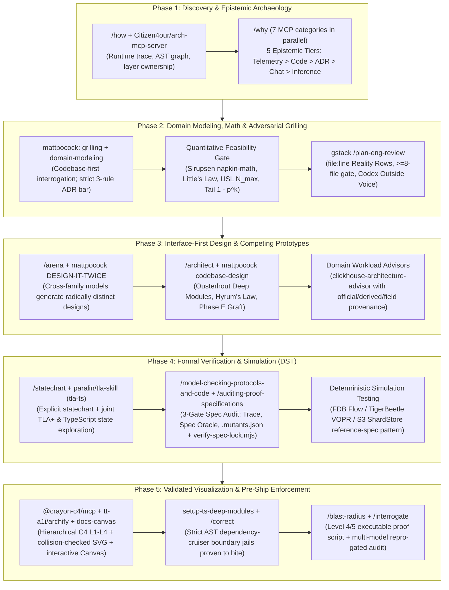

# Staff/Principal System Design Resources & AI Architecture Skills (2026)

This synthesis audits [`vasanthk/485d1c25737e8e72759f`](https://gist.github.com/vasanthk/485d1c25737e8e72759f) ("System Design Cheatsheet") alongside its open-source lineage, curates the canonical Staff/Principal-grade books, papers, pattern libraries, simulation tools, and postmortem corpora through 2026, and evaluates modern AI agent skills and MCP servers for software architecture. While 2010–2015 interview cheat sheets teach static box-and-arrow vocabulary for L4/L5 loops, L6–L8 system design requires quantitative failure physics (tail amplification, metastability, Universal Scalability Law), disaggregated cloud-native internals, socio-technical alignment, and executable AI workflows that enforce Ousterhout module depth, multi-model competing designs, and model-checked state machines.

## Key findings

1. **The `vasanthk` Gist is an unattributed 2010–2011 collage with factual errors and 15-year-old stack anachronisms.** Its 151 lines paste verbatim excerpts from HiredInTech, Will Larson's 2011 blog, Palantir's 2011 interview guide, and a broken TechTarget blurb that falsely defines database replication as "normalization" (`System Design.md:5-97`).
2. **Two of the Gist's seven footer links still hold enduring architectural signal while five are introductory or dated.** Kate Matsudaira's AOSA chapter (collapsed forwarding, health-check overload cascades) and Will Larson's 2011 essay (smart-client vs. hybrid HAProxy load balancing, platform layer decoupling) remain foundational, whereas `lecloud.net` is dead (HTTP 500) and the LiveJournal/MapReduce notes reflect 2000s constraints ([AOSA Vol. 2](https://aosabook.org/en/v2/distsys.html), [Lethain](https://lethain.com/introduction-to-architecting-systems-for-scale/)).
3. **L4/L5 interview prep diverges from L6–L8 Staff/Principal architecture across eight operational dimensions.** Staff+ design shifts from static block diagrams to tail-latency amplification math ($1 - 0.99^{50} \approx 39.5\%$), metastable retry-storm defense ($3^K$ work amplification), strict serializability vs. linearizability, cell-based shuffle sharding ($\binom{n}{k}$), 4-step expand-contract live migrations, FinOps unit economics, Conway's Law alignment, and burn-rate SLOs ([The Tail at Scale](https://www.barroso.org/publications/TheTailAtScale.pdf), [HotOS 2021 Metastable Failures](https://sigops.org/s/conferences/hotos/2021/papers/hotos21-s11-bronson.pdf)).
4. **Recent 2024–2026 book editions overhaul classic distributed systems and modularity guidance for cloud-native reality.** *Designing Data-Intensive Applications, 2nd Ed.* (2026) adds object-storage disaggregation (SlateDB/WAL-on-S3), lakehouses, and CRDTs, while Khononov's *Balancing Coupling* (2024), *Fundamentals of Software Architecture, 2nd Ed.* (2025), and *Team Topologies, 2nd Ed.* (2025) formalize modular monoliths, coupling math, and platform groupings ([DDIA 2e](https://martin.kleppmann.com/2026/03/24/designing-data-intensive-applications-2e.html), [Balancing Coupling](https://coupling.dev/)).
5. **Production systems papers frequently refute the simplified mental models taught by their own predecessors.** The 2022 Amazon DynamoDB paper shows production DynamoDB abandoned the 2007 Dynamo paper's sloppy quorums and vector clocks in favor of Multi-Paxos, B-tree + log storage, and Global Admission Control, just as Bailis's *HAT, not CAP* refutes using CAP as an excuse to drop ACID guarantees ([DynamoDB ATC '22](https://www.usenix.org/system/files/atc22-elhemali.pdf), [HAT VLDB '13](https://vldb.org/pvldb/vol7/p181-bailis.pdf)).
6. **Deterministic Simulation Testing (DST) and lightweight formal verification have replaced Jepsen-after-the-fact as the gold standard for stateful design.** FoundationDB's `flow`, TigerBeetle's VOPR (`TIGER_STYLE.md`), Antithesis, and Amazon S3's `ShardStore` (SOSP 2021 Best Paper) prove that deterministic pseudo-random fault injection and property-based reference models catch multi-fault concurrency bugs before production ([FDB SIGMOD '21](https://www.foundationdb.org/files/fdb-paper.pdf), [ShardStore SOSP '21](https://jamesbornholt.com/papers/shardstore-sosp21.pdf), [TIGER_STYLE.md](https://github.com/tigerbeetle/tigerbeetle/blob/main/docs/TIGER_STYLE.md)).
7. **AI system design skills bifurcate sharply between single-shot "architecture theater" and contract-locked, adversarial engineering playbooks.** Low-signal skills emit unverified Mermaid diagrams and MADR boilerplate in one pass, whereas Staff-grade skills enforce codebase grounding (`/how`, `/why`, `/plan-eng-review`), Ousterhout interface depth (`/architect`, `codebase-design`), cross-family competing designs (`/arena`), AST-locked model checking (`/auditing-proof-specifications`, `paralin/tla-skill`), and runnable blast-radius scripts (`/blast-radius`, `setup-ts-deep-modules`) (`skills/architect/SKILL.md:1-81`, `skills/blast-radius/SKILL.md:1-54`).

## Comparison / Architecture (tables & visualizations)

The tables and lifecycle diagram below audit the `vasanthk` Gist, contrast L4/L5 interview prep with L6–L8 Staff+ practice, catalog the highest-signal literature and practitioner resources, and map AI agent skills across the seven phases of system design.

### 1. Audit of `vasanthk/485d1c25737e8e72759f` & Its 7 Linked Resources

This table evaluates the Gist itself, each of its seven footer links, and its four major open-source successors.

| Resource / Link | Status & Provenance | Enduring Signal | Obsolete / Erroneous Content | Staff+ Verdict |
| --- | --- | --- | --- | --- |
| [`vasanthk/485d1c25737e8e72759f`](https://gist.github.com/vasanthk/485d1c25737e8e72759f) (`System Design.md:1-151`) | Live (~2015, rev. Sept 2022); unattributed collage of HiredInTech, Will Larson (2011), TechTarget, and Palantir (2011) | Epigraph (`System Design.md:3`); Will Larson's smart-client vs. hybrid LB tradeoff (`System Design.md:45`) | Line 60 falsely calls DB replication "normalization"; recommends Hadoop/Hive for SQL scale-out; lists Bower/Grunt/Sphinx; reduces security to `"CORS"` | **Retire as reference**; historical artifact only |
| 1. [HiredInTech System Design](http://www.hiredintech.com/system-design/) | Live; copied verbatim into `System Design.md:5-36` | Clean 4-step structure for 45-min whiteboard scoping (constraints, abstract design, bottlenecks, scaling) | Zero operational depth, failure physics, or data-consistency rigor | **Junior/Mid interview intro only** |
| 2. `lecloud.net/tagged/scalability` ([Archive](https://web.archive.org/web/20210309191656/http://www.lecloud.net/tagged/scalability) / [Mirror](https://cs.fyi/guide/scalability-for-dummies)) | **Dead (HTTP 500)**; Sebastian Kreutz's 4-part *Scalability for Dummies* | Clear distinction between caching raw SQL strings vs. assembled domain objects (Part 3); pre-computation vs. queues (Part 4) | Treats NoSQL simply as "denormalized MySQL without joins"; ignores cache stampedes and consistency | **Basic primer** (read via mirror only if needed) |
| 3. [Will Larson — *Introduction to Architecting Systems for Scale*](https://lethain.com/introduction-to-architecting-systems-for-scale/) (2011) | Live; source of `System Design.md:42-76` and both embedded PNG diagrams | Smart-client vs. hardware vs. hybrid HAProxy load balancing; decoupling apps via a Platform Layer | 2011 batch tooling specifics (Hadoop MapReduce as default offline store) | **Keep** for platform-decoupling & LB mental models |
| 4. [Ricky Ho — *Scalable System Design Patterns*](http://horicky.blogspot.com/2010/10/scalable-system-design-patterns.html) (2010) | Live; 8 distributed compute topologies | Concise taxonomy of Scatter-Gather, Blackboard/Shared Space, BSP (Pregel), and DAG Orchestrator (Dryad) | Pre-dates modern stream engines (Flink), lakehouses, and disaggregated storage | **Keep** as a quick distributed topology taxonomy |
| 5. [Kate Matsudaira — *Scalable Web Architecture and Distributed Systems*](https://aosabook.org/en/v2/distsys.html) (AOSA Vol. 2) | Live (redirected from `aosabook.org/en/distsys.html`) | **Highest-signal link in Gist**: teaches proxy **collapsed forwarding** (request coalescing) and how LB health checks trigger cascading overload failures | Minor 2012 tooling references | **Must-read primer** before diving into AWS Builders' Library |
| 6. [Byrne Reese — SE.SE Answer `108679`](https://softwareengineering.stackexchange.com/a/108679/62739) (2011) | Live (redirected from `programmers.stackexchange.com`) | First-hand LiveJournal/Six Apart war story: user-clustered sharding (`user_id` colocated on one shard) and Memcached discipline | Narrow key-value table advice was a workaround for 2000s MySQL table-locking `ALTER TABLE` (solved by `pt-online-schema-change` / `gh-ost` / instant DDL) | **Historical case study**; do not copy narrow-table anti-pattern |
| 7. [`vasanthk/how-web-works`](https://github.com/vasanthk/how-web-works) | Live GitHub repo | End-to-end trace of DNS, TCP/TLS handshake, HTTP/2 multiplexing, and browser DOM/CSSOM/Layout/Paint pipeline | Client-to-edge request lifecycle only; not backend distributed architecture | **Useful full-stack browser/network trace** |
| Lineage: [`donnemartin/system-design-primer`](https://github.com/donnemartin/system-design-primer), [`karanpratapsingh/system-design`](https://github.com/karanpratapsingh/system-design), [`ashishps1/awesome-system-design-resources`](https://github.com/ashishps1/awesome-system-design-resources) | Live GitHub repos (`donnemartin` credits `vasanthk` at `README.md:1821`) | Broad visual catalogs of standard components, algorithms (Leaky Bucket, Consistent Hashing, Quadtrees), and L5 interview prompts | Optimize for 45-minute whiteboard pattern-matching rather than production failure modes | **L4/L5 interview standard**; insufficient for Staff+ |
| Lineage Bridge: [`charlax/professional-programming`](https://github.com/charlax/professional-programming) | Live curated repository | Curates real-world engineering blogs, postmortems, socio-technical essays, and anti-complexity design | Broad software craftsmanship scope rather than a single structured curriculum | **Strongest open-source curation bridge** to Staff+ |

### 2. The 8-Dimension Gap: L4/L5 Cheat Sheets vs. L6–L8 Staff/Principal Architecture

This table contrasts how interview cheat sheets frame eight core architecture domains against the quantitative, operational, and organizational mechanics expected of a Staff, Principal, or Distinguished Engineer.

| Dimension | L4/L5 Cheat-Sheet Framing (`vasanthk` / Primers) | L6–L8 Staff/Principal Engineering Reality | Primary Staff+ Reference |
| --- | --- | --- | --- |
| **1. Latency & Fan-out** | "Add a Load Balancer (`Nginx`/`HAProxy`) in front of stateless clones." | **Tail-Latency Amplification**: 50-way parallel fan-out turns a $p99$ component glitch into $1 - 0.99^{50} \approx 39.5\%$ user requests hitting tail latency; requires deadline propagation, hedged/tied requests, and Little's Law adaptive concurrency limits. | [Dean & Barroso, *The Tail at Scale* (2013)](https://www.barroso.org/publications/TheTailAtScale.pdf) |
| **2. Caching & Overload** | "Put `Redis`/`Memcached` in front of the DB (`cache-aside`)." | **Metastability & Retry Storms**: Cache eviction or DB blips drop hit rate, saturating origin CPU; 3x retries across $K$ tiers cause $3^K$ work amplification that persists after the trigger clears; requires singleflight/collapsed forwarding, leases, full-jitter backoff, token-bucket **retry budgets** ($\le 10\%$), and LIFO/priority load shedding. | [Bronson et al., *Metastable Failures* (HotOS '21)](https://sigops.org/s/conferences/hotos/2021/papers/hotos21-s11-bronson.pdf); [Brooker, *Backoff & Jitter*](https://aws.amazon.com/builders-library/timeouts-retries-and-backoff-with-jitter/) |
| **3. Consistency & Consensus** | "Pick CP or AP (CAP theorem); use master-slave replication." | **Isolation vs. Recency**: Distinguishing **Linearizability** (single-object real-time recency via Raft/Paxos `ReadIndex`) from **Serializability** (multi-object transaction isolation) and **Strict Serializability** (Spanner TrueTime $2\epsilon$ commit-wait); preventing dual-write bugs via **Transactional Outbox + CDC** and stale-leader zombies via monotonic **fencing tokens**. | [Kleppmann & Riccomini, *DDIA 2e* (2026)](https://dataintensive.net/); [Spanner (OSDI '12)](https://static.googleusercontent.com/media/research.google.com/en//archive/spanner-osdi2012.pdf) |
| **4. Blast Radius & Multi-Tenancy** | "Eliminate single points of failure with active-passive failover." | **Cell-Based Architecture & Shuffle Sharding**: Partitioning infrastructure into independent self-contained cells; assigning each tenant to $k$ of $n$ workers provides $\binom{n}{k}$ virtual isolation (e.g., $\binom{8}{2} = 28$ combinations shrinks noisy-neighbor blast radius to $3.6\%$) alongside control-plane vs. data-plane **static stability**. | [MacCárthaigh, *Shuffle-Sharding*](https://aws.amazon.com/builders-library/workload-isolation-using-shuffle-sharding/); [Weiss & Furr, *Static Stability*](https://aws.amazon.com/builders-library/static-stability-using-availability-zones/) |
| **5. Live Evolution & Migrations** | Assumes greenfield schemas and clean microservice cuts. | **Expand-Contract / Parallel Change**: Zero-downtime 4-phase migrations: (1) Expand schema/API backward-compatibly + dual-write, (2) Throttled idempotent backfill, (3) Shadow-read verification with diff metrics, (4) Cutover reads + contract legacy state with an explicit rollback horizon. | [Larson, *Staff Engineer*](https://staffeng.com/book); [Ford et al., *Architecture: The Hard Parts*](https://www.oreilly.com/library/view/software-architecture-the/9781492086888/) |
| **6. FinOps & Unit Economics** | "Hardware load balancers cost $$$; software is free." | **Cloud Physics & Margin**: Cross-AZ network egress ($\$0.01\text{–}\$0.02/\text{GB}$ per hop) frequently dwarfs compute in chatty microservices; high-cardinality observability tags can exceed production DB spend; tiered storage (NVMe vs. EBS vs. S3 Express One Zone WAL) is modeled as cost per unit of business value. | [DDIA 2e (2026)](https://martin.kleppmann.com/2026/03/24/designing-data-intensive-applications-2e.html); [Sirupsen `napkin-math`](https://github.com/sirupsen/napkin-math) |
| **7. Socio-Technical Architecture** | Treats system topology as purely technical boxes and arrows. | **Conway's Law & Coupling Physics**: `Balance = (Strength XOR Distance) OR NOT Volatility`—high-strength coupling across distant team boundaries over volatile domains creates a distributed monolith; Staff+ engineers co-design team cognitive load, **Modular Monoliths**, and **Thinnest Viable Platforms (TVP)**. | [Khononov, *Balancing Coupling* (2024)](https://coupling.dev/); [Skelton & Pais, *Team Topologies 2e* (2025)](https://teamtopologies.com/books) |
| **8. Observability & Operations** | "Add logging and monitoring." | **SLOs, Burn Rates & Retroactive Tracing**: User-centric SLIs, error-budget policies, multi-window multi-burn-rate alerting, and **Hindsight/tail-based distributed tracing** (local ring buffers persisted only when a downstream span breaches latency/error thresholds). | [Google *SRE Workbook*](https://sre.google/books/); [Hindsight (NSDI '23)](https://www.usenix.org/system/files/nsdi23-zhang-lei.pdf) |

### 3. Definitive Books for Staff/Principal System Design (including 2024–2026 Editions)

This table curates the 15 foundational books across data internals, software modularity, and socio-technical execution.

| Category | Title, Author(s) & Edition | Core Mental Models | Architectural Failure Mode Prevented |
| --- | --- | --- | --- |
| **Data Systems & Internals** | [*Designing Data-Intensive Applications, 2nd Ed.*](https://martin.kleppmann.com/2026/03/24/designing-data-intensive-applications-2e.html) — Martin Kleppmann & Chris Riccomini (O'Reilly, 2026, ISBN `978-1098119065`) | Storage engines, replication, partitioning, weak isolation anomalies, consensus, stream processing, **disaggregated S3 storage (`SlateDB`), lakehouses (`Iceberg`), CRDTs** | Treating "ACID" or "eventual consistency" as binary checkboxes; dual-write bugs; ignoring object-storage latency physics |
| **Data Systems & Internals** | [*Database Internals*](https://www.databass.dev/) — Alex Petrov (O'Reilly, 2019) | Slotted pages, B-tree vs. LSM-tree compaction/write amplification, failure detectors, Paxos/Raft/Zab implementation | Picking a datastore by marketing benchmarks without understanding disk I/O and compaction stalls |
| **Data Systems & Internals** | [*Systems Performance, 2nd Ed.*](https://www.brendangregg.com/systems-performance-2nd-edition-book.html) — Brendan Gregg (Addison-Wesley, 2020) | **USE Method** (Utilization, Saturation, Errors), eBPF tracing, Flame Graphs, VFS/page cache, TCP/NVMe/NUMA queueing | "Streetlight anti-method" (scaling out nodes blindly when bottlenecked on kernel locks, GC, or NIC ring buffers) |
| **Data Systems & Internals** | [*Release It!, 2nd Ed.*](https://pragprog.com/titles/mnee2/release-it-second-edition/) — Michael T. Nygard (Pragmatic Bookshelf, 2018) | Bulkheads, Circuit Breakers, fail-fast timeouts, steady-state hygiene, deployment stability antipatterns | Cascading failure chains where one slow downstream dependency exhausts caller thread/connection pools |
| **Architecture & Modularity** | [*A Philosophy of Software Design, 2nd Ed.*](https://web.stanford.edu/~ouster/cgi-bin/books.php) — John Ousterhout (Yaknyam Press, 2021) | **Deep vs. Shallow Modules**, information hiding, pulling complexity downward, defining errors out of existence | Classitis/micro-service proliferation where tiny wrappers leak internal state across call chains |
| **Architecture & Modularity** | [*Fundamentals of Software Architecture, 2nd Ed.*](https://fundamentalsofsoftwarearchitecture.com/) — Mark Richards & Neal Ford (O'Reilly, 2025) | Architecture styles scorecard, **Modular Monoliths**, architectural quantum, **automated fitness functions**, AI integration | Architecture erosion over time because invariants live only in wiki diagrams rather than CI gates |
| **Architecture & Modularity** | [*Software Architecture: The Hard Parts*](https://www.oreilly.com/library/view/software-architecture-the/9781492086888/) — Ford, Richards, Sadalage & Dehghani (O'Reilly, 2021) | Service granularity disintegrators vs. integrators, database decomposition, **3D Saga Taxonomy** (consistency $\times$ communication $\times$ coordination) | Picking the wrong distributed workflow pattern (e.g., async choreography where synchronous orchestrated sagas are required) |
| **Architecture & Modularity** | [*Learning Domain-Driven Design*](https://vladikk.com/page/books/) — Vlad Khononov (O'Reilly, 2021) | **Core vs. Supporting vs. Generic** subdomains, Bounded Contexts, Anti-Corruption Layers, Event Sourcing lifecycle | Over-engineering generic CRUD with CQRS/Event Sourcing while under-investing in the core competitive domain |
| **Architecture & Modularity** | [*Balancing Coupling in Software Design*](https://coupling.dev/) — Vlad Khononov (Addison-Wesley, Oct 2024) | Unified coupling equation: `Balance = (Strength XOR Distance) OR NOT Volatility` across Connascence, Integration Strength, Distance, and Volatility | Extracting microservices along high-strength, high-volatility seams, creating a **distributed monolith** |
| **Architecture & Modularity** | [*The Software Architect Elevator*](https://architectelevator.com/book/) — Gregor Hohpe (O'Reilly, 2020) | Riding between the engine room and the penthouse; framing architecture as **economic options** and deferred commitment | Writing technically pristine RFCs that fail executive funding because they ignore business optionality |
| **Architecture & Modularity** | [*Enterprise Integration Patterns*](https://www.enterpriseintegrationpatterns.com/) — Gregor Hohpe & Bobby Woolf (Addison-Wesley, 2003) | 65 messaging patterns: Claim Check, Idempotent Receiver, Dead Letter Channel, Content-Based Router, Process Manager | Reinventing broken ad-hoc Kafka/SQS consumer loops that fail on poison pills, duplicates, or oversized payloads |
| **Socio-Technical & Staff+** | [*Staff Engineer*](https://staffeng.com/book) (2021) & [*An Elegant Puzzle*](https://lethain.com/elegant-puzzle/) (2019) — Will Larson | Rumelt's strategy kernel (diagnosis, guiding policy, coherent actions), 4 Staff archetypes, **migration ratchets** | Launching multi-year rewrites that stall at 60% completion, leaving two competing architectures in production |
| **Socio-Technical & Staff+** | [*The Staff Engineer's Path*](https://noidea.dog/staff) — Tanya Reilly (O'Reilly, 2022) | Locator, treasure, and terrain maps; managing ambiguity; driving cross-org RFC convergence without positional authority | Endless architecture review bike-shedding or surprise production constraints discovered mid-rollout |
| **Socio-Technical & Staff+** | [*Team Topologies, 2nd Ed.*](https://teamtopologies.com/books) — Matthew Skelton & Manuel Pais (IT Revolution, Sept 2025) | 4 team types, 3 interaction modes, **Inverse Conway Maneuver**, **Platform Groupings / Thinnest Viable Platform (TVP)** | Designing service boundaries that require cross-team ticket handoffs for every feature |
| **Socio-Technical & Staff+** | [Google SRE Triptych](https://sre.google/books/) (*SRE* 2016, *SRE Workbook* 2018, *Building Secure and Reliable Systems* 2020) | SLIs/SLOs, error budgets, burn-rate alerts, toil caps, Defense in Depth, zero-trust reliability + security co-design | Alert fatigue from CPU/symptom paging; emergency security controls that trigger availability outages during incidents |

### 4. Canonical & Modern Production Systems Papers (1985–2025)

This table summarizes the 16 essential academic and industrial paper groups that govern modern storage, consensus, tail latency, and cloud-native compute.

| Domain | Paper(s) & Venue | Core Architectural Mechanism | Production Design Takeaway |
| --- | --- | --- | --- |
| **Storage & Consensus** | [Dynamo (SOSP 2007)](https://www.allthingsdistributed.com/files/amazon-dynamo-sosp2007.pdf) vs. [Amazon DynamoDB (USENIX ATC 2022)](https://www.usenix.org/system/files/atc22-elhemali.pdf) | **Evolutionary correction**: 2007 used leaderless sloppy quorums + vector clocks; 2022 uses **Multi-Paxos** replication groups, log replicas, **Global Admission Control (GAC)**, and burst-adaptive splitting | Leaderless client-side conflict resolution is an operational tax; modern cloud KV stores use consensus groups with centralized token-bucket admission control |
| **Storage & Consensus** | [Google Spanner (OSDI 2012)](https://static.googleusercontent.com/media/research.google.com/en//archive/spanner-osdi2012.pdf) | **TrueTime API** (GPS + atomic clocks bounding clock uncertainty to $\epsilon \approx 1\text{–}7\text{ ms}$) + **commit-wait ($2\epsilon$)** + Paxos + 2PC + lock-free MVCC reads | External consistency (strict serializability) at global scale depends on bounding physical clock drift (`Clock-Bound Wait`) |
| **Storage & Consensus** | [Raft (USENIX ATC 2014)](https://raft.github.io/raft.pdf) | Decomposes consensus into leader election, log replication, and safety (`etcd`, `CockroachDB`, `TiKV`, `Kafka KRaft`) | Naive leader reads can serve stale state under network partition; linearizable reads require **ReadIndex** heartbeats or bounded clock leases |
| **Storage & Consensus** | [ZooKeeper (ATC 2010)](https://www.usenix.org/legacy/event/atc10/tech/full_papers/Hunt.pdf) & [Zab (DSN 2011)](https://ieeexplore.ieee.org/document/5958223) | Wait-free coordination kernel, FIFO client ordering, ephemeral nodes, watches, monotonic `zxid` | Never put bulk data in a coordination service; always pass the coordinator's monotonic `zxid`/epoch as a **fencing token** to storage |
| **Storage & Consensus** | [FoundationDB (SIGMOD 2021)](https://www.foundationdb.org/files/fdb-paper.pdf) | **Unbundled DB architecture** (stateless Sequencer, OCC Resolvers, LogSystem decoupled from SSD Storage Servers) + **Deterministic Simulation (`flow`)** | Unbundling transaction ordering, conflict resolution, and durable storage allows independent scaling; DST must precede distributed storage coding |
| **Storage & Consensus** | [LSM-Tree (1996)](https://www.cs.umb.edu/~poneil/lsmtree.pdf), [RocksDB (FAST/TOS 2021)](https://dl.acm.org/doi/10.1145/3483840), & [WiscKey (FAST 2016)](https://www.usenix.org/system/files/conference/fast16/fast16-papers-lu.pdf) | **RUM Conjecture** (Read/Update/Memory tradeoffs), leveled vs. universal compaction, prefix bloom filters, **key-value separation** (keys in LSM, values in vLog) | Standard LSM compaction causes $10\times\text{–}50\times$ write amplification and tail-latency stalls; separate large values from the LSM tree on SSDs |
| **Failure & Tail Physics** | [The Tail at Scale (CACM 2013)](https://www.barroso.org/publications/TheTailAtScale.pdf) — Dean & Barroso | Fan-out probability math, **hedged requests** (send secondary read after $p95$ delay), **tied requests** (cross-server cancellation), micro-partition canarying | High-fan-out microservice architectures cannot meet $p99$ SLAs by tuning averages; tail-tolerant RPC patterns are mandatory |
| **Failure & Tail Physics** | [Metastable Failures in Distributed Systems (HotOS 2021)](https://sigops.org/s/conferences/hotos/2021/papers/hotos21-s11-bronson.pdf) — Bronson et al. | Three-state lifecycle (**Stable $\to$ Vulnerable $\to$ Metastable**) driven by **sustaining feedback loops** (retries, cache misses, lock contention, slow GC) | Once load exceeds the vulnerable threshold, removing the trigger does **not** restore health; recovery requires circuit-breaking the feedback loop via load shedding |
| **Failure & Tail Physics** | [Why Do Computers Stop? (Tandem TR 85.7, 1985)](https://www.hpl.hp.com/techreports/tandem/TR-85.7.pdf) — Jim Gray | **Bohrbugs vs. Heisenbugs**, fail-fast modular hardware/process pairs, transactional state recovery | Because most production crashes are transient Heisenbugs, fail-fast crash-only restart with bounded state recovery beats complex in-process error recovery |
| **Failure & Tail Physics** | [HAT, not CAP (VLDB 2013)](https://vldb.org/pvldb/vol7/p181-bailis.pdf) & [PBS (VLDB 2012)](https://vldb.org/pvldb/vol5/p776_peterbailis_vldb2012.pdf) — Bailis et al. | **Highly Available Transactions** (Read Committed, Monotonic Atomic View, Causal+ without cross-partition coordination) + **WARS** latency Monte Carlo staleness | Stop citing CAP to drop transactions; many useful ACID isolation levels are achievable under partitions without blocking |
| **Failure & Tail Physics** | [Life beyond Distributed Transactions (CIDR 2007 / CACM 2016)](https://cacm.acm.org/practice/life-beyond-distributed-transactions/) — Pat Helland | **Data on the Inside** (current mutable truth inside one service) vs. **Data on the Outside** (immutable versioned events/facts across services) | Never hold 2PC locks across independent services; use autonomous idempotent messages and compensating business workflows |
| **Cloud-Native Data & Compute** | [Snowflake (SIGMOD 2016)](https://dl.acm.org/doi/10.1145/2882903.2903741), [Lakehouse (CIDR 2021)](https://vldb.org/cidrdb/papers/2021/cidr2021_paper17.pdf), [Iceberg Spec](https://iceberg.apache.org/spec/), & [Columnar Formats (PVLDB 2023)](https://www.vldb.org/pvldb/vol17/p148-zeng.pdf) | Ephemeral NVMe-cached compute clusters over S3; snapshot-isolated manifest trees (`Iceberg`); Parquet/ORC dictionary + zone-map trade-offs for wide/vector schemas | Decouple compute from durable object storage; adopt open table formats (`Iceberg`) so streaming, BI, and ML share one ACID table representation |
| **Cloud-Native Data & Compute** | [Monarch (VLDB 2020)](https://research.google/pubs/monarch-googles-planet-scale-in-memory-time-series-database/) | Planet-scale time-series DB keeping data in regional memory leaves with federated query pushdown and **partial-response tolerance** | Monitoring and alerting planes must never centralize ingestion in a way that fails during a regional network partition |
| **Cloud-Native Data & Compute** | [Dapper (2010)](https://static.googleusercontent.com/media/research.google.com/en//archive/papers/dapper-2010-1.pdf), [Canopy (SOSP 2017)](https://dl.acm.org/doi/10.1145/3132747.3132749), & [Hindsight (NSDI 2023)](https://www.usenix.org/system/files/nsdi23-zhang-lei.pdf) | **Evolutionary trio**: head-based uniform sampling ($<0.01\%$) $\to$ event-graph normalization $\to$ **retroactive ring-buffer breadcrumbs** dumped only on downstream symptom triggers | Head-based sampling misses rare $p99.9$ bugs; retroactive local buffering captures 100% of anomalous traces at near-zero network overhead |
| **Cloud-Native Data & Compute** | [Borg (EuroSys 2015)](https://static.googleusercontent.com/media/research.google.com/en//pubs/archive/43438.pdf) & [Firecracker (NSDI 2020)](https://www.usenix.org/system/files/nsdi20-paper-agache.pdf) | Priority preemption mixed batch/prod scheduling (`Borg`); minimalist Rust KVM VMM booting microVMs in $<125\text{ ms}$ with $<5\text{ MB}$ overhead (`Firecracker`) | Linux cgroup/namespace containers are insufficient for untrusted multi-tenant code or AI sandboxes; hardware-virtualized microVMs provide strong isolation with serverless density |
| **Cloud-Native Data & Compute** | [Aurora (SIGMOD 2017)](https://web.stanford.edu/class/cs245/readings/aurora.pdf), [S3 ShardStore (SOSP 2021)](https://jamesbornholt.com/papers/shardstore-sosp21.pdf) / [Warfield (FAST 2023)](https://www.allthingsdistributed.com/2023/07/building-and-operating-a-pretty-big-storage-system.html), & SOSP '23–'25 Disaggregated Memory ([Ditto](https://dl.acm.org/doi/10.1145/3600006.3613144), [CHIME](https://dl.acm.org/doi/10.1145/3694715.3695966)) | **The Log is the Database** (shipping redo logs to $4/6$ storage quorums across 3 AZs); lightweight specification-based Rust property checking (`ShardStore`); CXL/RDMA memory pooling | Push only redo logs over the network rather than dirty data pages; validate storage engines continuously against executable reference specs |

### 5. Cloud Pattern Libraries, Practitioner Blogs, DST/Math Tools & Postmortem Corpora

This table organizes the highest-signal ongoing reference libraries, quantitative calculators, simulation frameworks, and incident databases.

| Category | Resource & URL | Specific High-Value Artifacts / Primitives | When a Staff+ Engineer Reaches for It |
| --- | --- | --- | --- |
| **Pattern Library** | [Amazon Builders' Library](https://aws.amazon.com/builders-library/) & [AWS Cell-Based Architecture](https://docs.aws.amazon.com/wellarchitected/latest/reducing-scope-of-impact-with-cell-based-architecture/reducing-scope-of-impact-with-cell-based-architecture.html) | Brooker ([*Backoff/Jitter*](https://aws.amazon.com/builders-library/timeouts-retries-and-backoff-with-jitter/), [*Leader Election*](https://aws.amazon.com/builders-library/leader-election-in-distributed-systems/)), MacCárthaigh ([*Shuffle-Sharding*](https://aws.amazon.com/builders-library/workload-isolation-using-shuffle-sharding/), [*Constant Work*](https://aws.amazon.com/builders-library/reliability-and-constant-work/)), Weiss & Furr ([*Static Stability*](https://aws.amazon.com/builders-library/static-stability-using-availability-zones/)), Gabrielson ([*Avoiding Fallback*](https://aws.amazon.com/builders-library/avoiding-fallback-in-distributed-systems/)), Yanacek ([*Load Shedding*](https://aws.amazon.com/builders-library/using-load-shedding-to-avoid-overload/), [*Multi-Tenant Fairness*](https://aws.amazon.com/builders-library/fairness-in-multi-tenant-systems/), [*Queue Backlogs*](https://aws.amazon.com/builders-library/avoiding-insurmountable-queue-backlogs/)) | Designing mission-critical control/data plane boundaries, cellular blast-radius limits, LIFO queue shedding, and constant-work health paths |
| **Pattern Library** | [Azure Cloud Design Patterns](https://learn.microsoft.com/en-us/azure/architecture/patterns/) & [Cloud Antipatterns](https://learn.microsoft.com/en-us/azure/architecture/antipatterns/) | 44 formal patterns ([Bulkhead](https://learn.microsoft.com/en-us/azure/architecture/patterns/bulkhead), [Circuit Breaker](https://learn.microsoft.com/en-us/azure/architecture/patterns/circuit-breaker), [Deployment Stamps](https://learn.microsoft.com/en-us/azure/architecture/patterns/deployment-stamps), [Geode](https://learn.microsoft.com/en-us/azure/architecture/patterns/geode), [Saga](https://learn.microsoft.com/en-us/azure/architecture/patterns/saga), [Strangler Fig](https://learn.microsoft.com/en-us/azure/architecture/patterns/strangler-fig), [Valet Key](https://learn.microsoft.com/en-us/azure/architecture/patterns/valet-key), [Claim Check](https://learn.microsoft.com/en-us/azure/architecture/patterns/claim-check)) + 11 Antipatterns (Chatty I/O, Busy DB, Monolithic Persistence) | Writing RFC sections that need standardized trade-off checklists ("When to use / When NOT to use") and anti-pattern remediation |
| **Pattern Library** | [Martin Fowler / Unmesh Joshi — *Patterns of Distributed Systems*](https://martinfowler.com/articles/patterns-of-distributed-systems/) | 30 code-level primitives across Time (`Clock-Bound Wait`, `Hybrid Clock`, `Generation Clock`), Logs (`High-Water Mark`, `Follower Reads`), Coordination (`Consistent Core`, `Lease`, `State Watch`), and Execution (`Singular Update Queue`, `Single-Socket Channel`, `Request Waiting List`) | Implementing replication, consensus, partitioning, or actor-style concurrency primitives inside a storage engine or stateful service |
| **Practitioner Blogs** | [Marc Brooker](https://brooker.co.za/blog/), [Murat Demirbas](https://muratbuffalo.blogspot.com/), [Jack Vanlightly](https://jack-vanlightly.com/), [Kyle Kingsbury / Jepsen](https://jepsen.io/analyses) ([Consistency Map](https://jepsen.io/consistency)), [Dan Luu](https://danluu.com/), [Brendan Gregg](https://www.brendangregg.com/), [Phil Eaton](https://notes.eatonphil.com/), [Chris Riccomini](https://materializedview.io/) | Queueing simulations (`Brooker`); SOSP/VLDB paper distillations (`Demirbas`); TLA+ models of Kafka/Pulsar/RabbitMQ (`Vanlightly`); vendor consistency proofs (`Jepsen`); normalization of deviance & filesystem bugs (`Luu`); USE/FlameGraphs (`Gregg`); zero-disk S3 databases (`Riccomini`) | Verifying vendor reliability claims, modeling queue dynamics, and staying current on storage/consensus research; use [High Scalability](https://highscalability.com/), [Architecture Notes](https://architecturenotes.co/), and [ByteByteGo](https://blog.bytebytego.com/) only as introductory visual indices |
| **Simulation (DST)** | [FoundationDB `Flow`](https://apple.github.io/foundationdb/testing.html), [TigerBeetle VOPR](https://tigerbeetle.com/blog/2023-07-11-we-put-a-distributed-database-in-the-browser/) ([Protocol-Aware DST](https://tigerbeetle.com/blog/2026-08-20-protocol-aware-dst/) & [`TIGER_STYLE.md`](https://github.com/tigerbeetle/tigerbeetle/blob/main/docs/TIGER_STYLE.md)), [Antithesis](https://antithesis.com/) | Deterministic single-threaded event loops with seeded PRNG network/disk/clock faults (`Flow`, `VOPR`); strict static memory allocation & assertion density (`TIGER_STYLE.md`); deterministic hypervisor fuzzing (`Antithesis`) | Proving stateful protocols, consensus engines, financial ledgers, or multi-service containers survive Byzantine/gray faults deterministically |
| **Capacity & Math** | [Sirupsen `napkin-math`](https://github.com/sirupsen/napkin-math), [Colin Scott Interactive Latency](https://colin-scott.github.io/personal_website/research/interactive_latency.html), [Universal Scalability Law (USL)](https://www.perfdynamics.com/Manifesto/USLscalability.html) ([Baron Schwartz ebook](https://raw.githubusercontent.com/VividCortex/ebooks/master/scalability.pdf), [Interactive Calculator](https://tools.ntsd.dev/universal-scalability-law/)) | Verified 2026 latencies (NVMe `30–100 μs`, EBS `500 μs`, S3 Express CAS `100 ms`, B200 NVLink `800 GiB/s`); Little's Law ($N = X \cdot R$); Kingman's Wait ($\frac{\rho}{1-\rho}$); USL $C(N) = \frac{N}{1 + \alpha(N-1) + \beta N(N-1)}$ peaking at $N_{\max} = \lfloor \sqrt{(1-\alpha)/\beta} \rfloor$ | Rejecting unfeasible designs during RFC review in 5 minutes; proving why adding nodes past $N_{\max}$ causes retrograde throughput collapse due to coherence delay ($\beta$) |
| **Postmortem Corpora** | [`danluu/post-mortems`](https://github.com/danluu/post-mortems), [`lorin/resilience-engineering`](https://github.com/lorin/resilience-engineering), [The VOID](https://www.thevoid.community/) ([Annual Reports](https://www.thevoid.community/report)) | 200+ categorized outage writeups (cascading retries, BGP/DNS, clock leap-second bugs, config pushes); Cook's *How Complex Systems Fail*; empirical debunking of MTTR as a valid resilience metric | Running pre-mortems on a proposed RFC by matching every stateful boundary against historical cascade, configuration, and split-brain outages |

### 6. AI Agent Skills & MCP Servers Across the 7-Phase Architecture Lifecycle

This table compares production-grade, contract-locked AI system design skills against low-signal "architecture theater" across the seven phases of software system design.

| Lifecycle Phase | Top Staff-Grade Skills & MCPs | Core Enforcement Mechanism / Invariant | Low-Signal Alternative ("AI Slop") & Why It Fails |
| --- | --- | --- | --- |
| **1. Discovery & Archaeological Context** | [`/how`](../../skills/how/SKILL.md) (`skills/how/SKILL.md:1-39`), [`/why`](../../skills/why/SKILL.md) (`skills/why/SKILL.md:1-101`, `references/epistemics.md:1-76`), [`Citizen4our/arch-mcp-server`](https://github.com/Citizen4our/arch-mcp-server) | `/how` resolves runtime paths + package ownership; `/why` queries **7 MCP categories** in parallel and grades evidence across **5 epistemic tiers** (Observed Telemetry > Merged Code > Issue/ADR > Chat > Inference); `arch-mcp-server` exposes C1–C4/ERD/ADR `docs://` URIs | Prompting an LLM to "explain the architecture" from READMEs alone, which regurgitates stale docs and misses undocumented load-bearing hacks |
| **2. Domain Modeling, Requirements & Grilling** | [`mattpocock/skills`](https://github.com/mattpocock/skills) (`grilling/SKILL.md:6-27`, `domain-modeling/SKILL.md:6-74`, `grill-with-docs/SKILL.md:1-7`), [`garrytan/gstack`](https://github.com/garrytan/gstack) ([`/plan-eng-review`](https://github.com/garrytan/gstack/blob/main/plan-eng-review/SKILL.md), `/autoplan`), [`addyosmani/agent-skills`](https://github.com/addyosmani/agent-skills) (`spec-driven-development`), [`obra/superpowers`](https://github.com/obra/superpowers) (`brainstorming`) | **Frontier decision-tree codebase-first interrogation** (`grilling`); strict **3-rule ADR bar** (`domain-modeling`); `gstack-plan-reality` requiring `file:line` Reality Rows, an **$\ge 8$-file Complexity Gate**, and a cross-model Codex CLI `Outside Voice` challenge | `senior-solution-architect` / `pai-architecture-skills` MADR factories that auto-generate canned ADR options without reading the codebase or challenging the premise |
| **3. Interface-First Design & Competing Prototypes** | [`/architect`](../../skills/architect/SKILL.md) (`skills/architect/SKILL.md:1-81`, `references/design-red-flags.md:1-58`), [`/arena`](../../skills/arena/SKILL.md) (`skills/arena/SKILL.md:1-50`), [`mattpocock/skills`](https://github.com/mattpocock/skills) (`codebase-design/SKILL.md:1-113`, `DEEPENING.md:1-38`, `DESIGN-IT-TWICE.md:1-46`, `improve-codebase-architecture/SKILL.md:1-73`, `prototype`), [`addyosmani/agent-skills`](https://github.com/addyosmani/agent-skills) (`api-and-interface-design`), `gstack` (`/design-shotgun`) | **Interface-first loop** auditing Ousterhout shallow wrappers, temporal decomposition, and illegal states (`/architect`); **cross-family multi-model competition + out-of-family judge + Phase E Graft** (`/arena`); **Hyrum's Law & atomic idempotency keys** (`api-and-interface-design`) | Single-shot "design 3 options" prompts within one model context, which anchor on the first design and invent two strawman alternatives |
| **4. Domain-Specific Workload Advisors** | `clickhouse-architecture-advisor` (`SKILL.md:1-125`), `clickhouse-best-practices` (`SKILL.md:1-10`), `create-a-backend` (`SKILL.md:1-116`) | Classifies ingestion shape and enforces **3-tier provenance labels** (`official` vendor docs, `derived` rule consequence, `field` operational heuristics) paired with 31 rule checks and live SQL validation | Generic multi-cloud advisor prompts that emit unverified instance sizing tables and hallucinated database limits |
| **5. Formal Verification & State-Machine Model Checking** | [`/proof-driven-development`](../../skills/proof-driven-development/SKILL.md) (`SKILL.md:1-137`), [`/model-checking-protocols-and-code`](../../skills/model-checking-protocols-and-code/SKILL.md) (`SKILL.md:1-168`), [`/auditing-proof-specifications`](../../skills/auditing-proof-specifications/SKILL.md) (`SKILL.md:1-109`), [`/statechart`](../../skills/statechart/SKILL.md) (`SKILL.md:1-85`), [`paralin/tla-skill`](https://github.com/paralin/tla-skill) | **3-Gate Spec Validation** (Trace Validation, Spec Oracle Diff Fuzzing, $N$-Mutant Kill Gate) + **AST Spec Lock (`verify-spec-lock.mjs`)** + cheat scanner (`check-proof-cheats.mjs`); zero-Java TypeScript model checker (`tla-ts`) with `.mutants.json` guard-mutation testing (`paralin/tla-skill`) | Letting an AI write both a TLA+/Lean spec and proof without spec-locking, where the agent silently weakens the theorem (`assume false`) to pass the solver |
| **6. Visualization & C4 Diagrams-as-Code** | [`tt-a1i/archify`](https://github.com/tt-a1i/archify), [`@crayon-c4/mcp`](https://www.crayon-c4.com/docs/getting-started/mcp-server), [`hewimetall/architect-c4-mcp`](https://github.com/hewimetall/architect-c4-mcp), [`MetriSomesh/archlens`](https://github.com/MetriSomesh/archlens), `docs-canvas` | **Multi-stage geometric layout pipeline** (`archify`: JSON spec $\to$ schema validation $\to$ SVG generation $\to$ overlap/collision check $\to$ headless browser render); stateful **C4 L1–L4 hierarchical model validation** (`@crayon-c4/mcp`, `architect-c4-mcp`) | Raw single-shot Mermaid generation, which produces tangled edges, overlapping text, and disconnected C4 abstraction levels on systems with $>10$ nodes |
| **7. Pre-Ship Blast Radius & Boundary Enforcement** | [`/blast-radius`](../../skills/blast-radius/SKILL.md) (`skills/blast-radius/SKILL.md:1-54`), [`/interrogate`](../../skills/interrogate/SKILL.md) (`skills/interrogate/SKILL.md:1-38`), [`setup-ts-deep-modules`](../../skills-disabled/mattpocock-2026-09-09/setup-ts-deep-modules/SKILL.md) (`SKILL.md:1-103`, `dependency-cruiser.config.cjs:1-96`), [`/correct`](../../skills/correct/SKILL.md) (`skills/correct/SKILL.md:1-34`) | **5-level epistemic safety ladder** banning prose reassurance and requiring a runnable Level 4/5 verification script (`/blast-radius`); **repro-gated multi-model adversarial audit** (`/interrogate`); **AST module-jail enforcement** proven to fail on deliberate boundary violations (`setup-ts-deep-modules`, `/correct`) | Pre-PR "review checklists" where an agent writes a markdown paragraph claiming "this change is backward-compatible" without executing any caller |

### 7. Staff+ System Design Lifecycle: Combining Foundational Literature & AI Skills

The Mermaid diagram below illustrates how a Staff/Principal engineer sequences primary literature, quantitative calculators, and executable AI skills across the seven architecture phases.

## Details

Each bullet below synthesizes the deep technical mechanisms and exact citations from the four research workstreams.

- **Provenance and errors inside `vasanthk/485d1c25737e8e72759f`.** The Gist (`System Design.md:1-151`) stitches together HiredInTech (`System Design.md:5-36`), Will Larson's 2011 scalability post (`System Design.md:42-76`), an erroneous TechTarget blurb (`System Design.md:59-60` claiming database replication is "normalization"), and Palantir's 2011 interview guide (`System Design.md:79-97`), followed by a 2014-era glossary listing Bower, Grunt, Sphinx, and `"Security (CORS)"` (`System Design.md:101-141`).
- **Enduring gems inside the Gist's seven footer links.** Kate Matsudaira's [AOSA Vol. 2 chapter](https://aosabook.org/en/v2/distsys.html) remains valuable for introducing proxy **collapsed forwarding** (coalescing concurrent cache misses into one origin fetch) and warning that load-balancer health checks cause cascading failures when overloaded nodes are dropped, while Will Larson's [2011 essay](https://lethain.com/introduction-to-architecting-systems-for-scale/) cleanly contrasts smart-client load balancing against hybrid HAProxy topologies.
- **Disaggregated cloud-native storage replaces shared-nothing local disks.** Across [*DDIA 2nd Edition* (2026)](https://martin.kleppmann.com/2026/03/24/designing-data-intensive-applications-2e.html), [Amazon Aurora (SIGMOD '17)](https://web.stanford.edu/class/cs245/readings/aurora.pdf), [Snowflake (SIGMOD '16)](https://dl.acm.org/doi/10.1145/2882903.2903741), [Apache Iceberg](https://iceberg.apache.org/spec/), and Chris Riccomini's [SlateDB essays](https://materializedview.io/), modern architectures separate stateless compute with ephemeral NVMe caches from durable multi-AZ object storage (`S3` / `S3 Express One Zone`) and quorum redo logs.
- **Metastability, retry budgets, and shuffle sharding govern production resilience.** Combining [Bronson et al. (HotOS '21)](https://sigops.org/s/conferences/hotos/2021/papers/hotos21-s11-bronson.pdf) with the [Amazon Builders' Library](https://aws.amazon.com/builders-library/) shows that surviving overload requires bounding amplification loops (full-jitter backoff, $\le 10\%$ client retry budgets, singleflight leases, LIFO priority load shedding, and zero untested fallback code paths) and bounding multi-tenant blast radius via cell-based [$\binom{n}{k}$ shuffle sharding](https://aws.amazon.com/builders-library/workload-isolation-using-shuffle-sharding/).
- **Quantitative napkin math and the Universal Scalability Law refute hand-wavy horizontal scaling.** Using [Sirupsen's `napkin-math`](https://github.com/sirupsen/napkin-math) alongside Little's Law ($N = X \cdot R$), Kingman's queueing delay ($\frac{\rho}{1-\rho}$), and Neil Gunther's [Universal Scalability Law](https://www.perfdynamics.com/Manifesto/USLscalability.html) $C(N) = \frac{N}{1 + \alpha(N-1) + \beta N(N-1)}$ proves that any non-zero cross-node coherence/lock-contention factor ($\beta > 0$) creates a hard throughput ceiling at $N_{\max} = \lfloor \sqrt{(1-\alpha)/\beta} \rfloor$, above which adding nodes degrades total system throughput.
- **Codebase-grounded discovery and adversarial grilling defeat premature architecture.** Before proposing any design, [`/how`](../../skills/how/SKILL.md) (`skills/how/SKILL.md:1-39`) and [`/why`](../../skills/why/SKILL.md) (`skills/why/SKILL.md:1-101`, `skills/why/references/epistemics.md:1-76`) trace live code and rank 7 MCP evidence channels across 5 epistemic tiers, while [`mattpocock/skills`](https://github.com/mattpocock/skills) (`grilling/SKILL.md:6-27`, `domain-modeling/SKILL.md:6-74`) and [`garrytan/gstack`](https://github.com/garrytan/gstack) ([`/plan-eng-review`](https://github.com/garrytan/gstack/blob/main/plan-eng-review/SKILL.md)) enforce `file:line` Reality Rows, an $\ge 8$-file Complexity Gate, and cross-model `Outside Voice` review.
- **Ousterhout module deepening and cross-family model arenas produce superior interfaces.** [`/architect`](../../skills/architect/SKILL.md) (`skills/architect/SKILL.md:1-81`, `references/design-red-flags.md:1-58`) and `mattpocock`'s [`codebase-design`](../../skills-disabled/mattpocock-2026-09-09/codebase-design/SKILL.md) (`SKILL.md:1-113`, `DEEPENING.md:1-38`, `DESIGN-IT-TWICE.md:1-46`) lock pure types and boundary contracts before implementation, using [`/arena`](../../skills/arena/SKILL.md) (`skills/arena/SKILL.md:1-50`) to pit heterogeneous model families against each other and graft the winning ideas into one deep interface.
- **AST-locked model checking and runnable blast-radius scripts turn design invariants into executable gates.** [`/auditing-proof-specifications`](../../skills/auditing-proof-specifications/SKILL.md) (`SKILL.md:1-109`) and [`paralin/tla-skill`](https://github.com/paralin/tla-skill) verify state machines through trace validation, spec oracle differential fuzzing, and `.mutants.json` guard-mutation gates while locking spec AST hashes (`verify-spec-lock.mjs`), and [`/blast-radius`](../../skills/blast-radius/SKILL.md) (`SKILL.md:1-54`) plus [`setup-ts-deep-modules`](../../skills-disabled/mattpocock-2026-09-09/setup-ts-deep-modules/SKILL.md) (`SKILL.md:1-103`) require runnable scripts and `dependency-cruiser` module jails that demonstrably fail on boundary violations.

## Conflicts & uncertainties

The literature and tooling surface four primary conflicts that Staff+ engineers must explicitly reconcile.

- **2007 Dynamo Paper vs. 2022 Production DynamoDB.** Many system design guides (including `system-design-primer`) still teach the 2007 Dynamo paper's sloppy quorums, hinted handoff, and client-resolved vector clocks as how Amazon runs DynamoDB, whereas the [2022 USENIX ATC paper](https://www.usenix.org/system/files/atc22-elhemali.pdf) confirms production DynamoDB replaced those mechanisms with Multi-Paxos leader-based replication groups, log-only storage replicas, and Global Admission Control.
- **CAP Theorem Shortcuts vs. Bailis's HAT & PBS.** Interview cheat sheets treat CAP as a binary choice between CP (blocking 2PC) and AP (unbounded eventual consistency), which [Bailis et al. (VLDB '12 / '13)](https://vldb.org/pvldb/vol7/p181-bailis.pdf) and [*DDIA 2nd Edition*](https://dataintensive.net/) refute by demonstrating that Read Committed, Monotonic Atomic View, and Causal+ consistency are achievable with high availability (HAT) and quantifiable partial-quorum latency bounds (PBS).
- **The `vasanthk` Gist's "Normalization" Definition vs. Relational Theory.** Line 60 of [`vasanthk/485d1c25737e8e72759f`](https://gist.github.com/vasanthk/485d1c25737e8e72759f) defines database replication as "normalization", a direct factual error copied from a flawed TechTarget summary that conflates physical state replication with Edgar Codd's logical normal forms (1NF–BCNF).
- **Single-Shot AI ADR/Diagram Generators vs. Adversarial Executable Skills.** Popular community skill packs (`senior-solution-architect`, `pai-architecture-skills`) optimize for instant MADR and Mermaid output in one prompt, directly conflicting with Staff+ playbooks (`/architect`, `/arena`, `/plan-eng-review`, `/blast-radius`, `tt-a1i/archify`) that block prose hand-waving in favor of codebase-first interrogation, cross-model judging, geometric SVG overlap checks, and runnable verification scripts.

## Open questions / next steps

These three actions translate the research findings into immediate engineering workflow upgrades (see the full audit, optimal process blueprint, and file-by-file diff in [`kit-system-design-audit-and-augmentation.md`](./kit-system-design-audit-and-augmentation.md)).

- **Adopt the 7-phase AI architecture toolchain on the next RFC.** Run `/how` + `/why` for epistemic discovery, `mattpocock/grilling` + `gstack /plan-eng-review` for premise interrogation, `/arena` + `/architect` for competing deep-module interfaces, `paralin/tla-skill` + `/auditing-proof-specifications` for stateful concurrency protocols, and `/blast-radius` + `setup-ts-deep-modules` for pre-ship boundary enforcement.
- **Standardize RFC quantitative gates around `napkin-math`, USL, and Metastability.** Require every Staff+ design doc to include a 5-line capacity block (Little's Law concurrency $N = X \cdot R$, fan-out tail probability $1 - p^k$, retry budget cap $\le 10\%$, and expand-contract rollback horizon).
- **Evaluate interactive C4 and geometric diagram skills (`@crayon-c4/mcp` or `tt-a1i/archify`).** Replace unvalidated raw Mermaid blocks in large architectural RFCs with schema-validated C4 models or collision-checked SVGs paired with an interactive `docs-canvas`.

## Sources

The deduplicated list below preserves every local file path and external URL cited across the research workstreams.

- **Audited Gist & Open-Source Lineage**:
  - [`https://gist.github.com/vasanthk/485d1c25737e8e72759f`](https://gist.github.com/vasanthk/485d1c25737e8e72759f) (`System Design.md:1-151`)
  - [`http://www.hiredintech.com/system-design/`](http://www.hiredintech.com/system-design/)
  - [`https://web.archive.org/web/20210309191656/http://www.lecloud.net/tagged/scalability`](https://web.archive.org/web/20210309191656/http://www.lecloud.net/tagged/scalability) & [`https://cs.fyi/guide/scalability-for-dummies`](https://cs.fyi/guide/scalability-for-dummies)
  - [`https://lethain.com/introduction-to-architecting-systems-for-scale/`](https://lethain.com/introduction-to-architecting-systems-for-scale/)
  - [`http://horicky.blogspot.com/2010/10/scalable-system-design-patterns.html`](http://horicky.blogspot.com/2010/10/scalable-system-design-patterns.html)
  - [`https://aosabook.org/en/v2/distsys.html`](https://aosabook.org/en/v2/distsys.html)
  - [`https://softwareengineering.stackexchange.com/a/108679/62739`](https://softwareengineering.stackexchange.com/a/108679/62739)
  - [`https://github.com/vasanthk/how-web-works`](https://github.com/vasanthk/how-web-works)
  - [`https://github.com/donnemartin/system-design-primer`](https://github.com/donnemartin/system-design-primer) (`README.md:1821`)
  - [`https://github.com/karanpratapsingh/system-design`](https://github.com/karanpratapsingh/system-design)
  - [`https://github.com/ashishps1/awesome-system-design-resources`](https://github.com/ashishps1/awesome-system-design-resources)
  - [`https://github.com/charlax/professional-programming`](https://github.com/charlax/professional-programming)
- **Definitive Books (2003–2026)**:
  - [`https://martin.kleppmann.com/2026/03/24/designing-data-intensive-applications-2e.html`](https://martin.kleppmann.com/2026/03/24/designing-data-intensive-applications-2e.html) & [`https://dataintensive.net/`](https://dataintensive.net/)
  - [`https://www.databass.dev/`](https://www.databass.dev/)
  - [`https://www.brendangregg.com/systems-performance-2nd-edition-book.html`](https://www.brendangregg.com/systems-performance-2nd-edition-book.html)
  - [`https://pragprog.com/titles/mnee2/release-it-second-edition/`](https://pragprog.com/titles/mnee2/release-it-second-edition/)
  - [`https://web.stanford.edu/~ouster/cgi-bin/books.php`](https://web.stanford.edu/~ouster/cgi-bin/books.php)
  - [`https://fundamentalsofsoftwarearchitecture.com/`](https://fundamentalsofsoftwarearchitecture.com/)
  - [`https://www.oreilly.com/library/view/software-architecture-the/9781492086888/`](https://www.oreilly.com/library/view/software-architecture-the/9781492086888/)
  - [`https://vladikk.com/page/books/`](https://vladikk.com/page/books/) & [`https://coupling.dev/`](https://coupling.dev/)
  - [`https://architectelevator.com/book/`](https://architectelevator.com/book/) & [`https://www.enterpriseintegrationpatterns.com/`](https://www.enterpriseintegrationpatterns.com/)
  - [`https://staffeng.com/book`](https://staffeng.com/book), [`https://lethain.com/elegant-puzzle/`](https://lethain.com/elegant-puzzle/), & [`https://noidea.dog/staff`](https://noidea.dog/staff)
  - [`https://teamtopologies.com/books`](https://teamtopologies.com/books)
  - [`https://sre.google/books/`](https://sre.google/books/)
- **Foundational & Modern Production Papers (1985–2025)**:
  - [`https://www.allthingsdistributed.com/files/amazon-dynamo-sosp2007.pdf`](https://www.allthingsdistributed.com/files/amazon-dynamo-sosp2007.pdf) & [`https://www.usenix.org/system/files/atc22-elhemali.pdf`](https://www.usenix.org/system/files/atc22-elhemali.pdf)
  - [`https://static.googleusercontent.com/media/research.google.com/en//archive/spanner-osdi2012.pdf`](https://static.googleusercontent.com/media/research.google.com/en//archive/spanner-osdi2012.pdf)
  - [`https://raft.github.io/raft.pdf`](https://raft.github.io/raft.pdf)
  - [`https://www.usenix.org/legacy/event/atc10/tech/full_papers/Hunt.pdf`](https://www.usenix.org/legacy/event/atc10/tech/full_papers/Hunt.pdf) & [`https://doi.org/10.1109/DSN.2011.5958223`](https://doi.org/10.1109/DSN.2011.5958223)
  - [`https://www.foundationdb.org/files/fdb-paper.pdf`](https://www.foundationdb.org/files/fdb-paper.pdf)
  - [`https://www.cs.umb.edu/~poneil/lsmtree.pdf`](https://www.cs.umb.edu/~poneil/lsmtree.pdf), [`https://dl.acm.org/doi/10.1145/3483840`](https://dl.acm.org/doi/10.1145/3483840), & [`https://www.usenix.org/system/files/conference/fast16/fast16-papers-lu.pdf`](https://www.usenix.org/system/files/conference/fast16/fast16-papers-lu.pdf)
  - [`https://www.barroso.org/publications/TheTailAtScale.pdf`](https://www.barroso.org/publications/TheTailAtScale.pdf)
  - [`https://sigops.org/s/conferences/hotos/2021/papers/hotos21-s11-bronson.pdf`](https://sigops.org/s/conferences/hotos/2021/papers/hotos21-s11-bronson.pdf)
  - [`https://www.hpl.hp.com/techreports/tandem/TR-85.7.pdf`](https://www.hpl.hp.com/techreports/tandem/TR-85.7.pdf)
  - [`https://vldb.org/pvldb/vol7/p181-bailis.pdf`](https://vldb.org/pvldb/vol7/p181-bailis.pdf) & [`https://vldb.org/pvldb/vol5/p776_peterbailis_vldb2012.pdf`](https://vldb.org/pvldb/vol5/p776_peterbailis_vldb2012.pdf)
  - [`https://cacm.acm.org/practice/life-beyond-distributed-transactions/`](https://cacm.acm.org/practice/life-beyond-distributed-transactions/)
  - [`https://dl.acm.org/doi/10.1145/2882903.2903741`](https://dl.acm.org/doi/10.1145/2882903.2903741), [`https://vldb.org/cidrdb/papers/2021/cidr2021_paper17.pdf`](https://vldb.org/cidrdb/papers/2021/cidr2021_paper17.pdf), [`https://iceberg.apache.org/spec/`](https://iceberg.apache.org/spec/), & [`https://www.vldb.org/pvldb/vol17/p148-zeng.pdf`](https://www.vldb.org/pvldb/vol17/p148-zeng.pdf)
  - [`https://research.google/pubs/monarch-googles-planet-scale-in-memory-time-series-database/`](https://research.google/pubs/monarch-googles-planet-scale-in-memory-time-series-database/)
  - [`https://static.googleusercontent.com/media/research.google.com/en//archive/papers/dapper-2010-1.pdf`](https://static.googleusercontent.com/media/research.google.com/en//archive/papers/dapper-2010-1.pdf), [`https://dl.acm.org/doi/10.1145/3132747.3132749`](https://dl.acm.org/doi/10.1145/3132747.3132749), & [`https://www.usenix.org/system/files/nsdi23-zhang-lei.pdf`](https://www.usenix.org/system/files/nsdi23-zhang-lei.pdf)
  - [`https://static.googleusercontent.com/media/research.google.com/en//pubs/archive/43438.pdf`](https://static.googleusercontent.com/media/research.google.com/en//pubs/archive/43438.pdf) & [`https://www.usenix.org/system/files/nsdi20-paper-agache.pdf`](https://www.usenix.org/system/files/nsdi20-paper-agache.pdf)
  - [`https://web.stanford.edu/class/cs245/readings/aurora.pdf`](https://web.stanford.edu/class/cs245/readings/aurora.pdf), [`https://dl.acm.org/doi/10.14778/3685800.3685825`](https://dl.acm.org/doi/10.14778/3685800.3685825), [`https://jamesbornholt.com/papers/shardstore-sosp21.pdf`](https://jamesbornholt.com/papers/shardstore-sosp21.pdf), [`https://www.allthingsdistributed.com/2023/07/building-and-operating-a-pretty-big-storage-system.html`](https://www.allthingsdistributed.com/2023/07/building-and-operating-a-pretty-big-storage-system.html), [`https://dl.acm.org/doi/10.1145/3600006.3613144`](https://dl.acm.org/doi/10.1145/3600006.3613144), & [`https://dl.acm.org/doi/proceedings/10.1145/3694715`](https://dl.acm.org/doi/proceedings/10.1145/3694715)
- **Pattern Libraries, Blogs, Simulation, Math & Postmortems**:
  - [`https://aws.amazon.com/builders-library/`](https://aws.amazon.com/builders-library/) & [`https://docs.aws.amazon.com/wellarchitected/latest/reducing-scope-of-impact-with-cell-based-architecture/reducing-scope-of-impact-with-cell-based-architecture.html`](https://docs.aws.amazon.com/wellarchitected/latest/reducing-scope-of-impact-with-cell-based-architecture/reducing-scope-of-impact-with-cell-based-architecture.html)
  - [`https://learn.microsoft.com/en-us/azure/architecture/patterns/`](https://learn.microsoft.com/en-us/azure/architecture/patterns/) & [`https://learn.microsoft.com/en-us/azure/architecture/antipatterns/`](https://learn.microsoft.com/en-us/azure/architecture/antipatterns/)
  - [`https://cloud.google.com/architecture/framework`](https://cloud.google.com/architecture/framework)
  - [`https://martinfowler.com/articles/patterns-of-distributed-systems/`](https://martinfowler.com/articles/patterns-of-distributed-systems/)
  - [`https://brooker.co.za/blog/`](https://brooker.co.za/blog/), [`https://muratbuffalo.blogspot.com/`](https://muratbuffalo.blogspot.com/), [`https://jack-vanlightly.com/`](https://jack-vanlightly.com/), [`https://jepsen.io/analyses`](https://jepsen.io/analyses), [`https://jepsen.io/consistency`](https://jepsen.io/consistency), [`https://danluu.com/`](https://danluu.com/), [`https://www.brendangregg.com/usemethod.html`](https://www.brendangregg.com/usemethod.html), [`https://www.brendangregg.com/flamegraphs.html`](https://www.brendangregg.com/flamegraphs.html), [`https://notes.eatonphil.com/`](https://notes.eatonphil.com/), [`https://materializedview.io/`](https://materializedview.io/)
  - [`https://apple.github.io/foundationdb/testing.html`](https://apple.github.io/foundationdb/testing.html), [`https://tigerbeetle.com/blog/2023-07-11-we-put-a-distributed-database-in-the-browser/`](https://tigerbeetle.com/blog/2023-07-11-we-put-a-distributed-database-in-the-browser/), [`https://tigerbeetle.com/blog/2026-08-20-protocol-aware-dst/`](https://tigerbeetle.com/blog/2026-08-20-protocol-aware-dst/), [`https://github.com/tigerbeetle/tigerbeetle/blob/main/docs/TIGER_STYLE.md`](https://github.com/tigerbeetle/tigerbeetle/blob/main/docs/TIGER_STYLE.md), [`https://antithesis.com/`](https://antithesis.com/)
  - [`https://github.com/sirupsen/napkin-math`](https://github.com/sirupsen/napkin-math), [`https://colin-scott.github.io/personal_website/research/interactive_latency.html`](https://colin-scott.github.io/personal_website/research/interactive_latency.html), [`https://www.perfdynamics.com/Manifesto/USLscalability.html`](https://www.perfdynamics.com/Manifesto/USLscalability.html), [`https://raw.githubusercontent.com/VividCortex/ebooks/master/scalability.pdf`](https://raw.githubusercontent.com/VividCortex/ebooks/master/scalability.pdf), [`https://tools.ntsd.dev/universal-scalability-law/`](https://tools.ntsd.dev/universal-scalability-law/)
  - [`https://github.com/danluu/post-mortems`](https://github.com/danluu/post-mortems), [`https://github.com/lorin/resilience-engineering`](https://github.com/lorin/resilience-engineering), [`https://www.thevoid.community/`](https://www.thevoid.community/)
- **Local & Ecosystem AI Architecture Skills / MCPs**:
  - `skills/how/SKILL.md:1-39`, `skills/why/SKILL.md:1-101`, `skills/why/references/epistemics.md:1-76`
  - `skills/architect/SKILL.md:1-81`, `skills/architect/references/design-red-flags.md:1-58`, `skills/architect/references/runner-prompt.md:1-21`, `skills/architect/references/rationale-template.md:1-38`
  - `skills/arena/SKILL.md:1-50`, `skills/blast-radius/SKILL.md:1-54`, `skills/interrogate/SKILL.md:1-38`, `skills/correct/SKILL.md:1-34`
  - `skills/proof-driven-development/SKILL.md:1-137`, `skills/model-checking-protocols-and-code/SKILL.md:1-168`, `skills/auditing-proof-specifications/SKILL.md:1-109`, `skills/statechart/SKILL.md:1-85`
  - `skills-disabled/mattpocock-2026-09-09/codebase-design/SKILL.md:1-113`, `DEEPENING.md:1-38`, `DESIGN-IT-TWICE.md:1-46`, `grilling/SKILL.md:6-27`, `domain-modeling/SKILL.md:6-74`, `improve-codebase-architecture/SKILL.md:1-73`, `setup-ts-deep-modules/SKILL.md:1-103`, `dependency-cruiser.config.cjs:1-96` ([`https://github.com/mattpocock/skills`](https://github.com/mattpocock/skills))
  - `~/.cursor/plugins/cache/cursor-public/729/release_v1.0.6/skills/clickhouse-architecture-advisor/SKILL.md:1-125` & `clickhouse-best-practices/SKILL.md:1-10`
  - `~/.cursor/plugins/cache/cursor-public/649/3b472643cbb1a42479d99b0c9a1d27b8bc84aaa7/skills/create-a-backend/SKILL.md:1-116`
  - `~/.cursor/plugins/cache/cursor-public/6306/6b0300214a09fd6029cfb7077043125758cd1fd2/skills/docs-canvas/SKILL.md:1-58`
  - [`https://github.com/garrytan/gstack`](https://github.com/garrytan/gstack), [`https://github.com/obra/superpowers`](https://github.com/obra/superpowers), [`https://github.com/addyosmani/agent-skills`](https://github.com/addyosmani/agent-skills), [`https://github.com/tt-a1i/archify`](https://github.com/tt-a1i/archify), [`https://github.com/paralin/tla-skill`](https://github.com/paralin/tla-skill), [`https://www.crayon-c4.com/docs/getting-started/mcp-server`](https://www.crayon-c4.com/docs/getting-started/mcp-server), [`https://github.com/hewimetall/architect-c4-mcp`](https://github.com/hewimetall/architect-c4-mcp), [`https://github.com/Citizen4our/arch-mcp-server`](https://github.com/Citizen4our/arch-mcp-server), [`https://github.com/MetriSomesh/archlens`](https://github.com/MetriSomesh/archlens)

## TL;DR

Treat [`vasanthk/485d1c25737e8e72759f`](https://gist.github.com/vasanthk/485d1c25737e8e72759f) and its interview-primer descendants (`system-design-primer`) strictly as L4/L5 vocabulary checklists, saving only Kate Matsudaira's AOSA chapter and Will Larson's 2011 essay from the Gist's footer. For Staff/Principal architecture, anchor on *DDIA 2nd Edition* (2026), Ousterhout's *Philosophy of Software Design*, Khononov's *Balancing Coupling*, the Amazon Builders' Library, Unmesh Joshi's 30 Distributed Systems Patterns, and modern production papers (DynamoDB 2022, Spanner, FoundationDB, Metastable Failures, S3 ShardStore), paired with executable AI skills (`/how` + `/why`, `mattpocock/grilling`, `gstack /plan-eng-review`, `/arena` + `/architect`, `paralin/tla-skill`, and `/blast-radius`).

