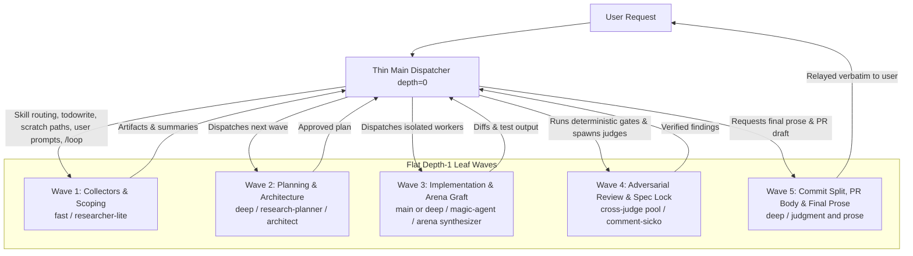
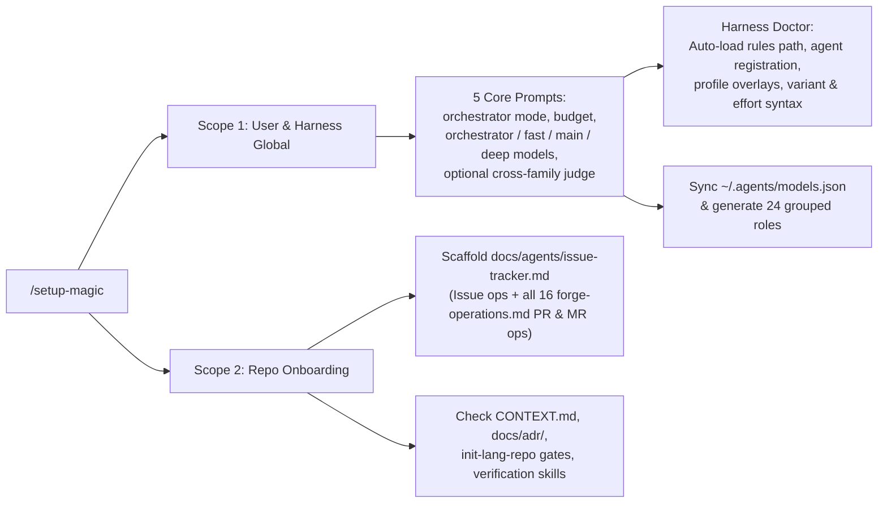

# Thin-Orchestrator Architecture and `/setup-magic` Redesign

This research document defines the repository changes required to run a lightweight main model that delegates heavy work to subagents and overhauls `/setup-magic` to close configuration gaps across all five supported harnesses.

## 1. Architectural Premise: Flat Depth-1 Wave Dispatch

A lightweight main model cannot delegate an entire session to one mega sub-orchestrator because every supported harness restricts subagent nesting and interactive tools at depth 1. Instead, the main model must operate as a flat depth-1 wave dispatcher (`depth = 0` to `depth = 1`) that handles routing, state tracking, and user prompts while leaf subagents execute all cognitive phases.

| Capability Constraint | OpenCode V2 | Claude Code | Cursor | Codex | Pi |
| :--- | :--- | :--- | :--- | :--- | :--- |
| **Max subagent depth** | `1` by default (`general` and `explore` cannot call `subagent`, and `.opencode/plugins/magic.js:54-84` `isChildSession` strips child bootstrap) | `1` in Web, Explore, and SDK modes (`Agent` stripped in subagents) | `1` in `@cursor/sdk`, `2` max in IDE | `1` (`agents.max_depth = 1` in `spawn.rs`) | `1` (`pi-subagents` disables nesting by default) |
| **User prompts & timers in subagents** | Blocked in background subagents | Strips `AskUserQuestion`, `/loop`, and `EnterPlanMode` in all subagents | Parent owns interactive prompts | Parent owns turn loop | Parent owns session prompt |
| **Existing repo depth-2 bugs to flatten** | `agents/comment-sicko/agent.md:31`, `skills/magic-mode/playbooks/feature.md:19`, `playbooks/autopilot-full.md:10`, `playbooks/orchestrate.md:11` | Same 4 files fail when a depth-1 worker tries to spawn nested workers | Same 4 files fail in SDK runs | Same 4 files hit `max_depth = 1` | Same 4 files fail without nesting enabled |

## 2. Harness Mechanics, Rule Auto-Loading, and Agent Discovery

Cross-harness verification exposed broken `magic-models` file paths, missing agent registrations, and a critical OpenCode V2 `subagent` model-passing nuance in `skills/magic-mode/references/harness-adapter.md:22-50` and `.opencode/plugins/magic.js:28-29`.

| Harness | Primary Orchestrator Config | Subagent Model Passing & Guardrails | `magic-models` & `rules/*.md` Auto-Load Reality | Named Kit Agent Discovery (`7` agents in `agents/*/agent.md`) |
| :--- | :--- | :--- | :--- | :--- |
| **OpenCode V2** | `opencode.json` `"model"` or `agents.build.model`, plus `~/.config/opencode/profiles/*.json` overlays (V1 `small_model` only sets `agents.title.model`) | Live `subagent` tool accepts `model: "providerID/modelID#variant"`, with a prompt guardrail warning never to set `model` unless requested by the user; `.opencode/plugins/magic.js:28-29` `V2_MAPPING` omits `model` and falsely claims OpenCode V2 has no `todowrite` | `harness-adapter.md:50` writes `~/.agents/rules/magic-models.md`, which OpenCode **never** auto-loads; real path is `~/.config/opencode/rules/magic-models.md` (via `instructions` or `.opencode/plugins/magic.js` context hook) | `0` of `7` discovered natively; register all 7 as `mode: "subagent"` via `.opencode/plugins/magic.js` (`ctx.agent.transform` with configured `model` and edit-deny on readonly agents) or `~/.config/opencode/agents/` |
| **Claude Code** | `settings.json` `"model"` or CLI `--model` | `Agent` tool accepts only 4 family aliases (`opus`, `sonnet`, `haiku`, `fable`) plus `effort` (`low`, `medium`, `high`, `xhigh`, `max`); `harness-adapter.md:22` says to omit `model` on cross-provider slugs, which silently downgrades `deep` tasks onto a weak Haiku parent instead of falling back to `opus` or `sonnet` (`CLAUDE_CODE_SUBAGENT_MODEL` also sets defaults) | `~/.claude/rules/magic-models.md` auto-loads, **but** plugin installs skip all 5 `rules/*.md` files because `hooks/session-start:25-50` only injects `using-magic/SKILL.md` | Nested `agents/<id>/agent.md` registers as double-colon `magic:<id>:<id>` unless explicitly listed in `.claude-plugin/plugin.json` `"agents"` or flattened to `agents/<id>.md`; `readonly: true` needs `disallowedTools` |
| **Cursor** | IDE model picker or CLI `--model` | `Task` accepts entitled model slugs plus bracket suffixes (`[effort=high]`, `-fast`) | `~/.cursor/rules/magic-models.mdc` requires `alwaysApply: true` YAML frontmatter, which `skills/setup-magic/SKILL.md:43-64` omits | `7` of `7` discovered cleanly via plugin manifest |
| **Codex** | `~/.codex/config.toml` `model` and `model_reasoning_effort` | `spawn_agent {fork_turns: "none"}` requires `multi_agent = true` and `[agents] default_subagent_model` plus `default_subagent_reasoning_effort` in `~/.codex/config.toml`; always pass `reasoning_effort` with `model` or effort resets | `~/.agents/rules/magic-models.md` is **not** auto-loaded; only `~/.codex/AGENTS.md` and repo `AGENTS.md` load (`.codex-plugin/plugin.json:22-23` has empty `"hooks": {}`) | `0` of `7` discovered; requires `.toml` definitions in `~/.codex/agents/` |
| **Pi** | `~/.pi/agent/settings.json` default model | Requires `pi-subagents` extension (`subagent { model, thinking }`) | `.pi/extensions/magic.ts:16-49` injects `using-magic` only and skips `rules/*.md` and `magic-models.md` | `0` of `7` discovered; `package.json:17-24` omits `pi.subagents.agents` |

In OpenCode V2, combining two mechanisms solves subagent model routing cleanly. Update `.opencode/plugins/magic.js` to register all 7 kit agents with their configured `magic-models` bindings via `ctx.agent.transform` (and restore `todowrite` in `V2_MAPPING`), and update `V2_MAPPING` plus `harness-adapter.md:22` to state that user-configured entries in `magic-models` constitute explicit user authorization to pass `model: "providerID/modelID#variant"` on `subagent` calls.

## 3. Thin-Orchestrator Skill and Playbook Redesign

Combining universal flat depth-1 wave delegation across multi-step workflows with an explicit `# orchestrator: thin | standard` switch in `magic-models` eliminates inline cognitive bottlenecks without penalizing strong main models on trivial tasks.

### 3.1 Mode Switch Behavior (`# orchestrator: thin | standard`)

When `magic-models` sets `# orchestrator: thin`, three dispatch rules activate across `skills/using-magic/SKILL.md`, `rules/workflow-routing.md`, `skills/magic-mode/SKILL.md`, and `skills/magic-mode/references/harness-adapter.md`:

1. **No weak-parent fallback:** `/setup-magic` warns against `inherit-parent` or `auto` on `main` and `deep` roles, and runtime fallback resolves to `~/.agents/models.json` tiers (or `opus` and `sonnet` in Claude Code) instead of omitting `model` (`magic-mode/SKILL.md:99`, `harness-adapter.md:22`).
2. **Direct leaf-skill wrapping:** Direct invocations of heavy leaf skills (`/blast-radius`, `/thermo-nuclear-code-quality-review`, `/make-pr-easy-to-review`, `/tdd`, `/technical-writing`, `/sharpen`, `/proving-*`, `/statechart`) wrap execution inside one depth-1 `magic-agent` call via `using-magic/SKILL.md` and `workflow-routing.md`, preserving byte-identity on `scripts/magic-verbatim.txt` files.
3. **Delegated judgment and verbatim relay:** `magic-mode` delegates inline `take-a-step-back` framing, domain-shape naming, diff review (`magic-mode/SKILL.md:101`), and final user-facing prose (`magic-mode/SKILL.md:105-121`) to the `judgment and prose` (`deep`) role, while the thin main model relays verified output without rewriting.

### 3.2 Universal Flat-Wave Changes Across Skills and Playbooks

All multi-step workflows below convert inline bottlenecks into flat depth-1 subagent waves for both `standard` and `thin` modes:

| Target File(s) | Current Inline Bottleneck or Depth-2 Bug | Flat Depth-1 Wave Redesign |
| :--- | :--- | :--- |
| `skills/arena/SKILL.md:16-17,31-49` | Main model reads all candidates and cross-judge outputs and hand-grafts code or designs inline | Add mandatory Phase D+E `arena synthesizer` (`deep`) `magic-agent` to select the base candidate and graft winning parts in an isolated context |
| `skills/architect/SKILL.md:36-40,52-76` | Red-flag screening and Phase D (`:52-55`) coding happen inline on main | Route red-flag screening into `arena synthesizer`, and dispatch Phase D implementation to a `feature, refactoring` or `hardest tasks` `magic-agent` |
| `skills/no-comments/SKILL.md:20-25`, `agents/comment-sicko/agent.md:31` | `comment-sicko` attempts nested `/how` and `/why` calls at depth 2; Steps 2-4 refactoring runs inline | Flatten `comment-sicko` to gather context directly or request Wave 1 collectors, and delegate `MUST KILL` root-cause edits to a `magic-agent` |
| `skills/research/SKILL.md:22-25,53-75,87-127` | Unbound from `magic-models`, Tier 2 synthesis (`:69-74`) runs inline, and `research-planner` is unnamed at `:87,115` | Bind all roles to `magic-models`, delegate Tier 2 synthesis and file write to `research-synthesizer`, and explicitly invoke `research-planner` in Tier 3 |
| `skills/why/SKILL.md:26-29` | Step 2 `git blame` and `git log --follow -p` dump raw patches into main context | Move git blame, patch history, and PR anchor lookup into a Wave 1 `fast` collector subagent |
| `skills/autopilot/SKILL.md:39,45,95,112-135`, `playbooks/babysit.md:19-20` | Conflict resolution, CI log diagnosis, bot triage, and `fix-now` edits run inline; `:95` hardcodes `Claude Opus 5.5 xhigh` | Delegate conflict resolution, CI diagnosis, bot triage (`judgment and prose`), and batched red-first `fix-now` edits (`bug-fix`) to subagents while main enforces numeric diff budgets and stop gates |
| `skills/magic-mode/playbooks/*.md` (`21` of `23` playbooks) | Inline framing (`feature.md:5-12`, `refactoring.md:7-10`), repro (`bug-fix.md:7-8`, `perf-issue.md:5-19`, `runtime-forensics.md:5-8`, `trace-forensics.md:7-11`), harnesses (`hillclimb.md:8-17`, `visual-parity.md:5-8`), sketches (`prototype.md:7-12`), authoring (`authoring-a-skill.md:5-8`, `multi-phase-plan.md:6-10`), evals (`eval.md:17-24`), loops (`autonomous-run.md:7-11`), stack rebase (`shipping.md:7-8`), PR prep (`opening-a-pr.md:7-22`), plus depth-2 spawns (`feature.md:19`, `autopilot-full.md:10`, `orchestrate.md:11`) | Convert each cognitive step into flat depth-1 waves, flatten nested playbook subagent spawns into parent-dispatched waves, and add Wave 5 (`judgment and prose`) in `opening-a-pr.md` for commit splitting, PR body, and final reply drafting |
| `writing-plans:23-178`, `subagent-driven-development:140-176` (`preflight.md`, `fix-loop.md`, `final-review.md`) | `writing-plans` drafts inline; `SDD` adjudicates fix loops inline, lacks role bindings, and has broken Superpowers links | Wrap `writing-plans` in a `deep` planner subagent (or update notices if edited directly), bind `SDD` implementer and reviewer slots to `magic-models`, and fix broken reference links |
| `blast-radius:34-38`, `thermo-nuclear-code-quality-review:13-192`, `make-pr-easy-to-review:10-59`, `teach:15-22`, `research-summary:15-110`, `recall:21-24`, `ketchup-video:11-31`, `correct:16-31`, `figure-it-out:17-43`, `show-me-your-work:58-64`, `create-verification-skill`, `maintain-verification-skill`, `create-formal-verification-skill`, `maintain-formal-verification-skill` | Heavy synthesis, transcript mining (`show-me-your-work:58-64`), video slide scripting, or verification authoring execute inline on main | Route mining steps to `fast` miners, synthesis and authoring steps to `main` or `deep` leaf subagents, and direct verbatim leaf calls through `using-magic` thin wrapping |
| `proof-driven-development` 7-skill suite | Formal modeling, spec authoring, and solver loops run inline | Split into a 4-wave PDD pipeline (Scoping, Spec Authoring, Proof Synthesis, Spec Audit) where the thin main dispatcher runs deterministic `verify-spec-lock.mjs --generate` between Spec Authoring and Proof Synthesis |

## 4. Complete `/setup-magic` and `model-roles.md` Audit

Auditing `skills/setup-magic/SKILL.md:1-76` and `skills/magic-mode/references/model-roles.md` uncovered missing research and SDD roles, zero `fast`-tier defaults, lack of orchestrator awareness, broken per-harness config paths, and the orphaned `docs/agents/issue-tracker.md` prerequisite.

### 4.1 Tier-First Header and Grouped Role Schema (`model-roles.md`)

Instead of prompting across 40 separate role lines, `/setup-magic` should ask 5 top-level questions (`orchestrator: standard | thin`, `budget`, core tier models for `orchestrator`, `fast`, `main`, `deep`, and an optional cross-family judge model), sync `~/.agents/models.json`, auto-populate 24 grouped role lines, and prompt per-role only when requested:

| Config Header or Grouped Role Line | Default Tier | Skills, Agents, and Wave Slots Covered | Gap Closed |
| :--- | :--- | :--- | :--- |
| `# orchestrator: standard \| thin` + `orchestrator:` | User choice | Harness primary model (`opencode.json` or profile overlay, Claude `settings.json`, `~/.codex/config.toml`, Pi `settings.json`) + cross-family comparison baseline | Enables thin routing and fixes cross-family checks in `arena:29`, `eval.md:21`, `show-me-your-work:68`, and `orchestrate.md:14` |
| `# budget: ...` + tier defaults (`fast`, `main`, `deep`) | User choice | Syncs `~/.agents/models.json` alongside `magic-models` and formats per-harness effort (`#low`, `#high`, `#max`, `[effort=...]`, `reasoning_effort`) | Fixes plugin-only installs lacking `models.json` and fixes Step 4 `#variant` validation failures |
| `fast, mechanical, miners` | `fast` | Mechanical edits (`magic-mode:97`), `SDD` mechanical implementer, transcript and log miners (`recall`, `automate-me`, `session-pickup`, `worktree-cleanup`, `runtime-forensics`, `trace-forensics`, `show-me-your-work`), event watchers (`autonomous-run`), `maintain-verification-skill` source wave | Activates the orphaned `fast` tier (`0` of `17` roles used `fast` previously) |
| `researcher-lite, collectors` | `fast` | `agents/researcher-lite`, `/research` Tier 1-3 collectors, `/why` Wave 1 git and PR collector | Binds `/research` collectors to `magic-models` |
| `researcher-mid` | `main` | `agents/researcher-mid` | Binds `/research` standard investigators |
| `researcher-deep, planner, synthesizer` | `deep` | `agents/researcher-deep`, `agents/research-planner`, `agents/research-synthesizer` (reconciles `research/SKILL.md` "tools forbidden" prose with `research-synthesizer/agent.md:26` and `researcher-deep/agent.md:38`) | Binds `/research` deep roles and reconciles tool permissions with modern effort budgets |
| `arena synthesizer` | `deep` | `/arena` Phase D+E base selection and code or design grafting, `/architect` red-flag screening | Removes inline grafting from weak main models |
| `sdd reviewer` | `main` | `subagent-driven-development` task reviewer, scoped re-reviewer, and fix-loop adjudicator (escalated implementer and final whole-branch reviewer map to `hardest tasks` and `judgment and prose`) | Connects `SDD` slots to `magic-models` |
| `comment-sicko` | `main` | `agents/comment-sicko` audit wave in `/no-comments` | Binds `comment-sicko` explicitly |
| `arena cross-judge pool` (widened) | Cross-family `deep` pool | `/arena` cross-judges, `/interrogate` reviewers, `eval.md` judges, `show-me-your-work` reviewer, `figure-it-out` judges, `orchestrate` and `autopilot-full` verifiers, `writing-skills` and `writing-rules` pressure testers | Unifies cross-family adversarial verification across the kit |
| Existing 15 core role lines (`feature, refactoring`, `bug-fix`, `perf-issue`, `hillclimb`, `judgment and prose`, `hardest tasks`, `how *`, `why *`, `reflect *`, `arena runners`, `swarm workers`, `architect runners`, `interrogate reviewers`) | Existing `fast`, `main`, and `deep` tiers | All current `magic-mode`, `/how`, `/why`, `/reflect`, `/arena`, `/swarm`, `/architect`, and `/interrogate` dispatches, plus `orchestrate` and `autopilot-full` PR owners | Preserves backward compatibility with existing `magic-models.md` files |

### 4.2 Non-Model Setup Gaps: Scope Split, Harness Doctor, and Repo Onboarding

Splitting `/setup-magic` into two independent scopes lets users onboard new repositories (`rules/new-repo-setup.md:21`) without repeating global model prompts:

| `/setup-magic` Scope | Required Actions and Validations | Gaps Closed |
| :--- | :--- | :--- |
| **Scope 1: User & Harness Global** | 1. Detect active harness (and OpenCode profile overlay: `personal`, `work-dev`, `work-prod`, or global). 2. Write `magic-models` to the real auto-loaded path (`~/.config/opencode/rules/magic-models.md`, `~/.cursor/rules/magic-models.mdc` with `alwaysApply: true`, `~/.claude/rules/magic-models.md`, Codex `AGENTS.md` + `~/.codex/config.toml` `multi_agent = true` + `default_subagent_model`, Pi settings and extension). 3. Register all 7 named subagents per harness and validate model IDs plus `#variant` or `effort` syntax. 4. Sync `~/.agents/models.json` and optionally set the harness primary orchestrator model. | Fixes silent non-loading on OpenCode, Cursor, Codex, and Pi; fixes Claude Code Haiku fallback via `CLAUDE_CODE_SUBAGENT_MODEL`; preserves `#variant` suffixes across re-runs |
| **Scope 2: Repo Onboarding** | 1. Auto-detect GitHub, GitLab, or Linear from `git remote -v` and installed CLIs or MCPs, then scaffold `docs/agents/issue-tracker.md` covering both issue-tracker commands and all 16 PR and MR operations in `skills/magic-mode/references/forge-operations.md:18-37`. 2. Check for `CONTEXT.md` and `docs/adr/` stubs. 3. On greenfield repos, check `init-<lang>-repo` gates per `rules/new-repo-setup.md`. 4. Offer `/create-verification-skill` and `/create-formal-verification-skill`. | Replaces archived `setup-matt-pocock-skills` (`ADR-0007`) and unblocks 7 broken consumers (`opening-a-pr.md:24`, `babysit.md:7`, `shipping.md:5`, `autopilot-full.md:8`, `multi-phase-plan.md:57`, `worktree-cleanup.md:3`, `worktree-audit.sh:15`) |

## 5. Rules Triage, Validator Locks, and Repo Drift Inventory

Applying `/writing-rules` four-gate triage confirms that thin-orchestrator routing belongs in `rules/workflow-routing.md`, `skills/using-magic/SKILL.md`, entry-point skills, and consumer-local `magic-models`, never in a new `rules/subagents.md` or `rules/thin-orchestrator.md` file.

### 5.1 `/writing-rules` Triage and Test Suite Locks

Creating a new `rules/*.md` file fails `/writing-rules` triage and repository invariants: `tests/test_install.py:65` explicitly forbids `rules/subagents.md`, 3 of 5 plugin harnesses do not auto-load `rules/*.md`, `alwaysApply` rules leak into leaf subagents where sub-dispatch is impossible, and multi-step wave procedures fail Gate 3. Folding a `<50`-word pre-routing and thin leaf-wrapping guard into `rules/workflow-routing.md` (currently `190` of `250` words) keeps the operational rule count at `5`.

| Test or Validator File | Enforced Invariant to Respect During Implementation |
| :--- | :--- |
| `tests/opencode-and-pi-plugins.test.mjs:157,181,258` | Locks exact skill count at `75` skills |
| `tests/writing-rules.test.mjs:38-55` | Locks `5` operational rules, `<250` words per rule file, and `<=25` words with zero em-dashes in `agents.kit.md` pointers |
| `tests/test_install.py:65` | Forbids `rules/subagents.md` |
| `tests/output-format-skills.test.mjs` | Locks Variant C output-format regexes |
| `tests/magic-sync.test.mjs`, `tests/pr26-regressions.test.mjs` | Locks `/take-a-step-back/` and `/make-pr-easy-to-review/` references, plus zero dashes and zero mid-sentence colons in `multi-phase-plan.md` |
| `THIRD-PARTY-NOTICES.md`, `agents.md:11`, `scripts/magic-verbatim.txt` | Protects verbatim upstream files (`magic-verbatim.txt` and 3 Superpowers skill directories: `writing-skills`, `writing-plans`, `subagent-driven-development`) |

### 5.2 Existing Repository Drift and Bugs Uncovered

Research uncovered 10 pre-existing repository bugs that should be cleaned up alongside the redesign:

| # | Location | Defect Description |
| :--- | :--- | :--- |
| 1 | `.opencode/plugins/magic.js:28-29` | `V2_MAPPING` falsely claims OpenCode V2 has no todo tool (`todowrite` exists), omits `subagent` `model` parameter guidance, and registers `0` of `7` kit agents |
| 2 | `skills/autopilot/SKILL.md:83-84,95` | Hardcodes leaked `Claude Opus 5.5 xhigh` string at `:95` (violating `ADR-0001`) and references deleted rule names at `:83-84` |
| 3 | `skills/research-summary/SKILL.md:14` | References non-existent `simple-english` skill instead of `/technical-writing` and `/unslop` |
| 4 | `skills/subagent-driven-development/references/final-review.md:14` (and sibling SDD refs) | Contains broken upstream Superpowers skill links (`../../requesting-code-review/code-reviewer.md`, `superpowers:using-git-worktrees`, `superpowers:finishing-a-development-branch`) |
| 5 | `agents/comment-sicko/agent.md:31`, `playbooks/feature.md:19`, `playbooks/autopilot-full.md:10`, `playbooks/orchestrate.md:11` | Attempt depth-2 subagent spawning, which fails across depth-1 harnesses |
| 6 | `skills/research/SKILL.md:87,115` & `agents/research*/agent.md` | Fails to reference `research-planner` by agent ID, and "tools forbidden" upgrade prose contradicts `research-synthesizer/agent.md:26` and `researcher-deep/agent.md:38` |
| 7 | `skills/setup-magic/SKILL.md:43-64` & `harness-adapter.md:49-50` | Cursor template omits `alwaysApply: true` frontmatter; OpenCode, Codex, and Pi point to non-auto-loaded `~/.agents/rules/magic-models.md` |
| 8 | `docs/agents/issue-tracker.md` (repo root) | Missing in this repository despite `ADR-0007:3` claiming it exists and 7 playbooks and scripts requiring the file |
| 9 | `docs/adr/0004`, `0005`, `0008`, plus stale `create-skill` and external `/tdd` refs | Stale architectural records and skill name references out of sync with the current 75-skill catalog |
| 10 | `lychee.toml:13-14` & `full-lint` URLs | Stale self-link exclusion and legacy `full-lint` references |

## 6. Phased Execution Plan and Open Decisions

Delivering these changes in four verifiable phases keeps diffs reviewable and preserves all test gates (`./scripts/validate.sh`, `python3 -m unittest discover -s tests`, and `node --test tests/*.test.mjs`) at every boundary.

| Phase | Scope and Target Files | Verification Gate |
| :--- | :--- | :--- |
| **Phase 1: Harness Plumbing, `model-roles.md`, & `/setup-magic` Overhaul** | Fix `.opencode/plugins/magic.js` (`todowrite`, `model` authorization, 7 registered subagents, `rules/*.md` + `magic-models` context injection), `.pi/extensions/magic.ts`, `package.json`, `.claude-plugin/plugin.json` + `hooks/session-start`, `.codex-plugin` and Codex setup instructions, `harness-adapter.md`, `model-roles.md` (24 grouped roles + `# orchestrator`), and `skills/setup-magic/SKILL.md` (Scope 1 Global + Scope 2 Repo Onboarding + `docs/agents/issue-tracker.md` generator, plus generating this repo's `docs/agents/issue-tracker.md`) | Plugin unit tests (`tests/opencode-and-pi-plugins.test.mjs`), install tests (`tests/test_install.py`), and `./scripts/validate.sh` |
| **Phase 2: Core Thin-Orchestrator Routing & Flagship Multi-Agent Skills** | Add `<50`-word thin guard to `rules/workflow-routing.md` and `skills/using-magic/SKILL.md`; add `# orchestrator: thin` handling to `skills/magic-mode/SKILL.md`; convert `skills/research/SKILL.md`, `skills/why/SKILL.md`, `skills/arena/SKILL.md` (`arena synthesizer`), `skills/architect/SKILL.md`, `skills/no-comments/SKILL.md`, and `agents/comment-sicko/agent.md` to flat depth-1 waves | `tests/writing-rules.test.mjs` (`<250` words, 5 rules), `tests/magic-sync.test.mjs`, and `tests/output-format-skills.test.mjs` |
| **Phase 3: Playbook Wave Conversion & `/autopilot`** | Convert `21` of `23` playbooks in `skills/magic-mode/playbooks/*.md` (flattening depth-2 spawns in `feature.md`, `autopilot-full.md`, and `orchestrate.md`, and adding Wave 5 prose and PR prep in `opening-a-pr.md`) and refactor `skills/autopilot/SKILL.md` (removing `Claude Opus 5.5 xhigh` leak) | `tests/pr26-regressions.test.mjs` (zero dashes and zero mid-sentence colons in `multi-phase-plan.md`) and full test suite |
| **Phase 4: Standalone Skills, 4-Wave PDD Pipeline, & Repo Drift Cleanup** | Update non-verbatim standalone skills (`teach`, `research-summary`, `recall`, `ketchup-video`, `correct`, `figure-it-out`, `show-me-your-work`, verification skill generators, and 7 `proof-driven-development` skills with deterministic `verify-spec-lock.mjs --generate` gate), resolve Superpowers and `magic-verbatim.txt` wrapping vs edits, and clean up ADR and `lychee.toml` drift | `./scripts/validate.sh`, `python3 -m unittest discover -s tests`, and `node --test tests/*.test.mjs` |

### Locked Product Decisions (Confirmed 2026-11-11)

1. **Direct skill updates over external-only wrapping:** Update `writing-plans`, `subagent-driven-development`, `make-pr-easy-to-review`, and `thermo-nuclear-code-quality-review` directly in-repo so they obey `magic-models`, forge-agnosticism (`ADR-0007`), model-neutrality (`ADR-0001`), and flat depth-1 delegation natively. Update `THIRD-PARTY-NOTICES.md` ("adapted from..." instead of "copied without content changes"), `scripts/magic-verbatim.txt`, `scripts/validate.sh`, `lychee.toml`, `.markdownlint-cli2.jsonc`, `.typos.toml`, and `tests/magic-sync.test.mjs` accordingly.
2. **Agent directory layout:** Keep `agents/<id>/agent.md` directory structure for `.agents` protocol and CI compatibility, and add explicit `"agents"` file paths in `.claude-plugin/plugin.json` (plus `disallowedTools` on readonly agents, `ctx.agent.transform` registration in `.opencode/plugins/magic.js`, and `"subagents"` in `package.json` `"pi"`) so all 5 harnesses discover named agents cleanly.
3. **OpenCode profile targeting in `/setup-magic`:** Default to one shared `~/.config/opencode/rules/magic-models.md` file (auto-injected by `.opencode/plugins/magic.js` and documented for `opencode.json` `"instructions"`), while noting and supporting per-profile `magic-models-<profile>.md` files when OpenCode profile overlays (`personal`, `work-dev`, `work-prod`) have different provider entitlements.
4. **Default `# orchestrator` mode:** Default `# orchestrator` to `thin` (`# orchestrator: thin`) so main sessions stay lightweight, context-clean flat depth-1 wave dispatchers out of the box (keeping pure conversation and single-fact lookups inline), with `# orchestrator: standard` available when a user wants a frontier main session to execute leaf edits or prose inline.

## Sources

- Repository skills, playbooks, agents, plugins, and tests:
  - `skills/setup-magic/SKILL.md:1-76`, `skills/using-magic/SKILL.md:1-67`, `skills/magic-help/SKILL.md:1-178`
  - `skills/magic-mode/SKILL.md:1-155`, `skills/magic-mode/references/model-roles.md:1-71`, `skills/magic-mode/references/harness-adapter.md:1-63`, `skills/magic-mode/references/forge-operations.md:1-53`
  - `skills/magic-mode/playbooks/*.md` (`23` playbooks), `skills/magic-mode/scripts/check-plan.mjs:1-205`, `skills/magic-mode/scripts/worktree-audit.sh:15`
  - `skills/research/SKILL.md:1-164`, `skills/research-summary/SKILL.md:1-110`, `skills/how/SKILL.md:1-37`, `skills/why/SKILL.md:1-101`, `skills/teach/SKILL.md:1-22`, `skills/recall/SKILL.md:1-36`, `skills/ketchup/SKILL.md:1-44`, `skills/ketchup-video/SKILL.md:1-31`
  - `skills/arena/SKILL.md:1-49`, `skills/architect/SKILL.md:1-80`, `skills/swarm/SKILL.md:1-42`, `skills/interrogate/SKILL.md:1-36`, `skills/no-comments/SKILL.md:1-25`, `skills/blast-radius/SKILL.md:1-53`, `skills/thermo-nuclear-code-quality-review/SKILL.md:1-192`, `skills/make-pr-easy-to-review/SKILL.md:1-59`, `skills/autopilot/SKILL.md:1-189`
  - `skills/writing-plans/SKILL.md:1-204`, `skills/subagent-driven-development/SKILL.md:1-339`, `skills/subagent-driven-development/references/final-review.md:1-49`, `skills/writing-skills/SKILL.md:1-399`, `skills/writing-rules/SKILL.md:1-212`, `skills/technical-writing/SKILL.md:1-107`
  - `skills/proof-driven-development/SKILL.md:1-136` (+ 5 child proof skills + `skills/statechart/SKILL.md:1-84`), `skills/create-verification-skill/SKILL.md:1-45`, `skills/maintain-verification-skill/SKILL.md:1-40`, `skills/create-formal-verification-skill/SKILL.md:1-44`, `skills/maintain-formal-verification-skill/SKILL.md:1-59`, `skills/figure-it-out/SKILL.md:1-53`, `skills/correct/SKILL.md:1-33`, `skills/automate-me/SKILL.md:1-105`, `skills/reflect/SKILL.md:1-67`, `skills/show-me-your-work/SKILL.md:1-83`
  - `agents/*/agent.md` (`7` agent definitions), `rules/*.md` (`5` operational rules), `agents.kit.md:1-8`, `agents.md:1-25`, `CONTEXT.md:1-50`, `README.md:1-153`, `docs/CATALOG.md:1-149`, `docs/adr/0001-no-model-pins.md` through `0008-pstack-port.md`, `THIRD-PARTY-NOTICES.md:1-132`
  - `.opencode/plugins/magic.js:1-209`, `.pi/extensions/magic.ts:1-84`, `package.json:1-25`, `.cursor-plugin/plugin.json`, `.claude-plugin/plugin.json`, `.codex-plugin/plugin.json`, `hooks/session-start:1-90`, `scripts/install.sh:1-314`, `scripts/validate.sh:1-226`, `scripts/magic-verbatim.txt:1-6`
  - `tests/magic-sync.test.mjs`, `tests/writing-rules.test.mjs`, `tests/test_install.py`, `tests/plugin-hooks-and-manifests.test.mjs`, `tests/pr26-regressions.test.mjs`, `tests/proof-skills.test.mjs`, `tests/version-sync.test.mjs`, `tests/output-format-skills.test.mjs`, `tests/opencode-and-pi-plugins.test.mjs`
- Official harness documentation:
  - OpenCode V2 docs: <https://opencode.ai/docs/config/>, <https://opencode.ai/docs/models/>, <https://opencode.ai/docs/agents/>, <https://opencode.ai/docs/instructions/>, <https://opencode.ai/docs/build/plugins/server/>
  - Claude Code docs: <https://code.claude.com/docs/en/sub-agents>, <https://code.claude.com/docs/en/model-config>, <https://code.claude.com/docs/en/memory>, <https://code.claude.com/docs/en/plugins/components>
  - Cursor docs: <https://cursor.com/docs/subagents>, <https://cursor.com/docs/rules>, <https://cursor.com/docs/reference/plugins>
  - OpenAI Codex docs: <https://developers.openai.com/codex/multi-agent/>, <https://learn.chatgpt.com/docs/config-file/config-reference>
  - Pi & `pi-subagents` docs: <https://docs.pify.dev/en/reference/configuration>, <https://github.com/nicobailon/pi-subagents/blob/main/docs/agents.md>

## TL;DR

Because all five supported harnesses block reliable depth-2 subagent nesting and subagent user prompts, running a lightweight main model requires a **Flat Depth-1 Wave Dispatcher** (`# orchestrator: thin` in `magic-models` plus flat leaf waves across `magic-mode`, `/research`, `/arena`, `/architect`, `/autopilot`, and 21 playbooks) rather than a single nested sub-orchestrator. Simultaneously, `/setup-magic` should split into **Global Harness Setup** (fixing auto-load rule paths, OpenCode V2 `subagent` model and agent registration, `~/.agents/models.json` sync, and 24 tier-backed roles including `/research`, `fast` miners, `arena synthesizer`, and `SDD`) and **Repo Onboarding** (scaffolding `docs/agents/issue-tracker.md` for all issue and PR forge operations).
