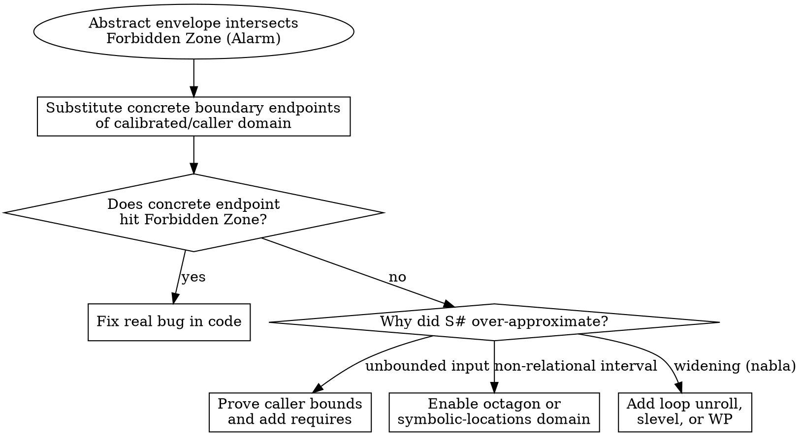

# Analyzing with Abstract Interpretation

## Overview

Abstract interpretation executes a program over an **abstract domain** (such as intervals $[a, b]$, octagons $\pm x \pm y \le c$, or convex polyhedra) linked to concrete execution states by a mathematical **Galois connection** ($\alpha, \gamma$). Because the abstract state envelope $S^\#$ is a **sound over-approximation** of all reachable concrete states $S$ ($S \subseteq \gamma(S^\#)$), if $S^\#$ never intersects a Forbidden Zone (such as $\text{divisor} = 0$ or $\text{idx} \notin [0, N-1]$), that runtime error is mathematically impossible across all executions.

**Violating the soundness of the abstract envelope is violating the proof.** Never suppress alarms with `#pragma` or `-eva-no-warn-key`, never accept "1M unit tests passed so the alarms are false positives" without testing the concrete domain endpoints first, and never add an entry `requires` clause without verifying that every caller or hardware source satisfies it.

**REQUIRED SUB-SKILL:** Use `auditing-proof-specifications` before claiming any static-analysis proof is complete.

## Wave Assignment

This skill is a depth-1 leaf. Under `orchestrator: thin`, the root chat either dispatches it as a **Wave 3** worker from the `/proof-driven-development` pipeline or wraps it as a heavy leaf, and it runs on the `hardest tasks` role (`deep`). It executes directly in this session and spawns no subagent, because a second wave inside a leaf would nest a wave inside a wave. When the harness exposes no subagent tool, run it inline in this session as well. The hand-off back to the parent is the report plus the exact commands it must run, and the spec audit stays with `/auditing-proof-specifications`.

## When to Use

- Proving whole-program absence of runtime errors (overflow, underflow, division by zero, out-of-bounds array access, null pointer dereference, NaN/Inf) in C or embedded systems (Frama-C EVA, Astrée, Goblint).
- Triaging alarms raised by an abstract interpreter to separate real concrete bugs from abstract over-approximation.
- Choosing or refining abstract domains (intervals vs. octagons vs. polyhedra) and loop widening/unrolling parameters.

**When NOT to use:**

- Proving rich functional specifications (e.g., "output is a sorted permutation of input" or complex heap data structures) where deductive contracts are needed (use `proving-with-hoare-logic`).
- Proving deep algebraic/cryptographic/compiler theorems (use `proving-with-dependent-types`).
- Checking distributed protocol interleavings or bit-exact single-function Rust harnesses (use `model-checking-protocols-and-code`).
- Unsure which verification paradigm fits (use `proof-driven-development`).

## Alarm Triage Flowchart



## Required 4-Step Contract for Abstract Interpretation & Alarm Triage

Whenever you configure an abstract interpreter or triage its alarms, include all four sections below in order, even when the user insists the alarms are false positives and asks not to touch the C code:

1. **Step 1 (Concrete Boundary Check, Mandatory Before Any Tuning).**
   - Never take "we ran 1M unit tests and inspected the code" on faith. Substitute the extreme endpoints of the calibrated/caller range (`CAL_MIN`, `CAL_MAX`, `0`, `MAX_ADC`, maximum loop trip count) into the exact expression that raised each alarm.
   - If any concrete endpoint reaches the Forbidden Zone (e.g., `(4095 + 8) >> 4 == 256` on a 256-entry table), classify that alarm as a **Real Concrete Bug** and provide the C code fix. Refusing to fix C code when a concrete input hits out-of-bounds or overflow is never acceptable.
2. **Step 2 (Mathematical Diagnosis of Over-Approximation Loss).**
   - For each alarm that is unreachable on concrete inputs, classify its exact precision-loss mechanism and apply the matching refinement:

   | Precision-Loss Mechanism | Symptom in Analyzer | Refinement |
   | --- | --- | --- |
   | **Unmodeled entry domain** | Entry parameter defaults to `[INT_MIN..INT_MAX]` | Add ACSL `requires CAL_MIN <= x <= CAL_MAX;` (or `Frama_C_interval` driver) **only** after verifying every caller or hardware ADC datasheet bound |
   | **Non-relational interval projection** | Guard checks `span_hi - span_lo >= 20`, but interval subtraction `[30..100] - [10..50] = [-20..90]` contains `0` | Enable relational domains (`-eva-domains octagon`, `-eva-domains symbolic-locations`, `-eva-domains gauges`) |
   | **Premature loop widening ($\nabla$)** | Fixed-trip filter loop widens accumulator `acc` to `[0..2147483647]` on iteration 3 | Use semantic loop unrolling (`-eva-auto-loop-unroll N`, `-eva-slevel N`, `/*@ loop unroll N; */`) or discharge with `-then -wp -wp-prop="@alarms"` |
   | **Branch join merging** | Merging two branches loses correlation between a status flag and a pointer/value | Split trace states (`-eva-split-return auto` or ACSL `/*@ split x; */`) |

3. **Step 3 (Reproducible Zero-Alarm, Zero-Suppression Gate).**
   - Give the exact CLI invocation with `-eva-error-on-alarms` (and `-then -wp -wp-prop="@alarms"` when combining EVA with WP) that exits `0` with **0 alarms and 0 suppressions**.
4. **Step 4 (Soundness Boundary and TCB Statement).**
   - State the verified entry-point contract, target machine ABI (`-machdep`), floating-point semantics, and what lies outside the sequential abstract model (DMA, interrupt service routines, inline assembly, or compiler miscompilation unless compiled with CompCert).

## Core Pattern: Fixing a Boundary Bug + Refining Relational & Loop Precision in Frama-C EVA

```c
// actuator.c
#include <stdint.h>

#define ADC_MAX 4095
#define LUT_SIZE 256

static const int32_t lut[LUT_SIZE] = { /* 256 calibrated entries */ };

/*@ requires 0 <= raw_sensor <= ADC_MAX;
  @ requires 10 <= span_lo <= 50;
  @ requires 30 <= span_hi <= 100;
  @ requires span_hi - span_lo >= 20;
  @ requires \valid_read(samples + (0 .. 63));
  @ requires \forall integer k; 0 <= k < 64 ==> -1000 <= samples[k] <= 1000;
  @ assigns \nothing;
  @*/
int32_t compute_actuator_cmd(
    int32_t raw_sensor,
    int32_t span_lo,
    int32_t span_hi,
    const int32_t *samples
) {
    // 1. Concrete boundary fix: (4095 + 8) >> 4 == 256 (OOB on lut[256]).
    // Clamp index to LUT_SIZE - 1 so all calibrated ADC inputs stay in [0..255].
    int32_t idx = (raw_sensor + 8) >> 4;
    if (idx >= LUT_SIZE) {
        idx = LUT_SIZE - 1;
    }
    int32_t base = lut[idx];

    // 2. Relational division: octagon domain preserves (span_hi - span_lo >= 20),
    // proving divisor is in [20..90] and never 0.
    int32_t scaled = base / (span_hi - span_lo);

    // 3. Bounded accumulation: loop unroll prevents widening from jumping to INT32_MAX.
    int32_t acc = scaled;
    /*@ loop unroll 64; */
    for (int i = 0; i < 64; i++) {
        acc += samples[i];
    }
    return acc;
}
```

Verification command:

```bash
frama-c -eva actuator.c \
  -main compute_actuator_cmd \
  -machdep x86_64 \
  -eva-domains cvalue,octagon,symbolic-locations \
  -eva-auto-loop-unroll 64 \
  -eva-error-on-alarms
```

## Common Mistakes & Rationalizations

| Excuse | Reality |
| --- | --- |
| "We ran 1M unit tests and inspected the code, so all 4 alarms are false positives" | A 3-parameter function over 16-bit/32-bit integers has $2^{64}$+ states. Unit tests routinely miss rounding boundary off-by-one bugs like `(4095 + 8) >> 4 == 256`. Always check concrete boundary endpoints first. |
| "Just add `-eva-no-warn-key` or `#pragma` suppressions so CI turns green" | Suppressing an alarm category blinds the analyzer to every future real bug of that class in the file. Refine the domain or fix the code until 0 alarms remain with `-eva-error-on-alarms`. |
| "Add `/*@ admit ...; */` right on the failing array index or division line" | `admit` at an alarm site assumes the bug cannot happen without checking whether entry preconditions actually prevent it. Only state verified preconditions at the entry boundary. |
| "Skip relational domains (`octagon`) because CLI unrolling is faster" | Loop unrolling does nothing for non-loop relational invariants like `span_hi - span_lo >= 20`. Match the refinement to the mathematical source of precision loss. |

## Red Flags - STOP and Fix Properly

- Tuning EVA flags or adding `requires` before testing whether the concrete boundary endpoints (`CAL_MIN`, `CAL_MAX`) actually trigger the alarm
- Suppressing alarms via `-eva-no-warn-key`, disabling RTE checks via `-no-warn-signed-overflow` / `-no-warn-special-float`, removing `-eva-error-on-alarms`, or adding `/*@ admit */` at interior alarm sites
- Padding an array size (`lut[257]`) to silence an out-of-bounds read without checking whether index `256` reads uncalibrated zero memory
- Adding `requires` on an internal function without proving that all callers in the program satisfy that precondition

**All of these mean: Test the concrete domain boundaries first, fix any real boundary bug in the code, match each false alarm to its exact domain/widening refinement, and run with `-eva-error-on-alarms`.**
