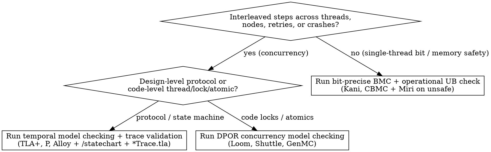

# Model Checking Protocols and Code

## Overview

Model checking explores every reachable state transition, thread/message schedule interleaving, or bit pattern within a stated scope across three complementary tiers:

1. **Tier A — Design-level temporal model checking (TLA+, P, Alloy):** Verifies state machines (`Init`, `Next`) against **Safety** invariants ($\Box I$, "nothing bad ever happens") and **Liveness** properties ($\Box(P \implies \Diamond Q)$, "something good eventually happens" under fairness), plus forward trace validation (`*Trace.tla`) against recorded execution logs.
2. **Tier B — Code-level stateless concurrency model checking / DPOR (Loom, Shuttle, GenMC):** Exhaustively permutes thread interleavings, `Mutex` locks, and C11/Rust atomic memory orderings (`Acquire`/`Release`/`SeqCst`) directly on the implementation's concurrent wrapper.
3. **Tier C — Code-level bounded symbolic execution & operational memory safety (Kani, CBMC, ESBMC + Miri):** Compiles real source code (Rust MIR or C) with symbolic inputs (`kani::any()`) into bit-precise SAT/SMT formulas up to loop unwind bound $K$, paired with operational memory-model UB and leak checking (`cargo +nightly miri test`) on any whitelisted `unsafe` code.

**Violating the fidelity of the model or the input space is violating the proof.** Never collapse separate network RPCs or lock acquisitions into a single atomic step in TLA+, never use `kani::assume` to constrain untrusted payload bytes or parsed header fields, and never rely on a single-threaded Kani harness alone to prove multi-threaded `Mutex`/`Atomic` or `UnsafeCell` safety.

**REQUIRED SUB-SKILL:** Use `auditing-proof-specifications` before claiming any model check is complete, and use `/statechart` to visualize and inspect TLA+ models and counterexamples.

## When to Use



**When NOT to use:**

- Unbounded functional correctness over arbitrary collection sizes $N$ where bounded loop unwinding is insufficient (use `proving-with-hoare-logic`).
- Deep inductive theorems over recursive ASTs, compilers, or cryptography (use `proving-with-dependent-types`).
- Whole-program C static analysis over infinite control loops via abstract domains (use `analyzing-with-abstract-interpretation`).

## Required Contract for Protocol Model Checking (TLA+ / P / Alloy)

Every protocol model check must include all five parts below in order:

1. **One-to-One Atomicity Mapping:**
   - Each action in `Next` must correspond to one indivisible atomic step in the implementation (one RPC, one compare-and-swap, one lock acquisition, one disk write).
   - Never merge two separate network calls or a read-then-write into a single atomic TLA+ action.
   - When modeling existing code, annotate every action guard with a source file and line comment (e.g., `\* lease.go:142`).
2. **Type Invariant & Safety Invariants ($\Box I$):**
   - Include `TypeOK` and explicit safety invariants (e.g., `SinglePrimary`, `Consistent`, conservation of balances).
3. **Fairness & Liveness Properties ($\Box(P \implies \Diamond Q)$):**
   - Define the full specification with explicit weak or strong fairness on system progress actions (`Spec == Init /\ [][Next]_vars /\ WF_vars(ProgressActions)`).
   - Include at least one temporal liveness property (`EventuallyDecided` or `StarvationFree == [](Pending => <>Resolved)`) so a protocol that avoids safety bugs by deadlocking or dropping all requests is caught.
4. **Bidirectional Trace Conformance (`/statechart` Replay & Forward `*Trace.tla` Validation):**
   - *Reverse direction (Model $\to$ Code):* Run `/statechart` on TLA+ specs to render state transitions and invariant violation paths, and replay every counterexample trace step-by-step against the real implementation code.
   - *Forward direction (Code $\to$ Model Trace Validation, `*Trace.tla`):* When modeling an existing system (such as a Python, Go, or Rust service with an existing test suite), attach a non-invasive trace observer (`TlaTraceObserver`) to the test suite to emit NDJSON execution traces. Feed those recorded traces into a TLA+ trace wrapper (`TraceData == <<...>>` where `StepTrace` advances `pc` from `1` to `Len(TraceData) + 1`) and run `TLC` with `INVARIANT TraceSafetyInvariant` and `PROPERTY TraceAcceptedProperty == <>(pc > Len(TraceData))`. If the TLA+ model invented an idealized transition or omitted a real branch, `TLC` fails to reach `pc > Len(TraceData)`.
5. **Explicit Scope & Model Bounds:**
   - State the exact finite `CONSTANTS` checked (e.g., 3 nodes, 2 epochs, max 2 retries) and what remains outside the finite model.

## Required Contract for Code-Level BMC, DPOR Concurrency & Operational UB Checking (Kani / CBMC + Loom + Miri)

Every code-level model-checking suite must include all five parts below in order:

1. **Symbolic Input Scope vs. Untrusted Data Discipline (Kani / CBMC):**
   - Bound **only** the container capacity (`const MAX_LEN: usize = ...; kani::assume(len <= MAX_LEN);`).
   - **Never** `kani::assume(...)` on untrusted bytes, wire headers, offsets, or loop counts decoded from the input buffer (such as `kani::assume(header.tlv_count <= 4)` or `kani::assume(header.payload_offset <= buf.len())`).
   - If a loop's iteration count comes from untrusted input (`let count = buf[0]`) and exceeds `#[kani::unwind(N)]` on a buffer of size `MAX_LEN`, **that is a bug in the parser** (missing validation that `count * MIN_ITEM_SIZE <= remaining_bytes`), not a harness bound artifact! Fix the code to reject truncated/oversized counts, or set `#[kani::unwind(MAX_POSSIBLE_ITERS_FOR_MAX_LEN + 1)]`.
2. **Unwind Completeness & Non-Vacuity Coverage (`kani::cover!`):**
   - Keep unwinding assertions enabled (the default in Kani; `--unwinding-assertions` in CBMC). Set `#[kani::unwind(K + 1)]` where $K$ is the maximum possible iterations within `MAX_LEN`.
   - Include `kani::cover!(...)` statements proving that normal success paths, boundary cases, and error-rejection paths are all reachable under the harness assumptions.
3. **Operational Memory-Model UB & Leak Checking (`Miri`) on Whitelisted `unsafe` Code:**
   - Any file permitted to use `unsafe` (such as an `UnsafeCell<MaybeUninit<T>>` lock-free SPSC ring buffer whitelisted in `spec.lock`) must be verified under **both** `cargo kani` (bit-precise symbolic inputs) and `cargo +nightly miri test` (Stacked Borrows / Tree Borrows pointer aliasing provenance, uninitialized memory reads, alignment, and memory-leak detection).
   - If `std::mem::forget` is used inside `#[cfg(kani)]` to avoid CBMC drop-unwinding explosion on `VecDeque<Vec<u8>>`, gate it strictly behind `#[cfg(kani)]` so standard builds and `Miri` run the full destructors and verify zero leaks.
4. **Stateless Concurrency Permutation Checking (`Loom` / `Shuttle` / `GenMC`):**
   - Single-threaded Kani harnesses do not check multi-threaded lock or atomic memory-ordering schedules. For concurrent handles (`Mutex`, `RwLock`, `AtomicBool`, `AtomicUsize`, SPSC channels), swap synchronization primitives under `#[cfg(loom)]` (`loom::sync::{Mutex, atomic::AtomicBool}`, `loom::thread`) and run `RUSTFLAGS="--cfg loom" cargo test --release` inside `loom::model(|| { ... })` to exhaustively verify that safety invariants hold across every thread interleaving.
5. **Scope Statement:**
   - State whether each check is **unbounded** (loop-free fixed-width arithmetic, checking 100% of $2^{64}$ or $2^{128}$ bit patterns) or **bounded** up to capacity `MAX_LEN`, unwind bound `K + 1`, and `Loom` thread count.

## Core Pattern 1: Bit-Precise Kani Proof Harness

```rust
pub fn midpoint(lo: u32, hi: u32) -> u32 {
    lo + (hi - lo) / 2
}

#[cfg(kani)]
mod proofs {
    use super::*;

    #[kani::proof]
    fn midpoint_in_range() {
        let lo: u32 = kani::any();
        let hi: u32 = kani::any();
        // Domain precondition of midpoint(lo, hi): caller guarantees lo <= hi
        kani::assume(lo <= hi);

        let m = midpoint(lo, hi);

        assert!(lo <= m && m <= hi);
        assert!(m as u64 == (lo as u64 + hi as u64) / 2);
        // Non-vacuity check: boundary where lo + hi would overflow u32::MAX
        kani::cover!(lo > u32::MAX / 2 && hi > lo);
    }
}
```

## Core Pattern 2: Forward Trace Validation (`*Trace.tla`) & Loom Schedule Exhaustion

```tla
---- MODULE ProcessorTrace ----
EXTENDS Naturals, Sequences, TLC

\* Recorded NDJSON events from pytest TlaTraceObserver injected into TraceData
TraceData ==
    <<
        [event |-> "process", tier |-> "Start", kind |-> "StartFrame", setup_done |-> TRUE, start_received |-> TRUE],
        [event |-> "process", tier |-> "Default", kind |-> "DataFrame", setup_done |-> TRUE, start_received |-> TRUE]
    >>

VARIABLES pc, started_processing, processed_count
vars == <<pc, started_processing, processed_count>>

Init == pc = 1 /\ started_processing = FALSE /\ processed_count = 0

StepTrace ==
    /\ pc <= Len(TraceData)
    /\ LET e == TraceData[pc] IN
       /\ pc' = pc + 1
       /\ e.setup_done = TRUE /\ e.start_received = TRUE
       /\ (processed_count = 0 => e.tier = "Start")
       /\ started_processing' = (IF e.tier = "Start" THEN TRUE ELSE started_processing)
       /\ processed_count' = processed_count + 1

Done == pc > Len(TraceData) /\ UNCHANGED vars
Next == StepTrace \/ Done
Spec == Init /\ [][Next]_vars /\ WF_vars(StepTrace)

TraceSafetyInvariant == (processed_count > 0) => started_processing
TraceAcceptedProperty == <>(pc > Len(TraceData))
====
```

## Common Mistakes & Rationalizations

| Excuse | Reality |
| --- | --- |
| "Collapse `CheckEpoch` and `WriteShard` into one atomic TLA+ action—TLA+ is a high-level abstraction" | If two steps are separate RPCs or unlocked operations in code, making them one atomic action in TLA+ deletes the exact interleaving window where race conditions happen. |
| "`TLC` exited 0 on `Processor.tla`, so we know the TLA+ spec matches our existing Python implementation" | `TLC` exiting 0 only proves `Processor.tla` is internally consistent! If `Processor.tla` omitted a transition or idealized a guard, it could disagree with 100% of real Python runs. Validate recorded test traces against `*Trace.tla` (`TraceAcceptedProperty`). |
| "We ran a single-threaded `#[kani::proof]` harness on `SpscRingBuffer` and `ConcurrentProcessorHandle`, so concurrency and `unsafe` are proved" | Single-threaded Kani never tests concurrent thread schedules, `Relaxed`/`Acquire`/`Release` memory orderings, or Tree/Stacked Borrows aliasing UB. Pair Kani with `cargo +nightly miri test` on `unsafe` code and `RUSTFLAGS="--cfg loom" cargo test --release` for multi-threaded interleavings. |
| "Add `kani::assume(buf[0] <= 4)` or `kani::assume(header.tlv_count <= 4)` so the loop unwinds in 1 second" | `buf[0]` and `header.tlv_count` are untrusted wire data! Assuming they are $\le 4$ in the harness masks out-of-bounds reads and unbounded-loop DoS bugs when a 4-byte buffer carries `buf[0] == 255`. Bound the buffer length (`len <= MAX_LEN`) and make the parser reject invalid counts. |
| "Skip liveness (`<>`) and fairness (`WF_vars`) in TLA+; safety (`[]I`) is enough" | A protocol where the coordinator drops every request and does nothing forever satisfies every safety invariant vacuously. Always pair safety with a liveness property under explicit fairness. |

## Red Flags - STOP and Fix Properly

- Merging two network RPCs, database queries, or unlocked memory accesses into a single TLA+ action
- Modeling an existing codebase in TLA+ without running forward trace validation (`TlaTraceObserver` $\to$ NDJSON $\to$ `*Trace.tla` in `TLC`) against its test suite
- Adding undocumented `CONSTRAINT` or `ACTION_CONSTRAINT` directives in TLC `.cfg` files that prune the state graph before a multi-step bug is reached, or using Alloy `run` (instance satisfiability) instead of `check` (counterexample search)
- Claiming `unsafe` code (`UnsafeCell`, `MaybeUninit`, raw pointers) or multi-threaded `Mutex`/`Atomic` code is verified based solely on a single-threaded Kani harness without running `Miri` and `Loom`/`Shuttle`
- Writing `kani::assume` on decoded header fields, offsets, lengths, or enum tags read from an untrusted input buffer
- Omitting `kani::cover!` checks (allowing contradictory `kani::assume` statements to pass vacuously)
- Writing a TLA+ spec with only `Init /\ [][Next]_vars` and zero liveness (`<>` / `~>`) or fairness (`WF_` / `SF_`) formulas

**All of these mean: Restore 1-to-1 step atomicity, validate forward traces in `*Trace.tla`, remove untrusted-data assumptions, add `kani::cover!`, and run `Miri` + `Loom` alongside `Kani` and `TLC`.**
