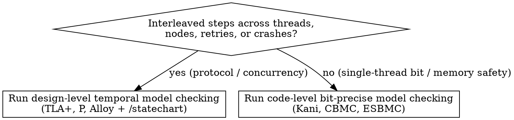

# Model Checking Protocols and Code

## Overview

Model checking explores every reachable state transition, schedule interleaving, or bit pattern within a stated scope:

1. **Design-level temporal model checking (TLA+, P, Alloy):** Verifies state machines (`Init`, `Next`) against **Safety** invariants ($\Box I$, "nothing bad ever happens") and **Liveness** properties ($\Box(P \implies \Diamond Q)$, "something good eventually happens" under fairness).
2. **Code-level bounded model checking (Kani, CBMC, ESBMC):** Compiles real source code (Rust MIR or C) with symbolic inputs (`kani::any()`) into bit-precise SAT/SMT formulas, checking all $2^N$ bit patterns up to loop unwind bound $K$.

**Violating the fidelity of the model or the input space is violating the proof.** Never collapse separate network RPCs or lock acquisitions into a single atomic step in TLA+, and never use `kani::assume` to constrain untrusted payload bytes or parsed header fields.

**REQUIRED SUB-SKILL:** Use `auditing-proof-specifications` before claiming any model check is complete, and use `/statechart` to visualize and inspect TLA+ models and counterexamples.

## When to Use



**When NOT to use:**

- Unbounded functional correctness over arbitrary collection sizes $N$ where bounded loop unwinding is insufficient (use `proving-with-hoare-logic`).
- Deep inductive theorems over recursive ASTs, compilers, or cryptography (use `proving-with-dependent-types`).
- Whole-program C static analysis over infinite control loops via abstract domains (use `analyzing-with-abstract-interpretation`).

## Required Contract for Protocol Model Checking (TLA+ / P / Alloy)

Every protocol model check must include all five parts below in order:

1. **One-to-One Atomicity Mapping:**
   - Each action in `Next` must correspond to one indivisible atomic step in the implementation (one RPC, one compare-and-swap, one lock acquisition, one disk write).
   - Never merge two separate network calls or a read-then-write into a single atomic TLA+ action.
   - When modeling existing code, annotate every action guard with a source file and line comment (e.g., `\* lease.go:142`).
2. **Type Invariant & Safety Invariants ($\Box I$):**
   - Include `TypeOK` and explicit safety invariants (e.g., `SinglePrimary`, `Consistent`, conservation of balances).
3. **Fairness & Liveness Properties ($\Box(P \implies \Diamond Q)$):**
   - Define the full specification with explicit weak or strong fairness on system progress actions (`Spec == Init /\ [][Next]_vars /\ WF_vars(ProgressActions)`).
   - Include at least one temporal liveness property (`PROPERTYTermination` or `StarvationFree == [](Pending => <>Resolved)`) so a protocol that avoids safety bugs by deadlocking or dropping all requests is caught.
4. **Counterexample Replay & `/statechart` Integration:**
   - Run `/statechart` on TLA+ specs to render state transitions and invariant violation paths.
   - Replay every counterexample trace step-by-step against the real implementation code before declaring whether a failure is a code bug or a modeling error.
5. **Explicit Scope & Model Bounds:**
   - State the exact finite `CONSTANTS` checked (e.g., 3 nodes, 2 epochs, max 2 retries) and what remains outside the finite model.

## Required Contract for Code-Level Bounded Model Checking (Kani / CBMC)

Every Kani or CBMC harness must include all four parts below in order:

1. **Symbolic Input Scope vs. Untrusted Data Discipline:**
   - Bound **only** the container capacity (`const MAX_LEN: usize = ...; kani::assume(len <= MAX_LEN);`).
   - **Never** `kani::assume(...)` on untrusted bytes, wire headers, offsets, or loop counts decoded from the input buffer (such as `kani::assume(header.tlv_count <= 4)` or `kani::assume(header.payload_offset <= buf.len())`).
   - If a loop's iteration count comes from untrusted input (`let count = buf[0]`) and exceeds `#[kani::unwind(N)]` on a buffer of size `MAX_LEN`, **that is a bug in the parser** (missing validation that `count * MIN_ITEM_SIZE <= remaining_bytes`), not a harness bound artifact! Fix the code to reject truncated/oversized counts, or set `#[kani::unwind(MAX_POSSIBLE_ITERS_FOR_MAX_LEN + 1)]`.
2. **Unwind Completeness:**
   - Keep unwinding assertions enabled (the default in Kani; `--unwinding-assertions` in CBMC). Set `#[kani::unwind(K + 1)]` where $K$ is the maximum possible iterations for any valid or invalid input within `MAX_LEN`.
3. **Non-Vacuity Coverage (`kani::cover!`):**
   - Include `kani::cover!(...)` statements proving that normal success paths, boundary cases, and error-rejection paths are all reachable under the harness assumptions.
4. **Scope Statement:**
   - State whether the proof is **unbounded** (loop-free fixed-width arithmetic, checking 100% of $2^{64}$ or $2^{128}$ bit patterns) or **bounded** up to capacity `MAX_LEN` and unwind bound `K + 1`.

## Core Pattern 1: Bit-Precise Kani Proof Harness

```rust
pub fn midpoint(lo: u32, hi: u32) -> u32 {
    lo + (hi - lo) / 2
}

#[cfg(kani)]
mod proofs {
    use super::*;

    #[kani::proof]
    fn midpoint_in_range() {
        let lo: u32 = kani::any();
        let hi: u32 = kani::any();
        // Domain precondition of midpoint(lo, hi): caller guarantees lo <= hi
        kani::assume(lo <= hi);

        let m = midpoint(lo, hi);

        assert!(lo <= m && m <= hi);
        assert!(m as u64 == (lo as u64 + hi as u64) / 2);
        // Non-vacuity check: boundary where lo + hi would overflow u32::MAX
        kani::cover!(lo > u32::MAX / 2 && hi > lo);
    }
}
```

## Core Pattern 2: TLA+ Safety + Liveness with Atomic Step Fidelity

```tla
------------------------------ MODULE TwoPhase ------------------------------
CONSTANTS RM \* e.g. {"r1", "r2", "r3"}
VARIABLES rmState, tmState, tmPrepared
vars == <<rmState, tmState, tmPrepared>>

TypeOK ==
    /\ rmState \in [RM -> {"working", "prepared", "committed", "aborted"}]
    /\ tmState \in {"init", "committed", "aborted"}
    /\ tmPrepared \subseteq RM

Init ==
    /\ rmState = [r \in RM |-> "working"]
    /\ tmState = "init"
    /\ tmPrepared = {}

RMPrepare(r) == \* participant.go:48
    /\ rmState[r] = "working"
    /\ rmState' = [rmState EXCEPT ![r] = "prepared"]
    /\ UNCHANGED <<tmState, tmPrepared>>

RMChooseToAbort(r) == \* participant.go:63
    /\ rmState[r] = "working"
    /\ rmState' = [rmState EXCEPT ![r] = "aborted"]
    /\ UNCHANGED <<tmState, tmPrepared>>

TMRcvPrepared(r) == \* coordinator.go:91
    /\ tmState = "init"
    /\ rmState[r] = "prepared"
    /\ tmPrepared' = tmPrepared \cup {r}
    /\ UNCHANGED <<rmState, tmState>>

TMCommit == \* coordinator.go:112
    /\ tmState = "init"
    /\ tmPrepared = RM
    /\ tmState' = "committed"
    /\ UNCHANGED <<rmState, tmPrepared>>

TMAbort == \* coordinator.go:128
    /\ tmState = "init"
    /\ \E r \in RM : rmState[r] = "aborted"
    /\ tmState' = "aborted"
    /\ UNCHANGED <<rmState, tmPrepared>>

RMRcvCommitMsg(r) == \* participant.go:84
    /\ tmState = "committed"
    /\ rmState' = [rmState EXCEPT ![r] = "committed"]
    /\ UNCHANGED <<tmState, tmPrepared>>

RMRcvAbortMsg(r) == \* participant.go:99
    /\ tmState = "aborted"
    /\ rmState' = [rmState EXCEPT ![r] = "aborted"]
    /\ UNCHANGED <<tmState, tmPrepared>>

Next ==
    \/ TMCommit
    \/ TMAbort
    \/ \E r \in RM :
        \/ RMPrepare(r)
        \/ RMChooseToAbort(r)
        \/ TMRcvPrepared(r)
        \/ RMRcvCommitMsg(r)
        \/ RMRcvAbortMsg(r)

Progress ==
    \/ TMCommit
    \/ TMAbort
    \/ \E r \in RM : RMPrepare(r) \/ TMRcvPrepared(r) \/ RMRcvCommitMsg(r) \/ RMRcvAbortMsg(r)

Spec == Init /\ [][Next]_vars /\ WF_vars(Progress)

\* Safety ([]I): No participant commits while another aborts.
Consistent ==
    \A r1, r2 \in RM : ~(rmState[r1] = "aborted" /\ rmState[r2] = "committed")

\* Liveness (<>Q): Every participant eventually reaches a terminal decision.
EventuallyDecided ==
    <>(\A r \in RM : rmState[r] \in {"committed", "aborted"})
=============================================================================
```

## Common Mistakes & Rationalizations

| Excuse | Reality |
| --- | --- |
| "Collapse `CheckEpoch` and `WriteShard` into one atomic TLA+ action—TLA+ is a high-level abstraction" | If two steps are separate RPCs or unlocked operations in code, making them one atomic action in TLA+ deletes the exact interleaving window where race conditions happen. |
| "Add `kani::assume(buf[0] <= 4)` or `kani::assume(header.tlv_count <= 4)` so the loop unwinds in 1 second" | `buf[0]` and `header.tlv_count` are untrusted wire data! Assuming they are $\le 4$ in the harness masks out-of-bounds reads and unbounded-loop DoS bugs when a 4-byte buffer carries `buf[0] == 255`. Bound the buffer length (`len <= MAX_LEN`) and make the parser reject invalid counts. |
| "Skip liveness (`<>`) and fairness (`WF_vars`) in TLA+; safety (`[]I`) is enough" | A protocol where the coordinator drops every request and does nothing forever satisfies every safety invariant vacuously. Always pair safety with a liveness property under explicit fairness. |
| "Disable unwinding assertions (`--no-unwinding-assertions`) to silence loop unwind failures" | Without unwinding assertions, loops that exceed bound $K$ are silently truncated and paths past iteration $K$ are never checked. |

## Red Flags - STOP and Fix Properly

- Merging two network RPCs, database queries, or unlocked memory accesses into a single TLA+ action
- Adding undocumented `CONSTRAINT` or `ACTION_CONSTRAINT` directives in TLC `.cfg` files that prune the state graph before a multi-step bug is reached, or using Alloy `run` (instance satisfiability) instead of `check` (counterexample search)
- Writing `kani::assume` on decoded header fields, offsets, lengths, or enum tags read from an untrusted input buffer
- Omitting `kani::cover!` checks (allowing contradictory `kani::assume` statements to pass vacuously)
- Writing a TLA+ spec with only `Init /\ [][Next]_vars` and zero liveness (`<>` / `~>`) or fairness (`WF_` / `SF_`) formulas
- Reporting a TLA+ or Kani failure as "modeling noise" without replaying the counterexample step-by-step against the real code

**All of these mean: Restore 1-to-1 step atomicity, remove the untrusted-data assumption, add liveness + `kani::cover!`, and replay the counterexample against the implementation.**
