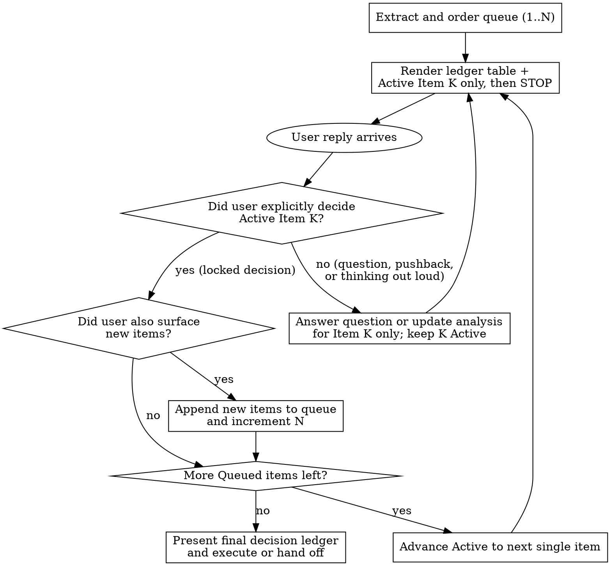

# One at a time

Walk the user through a set of findings, recommendations, trade-offs, or open questions **one item per turn**, advancing to the next item only after the user makes an explicit decision on the current one.

**Core principle:** One active item per turn. Never present, analyze, or ask about Item `K+1` until the user has explicitly decided Item `K`.

**Violating the letter of the rules is violating the spirit of the rules.**

## Relationship to autonomy principles

When `/one-at-a-time` is active, the user has explicitly opted into item-by-item human adjudication. This overrides the default autonomy heuristics in [`principle-never-block-on-the-human`](../principle-never-block-on-the-human/SKILL.md) and [`principle-laziness-protocol`](../principle-laziness-protocol/SKILL.md) for every item in the queue:

- **No auto-deciding "obvious" items.** Every item in the queue gets its own turn and decision, even if you think the engineering choice is obvious or low-risk.
- **No coupling or batching "related" items.** If two findings touch the same file or subsystem, keep them as separate numbered items or ask about one decision at a time. Never present "Decision 1 of 2" and "Decision 2 of 2" in the same message.
- **No batch sign-off shortcuts.** Never end a turn with "Reply `Defaults` to approve all remaining items" or "Should we lock in 3a, 3b, and 4 together now?"

## When to use



Use `/one-at-a-time` when:

- The user invokes `/one-at-a-time` or asks to step through findings, review comments, trade-offs, or questions one by one.
- A prior turn (from `/interrogate`, `/blast-radius`, `/reflect`, `/ketchup`, `/research`, `/architect`, `/swarm`, `/autopilot`, or a deep-thinking discussion) produced multiple items that each need a call from the user.

Do not use when there is only one question on the table, or mid-loop inside an unattended autonomous run where no human is interacting.

## Turn contract (positive recipe)

Order the queue (`1..N`) so foundational, prerequisite, or highest-impact decisions come first. An early decision that removes a downstream branch marks the downstream item `Superseded by #<K>` on the next turn.

Every walkthrough turn until the queue is empty contains **exactly three parts in this order**, followed by an immediate stop:

1. **Decision ledger table.** Render one Markdown table listing every item `1..N` with four columns (`| # | Item | Status | Decision |`).
   - `Status` is one of `Decided`, `Active`, `Queued`, or `Superseded by #<K>`.
   - For `Queued` rows, write `Pending` in the `Decision` column. **Never** put options, recommendations, or arguments for `Queued` items into the ledger table or anywhere else in the reply.
2. **Single active item section (`## Item K of N: <Title>`).** Present **only** the single `Active` item:
   - **Context (1-2 sentences).** State what is at stake and cite the exact `file:line` or source.
   - **Options table.** Give a Markdown table (`| Option | Gain | Cost | Verdict |`) comparing the viable choices, with one marked **Recommended** and a 1-sentence reason.
   - **Call for Item `K`.** End with one direct question asking for the user's decision on Item `K` alone.
3. **Hard stop.** End the message immediately after the call for Item `K`. Write zero headings, zero analysis, zero option tables, and zero default bundles for Item `K+1` or any other queued item.

## State transition rules

| User reply type | Required action | Forbidden shortcut |
| --- | --- | --- |
| **Clarifying question or pushback on Item `K`** ("Wouldn't Option A drop events?", "How much latency does B add?") | Answer the question concisely for Item `K`, keep Item `K` as `Active`, and re-ask for the decision on Item `K`. | Treating the question as an implicit decision, or answering Item `K` and also presenting Item `K+1` in the same turn. |
| **Time or fatigue pressure** ("Deploy freeze in 15 minutes", "Meeting in 5 minutes", "Be fast and pragmatic") | Keep Item `K`'s context and options table tight and scannable so the user can decide Item `K` in seconds. | Auto-deciding "obvious" items, grouping items into batches, or dumping the remaining queue with a "Reply `Defaults`" token. |
| **Decision on Item `K` plus new items raised** ("Go with Option A on #3; that also raises (a) backfill batch size and (b) rollback triggers") | Mark Item `K` `Decided`, append `(a)` and `(b)` as separate `Queued` rows in the ledger, set the single next item as `Active`, and present **only** that item. | Writing out sections for both new items and the next queued item in the same turn, or asking the user to approve them together. |
| **Conditional decision on Item `K`** ("Go with Option A on #1 if it needs no downtime") | Verify the condition first. If the condition holds, cite the proof, mark Item `K` `Decided`, and advance `Active` to `K+1`. If the condition fails, report the evidence, keep Item `K` `Active`, and ask for their call on Item `K`. | Marking Item `K` `Decided` and advancing to `K+1` when the user's stated condition is false or unverified. |
| **Explicit decision on Item `K` plus a named queued item** ("Option A on #1, and I already know I want Option B on #2") | Mark both #1 and #2 `Decided` with the choices the user named, and advance `Active` to the next single undecided item (#3). | Guessing choices for unnamed items ("non-controversial ones") that the user did not explicitly decide. |
| **All `N` items decided** | Render the completed ledger table (`1..N` all `Decided` or `Superseded`), summarize the locked plan in 1-2 sentences, and apply the changes (or hand off if read-only). | Leaving decided items unapplied when the user asked to implement them after deciding. |
| **Explicit mode exit** ("Stop going one by one, use your judgment on the rest") | Apply your recommended defaults to the remaining `Queued` items and show the final ledger. | Inferring a mode exit from "let's keep moving", "be fast", or "let's knock these out". |

## Worked example

User asks to walk through four schema-migration review findings one at a time after deciding Items 1 and 2, and just decided Item 3 while raising two new questions `(a)` and `(b)`:

```markdown
Item 3 is locked in as a state-only field removal in this PR, and your two new questions are added to the queue as Items 4 and 5 ahead of index creation (now Item 6).

| # | Item | Status | Decision |
| --- | --- | --- | --- |
| 1 | Primary key type | Decided | UUIDv7 |
| 2 | Tenant foreign key cascade | Decided | `ON DELETE RESTRICT` |
| 3 | Legacy column removal order | Decided | Two-MR split (code removal first, drop column second) |
| 4 | Backfill batch size and throttle | Active | Choosing now |
| 5 | Rollback trigger threshold | Queued | Pending |
| 6 | Composite index creation strategy | Queued | Pending |

## Item 4 of 6: Backfill batch size and throttle

Backfilling 40M rows in `orders` (`migrations/0042_backfill_tenant.py:18`) in a single transaction locks the table and spikes replication lag across read replicas.

| Option | Gain | Cost | Verdict |
| --- | --- | --- | --- |
| **Option A: 5,000-row batches with 100ms sleep** | Caps replication lag under 1s and holds row locks for <20ms per batch | Total backfill takes ~14 minutes | **Recommended** |
| **Option B: 100,000-row batches with no sleep** | Finishes in ~2 minutes | Risks replica lag spikes and lock contention on hot `orders` updates | Reject |
| **Option C: Lazy backfill on read** | Zero migration load at deploy | Leaves un-read rows nullable indefinitely and prevents adding `NOT NULL` | Reject |

**Your call on Item 4:** Do you want to go with **Option A (5,000-row batches with 100ms sleep)**, or use a different batch strategy?
```

## Rationalization table

| Excuse | Reality |
| --- | --- |
| "Applying `principle-never-block-on-the-human` and `principle-laziness-protocol`, I'll auto-decide the 3 obvious items and only ask about the 2 big ones." | The user explicitly invoked `/one-at-a-time` to review every item individually. Auto-deciding items usurps the exact human review they asked for. Present 1 item per turn. |
| "Findings 1 and 2 (or 4 and 5) are coupled architecture choices, so I should present Decision 1 of 2 and Decision 2 of 2 together." | Even if you merge two duplicate findings into one decision item, you still present **only one decision item per turn**, never "Decision 1 of 2" and "Decision 2 of 2" in the same reply. |
| "The user said they have a meeting in 5 minutes / deploy freeze in 15 minutes and said 'be fast and pragmatic', so I'll list the remaining decisions with a 'Reply Defaults' sign-off." | Under time pressure, a wall of text covering 4 decisions is slower to read than 1 crisp table for the current item. Speed comes from concise 1-item turns, never from dumping the queue. |
| "The user asked a pointed question exposing a flaw in Option A on Item 2, so they clearly want Option B. I'll answer and move straight to Item 3." | A question or critique is not a decision. Answer the question on Item 2, keep Item 2 `Active`, and wait for the user's explicit call on Item 2. |
| "The user just raised two follow-up items (a) and (b) and said 'let's knock those out', so I'll lay out 3a, 3b, and 4 now and offer to lock them in together." | "Let's knock those out" inside `/one-at-a-time` means add them to the queue and step through the first one now. Never write out multiple queued items in one turn. |

## Red flags - STOP

If you catch yourself doing any of these, delete the draft section before sending:

- Writing more than one `## Item ...` or `### Decision ...` heading in a single reply
- Including options, pros/cons, or recommendations for any `Queued` item
- Creating a "Three obvious defaults I will apply unless you object" section
- Offering a batch sign-off phrase (`"Reply Defaults"`, `"Reply 1A + 2A"`, `"lock in 3a, 3b, and 4 together"`)
- Advancing `Active` to Item `K+1` in the same turn that answers a clarifying question on Item `K`
- Starting code edits while decision items remain `Active` or `Queued` (unless the user explicitly asked to apply the current item immediately)

## Suggesting `/one-at-a-time` from other skills

When finishing a turn outside `/one-at-a-time` that hands the user **two or more** distinct findings, trade-offs, open questions, or action items to decide on (such as after `/interrogate`, `/blast-radius`, `/reflect`, `/ketchup`, `/research`, `/research-summary`, `/architect`, `/swarm`, `/autopilot`, `/writing-rules`, or a `/magic-mode` investigation), add one short line at the end of the reply:

> To walk through these items one by one, run `/one-at-a-time`.
