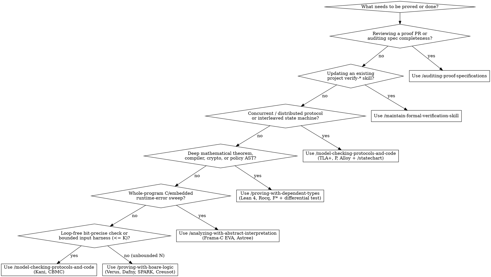

# Proof-Driven Development Orchestrator

## Overview

Unit tests and fuzzers only check the specific inputs executed. Even a function of two 64-bit integers has $2^{128}$ input pairs. **Proof-driven development** pairs AI coding agents with deterministic formal verifiers to prove theorems over *every* valid input, state transition, or execution schedule within a stated scope.

Because writing a formal proof is hard while checking one is mechanical, AI agents excel at synthesizing loop invariants, proof tactics, and symbolic harnesses—**except at the specification boundary**, where an unmonitored agent will state the wrong theorem (~90% failure rate when inferring specs from code alone) or game the spec (`sorry`, `admit`, `assume`, `external_body`, weakened `ensures`, strengthened `requires`). This orchestrator routes each engineering problem to the right mathematical mechanism and enforces specification auditing across every flow.

## The Three Mathematical Guarantees

1. **Positive guarantees (functionality and liveness):** The program computes the right output for every valid input, or the system eventually makes progress instead of stalling ($\Box(P \implies \Diamond Q)$).
2. **Negative guarantees (safety and absence of bad behavior):** The program can *never* reach a forbidden state ($\Box I$, `Reachable s -> Bad s -> False`, no arithmetic overflow, no out-of-bounds access, `forbid` always overrides `permit`).
3. **Exhaustiveness guarantees (no logical gaps):** Every state transition, input branch, or failure mode is handled, and no reachable combination of states can deadlock.

## Catalog of Proof-Driven Development Skills

| Skill | Role in Proof-Driven Development | Representative Tools |
| --- | --- | --- |
| [`/proof-driven-development`](../proof-driven-development/SKILL.md) | **Orchestrator & Router:** Classifies the guarantee, picks the mathematical mechanism and tool, sequences multi-skill workflows, and enforces the 4-gap audit. | All formal verification tools |
| [`/proving-with-hoare-logic`](../proving-with-hoare-logic/SKILL.md) | **Flow 1 — Auto-Active Deductive Verification:** Proves imperative code contracts (`requires`, `ensures`), 4-step inductive loop invariants (`invariant`, `decreases`), and separation-logic framing ($P * Q$). | Verus, Dafny, SPARK, Creusot, Frama-C WP |
| [`/proving-with-dependent-types`](../proving-with-dependent-types/SKILL.md) | **Flow 2 — Curry-Howard & Interactive Theorem Proving:** Proves deep mathematical theorems, compilers, cryptography, policy lattices, and multi-step state impossibility (`Reachable s -> Bad s -> False`). | Lean 4, Rocq, Isabelle/HOL, F\* (plus Aeneas, KaRaMeL, and `never` types) |
| [`/model-checking-protocols-and-code`](../model-checking-protocols-and-code/SKILL.md) | **Flow 3 — Temporal Logic & Bounded Model Checking:** Checks concurrent/distributed protocols for safety ($\Box I$) and liveness ($\Diamond Q$), and checks real code bit-precisely for panics/overflow via symbolic execution. | TLA+, P, Alloy (protocols); Kani, CBMC, ESBMC (code) |
| [`/analyzing-with-abstract-interpretation`](../analyzing-with-abstract-interpretation/SKILL.md) | **Flow 4 — Sound Static Analysis over Abstract Domains:** Proves whole-program absence of runtime errors (overflow, division by zero, out-of-bounds access) via Galois-connected abstract domains and triages alarms. | Frama-C EVA, Astrée, Goblint |
| [`/auditing-proof-specifications`](../auditing-proof-specifications/SKILL.md) | **Flow 5 — Specification Completeness, Anti-Gaming & 4-Gap Audit:** Audits specs for vacuity, runs `check-proof-cheats.mjs` against escape hatches, and bridges the 4 remaining gaps. | `check-proof-cheats.mjs`, `#print axioms`, differential fuzzing |
| [`/statechart`](../statechart/SKILL.md) | **Protocol Visualization & Counterexample Stories:** Renders TLA+ models and TLC counterexamples as Mermaid statecharts in reader terms and replays bug traces against code. | TLA+ / TLC + `statechart.mjs` |
| [`/create-formal-verification-skill`](../create-formal-verification-skill/SKILL.md) | **Project-Local Verify Skill Generator:** Packages a proven check into a repository-local `verify-*` skill with covered file paths, bounds, and a sync commit. | Any verifier chosen for the repo |
| [`/maintain-formal-verification-skill`](../maintain-formal-verification-skill/SKILL.md) | **Post-Change Drift & Regression Upkeep:** Diffs covered code from the sync commit after merges or refactors, updates models/harnesses, and separates drift from bugs. | Project-local `verify-*` skills |

## Decision Flowchart: Picking the Right Skill

## Matching the Question to the Proof Skill & Mechanism

| Engineering Question | Guarantee Class | Mathematical Mechanism | Tools | Primary Skill | Companion Skills |
| --- | --- | --- | --- | --- | --- |
| "Does this function ever panic, overflow, or index out of bounds on inputs up to size $K$ (or loop-free 64-bit ints)?" | Negative + Exhaustiveness | Bit-precise symbolic execution & SAT/SMT | Kani, CBMC, ESBMC | [`/model-checking-protocols-and-code`](../model-checking-protocols-and-code/SKILL.md) | [`/auditing-proof-specifications`](../auditing-proof-specifications/SKILL.md), [`/create-formal-verification-skill`](../create-formal-verification-skill/SKILL.md) |
| "Does this algorithm/data structure return the right output for every valid input of *any* size $N$?" | Positive + Negative | Hoare logic (`requires`/`ensures`/`invariant`/`decreases`) + SMT | Verus, Dafny, SPARK, Creusot, Frama-C WP | [`/proving-with-hoare-logic`](../proving-with-hoare-logic/SKILL.md) | [`/auditing-proof-specifications`](../auditing-proof-specifications/SKILL.md), [`/create-formal-verification-skill`](../create-formal-verification-skill/SKILL.md) |
| "Does this authorization policy, compiler pass, or cryptographic primitive obey deep mathematical laws?" | Positive + Negative + Exhaustiveness | Curry-Howard dependent types & kernel-checked tactics | Lean 4, Rocq, Isabelle/HOL, F\* (with Aeneas / KaRaMeL) | [`/proving-with-dependent-types`](../proving-with-dependent-types/SKILL.md) | [`/auditing-proof-specifications`](../auditing-proof-specifications/SKILL.md) |
| "Can this concurrent or distributed protocol deadlock, split-brain, or drop data across crash/retry interleavings?" | Negative ($\Box I$) + Positive ($\Diamond Q$) + Exhaustiveness | Temporal logic model checking over state transitions | TLA+, P, Alloy | [`/model-checking-protocols-and-code`](../model-checking-protocols-and-code/SKILL.md) | [`/statechart`](../statechart/SKILL.md), [`/auditing-proof-specifications`](../auditing-proof-specifications/SKILL.md), [`/create-formal-verification-skill`](../create-formal-verification-skill/SKILL.md) |
| "Does this embedded C firmware have zero division-by-zero, overflow, or out-of-bounds errors across the whole program?" | Negative (whole-program runtime safety) | Abstract interpretation over Galois-connected lattices | Frama-C EVA, Astrée, Goblint | [`/analyzing-with-abstract-interpretation`](../analyzing-with-abstract-interpretation/SKILL.md) | [`/proving-with-hoare-logic`](../proving-with-hoare-logic/SKILL.md) (for residual `-wp` obligations), [`/auditing-proof-specifications`](../auditing-proof-specifications/SKILL.md) |
| "Did this AI-generated proof actually prove the intended property without cheating or leaving gaps?" | Meta-assurance across all 4 gaps | Spec completeness, escape-hatch scan, differential conformance | `check-proof-cheats.mjs`, `#print axioms`, `proptest` | [`/auditing-proof-specifications`](../auditing-proof-specifications/SKILL.md) | [`/maintain-formal-verification-skill`](../maintain-formal-verification-skill/SKILL.md) |

## Required Output Contract When Recommending or Orchestrating

Whenever you use this skill to advise on, select, or orchestrate proof-driven development, output all five sections below in order:

1. **Guarantee & Problem Classification:**
   - For each target component, identify which of the three guarantees (Positive, Negative, Exhaustiveness) is needed and why unit testing or fuzzing cannot cover the state space.
2. **Selected Skill(s), Mathematical Mechanism, and Tool:**
   - Name the exact primary skill (`/proving-with-hoare-logic`, `/proving-with-dependent-types`, `/model-checking-protocols-and-code`, or `/analyzing-with-abstract-interpretation`), the mathematical mechanism, and the concrete verifier tool.
3. **Why Other Mechanisms Fail on This Target:**
   - Explain in 1-2 sentences per target why a wrong or single-tool choice fails (e.g., why Kani cannot check distributed message reordering or unbounded AST induction; why TLA+ uses unbounded mathematical integers and misses 64-bit machine overflow; why non-inductive bounded unwinding misses accumulated filter drift).
4. **Multi-Skill Execution Pipeline:**
   - State the ordered sequence of skills to run:
     1. **Human-verified specification first** (freeze `requires`/`ensures` or theorem statements before proof synthesis).
     2. **Primary flow skill** (`/proving-with-hoare-logic`, `/proving-with-dependent-types`, `/model-checking-protocols-and-code` + `/statechart`, or `/analyzing-with-abstract-interpretation`).
     3. **Mandatory gap & cheat audit** (`/auditing-proof-specifications` running `node skills/auditing-proof-specifications/scripts/check-proof-cheats.mjs`).
     4. **CI persistence & upkeep** (`/create-formal-verification-skill` to lock the check into the repo, and `/maintain-formal-verification-skill` after future edits).
5. **The Four Remaining Gaps Plan:**
   - Explicitly state how each of the four remaining gaps will be addressed for the target:
     1. **Specification gap & spec gaming** (two-sided completeness law + frozen spec diff + cheat scanner).
     2. **Model-to-implementation gap** (source-level verification, verified extraction via Aeneas/KaRaMeL, refinement, or structure-aware differential testing).
     3. **Bounded vs. unbounded scope** (exact unwind/state bounds $K$ vs. inductive invariants for all $N$).
     4. **Trusted computing base (TCB) & unmodeled reality** (`external_body`/FFI audit, compiler trust, constant-time side-channel discipline).

## Common Mistakes & Rationalizations

| Excuse | Reality |
| --- | --- |
| "Let's standardize on one tool (like Kani or property-based fuzzing) for all four problems so CI stays simple" | Different bug classes live in different mathematical domains. Fuzzing never proves absence of bugs; Kani cannot model distributed network partitions or unbounded AST induction; TLA+ misses fixed-width bit overflow. Match the tool to the question. |
| "Let the AI agent generate both the Lean/Verus specification and the proof from the existing code" | On benchmarks like VeriBench, AI agents given only code state the intended specification ~10% of the time, often proving a tautology that mirrors a bug in the code. Treat the specification as the human-reviewed contract. |
| "Routing to `/create-formal-verification-skill` alone is enough—we don't need the specific flow skills" | `/create-formal-verification-skill` packages a check into a project-local skill, while the flow skills (`/proving-with-hoare-logic`, `/proving-with-dependent-types`, `/model-checking-protocols-and-code`, `/analyzing-with-abstract-interpretation`, `/auditing-proof-specifications`) govern how to construct and audit each mathematical proof without soundness holes. |

## Red Flags - STOP and Re-Route

- Recommending fuzzing or property-based testing alone when the user asked for a mathematical proof
- Using a single bounded model checker for distributed consensus, unbounded recursive ASTs, or long-running numerical filter loops
- Allowing an agent to start synthesizing a proof before the specification (`requires`/`ensures` or theorem statement) is explicitly written and checked for two-sided completeness
- Finishing any proof workflow without running `/auditing-proof-specifications`

**All of these mean: Classify each problem's guarantee, select the matching flow skill per component, freeze the specification first, and audit all four remaining gaps.**
