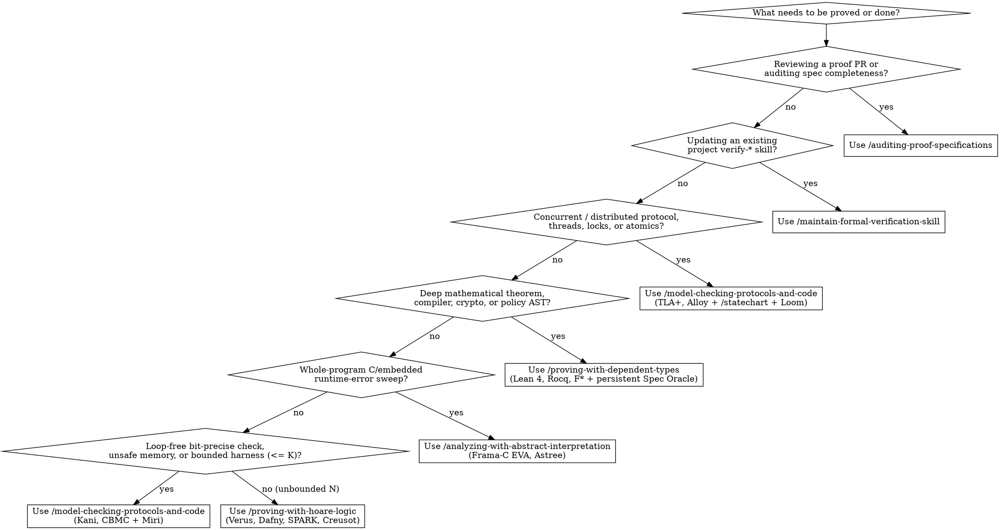

# Proof-Driven Development Orchestrator

## Overview

Unit tests and fuzzers only check the specific inputs executed. Even a function of two 64-bit integers has $2^{128}$ input pairs. **Proof-driven development** pairs AI coding agents with deterministic formal verifiers to prove theorems over *every* valid input, state transition, or execution schedule within a stated scope.

Because writing a formal proof is hard while checking one is mechanical, AI agents excel at synthesizing loop invariants, proof tactics, and symbolic harnesses—**except at the specification boundary**, where an unmonitored agent will state the wrong theorem (~90% failure rate when inferring specs from code alone) or game the spec (`sorry`, `admit`, `assume`, `external_body`, `trusted`, weakened `ensures`, strengthened `requires`). This orchestrator routes each engineering problem to the right mathematical mechanism, sequences the 4-Phase Proof-Driven Development lifecycle, and enforces specification auditing across every flow.

## The Three Mathematical Guarantees

1. **Positive guarantees (functionality and liveness):** The program computes the right output for every valid input, or the system eventually makes progress instead of stalling ($\Box(P \implies \Diamond Q)$).
2. **Negative guarantees (safety and absence of bad behavior):** The program can *never* reach a forbidden state ($\Box I$, `Reachable s -> Bad s -> False`, no arithmetic overflow, no out-of-bounds access, `forbid` always overrides `permit`).
3. **Exhaustiveness guarantees (no logical gaps):** Every state transition, input branch, or failure mode is handled, and no reachable combination of states can deadlock.

## Catalog of Proof-Driven Development Skills

| Skill | Role in Proof-Driven Development | Representative Tools |
| --- | --- | --- |
| [`/proof-driven-development`](../proof-driven-development/SKILL.md) | **Orchestrator & Router:** Classifies the guarantee, picks the mathematical mechanism and tool, sequences the 4-Phase PDD lifecycle, and enforces the 4-gap audit. | All formal verification tools |
| [`/proving-with-hoare-logic`](../proving-with-hoare-logic/SKILL.md) | **Flow 1 — Auto-Active Deductive Verification:** Proves imperative code contracts (`requires`, `ensures`), `verify_spec_not_vacuous` skeletons, 4-step loop induction (`invariant`, `decreases`), separation framing ($P * Q$), and split `decide`/`perform` cores with ghost erasure. | Verus, Dafny, SPARK, Creusot, Frama-C WP |
| [`/proving-with-dependent-types`](../proving-with-dependent-types/SKILL.md) | **Flow 2 — Curry-Howard & Interactive Theorem Proving:** Proves deep mathematical theorems, compilers, crypto, policy lattices, multi-step state impossibility (`Reachable s -> Bad s -> False`), and persistent JSON-RPC Spec Oracles (`OracleMain`). | Lean 4, Rocq, Isabelle/HOL, F\* (plus Aeneas, KaRaMeL, and `never` types) |
| [`/model-checking-protocols-and-code`](../model-checking-protocols-and-code/SKILL.md) | **Flow 3 — Temporal Logic, DPOR Concurrency & Bit-Precise Model Checking:** Checks distributed protocols (`Init`/`Next`/`WF_vars` + `*Trace.tla`), code-level thread/lock/atomic schedules (`Loom`/`Shuttle`), and bit-precise/operational safety (`Kani`/`CBMC` + `Miri`). | TLA+, P, Alloy; Loom, Shuttle, GenMC; Kani, CBMC, Miri |
| [`/analyzing-with-abstract-interpretation`](../analyzing-with-abstract-interpretation/SKILL.md) | **Flow 4 — Sound Static Analysis over Abstract Domains:** Proves whole-program absence of runtime errors (overflow, division by zero, out-of-bounds access) via Galois-connected abstract domains and triages alarms without suppressions. | Frama-C EVA, Astrée, Goblint |
| [`/auditing-proof-specifications`](../auditing-proof-specifications/SKILL.md) | **Flow 5 — Spec Validation (Gates A/B/C), AST Contract Lock & 4-Gap Audit:** Validates specs against reference code (`*Trace.tla`, Spec Oracle diff fuzzing, $N$-Mutant Kill Gate), locks contract ASTs (`verify-spec-lock.mjs`), and scans for escape hatches (`check-proof-cheats.mjs`). | `verify-spec-lock.mjs`, `check-proof-cheats.mjs`, `#print axioms`, `Hypothesis`, `proptest` |
| [`/statechart`](../statechart/SKILL.md) | **Protocol Visualization & Counterexample Stories:** Renders TLA+ models and TLC counterexamples as Mermaid statecharts in reader terms and replays bug traces against code. | TLA+ / TLC + `statechart.mjs` |
| [`/create-formal-verification-skill`](../create-formal-verification-skill/SKILL.md) | **Project-Local Verify Skill Generator:** Packages a proven check into a repository-local `verify-*` skill with covered file paths, bounds, and a sync commit. | Any verifier chosen for the repo |
| [`/maintain-formal-verification-skill`](../maintain-formal-verification-skill/SKILL.md) | **Post-Change Drift & Regression Upkeep:** Diffs covered code from the sync commit after merges or refactors, updates models/harnesses, and separates drift from bugs. | Project-local `verify-*` skills |

## Decision Flowchart: Picking the Right Skill

## Matching the Question to the Proof Skill & Mechanism

| Engineering Question | Guarantee Class | Mathematical Mechanism | Tools | Primary Skill | Companion Skills |
| --- | --- | --- | --- | --- | --- |
| "Does this function ever panic, overflow, violate aliasing/UB, or index out of bounds on inputs up to size $K$ (or loop-free 64-bit ints)?" | Negative + Exhaustiveness | Bit-precise symbolic execution (SAT/SMT) + operational memory-model UB checking | Kani, CBMC, ESBMC + Miri | [`/model-checking-protocols-and-code`](../model-checking-protocols-and-code/SKILL.md) | [`/auditing-proof-specifications`](../auditing-proof-specifications/SKILL.md), [`/create-formal-verification-skill`](../create-formal-verification-skill/SKILL.md) |
| "Does this algorithm or synchronous `decide` state machine return the right output for every valid input of *any* size $N$?" | Positive + Negative | Hoare logic (`requires`/`ensures`/`invariant`/`decreases` + `verify_spec_not_vacuous`) discharged by SMT | Verus, Dafny, SPARK, Creusot, Frama-C WP | [`/proving-with-hoare-logic`](../proving-with-hoare-logic/SKILL.md) | [`/auditing-proof-specifications`](../auditing-proof-specifications/SKILL.md), [`/create-formal-verification-skill`](../create-formal-verification-skill/SKILL.md) |
| "Does this authorization policy, compiler pass, cryptographic primitive, or reference model obey deep mathematical laws?" | Positive + Negative + Exhaustiveness | Curry-Howard dependent types & kernel-checked tactics + persistent JSON-RPC Spec Oracle | Lean 4, Rocq, Isabelle/HOL, F\* (with Aeneas / KaRaMeL) | [`/proving-with-dependent-types`](../proving-with-dependent-types/SKILL.md) | [`/auditing-proof-specifications`](../auditing-proof-specifications/SKILL.md) |
| "Can this concurrent or distributed protocol deadlock, split-brain, or drop data across crash/retry/thread interleavings?" | Negative ($\Box I$) + Positive ($\Diamond Q$) + Exhaustiveness | Temporal logic model checking (`*Trace.tla`) + code-level DPOR schedule exhaustion | TLA+, P, Alloy + Loom, Shuttle, GenMC | [`/model-checking-protocols-and-code`](../model-checking-protocols-and-code/SKILL.md) | [`/statechart`](../statechart/SKILL.md), [`/auditing-proof-specifications`](../auditing-proof-specifications/SKILL.md), [`/create-formal-verification-skill`](../create-formal-verification-skill/SKILL.md) |
| "Does this embedded C firmware have zero division-by-zero, overflow, or out-of-bounds errors across the whole program?" | Negative (whole-program runtime safety) | Abstract interpretation over Galois-connected lattices | Frama-C EVA, Astrée, Goblint | [`/analyzing-with-abstract-interpretation`](../analyzing-with-abstract-interpretation/SKILL.md) | [`/proving-with-hoare-logic`](../proving-with-hoare-logic/SKILL.md) (for residual `-wp` obligations), [`/auditing-proof-specifications`](../auditing-proof-specifications/SKILL.md) |
| "Did this spec or AI-generated proof actually capture the reference behavior without spec gaming or leaving gaps?" | Meta-assurance across all 4 gaps | 3-Gate Spec Validation (`*Trace.tla`, Spec Oracle diff, $N$-Mutant Kill Gate) + AST `spec.lock` + cheat scan | `verify-spec-lock.mjs`, `check-proof-cheats.mjs`, `#print axioms`, `Hypothesis`, `proptest` | [`/auditing-proof-specifications`](../auditing-proof-specifications/SKILL.md) | [`/maintain-formal-verification-skill`](../maintain-formal-verification-skill/SKILL.md) |

## Required Output Contract When Recommending or Orchestrating

Whenever you use this skill to advise on, select, or orchestrate proof-driven development, output all five sections below in order:

1. **Guarantee & Problem Classification:**
   - For each target component, identify which of the three guarantees (Positive, Negative, Exhaustiveness) is needed and why unit testing or fuzzing cannot cover the state space.
2. **Selected Skill(s), Mathematical Mechanism, and Tool:**
   - Name the exact primary skill (`/proving-with-hoare-logic`, `/proving-with-dependent-types`, `/model-checking-protocols-and-code`, or `/analyzing-with-abstract-interpretation`), the mathematical mechanism, and the concrete verifier tool.
3. **Why Other Mechanisms Fail on This Target:**
   - Explain in 1-2 sentences per target why a wrong or single-tool choice fails (e.g., why Kani cannot check distributed message reordering or unbounded AST induction; why TLA+ uses unbounded mathematical integers and misses 64-bit machine overflow; why non-inductive bounded unwinding misses accumulated filter drift).
4. **The 4-Phase Proof-Driven Development Execution Pipeline:**
   - Sequence the work across these four verifiable phases:
     - **Phase 1 — Formal Specifications, Computable Reference Models & Contract Skeletons (Before Target Implementation):**
       1. *Protocol & Concurrency Specs (`/model-checking-protocols-and-code` + `/statechart`):* Author TLA+ specs (`Init`, `Next`, `WF_vars`) and trace refinement wrappers (`*Trace.tla`); verify Safety ($\Box I$) and Liveness ($\Diamond Q$) with `TLC`.
       2. *Computable Functional Models & Persistent Spec Oracle (`/proving-with-dependent-types`):* Author total Lean 4 / Rocq functional models, prove universal theorems (`#print axioms` clean), and compile a persistent `stdin`/`stdout` JSON-lines Spec Oracle binary (`OracleMain`).
       3. *Contract Skeletons & Mechanized Non-Vacuity (`/proving-with-hoare-logic` + `/model-checking-protocols-and-code`):* Author target contract skeletons (`spec fn inv`, `requires`, `ensures` with `{ todo!() }` bodies), mechanized `proof fn verify_spec_not_vacuous` lemmas, and `#[kani::proof]` harnesses; verify non-vacuity before writing implementation bodies.
     - **Phase 2 — 3-Gate Spec-Against-Reference Validation (`/auditing-proof-specifications` — When Reference System Exists):**
       1. *Gate A (Forward Runtime Trace Validation):* Capture NDJSON traces from the reference system's test suite (`TlaTraceObserver`) and verify 100% trace acceptance in `TLC` (`*Trace.tla`).
       2. *Gate B (Persistent Spec Oracle Differential Fuzzing):* Run $50{,}000$+ property-based examples (`Hypothesis` / `fast-check`) per component comparing the reference implementation against the persistent Spec Oracle binary (`0` discrepancies).
       3. *Gate C ($N$-Mutant Spec Kill Gate):* Plant single-line semantic mutations (1 per theorem ID) in a scratch copy of the reference system and verify the spec suite kills **100% ($N/N$) of mutants**.
     - **Phase 3 — Cryptographic AST Spec Lock & Layered Implementation Synthesis:**
       1. *Lock Contract AST (`spec.lock`):* Run `node skills/auditing-proof-specifications/scripts/verify-spec-lock.mjs --generate .` to lock SHA-256 digests of `.tla`, `.cfg`, `.lean`, and extracted contract AST headers (plus any explicit `--allow-unsafe` files).
       2. *Verified Synchronous Core Synthesis (`/proving-with-hoare-logic`):* Factor stateful logic into synchronous, non-cancellable `decide(&mut self, event) -> StepDecision` state machines (`#![forbid(unsafe_code)]`) with ghost-erasure dual compilation; synthesize loop invariants and bodies until Verus/Dafny/SPARK reports `0 errors` and `verify-spec-lock.mjs --check` passes.
       3. *Bit-Precise & Memory-Safe Media/Parser Synthesis (`/model-checking-protocols-and-code` + `/analyzing-with-abstract-interpretation`):* Synthesize codecs, DSP math, wire parsers, and whitelisted `unsafe` containers; verify with Kani/CBMC/Frama-C EVA (`0 alarms`) and Miri (`0 UB/leaks`).
       4. *Async Runtime Shell & Concurrency Schedule Synthesis (`/model-checking-protocols-and-code`):* Wrap the `decide` core in the async `perform` runtime shell and verify concurrent lock/atomic/cancellation schedules under `Loom` / `Shuttle` / `GenMC`.
     - **Phase 4 — High-Volume Differential Fuzzing, Black-Box Protocol Evals & CI Lock-In:**
       1. *Multi-Threaded Differential Harness:* Run $10^5$–$10^6$ `proptest` / `Hypothesis` traces across worker threads comparing the new implementation against the persistent Spec Oracle and reference implementation (`0 divergences`).
       2. *End-to-End Black-Box Protocol Certification:* Boot the compiled binary and run the upstream black-box wire-protocol evaluation suite (`eval suite`) against it.
       3. *CI Persistence & Upkeep:* Run `node skills/auditing-proof-specifications/scripts/check-proof-cheats.mjs`, package the commands into a project-local `verify-*` skill via `/create-formal-verification-skill`, and maintain it after future code changes with `/maintain-formal-verification-skill`.
5. **The Four Remaining Gaps Plan:**
   - Explicitly state how each of the four remaining gaps is closed for the target:
     1. **Specification gap & spec gaming** (two-sided completeness law + `verify_spec_not_vacuous` + Gate C $N$-Mutant Kill Gate + `verify-spec-lock.mjs` + `check-proof-cheats.mjs`).
     2. **Model-to-implementation gap** (Gate A `*Trace.tla` + Gate B/Phase 4 persistent Spec Oracle differential fuzzing + ghost-erasure dual compilation + black-box wire evals).
     3. **Bounded vs. unbounded scope** (exact unwind/state bounds $K$ vs. inductive invariants for all $N$).
     4. **Trusted computing base (TCB) & unmodeled reality** (`#![forbid(unsafe_code)]` with explicit `spec.lock` `whitelisted_unsafe_files` verified by Kani + Miri, compiler trust, and constant-time side-channel discipline).

## Common Mistakes & Rationalizations

| Excuse | Reality |
| --- | --- |
| "Let's standardize on one tool (like Kani or property-based fuzzing) for all four problems so CI stays simple" | Different bug classes live in different mathematical domains. Fuzzing never proves absence of bugs; Kani cannot model distributed network partitions or unbounded AST induction; TLA+ misses fixed-width bit overflow. Match the tool to the question. |
| "Let the AI agent generate both the Lean/Verus specification and the proof from the existing code" | On benchmarks like VeriBench, AI agents given only code state the intended specification ~10% of the time, often proving a tautology that mirrors a bug in the code. Validate specs via Gates A/B/C and lock them with `verify-spec-lock.mjs --generate` before synthesis. |
| "Our TLA+ and Lean 4 specs passed `TLC` and `lake build`, so we can jump straight to synthesizing Rust" | Passing `TLC` and `lake build` only proves internal consistency. Without Phase 2 (Gate A forward trace validation, Gate B Spec Oracle differential fuzzing against the reference codebase, and Gate C $N$-Mutant Kill Gate), your specs will silently diverge from real system behavior. |
| "Routing to `/create-formal-verification-skill` alone is enough—we don't need the specific flow skills" | `/create-formal-verification-skill` packages a check into a project-local skill, while the flow skills (`/proving-with-hoare-logic`, `/proving-with-dependent-types`, `/model-checking-protocols-and-code`, `/analyzing-with-abstract-interpretation`, `/auditing-proof-specifications`) govern how to construct and audit each mathematical proof without soundness holes. |

## Red Flags - STOP and Re-Route

- Recommending fuzzing or property-based testing alone when the user asked for a mathematical proof
- Using a single bounded model checker for distributed consensus, unbounded recursive ASTs, or long-running numerical filter loops
- Allowing an agent to start synthesizing implementation code before `verify_spec_not_vacuous` passes, Phase 2 Gates A/B/C pass (when a reference system exists), and `spec.lock` is generated via `verify-spec-lock.mjs --generate`
- Finishing any proof workflow without running `/auditing-proof-specifications` (`verify-spec-lock.mjs --check` and `check-proof-cheats.mjs`)

**All of these mean: Classify each problem's guarantee, select the matching flow skill per component, validate and lock the specification first, and execute all four PDD phases.**
