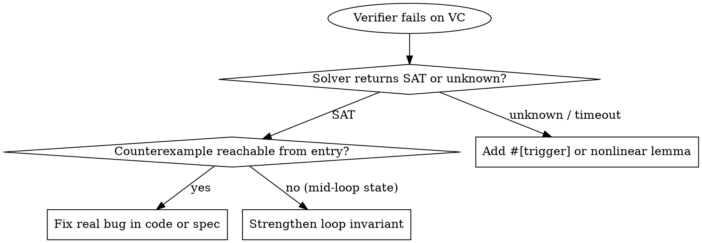

# Proving with Hoare Logic

## Overview

Auto-active verification proves a Hoare triple $\{P\}\; C \;\{Q\}$ by translating code $C$, precondition $P$ (`requires`), and postcondition $Q$ (`ensures`) into a verification condition ($\text{VC}$) and asking an SMT solver (Z3, cvc5, Alt-Ergo) whether $\lnot \text{VC}$ is satisfiable. If $\lnot \text{VC}$ is `UNSAT`, the code satisfies the contract for every valid input of any size; if `SAT`, the assignment is a concrete counterexample.

**Violating the letter of the proof obligations is violating the spirit of the proof.** Never weaken `ensures`, strengthen `requires` to exclude valid runtime inputs, or insert `assume`, `admit`, `trusted`, or `external_body` to make an SMT solver pass.

**REQUIRED SUB-SKILL:** Use `auditing-proof-specifications` before claiming any proof is complete.

## When to Use

- Proving an imperative function or state-machine transition computes the right output and never overflows, panics, or indexes out of bounds for inputs of arbitrary size $N$.
- Writing or debugging `requires`, `ensures`, `invariant`, `decreases`, `modifies`, `verify_spec_not_vacuous`, or ghost state in Verus, Dafny, SPARK, Creusot, or Frama-C WP.
- Factoring an async/event-driven runtime into a deductively verified synchronous `decide` core and a thin async `perform` wrapper.
- Reasoning about mutable references or heap pointers via separation logic ($P * Q$) or frame conditions (`modifies` / `assigns` / `\separated`).
- Diagnosing an SMT verification failure (counterexample vs. quantifier/nonlinear timeout).

**When NOT to use:**

- Distributed or concurrent state-machine protocols with message reordering, retries, and node crashes (use `model-checking-protocols-and-code`).
- Deep mathematical metatheory, compilers, or inductive proofs over unbounded syntax trees where SMT solvers time out (use `proving-with-dependent-types`).
- Whole-program absence-of-runtime-error sweeps on C/embedded code without per-function contracts (use `analyzing-with-abstract-interpretation`).
- Unsure which paradigm fits (use `proof-driven-development`).

## Architectural Prerequisite for Async & I/O Systems: Split `decide` / `perform` & Ghost Erasure

Deductive SMT verifiers (Verus, Dafny, SPARK, Creusot) verify deterministic state transitions, not async `.await` points, `tokio::select!` macros, OS sockets, or `Mutex` primitives. Never abandon deductive verification because a system is async; instead, enforce three structural boundaries:

1. **Split `decide` / `perform` Architecture:**
   - **Verified Synchronous Core (`decide(&mut self, event) -> StepDecision`):** Isolate all state variables, queues, and transition logic inside a pure, synchronous, deterministic state machine (`#![forbid(unsafe_code)]`) with zero `.await` points or I/O. Because `decide` executes atomically without yielding to the async executor, task cancellation at an `.await` point can never observe a torn invariant.
   - **Thin Async Runtime Shell (`perform`):** Outside the verifier macro, write a thin wrapper that awaits I/O, acquires the state lock, calls `kernel.decide(event)`, drops the lock, and performs the returned `StepDecision` command (`HoldUntilStarted`, `EnqueueForProcessTask`, `CancelAndRecreateProcessTask`, `EmitFrames`, etc.). Verify the wrapper's lock/atomic schedule interleavings with a DPOR concurrency checker (`Loom` / `Shuttle` via `model-checking-protocols-and-code`).
2. **Contract-First Skeletons (`todo!()`) + Mechanized Non-Vacuity (`verify_spec_not_vacuous`):**
   - Before writing executable bodies or loop invariants, write the module's `spec fn inv(&self)`, method signatures with `requires`/`ensures` and `{ todo!() }` bodies, and a `pub proof fn verify_spec_not_vacuous(...)` lemma proving that `inv()` and the preconditions/postconditions are simultaneously satisfiable ($\exists s.\; \text{inv}(s) \land P(s) \land Q(s)$).
   - Verify the non-vacuity lemma and lock the contract AST with `node skills/auditing-proof-specifications/scripts/verify-spec-lock.mjs --generate .` before synthesizing the implementation bodies.
3. **Ghost-Erasure Dual Compilation (`vstd` Erasure Shim):**
   - Provide a lightweight proc-macro shim (or `#[cfg(verus_keep_ghost)]` conditional dependency) that strips `spec fn`, `proof fn`, `requires`, `ensures`, `invariant`, `decreases`, and `proof { ... }` blocks when compiled under standard `cargo`. This lets downstream crates (`runtime`, `diff-harness`, `loom`, `miri`, `proptest`) link and execute the exact same verified Rust types without invoking the Verus compiler across the entire workspace.

## Required Output Contract for Loop & Function Proofs

Whenever you write or repair a Hoare-logic proof, include all four sections below in order, even when asked for a brief or code-only response:

1. **Annotated Implementation, Contract & Non-Vacuity Proof:**
   - Complete `spec fn inv(&self)`, `requires`, `ensures`, `invariant`, `decreases`, and frame clauses (`modifies` / `assigns` where applicable), specifying both structural properties (e.g., sortedness, bounds, well-formedness) and conservation properties (e.g., multiset/sequence preservation).
   - A mechanized `proof fn verify_spec_not_vacuous(...)` lemma proving the invariant and contract are non-vacuous.
   - If the target is part of an async or I/O system, show the synchronous `decide(&mut self, ...) -> StepDecision` boundary and how ghost erasure exposes the verified type to the runtime shell.
2. **Four-Obligation Loop Induction Breakdown (for every loop):**
   - **Base case ($P \implies I$):** Why the entry preconditions and initial variable bindings establish every loop invariant before iteration 0 (including non-underflow of initial expressions like `len - 1`).
   - **Inductive step ($I \land B \implies I'$):** Why executing every branch of the loop body from *only* the invariant $I$ and loop guard $B$ re-establishes $I'$ at the end of the iteration. State which preconditions (such as sortedness or `old(self)` bounds) are carried inside `invariant` because the verifier forgets pre-loop facts not in $I$.
   - **Exit step ($I \land \lnot B \implies Q$):** Why the invariant $I$ combined with the negated loop guard $\lnot B$ directly implies every `ensures` clause (including extensional sequence equality `=~=` when needed).
   - **Termination (`decreases`):** Which integer expression strictly decreases on every branch and why $I \land B$ bounds it below by $0$.
3. **Framing & Separation Logic Check:** Which mutable references or heap locations are modified, and why disjoint state ($P * Q$, Rust `&mut` exclusivity, or `modifies` / `\separated`) guarantees unmentioned state is preserved.
4. **SMT Verification Condition & Anti-Gaming Triage:** How each solver error (`SAT` counterexample vs. `unknown` timeout) was resolved without strengthening `requires`, weakening `ensures`, or adding trust escape hatches, confirmed by `node skills/auditing-proof-specifications/scripts/verify-spec-lock.mjs --check .`.

## Diagnosing SMT Verification Failures



| Solver Symptom | Root Cause | Correct Fix | Forbidden Shortcut |
| --- | --- | --- | --- |
| Arithmetic overflow on `(a + b) / 2` or `len - 1` | Fixed-width integer overflow or empty-slice underflow | Rewrite math (`a + (b - a) / 2`, `a > MAX - b`) or prove non-empty entry from `requires` | Adding arbitrary `requires v.len() < 1000` or `#[verifier::truncate]` |
| Postcondition fails at loop exit | $I \land \lnot B$ is too weak to imply $Q$, or pre-loop fact was dropped | Carry needed `requires` into `invariant`; add subarray witness to `invariant`; assert `s.subrange(0, len) =~= s` | Adding `assume(Q)` after the loop or weakening `ensures` |
| Loop invariant fails on preservation | Coupled variable bounds missing (e.g., `i2 < v.len()` without `i1 <= i2`) | Strengthen `invariant` with the coupled relation (`0 <= i1 <= i2 < v.len()`) | Unrolling the loop to a constant or adding `admit()` |
| Solver times out (`unknown` / rlimit exceeded) | Unbounded quantifier matching loop or nonlinear arithmetic (`*`, `/`, `%`) | Add explicit `#[trigger]` patterns, isolate nonlinear step in `assert(...) by (nonlinear_arith)`, or extract an `opaque` helper lemma | Marking the function `#[verifier::external_body]` or `#[verifier::trusted]` |
| Caller invariant lost after mutable call | Missing frame condition or aliased pointers | Use separation logic ($P * Q$), disjoint `&mut` borrows, or tighten `modifies` / `\separated` | Re-assuming the caller invariant after the call |

## Core Pattern: Inductive Loop Proof & Non-Vacuity Witness in Verus

```rust
use vstd::prelude::*;

verus! {

/// Mechanized non-vacuity witness: proves the precondition of `binary_search`
/// is satisfiable and non-contradictory on a concrete sorted vector.
pub proof fn verify_spec_not_vacuous()
    ensures
        exists|s: Seq<u64>, k: u64|
            s.len() == 2
            && (forall|i: int, j: int| 0 <= i <= j < s.len() ==> s[i] <= s[j])
            && (exists|i: int| 0 <= i < s.len() && k == s[i]),
{
    let s = seq![10u64, 20u64];
    let k = 20u64;
    assert(s.len() == 2);
    assert(forall|i: int, j: int| 0 <= i <= j < s.len() ==> s[i] <= s[j]);
    assert(s[1] == k);
}

pub fn binary_search(v: &Vec<u64>, k: u64) -> (r: usize)
    requires
        forall|i: int, j: int| 0 <= i <= j < v.len() ==> v[i] <= v[j],
        exists|i: int| 0 <= i < v.len() && k == v[i],
    ensures
        r < v.len(),
        k == v[r as int],
{
    let mut i1: usize = 0;
    let mut i2: usize = v.len() - 1;
    while i1 != i2
        invariant
            0 <= i1 <= i2 < v.len(),
            forall|i: int, j: int| 0 <= i <= j < v.len() ==> v[i] <= v[j],
            exists|i: int| i1 <= i <= i2 && k == v[i],
        decreases i2 - i1,
    {
        // Rewrite (i1 + i2) / 2 to avoid usize overflow when v.len() > usize::MAX / 2
        let ix = i1 + (i2 - i1) / 2;
        if v[ix] < k {
            i1 = ix + 1;
        } else {
            i2 = ix;
        }
    }
    i1
}

} // verus!
```

Why all four obligations hold:

1. **Base case ($P \implies I$):** `exists|i: int| 0 <= i < v.len() && k == v[i]` implies `v.len() >= 1`, so `v.len() - 1` cannot underflow. Binding `i1 = 0` and `i2 = v.len() - 1` establishes `0 <= i1 <= i2 < v.len()` and narrows the witness to `i1 <= i <= i2`.
2. **Inductive step ($I \land B \implies I'$):** Inside the loop, `i1 != i2` and `i1 <= i2` give `i1 < i2`, so `i1 <= ix < i2`. Carrying the sortedness quantifier inside `invariant` lets Z3 rule out `i <= ix` when `v[ix] < k` (updating `i1 = ix + 1 <= i2`) and rule out `i > ix` when `v[ix] >= k` (updating `i2 = ix >= i1`).
3. **Exit step ($I \land \lnot B \implies Q$):** When `!(i1 != i2)` holds, `i1 == i2`. The invariant `exists|i: int| i1 <= i <= i2 && k == v[i]` forces `i == i1 as int`, proving `k == v[i1 as int]` and `i1 < v.len()`.
4. **Termination (`decreases`):** Because `i1 <= ix < i2`, the `then` branch sets `i1' = ix + 1 > i1` and the `else` branch sets `i2' = ix < i2`. Both strictly shrink `i2 - i1`, which is bounded below by $0$.

## Common Mistakes & Rationalizations

| Excuse | Reality |
| --- | --- |
| "We already fuzz-tested this with 10 million inputs" | Fuzzers never allocate vectors of length $2^{63}$ and cannot exhaust $2^{128}$ 64-bit input pairs. Java's `Arrays.binarySearch` hid `(low + high) / 2` overflow for 9 years. Fix the math. |
| "Verus/Dafny can't verify `tokio::select!` or compile under standard `cargo`, so we have to abandon formal verification" | Never put `.await` or `tokio::select!` inside `verus!`. Split the synchronous state machine (`decide(&mut self, event) -> StepDecision`) into a verified core crate with a ghost-erasure shim for standard `cargo`, and wrap it in a thin async `perform` shell. |
| "Add `requires v.len() < 1000` just to stop the overflow warning" | Restricting `requires` shifts an unverified runtime obligation onto every caller and hides real overflow bugs. Only add preconditions that reflect true domain constraints. |
| "Add `assume(...)`, `#[verifier::trusted]`, or `#[verifier::external_body]` to turn CI green now and prove it next sprint" | An unproved `assume`, `trusted`, or `external_body` silently poisons every downstream theorem that calls this function, turning a failing check into a false proof. |
| "The user asked for a brief answer, so I'll omit the 4-obligation loop breakdown or `verify_spec_not_vacuous`" | A loop annotation without checking Base, Preservation, Exit, and Termination—or a contract without a non-vacuity lemma—is how missing invariants and vacuous specs slip through. Keep them concise, never omitted. |

## Red Flags - STOP and Fix Properly

- Adding `assume(...)`, `admit()`, `{:verify false}`, `#[verifier::external_body]`, `#[verifier::trusted]`, `#[verifier::exec_allows_no_decreases_clause]`, or `#[verifier::admit]` to make a proof pass
- Abandoning deductive verification on an async/I/O service instead of factoring out a synchronous `decide(&mut self, ...) -> StepDecision` kernel with ghost-erasure dual compilation
- Synthesizing implementation bodies before proving `verify_spec_not_vacuous` and locking the contract AST with `verify-spec-lock.mjs --generate`
- Strengthening `requires` to exclude large integers, non-empty slices, or edge cases that callers can pass
- Weakening `ensures` clauses or mutating helper `spec fn` / `predicate` bodies (e.g., making a predicate trivially `true`) when the SMT solver reports a counterexample
- Leaving pre-loop preconditions (like array sortedness or capacity bounds) out of `invariant` and wondering why the loop body cannot use them
- Omitting the 4-obligation loop breakdown, framing check, or SMT triage because of brevity or time pressure

**All of these mean: Revert the shortcut, factor out the synchronous `decide` core if async, lock the contract AST with `verify_spec_not_vacuous`, and discharge all four loop obligations cleanly.**
