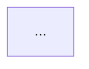

# Research summary

## Process

1. Infer the topic from the request and session. Load and run `research` first. Follow its file-output rules.
2. Use `simple-english` for word choice only. Layout, bullets, bold, and paragraph length come from this skill.
3. Decide whether the summary gets a Head-to-head table (see below).
4. Write the summary in the exact shape below, then run the self-check.

## Output shape

````markdown
# <Topic>: research summary

<1-2 sentence opening framing what was researched and why.>

## Key takeaways

- **<Bold 2-5 word lead-in>.** <One-line finding with its key number.> [1]
- (3 to 5 bullets total, most important first)

## Visualization (when comparing flows, architectures, or timelines)

<1-sentence framing line introducing the diagram.>



## Head-to-head

<1-sentence framing line introducing the comparison.>

| Metric | <Option 1> | <Option 2> | <Option 3> |
|---|---|---|---|
| <Metric, with unit and test set> | **<best value>** [2] | <value> [2] | not measured |

## At a glance

| <Item> | <Metric> | <Result> | <Verdict> |
|---|---|---|---|
| (2 to 5 rows, cells of a few words) |

## Findings

### <Track or theme>

- <One-line fact with number.> [3]
- <One-line fact.>
- (2 to 3 bullets per track, 2 to 3 tracks)

## Open questions

- <What we do not know yet, and why it matters.>

## Next steps

1. [ ] <Verb-first action, owner if known.>
2. [ ] (3 to 6 items)

## Sources

1. `<path>:<line>` or <link>

## TL;DR

<One or two plain sentences at the bottom of the finished turn stating the conclusion and what to do next.>
````

## Head-to-head table

Include `## Head-to-head` only when the research compares 2 or more options on 2 or more shared metrics. Otherwise the summary goes straight from Key takeaways to At a glance, with no heading or placeholder.

- Rows are metrics. Columns are a Metric column plus one column per option, up to 5 options.
- Options are alternatives for the same job. Components that do a different job stay out of the table.
- Add a row for each metric the decision depends on, including cost and rows where only one option has a value.
- A metric measured under a condition the decision depends on (such as phone-quality audio or a different chunk size) gets its own row per condition.
- With more than 5 options, keep the top 4 and name the dropped options in one line under the table.
- Each row uses one metric definition and one test set for every option. Name the unit and test set in the Metric cell.
- In rows where 2 or more options have a value, bold the best one. Rows with a single value stay plain.
- Write "not measured" where an option has no value.
- Tag each value with its source [n].

## Typography

- Write numbers, money, and percentages as plain text: 9.08% WER, $11.7k/month, 1.18 s.
- Use backticks only for file paths, commands, code identifiers, and model IDs.
- Each bullet is one line of about 25 words or fewer.
- Tables other than Head-to-head have at most 4 columns. Cells hold a few words or a number.
- Explain a term in 3 to 6 words inside the bullet that first uses it.
- Tag numeric or surprising claims with [n]. Every source appears once, in Sources.
- At a glance lists only items the Head-to-head table does not already show. With nothing left, omit the section.
- The summary is at most 60 lines before Sources, counting blank lines.

## Self-check

- A reader who jumps to the bottom `## TL;DR` section knows the conclusion and the next action in 1-2 plain sentences.
- Every prose block is at most 1-2 sentences; every other section is bullets, a table, a diagram, or a checklist.
- No number before Sources sits inside backticks.
- Head-to-head is present exactly when 2 or more options share 2 or more metrics. When present, every row uses one test set, the best value is bold only in rows with 2 or more values, and gaps say "not measured".
- Lines before Sources, counting blanks, are 60 or fewer. If over, cut Findings bullets first.
