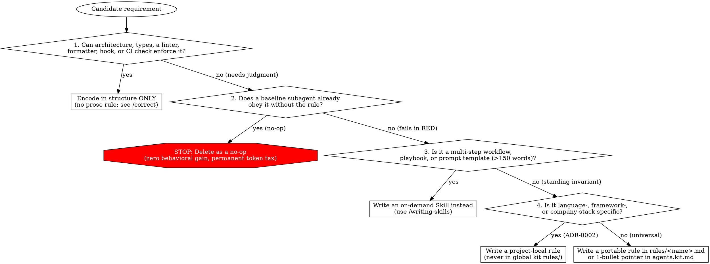

# Writing Rules

## Overview

**Writing rules IS Test-Driven Development applied to always-on agent constraints—governed by a strict context-window tax budget.**

Unlike a skill (which costs ~30 tokens of metadata until triggered) or a plan (which guides one feature), an `alwaysApply: true` rule or root `agents.md` bullet sits in the context window on **every turn of every session**. Every unnecessary rule, no-op platitude, or multi-step workflow stuffed into a rule permanently taxes attention across all tasks.

**Core principle:** Never write a prose rule for what a machine check can enforce, never keep a rule the agent already obeys by default, and never deploy a rule without watching a subagent fail without it first.

**Announce at start:** "I'm using the writing-rules skill to triage, author, and test this rule."

**REQUIRED BACKGROUND:** Understand [`/writing-skills`](../writing-skills/SKILL.md) (RED-GREEN-REFACTOR pressure testing), [`/correct`](../correct/SKILL.md) (the structural enforcement hierarchy), and [`/principle-encode-lessons-in-structure`](../principle-encode-lessons-in-structure/SKILL.md).

## Triage First: Structure vs. Skill vs. Rule

Before creating or editing any rule file, run every candidate requirement through this four-gate triage:



| Requirement Type | Right Mechanism | Wrong Mechanism | Why |
| --- | --- | --- | --- |
| Mechanical check (JSON key sorting, import order, formatting, banned regex) | **Linter / formatter / pre-commit / CI script** (per [`/correct`](../correct/SKILL.md)) | Prose rule in `rules/` | LLMs drift on mechanical formatting; a deterministic script catches it 100% of the time at 0 token cost. |
| Generic coding platitude ("write clean, readable code", "use descriptive variable names") | **None (delete it)** | `alwaysApply: true` rule | Models already try to write clean code by default. Platitude rules are pure context-window waste. |
| Multi-step workflow, 7-step RCA playbook, or subagent prompt templates | **On-demand Skill** (`skills/<name>/SKILL.md` via [`/writing-skills`](../writing-skills/SKILL.md)) | `alwaysApply: true` rule or multi-paragraph `agents.kit.md` block | Workflows only apply when triggered; putting them in a rule taxes every unrelated turn. |
| Language-, framework-, or company-stack invariant (Django `SeparateDatabaseAndState` two-MR column drops, Statsig unit IDs, prod data access) | **Project-local rule** (in the target repo's rules directory; see [`harness-adapter.md`](../poteto-mode/references/harness-adapter.md)) | Global `.agents` kit `rules/` | Per ADR-0002 and ADR-0007, the global `.agents` kit carries zero language-specific or company-stack rules. |
| Universal, cross-cutting behavioral invariant where the agent doesn't know to load a skill first (looking up docs vs. guessing, $\le 30\text{s}$ sleep cap, `rg` over `grep`) | **Kit rule** (`rules/<name>.md` or 1-line bullet in `agents.kit.md`) | Unenforced chat reminder | Fires on unconscious default behaviors across every task and language. |

## Where Rules Live & Packaging Contract

### 1. Root Instruction Layer (`agents.kit.md` $\to$ `~/.agents/agents.md`)

`agents.kit.md` is the distilled root instruction file auto-loaded by protocol consumers.

- **Format contract (strict):** Every entry in `agents.kit.md` **must** be a single bullet point (`- <Imperative rule>, with an optional [link](rules/<name>.md) to more context.`).
- **Forbidden in `agents.kit.md`:** Never add `#` headings, multi-sentence paragraphs, code blocks, or em dashes. If a rule needs a scope section or examples, put them in `rules/<name>.md` and add a 1-bullet context pointer in `agents.kit.md`.

### 2. Standalone Rule Files (`rules/<name>.md`)

Every file in `rules/*.md` must satisfy the kit validator (`./scripts/validate.sh`):

- **YAML frontmatter keys MUST be sorted alphabetically** (`alwaysApply` first, then `description`, then `globs` only when file-scoped):

```markdown
---
alwaysApply: true
description: >-
  <One-sentence imperative summary of what the rule enforces and when.>
---
```

- **Quoting `globs`:** When writing a file-scoped project rule (`alwaysApply: false`), always quote glob strings (`globs: ["**/*.py"]` or `globs: "**/*.json"`). Unquoted `globs: *.py` is invalid YAML (`*` is a YAML alias anchor) and misses subdirectories.
- **Zero vendor, harness, or forge lock-in (ADR-0001, ADR-0007):** Never put vendor model slugs, harness-specific rule paths, or forge CLI commands inside kit rules. Use the neutral terms in [`harness-adapter.md`](../poteto-mode/references/harness-adapter.md).
- **Token budget:**
  - `agents.kit.md` pointer: $\le 25$ words (1 bullet line).
  - Standard operational rule (`rules/sleeps-and-polling.md`, `rules/look-it-up.md`): **$< 150$ words**.
  - Complex safety/boundary rule (e.g., production data access table or two-MR column drop sequence): **$< 250$ words**. Move any reusable scripts or long templates into a skill and link to it.

## Rule Anatomy: Match the Form to the Failure

Every standalone rule in `rules/<name>.md` follows this four-part positive recipe:

```markdown
---
alwaysApply: true
description: >-
  <Imperative 1-sentence summary of the rule and trigger.>
---

# <Short Action-Oriented Title>

<1-2 sentence bright-line imperative: what to do and what never to do.>

## When this applies

<1-2 sentences or a compact table of concrete, observable triggers.>

## How to comply

1. **<First priority / step>.** <One concrete sentence.>
2. **<Second priority / step>.** <One concrete sentence.>

## Exceptions

- <Observable, objective predicate where the rule does not apply.>
```

### Critical Authoring Rules

1. **Deduplicate before creating (Single Source of Truth):**
   - Before creating a new file in `rules/` or adding a bullet to `agents.kit.md`, grep `rules/*.md` and `agents.kit.md` for overlapping topics.
   - Update an existing rule in place rather than creating a second file on the same topic (for example, extend [`rules/look-it-up.md`](../../rules/look-it-up.md) instead of creating `verify-api-docs.md`). When editing an existing rule, fold changes into its existing sections so it stays under the word budget instead of appending `"Additional Notes"` sediment.
2. **Lead with the positive target alongside the hard prohibition:**
   - Weak negation (`"Try not to use sleep for long waits"`) activates the forbidden behavior. Write the exact positive action (`"Never hold a sleep longer than 30 seconds in one tool call. Poll in <=30s increments and return control between polls."`).
3. **Ban subjective nuance and cleanup loopholes:**
   - **Never** write clauses like `"unless the table is probably small"`, `"unless it matters for simplicity"`, or `"unless it's a quick local debugging test and you clean it up before merging"`.
   - Under time or context pressure, agents treat subjective nuance clauses as unconditional permission to skip the rule.
   - Every exception must be keyed to an **observable predicate** (e.g., `"Pure reasoning or synthesis from code already in context"` in [`rules/look-it-up.md`](../../rules/look-it-up.md), or `"The upstream API endpoint accepts no pagination parameters"`).
4. **Use a table for boundary matrices:**
   - When a rule maps data sources or operations to approved vs. forbidden paths (like production data access), use a compact Markdown table (`| Resource | Approved Path | What Is Allowed |`) followed by a flat `## Never` bullet list.
5. **Sanitize all examples (Zero PII or internal secrets):**
   - Rules are committed to version control and often published across repositories. Never paste real customer PII, internal credentials, or private incident payloads into a rule as an example; always use synthetic values (`@example.com`, `example-service`).

## The Iron Law of Rule TDD

```text
NO RULE WITHOUT A FAILING BASELINE AND A STRUCTURAL-ENFORCEMENT CHECK FIRST
```

Follow the five-step RED-GREEN-REFACTOR loop for every new or edited rule:

- [ ] **Step 1 — Structural & Triage Gate:** Verify the rule cannot be enforced by a linter/hook/script ([`/correct`](../correct/SKILL.md)), is not a multi-step workflow ([`/writing-skills`](../writing-skills/SKILL.md)), and is placed in the right scope (global kit `rules/` vs. project-local rules per ADR-0002).
- [ ] **Step 2 — RED (Baseline Without Rule):** Run a fresh subagent on a realistic task **without** the rule present (combining 3+ pressures: time deadline, authority override, sunk cost, or "keep it simple").
  - If the subagent already complies without the rule $\to$ **STOP and delete the rule** (it is a no-op).
  - If the subagent violates the invariant $\to$ record the exact choice and rationalizations verbatim.
- [ ] **Step 3 — GREEN (Write Minimal Rule & Verify):** Author the rule under the word budget with sorted frontmatter (`alwaysApply`, `description`) and zero nuance loopholes. Re-run the subagent **with** the rule loaded under the same pressures and confirm compliance.
- [ ] **Step 4 — REFACTOR (Close Loopholes):** If the subagent invents a new rationalization or hybrid workaround, add an explicit counter in `## Never` or narrow `## Exceptions` to an observable predicate, then re-test.
- [ ] **Step 5 — Validate Kit Contract:** Run `./scripts/validate.sh` (plus `markdownlint-cli2` and `typos`) and confirm 0 errors and 0 frontmatter sort warnings.

## Worked Examples from This Kit

**Good operational rule ([`rules/sleeps-and-polling.md`](../../rules/sleeps-and-polling.md), 66 words):**

```markdown
---
alwaysApply: true
description: >-
  Cap single-call sleeps at 30 seconds or less and poll in short increments when
  waiting on CI, background jobs, or builds.
---

# Sleeps and polling

Never hold a `sleep` longer than **30 seconds** in one tool call. When waiting
on CI, background jobs, or builds, poll in ≤30s increments (or use whatever
poll primitive the tool offers) and return control between polls so the user
can steer. Prefer announcing the check ("polling CI, back in a moment") over
blocking silently; only one long wait is ever justified — a final gate whose
output the next single step needs verbatim, and even then say so first.
```

**Good root instruction entry ([`agents.kit.md`](../../agents.kit.md), 1 bullet per rule):**

```markdown
- All entries in this file should be a single bullet point with an optional link to more context.
- Use `rg` (ripgrep) instead of `grep`, `find`, and other search tools.
- Tests should always be in their own files. Not in the same file as the code they test.
- All commit attribution should be in the github users name and email, never the coding agent.
```

## Common Mistakes & Rationalizations

| Excuse | Reality |
| --- | --- |
| "It's just a 15-line Markdown rule, I don't need to run a baseline subagent test first" | Untested rules either restate default model behavior (burning context on every turn for nothing) or miss the exact rationalization agents use under pressure. Always run RED and GREEN. |
| "The tech lead asked for rules for all 3 issues, so I'll put the 7-step playbook and JSON key sorting in `rules/`" | Mechanical formatting belongs in a linter/pre-commit script, and multi-step playbooks belong in `skills/`. Only standing behavioral invariants belong in `rules/`. Push back and separate them. |
| "Add a nuance clause like 'unless the table is probably small' or 'unless it's a local debugging test cleaned up before merge'" | Agents under pressure treat subjective nuance clauses as an automatic exemption. One leaked PII fixture in a local test lands in transcripts, stashes, or commits. Use zero nuance clauses; state only objective, observable exceptions. |
| "I'll add a `clean-code.md` rule reminding agents to write readable code and use good variable names" | That is a 100% no-op. Every token in `alwaysApply: true` is paid on every turn of every chat. Delete platitude rules. |
| "I'll add a multi-paragraph summary or `# Rules` section to `agents.kit.md` so agents don't miss it" | `agents.kit.md` strictly requires each entry to be a single bullet point with an optional link to more context. Multi-paragraph blocks violate the root file contract and bloat every session. |
| "Put `description` before `alwaysApply` or use unquoted `globs: *.py`" | `./scripts/validate.sh` enforces alphabetical frontmatter key order (`alwaysApply` before `description`), and unquoted `*.py` is invalid YAML alias syntax. |

## Red Flags - STOP and Fix Properly

- Writing a prose rule for a check that `eslint`, `ruff`, `jq --sort-keys`, `shellcheck`, `shfmt`, or `./scripts/validate.sh` can enforce mechanically
- Authoring a rule without running a RED baseline subagent first (or keeping a rule when the RED baseline already complied without it)
- Creating a duplicate rule file when an existing file in `rules/` or bullet in `agents.kit.md` already covers the topic, or appending `"Additional Notes"` sections that push a rule over its word budget
- Putting a multi-step playbook, subagent prompt template, or $>300$-word manual into `rules/` instead of `skills/`
- Adding language-specific (Python, Django, Rust, TypeScript) or company-stack rules into the global `.agents` kit `rules/` directory (violates ADR-0002 and ADR-0007; place those in the project's own rules directory)
- Including subjective exemption clauses (`"unless small"`, `"unless simple"`, `"for quick local debugging if cleaned up later"`, `"when appropriate"`) or pasting real PII / internal secrets into rule examples
- Adding headings, multi-sentence paragraphs, or non-bullet text to `agents.kit.md`
- Unsorted frontmatter keys (`description` before `alwaysApply`), unquoted `globs: *.py`, or hardcoded model slugs / harness-specific paths in `rules/*.md`

**All of these mean: Re-triage the requirement (Structure $\to$ Skill $\to$ Rule), strip subjective loopholes, fix the frontmatter and scope, and verify RED $\to$ GREEN with a subagent.**

## Output Format When Presenting Rule Changes

Keep every prose block to **at most 1-2 sentences**; use bullet points, Markdown tables, and a `## Summary (TL;DR)` block at the bottom of the finished turn:

1. **Four-Gate Triage Table:** `| Candidate | Gate Verdict (Structure / No-Op / Skill / Project Rule / Kit Rule) | Target Path | Why |`
2. **Rule Artifact(s) & Word Count:** Exact Markdown content with sorted frontmatter and measured word count against the budget ($<150$ words operational, $<250$ words boundary table, $\le 25$ words `agents.kit.md` bullet).
3. **TDD & Validation Evidence:** Bullet list of RED baseline failure, GREEN pressure compliance, and `./scripts/validate.sh` output.
4. **Summary (TL;DR) at the bottom:** 1-2 sentences stating what was created, rejected, or routed elsewhere, and verification status.
